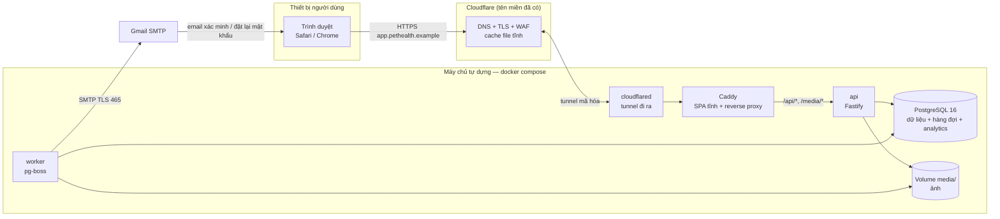
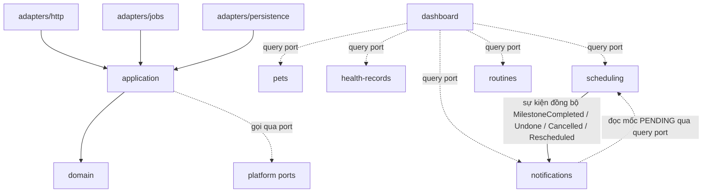
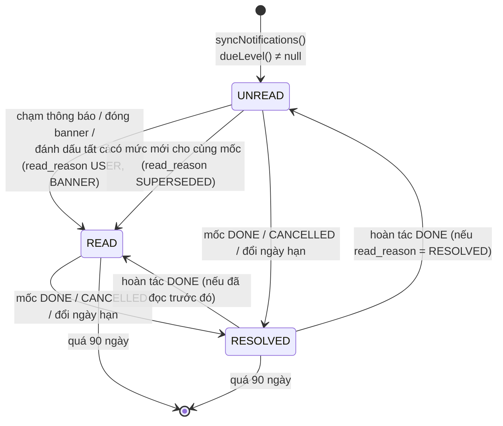

# Tài liệu Thiết kế Kiến trúc Phần mềm (SAD) — Pet Health: Nhật ký số theo dõi sức khỏe thú cưng (Web)

| Trường | Giá trị |
|---|---|
| Mã tài liệu | PH-SAD-001 |
| Phiên bản | **1.0** |
| Trạng thái | **Approved** — AD-001→AD-017 được Việt duyệt 2026-10-22 (BRD DEC-019) |
| Ngày | 2026-10-22 |
| Tác giả | Việt (soạn với Claude) |
| Người phê duyệt | Việt |
| Chuẩn áp dụng | IEEE 1016-2009 (Software Design Descriptions) |
| Baseline đầu vào | [BRD.md](../requirements/BRD.md) v1.2 · [PRD.md](../requirements/PRD.md) v1.2 · [SRS.md](../requirements/SRS.md) v0.3 |
| Prompt nguồn | `docs/requirements/SAD_Prompt_IEEE_standard.md` |

**Lịch sử phiên bản**

| Phiên bản | Ngày | Tác giả | Tóm tắt |
|---|---|---|---|
| 0.1 | 2026-10-22 | Việt | Bản nháp đầu tiên: cloud (Fly.io, Neon, R2, SES), email nhắc, có hệ thống giám sát |
| 0.2 | 2026-10-22 | Việt | Viết lại theo BRD DEC-016→DEC-018: **nhắc nhở trong app** thay email (bỏ bộ lập lịch gửi); **hạ tầng tự dựng** công bố qua Cloudflare Tunnel; email tài khoản qua **SMTP Gmail**; **không có hệ thống giám sát**; analytics tự lưu trong PostgreSQL |
| **1.0** | 2026-10-22 | Việt | **Approved.** Duyệt AD-001→AD-017 (DEC-019). Bỏ sao lưu ở Giai đoạn 1 (DEC-020): bỏ container `backup`, §4.2.4 chuyển thành phương án dự phòng chưa bật. Tên miền ví dụ `pethealth.example` (DEC-021). Đóng OQ-A01→OQ-A03 |

**Quy ước:** `AD-xxx` = quyết định kiến trúc (chờ duyệt) · `OQ-Axx` = câu hỏi mở của SAD · `RSK-Axx` = rủi ro kỹ thuật. Mã `FR-`, `NFR-`, `IF-`, `DC-`, `SD-` tham chiếu SRS; `MR-`, `G-`, `PD-` tham chiếu PRD; `BR-`, `BRU-`, `CON-`, `DEC-` tham chiếu BRD.

---

## 0. Giới thiệu

### 0.1 Mục đích

Tài liệu mô tả **cách** hệ thống Pet Health Giai đoạn 1 được xây dựng để đáp ứng SRS: thành phần, ranh giới, dữ liệu, giao diện, luồng tương tác, hạ tầng và lý do của từng lựa chọn. Đối tượng đọc:

- **Lập trình viên:** cài đặt đúng ranh giới mô-đun, schema, API và cơ chế idempotency.
- **QA:** biết điểm kiểm thử của từng yêu cầu (đồng hồ giả lập, contract test, IDOR test).
- **Người vận hành (Việt):** biết cách dựng máy chủ, triển khai và xử lý sự cố.

### 0.2 Phạm vi

Toàn bộ phần mềm Giai đoạn 1: web client, API, worker nền, cơ sở dữ liệu, kho ảnh, gửi email tài khoản, analytics và hạ tầng tự dựng. Thiết kế chừa sẵn điểm mở rộng cho app điện thoại Giai đoạn 2 (MR-1→MR-8) nhưng không thiết kế chi tiết app đó.

### 0.3 Bên liên quan và mối quan tâm thiết kế (IEEE 1016 §4.4)

| Bên liên quan | Mối quan tâm (design concern) | Được trả lời tại |
|---|---|---|
| Việt (chủ sản phẩm, lập trình viên và người vận hành duy nhất) | Một người làm và vận hành được; gần như không tốn phí; tự chủ hạ tầng | §1.2, §4.4 |
| Chủ nuôi (STK-001) | Thấy nhắc đúng ngày ngay khi mở app, không trùng; dữ liệu riêng tư; nhanh trên điện thoại | §3.2.1, §4.1, §4.2 |
| QA | Kiểm thử được logic ngày/múi giờ, idempotency, IDOR | §2.2.3, §3.2.1 |
| App Giai đoạn 2 (bên tiêu thụ tương lai) | Dùng lại API, auth, nhắc nhở theo kênh | §2.4, §4.1.1, §3.1.3 |

### 0.4 Ánh xạ viewpoint IEEE 1016 → mục trong tài liệu

| Viewpoint (IEEE 1016 §5) | Mục |
|---|---|
| Context | §2.0 |
| Composition | §2.1→§2.3 |
| Logical | §2.2.1 |
| Dependency | §2.2.2 |
| Information | §3.1 |
| Interface | §2.4 |
| Interaction | §3.2 |
| State dynamics | §3.1.4 |
| Resource / Deployment | §4.4 |
| Design rationale | §0.7, §1.2.2, Phụ lục A |

### 0.5 Tài liệu tham chiếu

| Tài liệu | Phiên bản |
|---|---|
| IEEE 1016-2009 — Software Design Descriptions | 2009 |
| SRS Pet Health (PH-SRS-001) | 0.3 |
| PRD Pet Health (PH-PRD-001) | 1.2 |
| BRD Pet Health (PH-BRD-001) | 1.2 |
| RFC 9457 — Problem Details for HTTP APIs | 2023 |
| OWASP ASVS / Password Storage Cheat Sheet | 4.0.3 / hiện hành |
| OpenAPI Specification | 3.1 |

### 0.6 Tóm tắt ràng buộc kỹ thuật (System Foundation)

| Mục | Nội dung | Nguồn |
|---|---|---|
| **Tên hệ thống** | Pet Health — Pet Health & Schedule Diary (Web) | PRD §0.1 |
| **Chức năng cốt lõi** | Nhật ký sức khỏe tối đa 10 thú cưng/tài khoản: hồ sơ, cân nặng + biểu đồ mục tiêu, sổ y tế kèm ảnh, mốc y tế tự lặp, **nhắc nhở trong app** (banner Dashboard + mục Thông báo) ở mức D7, D1 và Quá hạn, checklist việc hằng ngày | SRS §1.2, §2.6 |
| **Quy mô thiết kế** | 1.000 tài khoản · 10.000 thú cưng · 50.000 mốc (SD-011). Tải đỉnh ước tính ~5 req/s. Không có tải theo lịch (không còn gửi email nhắc) | SD-011, §4.2.5 |
| **Hiệu năng** | Dashboard LCP < 2,5 s, INP < 200 ms (p75, 4G); API đọc p95 < 500 ms, ghi p95 < 800 ms; tạo thông báo ≤ 50 ms p95; JS ban đầu < 250 KB gzip | NFR-PERF-001→005 |
| **Độ tin cậy** | Khả dụng 98%/tháng; thông báo không trùng, không mất kể cả khi máy chủ tắt nhiều ngày. **Không có sao lưu, không cam kết RPO/RTO** (DEC-020) | SD-012, NFR-REL-001, NFR-REL-003 |
| **Hạ tầng** | **Máy chủ tự dựng** (DEC-018); tên miền trên **Cloudflare**, tài liệu dùng tên ví dụ `pethealth.example` (DEC-021); email tài khoản qua **SMTP Gmail**; **không có hệ thống giám sát** (DEC-017); **chưa sao lưu** (DEC-020) | DC-006 |
| **Tech stack (SAD đề xuất)** | TypeScript toàn bộ; React SPA; Node.js + Fastify (modular monolith); PostgreSQL 16 làm cả CSDL lẫn hàng đợi job (pg-boss); ảnh lưu trên ổ đĩa máy chủ; Docker Compose; Caddy; Cloudflare Tunnel | §0.7 |
| **Ràng buộc cứng** | Chỉ web (Safari + Chrome, 2 bản mới nhất); nhắc chỉ trong app; không offline; không real-time (không WebSocket/SSE); backend dùng chung cho app Giai đoạn 2; mọi quy tắc nghiệp vụ ở server; API REST `/api/v1` có OpenAPI | CON-001→006, DC-001→006, MR-1→8 |
| **Ràng buộc mềm** | Chi phí gần như bằng 0 ngoài điện và tên miền; một người phát triển và vận hành; tuân thủ pháp luật Việt Nam về dữ liệu cá nhân | DC-005, NFR-SEC-012 |

**Hệ quả kiến trúc rút ra từ ràng buộc:**

1. **Nhắc nhở trong app chỉ cần đúng ở thời điểm người dùng mở app.** Vì vậy không cần bộ lập lịch chạy nền: thông báo được **tạo khi đọc** (lazy materialization, AD-016). Máy chủ tắt 3 ngày rồi bật lại thì lần mở app kế tiếp vẫn cho kết quả đúng. Đây là lý do việc không có hệ thống giám sát (DEC-017) là chấp nhận được.
2. Máy chủ tự dựng + một người vận hành ⇒ **ít tiến trình và ít phần mềm hạ tầng nhất có thể**: không Redis, không message broker, không object storage riêng. Mọi thứ chạy trong một `docker compose`.
3. Không mở cổng vào mạng nhà: máy chủ công bố ra Internet **chỉ qua kết nối đi ra** của Cloudflare Tunnel.
4. Một origin duy nhất cho SPA, API và ảnh ⇒ không cần CORS; cookie và CSP đơn giản.
5. Giai đoạn 2 dùng chung backend ⇒ web chỉ là một client của API công khai; auth không gắn chết với cookie.

### 0.7 Quyết định kiến trúc cần duyệt

| ID | Quyết định đề xuất | Phương án đã cân nhắc | Lý do chọn |
|---|---|---|---|
| AD-001 | **Modular monolith** theo Clean/Hexagonal Architecture; một Docker image chạy 2 tiến trình `api` và `worker` | Microservices; một tiến trình duy nhất | §1.2.2. Tách `worker` để xử lý ảnh (tốn CPU) không làm chậm API |
| AD-002 | **TypeScript** cho client và server; monorepo pnpm workspaces | Go/Kotlin cho backend | Một người, một ngôn ngữ; sinh type client từ OpenAPI |
| AD-003 | Backend: **Node.js 22 LTS + Fastify 5 + Zod**; OpenAPI 3.1 sinh từ schema Zod; truy vấn bằng **Kysely** | NestJS; Prisma | Fastify nhẹ; Kysely cho SQL tường minh (`ON CONFLICT`, partial index) mà vẫn có type |
| AD-004 | Frontend: **React 19 SPA + Vite**, TanStack Router + TanStack Query, Tailwind CSS. **Cùng origin** với API: Caddy phục vụ file tĩnh và chuyển `/api/*`, `/media/*` sang `api` | Next.js SSR; SPA ở subdomain riêng | Không cần SEO; cùng origin nên không có CORS, cookie `SameSite=Strict` dùng được |
| AD-005 | CSDL: **PostgreSQL 16** chạy trong Docker trên máy chủ tự dựng, chỉ mở trong mạng nội bộ Docker | SQLite | Cần ràng buộc, partial unique index, RLS, transaction đồng thời; Postgres đáp ứng tốt và quen thuộc |
| AD-006 | Hàng đợi job: **pg-boss** trên chính PostgreSQL, enqueue trong cùng transaction | Redis + BullMQ | Không thêm phần mềm; không mất job khi crash |
| AD-007 | Ảnh lưu trên **ổ đĩa máy chủ** (volume `media/`), phục vụ qua `/media/*` của API bằng **URL ký HMAC** 15 phút; bọc sau `ObjectStoragePort` | MinIO / S3-compatible tự host | Bớt một dịch vụ; ở quy mô này phục vụ qua Node là đủ. Port cho phép chuyển sang S3/R2 sau này |
| AD-008 | Email tài khoản (xác minh, đặt lại mật khẩu) qua **SMTP Gmail** (`smtp.gmail.com:465`, TLS, App Password) bằng `nodemailer`; địa chỉ gửi là **chính tài khoản Gmail** | Gửi từ địa chỉ `@pethealth.example` qua Gmail; dịch vụ email giao dịch | DEC-018. Gửi từ địa chỉ Gmail thì SPF/DKIM/DMARC khớp với `gmail.com` nên ít vào spam. Gửi bằng địa chỉ tên miền riêng qua Gmail thường thì DMARC không khớp |
| AD-009 | **Một máy chủ tự dựng** (Linux + Docker Compose). Công bố ra Internet qua **Cloudflare Tunnel** (`cloudflared`), không mở cổng nào trên router | Mở cổng 443 + DDNS | DEC-018; tên miền đã ở Cloudflare; không lộ IP nhà, có sẵn TLS, WAF và chống DDoS của Cloudflare |
| AD-010 | Xác thực: **phiên opaque lưu ở server** (bảng `sessions`); web dùng cookie `__Host-` HttpOnly; app Giai đoạn 2 dùng cùng bảng qua access/refresh token | JWT stateless | Đăng xuất phải hủy phiên ngay (FR-AUTH-007, 009); một cơ chế phục vụ được cả cookie lẫn bearer (NFR-PRT-003) |
| AD-011 | Mỗi bảng nghiệp vụ mang cột `owner_id`; ownership kiểm ở repository **và** bằng **PostgreSQL Row-Level Security** | Chỉ kiểm ở tầng ứng dụng | NFR-SEC-004 là gate G-9; RLS chặn lỗi quên điều kiện `WHERE` |
| AD-012 | Khóa chính **UUIDv7** | `bigserial` | Không đoán được, không lộ số lượng; sắp theo thời gian nên index không phân mảnh |
| AD-013 | Không dùng Redis/cache phân tán. Rate limit lưu ở PostgreSQL | Redis | Tải nhỏ; FR-GEN-008 cấm hiển thị dữ liệu cũ |
| AD-014 | **Không có hệ thống giám sát** (DEC-017). Chỉ có: log JSON có xoay vòng, healthcheck Docker tự khởi động lại container, và mã tham chiếu lỗi tra được trong log | Prometheus/Grafana; Sentry | Theo quyết định của Việt |
| AD-015 | Analytics: **tự lưu trong PostgreSQL** (bảng `analytics_events`), phân tích bằng SQL | PostHog Cloud | Không gửi dữ liệu ra bên thứ ba; đủ cho funnel ở PRD §5.2 |
| AD-016 | Thông báo nhắc được **tạo khi đọc** (lazy materialization): mỗi lần tải Dashboard, chuông hoặc mục Thông báo, server tính các mức nhắc đã tới và chèn idempotent (`ON CONFLICT DO NOTHING`). **Không có cron** | Cron chạy lúc 00:00 theo từng múi giờ | Đúng với mọi múi giờ mà không cần lịch; không mất nhắc khi máy chủ tắt; không cần giám sát job |
| AD-017 | Cửa sổ hoàn tác ở server = **15 giây** kể từ `completed_at` (client hiển thị 10 giây theo FR-MS-005) | Đúng 10 giây | Chống từ chối oan do độ trễ mạng |

---

## 1. Mục tiêu kiến trúc và nguyên tắc thiết kế

### 1.1 Ba động lực kiến trúc chính

| # | Động lực | Vì sao đứng đầu | Thiết kế ưu tiên nó bằng cách |
|---|---|---|---|
| **D1** | **Độ đúng của nhắc nhở** (Correctness) | Là giá trị cốt lõi (PRD O1). Nhắc sai ngày, trùng, hoặc vẫn nhắc mốc đã xong làm mất niềm tin ngay | Quy tắc mức nhắc là **hàm thuần** `dueLevel(milestone, today)` ở server, test bằng bảng ví dụ của SRS §2.6; ràng buộc unique trong DB là khóa idempotency; mọi thay đổi trạng thái mốc và thông báo nằm trong cùng một transaction; "hôm nay" luôn tính theo múi giờ tài khoản qua `ClockPort` để test bằng đồng hồ giả |
| **D2** | **Bảo mật và quyền riêng tư** (Security & Privacy) | Dữ liệu y tế thú cưng + email chủ nuôi; máy chủ đặt tại nhà nên một lỗ hổng có thể ảnh hưởng cả mạng nội bộ; G-9→G-12 là launch gate | Không mở cổng vào (Cloudflare Tunnel); container không chạy root, mạng Docker nội bộ; phòng thủ 2 lớp cho ownership (repository + RLS); phiên opaque hủy được ngay; ảnh chỉ qua URL ký và đã xóa EXIF; mã hóa ổ đĩa |
| **D3** | **Đơn giản khi vận hành và khả năng tiến hóa** (Operability & Evolvability) | Một người vận hành, không có giám sát (DEC-017); Giai đoạn 2 phải dùng lại backend (CON-006) | Hệ thống **tự đúng lại sau sự cố** (không có trạng thái "job bị lỡ"); một lệnh `docker compose up -d` dựng toàn bộ; API-first có OpenAPI + contract test; domain tách khỏi framework nên thêm kênh `push` chỉ là thêm adapter |

**Thứ tự đánh đổi khi xung đột:** D1 > D2 > D3 > hiệu năng > chi phí. Ví dụ: tạo thông báo ngay trong request đọc làm Dashboard chậm thêm vài ms (§3.2.1), nhưng đổi lại không bao giờ bỏ lỡ nhắc vì một job nền đã chết mà không ai biết.

### 1.2 Mẫu kiến trúc

#### 1.2.1 Mẫu tổng thể: Modular Monolith + Hexagonal (Ports & Adapters)

- **Một Docker image** chạy ở 2 vai trò: `api` (HTTP) và `worker` (job nền: gửi email tài khoản, xử lý ảnh, dọn dẹp). Hai vai trò dùng chung mã domain và CSDL.
- Chia **mô-đun theo nghiệp vụ**: `identity`, `pets`, `health-records`, `scheduling`, `notifications`, `routines`, `dashboard`, `media`, `analytics` (§2.2.1).
- Mỗi mô-đun có 3 lớp:

```
modules/<tên>/
  domain/        # Entity, value object, quy tắc nghiệp vụ thuần. Không import framework, DB, HTTP
  application/   # Use case (command/query handler), định nghĩa port cần dùng
  adapters/
    http/        # Route Fastify + schema Zod
    persistence/ # Repository Kysely
    jobs/        # Handler pg-boss (chạy trong worker)
```

- Hạ tầng dùng chung (`EmailPort`, `ObjectStoragePort`, `ClockPort`, `JobQueuePort`) nằm ở `platform/`, được tiêm vào use case qua composition root.

#### 1.2.2 Lý do chọn và phương án bị loại

| Phương án | Ưu | Nhược với Pet Health | Kết luận |
|---|---|---|---|
| **Modular monolith (chọn)** | Một lần deploy; transaction ACID xuyên mô-đun (cần cho "đánh dấu xong → thông báo đã xử lý → tạo mốc kế tiếp"); dễ chạy trên một máy | Phải tự kỷ luật ranh giới mô-đun | ✅ `dependency-cruiser` trong CI chặn import sai ranh giới |
| Microservices | Mở rộng độc lập | Giao dịch phân tán cho luồng nhạy cảm nhất; nhiều container và DB; quá tải cho một người với 5 req/s | ❌ |
| Một tiến trình duy nhất (API + job chung) | Ít container hơn | Giải mã HEIC chiếm CPU vài trăm ms mỗi ảnh, làm tăng p95 của API | ❌ Giữ 2 tiến trình, chi phí gần như bằng 0 |
| Cron sinh thông báo lúc 00:00 | Thông báo có sẵn trước khi người dùng mở app | Cần chạy theo từng múi giờ; máy chủ tắt đúng lúc 00:00 thì mất nhắc; cần giám sát job (trái DEC-017) | ❌ Thay bằng AD-016 |

**Đường tiến hóa:** Giai đoạn 2 thêm push. Push **cần** gửi chủ động, nên khi đó mới thêm một job `notifications.push-dispatch` trong `worker`, dùng cùng hàm `dueLevel` và cùng bảng `notifications` (thêm `channel = 'push'`). Lúc đó nên xem lại DEC-017, vì job gửi theo lịch là thứ cần được giám sát.

#### 1.2.3 Nguyên tắc thiết kế

| # | Nguyên tắc | Hệ quả cụ thể |
|---|---|---|
| P1 | **Server là nguồn sự thật duy nhất** (MR-5, NFR-MNT-002) | Tuổi, "hôm nay", mức nhắc, nhãn "còn N ngày", trạng thái hiển thị mốc đều do API trả về. Client không có thư viện múi giờ |
| P2 | **API-first, contract là OpenAPI** (MR-1, MR-2) | Schema Zod → `openapi.yaml` được commit; CI báo lỗi nếu khác; client web sinh type từ file này |
| P3 | **Thời điểm ở UTC, "ngày" là `date`** (FR-GEN-001) | `timestamptz` cho thời điểm; `date` cho ngày lịch; chuyển đổi chỉ ở `platform/calendar` |
| P4 | **Idempotent theo thiết kế** | Ràng buộc unique trong DB là cơ chế chống trùng chính |
| P5 | **Tự đúng lại sau sự cố** (self-healing by design) | Không có trạng thái phụ thuộc "job đã chạy hay chưa". Mọi dữ liệu dẫn xuất (thông báo) tính lại được từ dữ liệu gốc (mốc + ngày hôm nay) |
| P6 | **Deny by default** | Route mặc định yêu cầu đăng nhập; route công khai khai báo `public: true` |
| P7 | **Kiểm thử được thời gian** | Mọi use case nhận `ClockPort`; môi trường test có `FakeClock` để chạy E2E NFR-MNT-005 |

---

## 2. Phân rã thành phần hệ thống

### 2.0 Sơ đồ ngữ cảnh và triển khai logic



| Container | Image | Trách nhiệm | Mạng |
|---|---|---|---|
| `cloudflared` | `cloudflare/cloudflared` (ghim phiên bản) | Giữ tunnel đi ra tới Cloudflare; chuyển request của `app.pethealth.example` tới `caddy:80` | `edge` |
| `caddy` | Image tự build: Caddy + bundle SPA | Phục vụ SPA; header bảo mật; reverse proxy `/api/*`, `/media/*` tới `api:3000` | `edge`, `app` |
| `api` | `ph-app` (entrypoint `api`) | REST `/api/v1`, xác thực, kiểm quyền, use case đồng bộ, tạo thông báo, phục vụ ảnh có ký | `app`, `db` |
| `worker` | `ph-app` (entrypoint `worker`) | Gửi email tài khoản, xử lý ảnh, xóa ảnh theo prefix, dọn dẹp hằng ngày | `db`, `smtp-out` |
| `postgres` | `postgres:16` (ghim digest) | Dữ liệu nghiệp vụ, phiên, idempotency, hàng đợi pg-boss, analytics | `db` (internal) |

Mạng `db` và `app` khai báo `internal: true`: container trong đó không ra Internet được. Chỉ `cloudflared` (tới Cloudflare) và `worker` (tới `smtp.gmail.com:465`) có đường ra.

### 2.1 Tầng Frontend / Client

#### 2.1.1 Cơ chế phân phối

| Hạng mục | Thiết kế |
|---|---|
| Kiểu ứng dụng | **SPA** (client-side rendering). Không SSR: mọi màn hình dữ liệu cần đăng nhập, không cần SEO |
| Phân phối | Caddy phục vụ tại `https://app.pethealth.example/`. File có hash (`/assets/*.[hash].js`) đặt `Cache-Control: public, max-age=31536000, immutable` để **Cloudflare cache ở edge**, giảm băng thông upload của mạng nhà. `index.html` đặt `no-cache`. Route SPA không khớp file thì trả `index.html` |
| Code splitting | Mỗi route là một chunk lazy. Chunk ban đầu gồm shell (có chuông thông báo) + Dashboard. Thư viện biểu đồ và trình xem ảnh tải khi cần |
| Ngân sách JS (NFR-PERF-003) | React + ReactDOM ~60 KB · TanStack Router ~15 KB · TanStack Query ~13 KB · React Hook Form ~10 KB · Zod (mini) ~5 KB · openapi-fetch ~2 KB · mã Dashboard + banner ≤ 60 KB → **≈ 165 KB gzip**. CI chặn merge nếu vượt 250 KB (`size-limit`) |
| Biểu đồ | **uPlot** (~20 KB gzip) tải lazy; kèm bảng dữ liệu ẩn làm văn bản thay thế (NFR-USA-002) |
| Tối ưu LCP | Dashboard gọi **đúng 1 request** `GET /api/v1/dashboard` (gồm banner nhắc, §2.4.4); skeleton có kích thước cố định, chừa sẵn chỗ banner rồi thu lại khi không có nhắc (CLS < 0,1); dùng font hệ thống |
| Giao diện | Tailwind CSS; dark mode theo `prefers-color-scheme`; breakpoint `768px`, `1280px` (FR-DSH-004) |

#### 2.1.2 Quản lý trạng thái

| Loại trạng thái | Nơi giữ | Quy tắc |
|---|---|---|
| **Dữ liệu server** | TanStack Query | `staleTime: 0`, `refetchOnMount: 'always'`. Route loader **chờ dữ liệu mới** trước khi render (FR-GEN-008). Mutation thành công thì `invalidateQueries` các key liên quan |
| **Số chưa xem trên chuông** | TanStack Query key `['notifications','summary']` | Lấy lại khi đổi route, khi tab được chọn lại (`refetchOnWindowFocus: true`) và sau mỗi mutation mốc (FR-NTF-010). Không polling, không real-time (DC-003) |
| Cập nhật lạc quan | `onMutate` / `onError` rollback | Tick checklist (FR-RT-003), đánh dấu mốc từ Dashboard, đánh dấu thông báo đã xem |
| Thú cưng đang chọn | `localStorage` `ph.selectedPetId` | Nhớ theo thiết bị (FR-PET-007) |
| Form | React Hook Form + schema sinh từ OpenAPI | Client chỉ báo lỗi sớm; server luôn kiểm lại (NFR-SEC-007) |
| Bản nháp khi hết phiên | `sessionStorage` `ph.draft.<route>` | API trả 401 lúc submit → lưu form → `/login?next=` → khôi phục (FR-GEN-006) |
| Trạng thái mạng | Hook `useOnline` | Kết hợp sự kiện `online/offline` và lỗi mạng của fetch (FR-GEN-003) |
| CSRF token | Biến trong bộ nhớ | Lấy từ `GET /api/v1/auth/session`, gửi qua `X-CSRF-Token` |

#### 2.1.3 Giao tiếp với backend

| Hạng mục | Thiết kế |
|---|---|
| Giao thức | REST/JSON qua HTTPS (IF-COM-002). Không GraphQL, không gRPC |
| Client | `openapi-fetch` + type sinh bởi `openapi-typescript` (package `packages/api-client`) |
| Origin | **Cùng origin** `https://app.pethealth.example`: `/api/v1/*` và `/media/*` đi qua Caddy tới `api`. Không CORS |
| Timeout | `AbortController` 10 giây cho yêu cầu ghi → "Không lưu được" + "Thử lại" (FR-GEN-004) |
| Idempotency | Mỗi lần mở form tạo mới sinh `crypto.randomUUID()` làm `Idempotency-Key`; "Thử lại" dùng lại key (FR-GEN-005) |
| Lỗi | Đọc `application/problem+json`: lỗi trường → hiển thị dưới trường; 5xx → toast kèm `ref` (FR-GEN-011) |
| Tải ảnh | `POST multipart/form-data` lên API, **mỗi ảnh một request độc lập**, có tiến trình và "Thử lại" riêng (FR-VIS-006) |

### 2.2 Tầng ứng dụng / logic nghiệp vụ

#### 2.2.1 Ranh giới mô-đun

| Mô-đun | Sở hữu dữ liệu | Use case chính | FR |
|---|---|---|---|
| `identity` | `users`, `sessions`, `auth_tokens` | Đăng ký, xác minh, đăng nhập/đăng xuất, đặt lại mật khẩu, đổi múi giờ, xóa tài khoản | FR-AUTH-* |
| `pets` | `pets` | CRUD thú cưng, giới hạn 10, tính tuổi, mục tiêu cân nặng | FR-PET-*, FR-WGT-005 |
| `health-records` | `weight_entries`, `visits`, `visit_photos` | Số đo, bản ghi khám, gắn ảnh | FR-WGT-*, FR-VIS-* |
| `scheduling` | `milestones` | Vòng đời mốc, mốc kế tiếp, hoàn tác | FR-MS-* |
| `notifications` | `notifications` | Tạo thông báo khi đọc, đánh dấu đã xem / đã xử lý, banner, danh sách | FR-NTF-* |
| `routines` | `routine_tasks`, `routine_completions` | Việc hằng ngày, checklist theo ngày địa phương | FR-RT-* |
| `dashboard` | — (chỉ đọc) | Tổng hợp dữ liệu màn hình chính | FR-DSH-* |
| `media` | `uploads` + tệp trong volume `media/` | Nhận tệp, xác thực nội dung, HEIC → JPG, xóa EXIF, thumbnail, URL ký, xóa theo prefix | FR-PET-005, FR-VIS-005→008 |
| `analytics` | `analytics_events` | Nhận event client, ghi event server, băm `user_id` | FR-ANL-* |
| `platform` | `idempotency_keys`, `rate_limits` | Clock, calendar, email, storage, queue, idempotency, rate limit, logging | FR-GEN-* |

#### 2.2.2 Quy tắc phụ thuộc (Dependency viewpoint)



- `domain` chỉ import thư viện chuẩn và `platform/calendar` (hàm thuần).
- Mô-đun **không đọc bảng của mô-đun khác**. `notifications` đọc mốc qua `MilestoneQueryPort` do `scheduling` cung cấp.
- Sự kiện từ `scheduling` sang `notifications` được xử lý **đồng bộ, trong cùng transaction**, vì FR-NTF-006 yêu cầu thông báo đã xử lý ngay khi mốc đổi trạng thái.
- CI chạy `dependency-cruiser` chặn: `domain → adapters`, `moduleA → moduleB/adapters/persistence`, `web → api` (ngoài `api-client`).

#### 2.2.3 Quy tắc nghiệp vụ trung tâm (hàm thuần)

| Hàm | Đặc tả | Kiểm thử |
|---|---|---|
| `todayIn(tz, now): LocalDate` | Ngày lịch hiện tại theo múi giờ IANA (Luxon) | Chuyển ngày quanh 00:00 ở nhiều múi giờ |
| `ageInMonths` + `formatAge` | SRS §2.10.1 | 4 ca SRS + 29/02 |
| `addCalendarMonths(date, n)` | SRS §2.10.2 | 4 ca SRS + cộng qua năm |
| `appearOn(level, dueOn)` | `D7` → `dueOn − 7`, `D1` → `dueOn − 1`, `OVERDUE` → `dueOn + 1` | Bảng §2.6.1 SRS |
| `dueLevel(m, today, overdueEnabled)` | Trả về mức muộn nhất `L` thỏa `appearOn(L) ≤ today` **và** `appearOn(L) > m.dueSetOn`, hoặc `null`. Chỉ áp dụng cho `m.status = PENDING` (FR-NTF-001→004) | **Toàn bộ 9 ca** ở bảng ví dụ SRS §2.6 |
| `levelLabel(level, dueOn, today)` | "còn N ngày" / "ngày mai" / "hôm nay" / "quá hạn N ngày" (FR-NTF-007) | Biên N = 0, 1, −1 |
| `displayStatus(m, today)` | `UPCOMING` / `OVERDUE` / `DONE` / `CANCELLED` | Biên `due_on = today` |

Độ phủ mục tiêu ≥ 90% dòng cho `domain/` và `platform/calendar` (NFR-MNT-003).

#### 2.2.4 Worker và tác vụ bất đồng bộ

Không có tác vụ nào phục vụ nhắc nhở (AD-016). Worker chỉ làm những việc sau:

| Hàng đợi (pg-boss) | Kích hoạt | Xử lý | Concurrency | Retry |
|---|---|---|---|---|
| `email.transactional` | Đăng ký, gửi lại xác minh, quên mật khẩu | Render template (HTML + text, tiếng Việt) → `nodemailer` qua SMTP Gmail. Tối đa 1 kết nối SMTP, giữ kết nối (pool) | 1 | 5 lần, backoff 30 s × 2ⁿ. Lỗi `5xx` của SMTP (ví dụ địa chỉ không tồn tại) không thử lại |
| `media.process` | Tải ảnh xong | Kiểm magic bytes → giải mã (HEIC qua libheif) → xoay theo EXIF → **xóa toàn bộ metadata** → JPEG q82, cạnh dài ≤ 2048 px + thumbnail 320 px → ghi khóa chính thức → xóa bản gốc | 2 | 3 lần |
| `media.purge-prefix` | Xóa thú cưng / tài khoản / bản ghi khám | Xóa thư mục `media/u/{userId}/...` tương ứng | 2 | 10 lần |
| `maintenance.daily` | Cron `0 20 * * *` UTC (03:00 giờ VN) | Xóa `notifications` có `appear_on` quá 90 ngày (FR-NTF-011), `idempotency_keys` > 24 h, `sessions` hết hạn, `auth_tokens` hết hạn > 7 ngày, `rate_limits` cũ, `uploads` bỏ dở > 1 ngày | 1 | 3 |

Cron dọn dẹp có lỡ một đêm cũng không ảnh hưởng chức năng: thông báo cũ chỉ tồn tại lâu hơn một ngày, và truy vấn danh sách đã lọc theo 90 ngày.

**Giới hạn Gmail:** tài khoản Gmail thường giới hạn khoảng vài trăm thư mỗi ngày (cần kiểm lại theo trang hỗ trợ của Google). Email tài khoản chỉ phát sinh khi đăng ký hoặc quên mật khẩu nên nằm xa giới hạn. Worker đếm số thư gửi trong ngày; vượt 80% giới hạn cấu hình (`SMTP_DAILY_LIMIT`, mặc định 400) thì ghi log mức `warn` và chỉ còn gửi email đặt lại mật khẩu.

**Xử lý ảnh HEIC:** bản `sharp` cài sẵn không giải mã HEVC. Dockerfile build **libvips với libheif + libde265** và cài `sharp` dùng libvips hệ thống. Có test tích hợp với ảnh HEIC thật từ iPhone.

### 2.3 Tầng hạ tầng dữ liệu

| Thành phần | Lựa chọn | Cấu hình cụ thể |
|---|---|---|
| **CSDL chính** | PostgreSQL 16 trong Docker | Volume trên SSD (`/srv/pethealth/pgdata`). Không publish cổng ra host. `shared_buffers = 512MB`, `max_connections = 50`. Pool: `api` 10, `worker` 5. `statement_timeout = 5s`, `idle_in_transaction_session_timeout = 10s`. Hai role: `app_rw` (không `BYPASSRLS`) cho `api`, `app_worker` (`BYPASSRLS`) cho `worker` và job dọn dẹp |
| **Hàng đợi** | pg-boss (schema `pgboss`) | Giữ job hoàn thành 7 ngày để tra soát |
| **Cache** | **Không có** (AD-013) | FR-GEN-008; tải đỉnh ~5 req/s. Chỉ Cloudflare cache file tĩnh của SPA |
| **Kho ảnh** | Thư mục `/srv/pethealth/media` mount vào `api` (chỉ đọc) và `worker` (đọc/ghi) | Bố cục: `incoming/{uploadId}` (tệp tải lên chưa xử lý), `u/{userId}/p/{petId}/avatar/{id}.jpg`, `u/{userId}/p/{petId}/v/{visitId}/{photoId}.jpg` + `_thumb.jpg`. Prefix theo chủ sở hữu để xóa dây chuyền bằng một lệnh xóa thư mục |
| **Analytics** | Bảng `analytics_events` trong cùng DB | Phân vùng theo tháng (`PARTITION BY RANGE (occurred_at)`), giữ 13 tháng; view SQL sẵn cho 3 funnel ở PRD §5.2 |
| **Rate limit** | Bảng `rate_limits` | §4.2.3 |

**Chính sách lưu giữ dữ liệu**

| Dữ liệu | Thời gian giữ | Cơ chế xóa |
|---|---|---|
| Dữ liệu nghiệp vụ (thú cưng, cân nặng, khám, mốc, việc) | Tới khi người dùng xóa | Xóa cứng, `ON DELETE CASCADE` |
| Ảnh | Tới khi xóa bản ghi chủ | `media.purge-prefix` |
| `notifications` | 90 ngày kể từ `appear_on` (SD-013) | `maintenance.daily`; cascade khi xóa mốc/thú cưng/tài khoản |
| `routine_completions` | Vô thời hạn (MET-003) | Cascade |
| `sessions` | 30 ngày trượt | `maintenance.daily` |
| `auth_tokens` | Hết hạn + 7 ngày | `maintenance.daily` |
| `idempotency_keys` | 24 giờ (FR-GEN-005) | `maintenance.daily` + kiểm `created_at` khi đọc |
| `analytics_events` | 13 tháng | Drop partition cũ |
| Log ứng dụng | ~50 MB mỗi container (5 tệp × 10 MB) | Driver `json-file` của Docker tự xoay vòng |

> Giai đoạn 1 không có bản sao lưu (DEC-020): dữ liệu bị xóa là mất hẳn, và **hỏng ổ đĩa cũng làm mất toàn bộ dữ liệu** (RSK-A02).

### 2.4 Tầng Backend / API

#### 2.4.1 Quy ước chung

| Hạng mục | Quy ước |
|---|---|
| Base URL | `https://app.pethealth.example/api/v1` |
| Định dạng | JSON UTF-8, `camelCase`; ngày `YYYY-MM-DD`; thời điểm ISO 8601 UTC có `Z`; cân nặng là chuỗi thập phân `"9.2"` |
| Xác thực | Web: cookie `__Host-ph_sid` + header `X-CSRF-Token` cho method ghi. Giai đoạn 2: `Authorization: Bearer <access_token>` |
| Idempotency | Header `Idempotency-Key` (UUID) **bắt buộc** cho mọi `POST` tạo mới; thiếu → `400 IDEMPOTENCY_KEY_REQUIRED` |
| Phân trang | Keyset cursor: `?limit=20&cursor=<opaque>` → `{ items, nextCursor }` |
| Ghi đè đồng thời | Last-write-wins (FR-GEN-007) |
| Lỗi | RFC 9457 `application/problem+json` (§2.4.3) |
| Không tìm thấy / không có quyền | Cùng `404 NOT_FOUND` (FR-AUTH-013) |
| Cache HTTP | Mọi phản hồi `/api/*`: `Cache-Control: no-store` |
| Versioning | Thay đổi không tương thích → `/api/v2`. Client phải bỏ qua trường lạ |

#### 2.4.2 Danh mục endpoint

**identity**

| Method + Path | Input | Output thành công | Lỗi đặc thù | FR |
|---|---|---|---|---|
| `POST /auth/register` | `{ email, password, timezone? }` | `201 { user, csrfToken }` + Set-Cookie | `409 EMAIL_TAKEN`, `422`, `429` | AUTH-001, 002 |
| `POST /auth/verify-email` | `{ token }` | `200 { user }` | `410 TOKEN_EXPIRED`, `410 TOKEN_USED`, `400 TOKEN_INVALID` | AUTH-004 |
| `POST /auth/verify-email/resend` | — | `202` | `429` | AUTH-003 |
| `POST /auth/login` | `{ email, password }` | `200 { user, csrfToken }` + Set-Cookie | `401 INVALID_CREDENTIALS`, `423 ACCOUNT_LOCKED` + `retryAfter` | AUTH-005, 006 |
| `POST /auth/logout` | — | `204` | — | AUTH-007 |
| `GET /auth/session` | — | `200 { user, csrfToken, userIdHash }` | `401` | AUTH-012, 014 |
| `POST /auth/password/forgot` | `{ email }` | `202` (luôn giống nhau) | `429` | AUTH-008 |
| `POST /auth/password/reset` | `{ token, newPassword }` | `204`, hủy mọi phiên | `410`, `400` | AUTH-008, 009 |
| `GET /me` · `PATCH /me` | `{ timezone }` | `200 { user }` | `422 INVALID_TIMEZONE` | AUTH-011 |
| `POST /me/password` | `{ currentPassword, newPassword }` | `204`, hủy các phiên khác | `401 WRONG_PASSWORD` | AUTH-010 |
| `POST /me/email` *(P1, chờ OQ-S01)* | `{ newEmail, password }` | `202` | `409` | AUTH-015 |
| `DELETE /me` | `{ password }` | `204` | `401` | AUTH-016 |

**pets & health-records**

| Method + Path | Input | Output | FR |
|---|---|---|---|
| `GET /pets` | — | `200 { items: Pet[] }` (≤ 10, có `ageText`, `avatarUrl` ký) | PET-003, 007 |
| `POST /pets` | `{ name, breed, sex: "MALE"\|"FEMALE", birthDate, description? }` | `201 Pet` · `409 PET_LIMIT_REACHED` | PET-001, 002 |
| `GET /pets/{petId}` · `PATCH /pets/{petId}` | Trường như trên (tùy chọn) | `200 Pet` | PET-006 |
| `DELETE /pets/{petId}` | `{ confirmName }` | `204` · `422 CONFIRM_NAME_MISMATCH` | PET-008 |
| `PUT /pets/{petId}/avatar` | `multipart/form-data` field `file` (≤ 5 MB) | `202 { uploadId, status: "PROCESSING" }` | PET-005 |
| `DELETE /pets/{petId}/avatar` | — | `204` | PET-005 |
| `PUT /pets/{petId}/weight-target` · `DELETE` | `{ weightKg }` | `200` / `204` | WGT-005 |
| `GET /pets/{petId}/weights` | `?from&to` | `200 { items, target, latest, deltaFromPrevious }` | WGT-003, 004, 009 |
| `POST /pets/{petId}/weights` | `{ measuredOn, weightKg }` | `201 WeightEntry` | WGT-001, 002 |
| `PATCH /weights/{id}` · `DELETE /weights/{id}` | | `200` / `204` | WGT-010 |
| `GET /pets/{petId}/visits` | `?limit=20&cursor` | `200 { items: VisitSummary[], nextCursor }` | VIS-002 |
| `POST /pets/{petId}/visits` | `{ visitedOn, symptoms?, diagnosis?, prescription? }` | `201 Visit` | VIS-001 |
| `GET /visits/{id}` · `PATCH` · `DELETE` | | `200 Visit` (ảnh có `thumbUrl`, `url` ký) / `204` | VIS-003, 004, 008 |
| `POST /visits/{id}/photos` | `multipart/form-data` field `file` (≤ 5 MB) + `Idempotency-Key` | `202 { photoId, status: "PROCESSING" }` · `409 PHOTO_LIMIT_REACHED` · `413` · `415 UNSUPPORTED_FORMAT` | VIS-005, 006 |
| `GET /uploads/{id}` | — | `200 { status: "PROCESSING"\|"READY"\|"FAILED", reason?, photo? }` | VIS-006 |
| `DELETE /photos/{id}` | — | `204` | VIS-007 |
| `GET /media/{key}` | `?exp=<unix>&sig=<hmac>` | `200 image/jpeg` (`Cache-Control: private, max-age=900`) · `403` khi chữ ký sai hoặc hết hạn | NFR-SEC-006 |

**scheduling, notifications, routines, dashboard, hệ thống**

| Method + Path | Input | Output | FR |
|---|---|---|---|
| `GET /pets/{petId}/milestones` | — | `200 { upcoming, overdue, done, cancelled }` | MS-012 |
| `POST /pets/{petId}/milestones` | `{ type, dueOn, note?, cycleMonths? }` | `201 Milestone` | MS-001, 002 |
| `PATCH /milestones/{id}` | `{ dueOn?, note?, cycleMonths? }` | `200 Milestone` · `409 MILESTONE_NOT_PENDING` · `422 TYPE_IMMUTABLE` | MS-006, 010 |
| `POST /milestones/{id}/complete` | `{ doneOn }` | `200 { milestone, nextMilestone?, undoExpiresAt }` | MS-003, 004, 008, 009, 011 |
| `POST /milestones/{id}/undo-complete` | — | `200 { milestone }` · `409 UNDO_WINDOW_EXPIRED` | MS-005 |
| `POST /milestones/{id}/cancel` | — | `200 Milestone` | MS-007 |
| `GET /notifications/summary` | `?pet=all\|{petId}` | `200 { unreadCount, banner? }` (đồng bộ thông báo trước khi trả) | NTF-008, 009, 010 |
| `GET /notifications` | `?limit=20&cursor` | `200 { items: Notification[], nextCursor, unreadCount }` | NTF-007, 008 |
| `POST /notifications/read` | `{ ids: uuid[] }` (≤ 50) | `200 { unreadCount }` | NTF-008, 009 |
| `POST /notifications/read-all` | `{ upTo: timestamp }` | `200 { unreadCount: 0 }` | NTF-008 |
| `GET /pets/{petId}/routines` · `POST` | `{ name, timeOfDay: "HH:MM" }` | `200` / `201` · `409 ROUTINE_LIMIT_REACHED` | RT-001 |
| `PATCH /routines/{id}` · `DELETE` | | `200` / `204` (xóa mềm, SD-008) | RT-006, 007 |
| `PUT /routines/{id}/completion` | `{ done: boolean }` | `200 { localDate, done }` | RT-003, 004 |
| `GET /dashboard` | `?pet=all\|{petId}` | `200 DashboardView` (§2.4.4) | DSH-001→007, NTF-009 |
| `POST /analytics/events` | `{ events: [{ name, props, occurredAt }] }` (≤ 20) | `204` | ANL-001→003 |
| `GET /healthz` · `GET /readyz` | — | `200` (readyz kiểm DB) | Healthcheck Docker |

`read-all` nhận `upTo` (thời điểm client tải danh sách) để không đánh dấu nhầm thông báo vừa được tạo trên thiết bị khác sau thời điểm đó.

#### 2.4.3 Cấu trúc lỗi thống nhất

```json
{
  "type": "https://app.pethealth.example/errors/validation",
  "title": "Dữ liệu không hợp lệ",
  "status": 422,
  "code": "VALIDATION_FAILED",
  "errors": [
    { "field": "weightKg", "code": "OUT_OF_RANGE", "message": "Cân nặng phải từ 0,1 đến 150 kg" }
  ],
  "ref": "7KQ2M9XD"
}
```

- `code` ổn định cho client và app Giai đoạn 2; `message` tiếng Việt theo PRD §4.2.
- `ref` = request ID (8 ký tự base32) có trong mọi dòng log của request đó; tra bằng `docker compose logs api | grep 7KQ2M9XD` (FR-GEN-011).
- 5xx không bao giờ chứa stack trace hay câu SQL.

#### 2.4.4 Ví dụ đặc tả input/output chi tiết

**`GET /api/v1/dashboard?pet=all`** — một request đủ render Dashboard, gồm banner nhắc

```json
{
  "today": "2026-11-14",
  "account": { "emailVerified": false },
  "notifications": {
    "unreadCount": 2,
    "banner": {
      "top": {
        "id": "0192f9...", "level": "D1", "label": "ngày mai",
        "milestoneId": "0192f3a1...", "petName": "Mochi",
        "type": "VACCINE", "note": "Dại", "dueOn": "2026-11-15"
      },
      "moreCount": 1
    }
  },
  "pets": [{ "id": "...", "name": "Mochi", "avatarThumbUrl": "/media/u/.../avatar/..._thumb.jpg?exp=1794643200&sig=..." }],
  "routines": { "doneCount": 2, "totalCount": 4, "items": [
    { "id": "...", "petName": "Mochi", "name": "Cho ăn sáng", "timeOfDay": "07:00", "done": true }
  ]},
  "upcomingMilestones": [
    { "id": "...", "petName": "Mochi", "type": "DEWORM", "dueOn": "2026-11-12", "displayStatus": "OVERDUE", "daysUntilDue": -2 }
  ],
  "weight": { "petId": "...", "target": "9.0", "latest": { "measuredOn": "2026-11-01", "weightKg": "9.3", "delta": "0.3" },
              "series": [{ "measuredOn": "2026-06-01", "weightKg": "8.6" }] }
}
```

Thứ tự xử lý: (1) đồng bộ thông báo của user (§3.2.1, bước 2–4); (2) chạy 4 truy vấn đọc song song. Mục tiêu p95 < 150 ms ở quy mô SD-011.

**`POST /api/v1/milestones/{id}/complete`**

```http
POST /api/v1/milestones/0192f3a1-.../complete
Cookie: __Host-ph_sid=...
X-CSRF-Token: 4f1c...
Content-Type: application/json

{ "doneOn": "2026-11-14" }
```

```json
200 OK
{
  "milestone": {
    "id": "0192f3a1-...", "type": "VACCINE", "dueOn": "2026-11-15",
    "status": "DONE", "displayStatus": "DONE", "doneOn": "2026-11-14", "note": "Dại", "origin": "MANUAL"
  },
  "nextMilestone": {
    "id": "0192f3b7-...", "type": "VACCINE", "dueOn": "2027-11-14", "dueSetOn": "2026-11-14",
    "status": "PENDING", "displayStatus": "UPCOMING", "origin": "AUTO", "previousId": "0192f3a1-...", "note": "Dại"
  },
  "resolvedNotificationIds": ["0192f9..."],
  "undoExpiresAt": "2026-11-14T03:12:25Z"
}
```

---

## 3. Kiến trúc dữ liệu và luồng tích hợp

### 3.1 Chiến lược mô hình dữ liệu

#### 3.1.1 Nguyên tắc

| # | Quyết định | Lý do |
|---|---|---|
| 1 | **Một CSDL PostgreSQL, schema dùng chung, mỗi bảng thuộc đúng một mô-đun** | Cần transaction ACID xuyên `scheduling` + `notifications`; quy mô nhỏ |
| 2 | **Quan hệ**, không NoSQL | Nhiều ràng buộc (giới hạn 10/20/5, unique idempotency, cascade) |
| 3 | Khóa chính UUIDv7 sinh ở ứng dụng | Biết ID trước khi insert (dùng cho đường dẫn tệp ảnh) |
| 4 | Mọi bảng nghiệp vụ có `owner_id uuid NOT NULL` | Một điều kiện đủ để kiểm quyền; là khóa cho RLS |
| 5 | `timestamptz` cho thời điểm, `date` cho ngày lịch, `time` cho giờ việc, `numeric(4,1)` cho kg | FR-GEN-001; tránh sai số thực |
| 6 | Enum bằng `text` + `CHECK` | Thêm giá trị (ví dụ `channel = 'push'`) chỉ cần đổi CHECK |
| 7 | Migration **expand → migrate → contract** bằng Kysely Migrator, chạy trước khi khởi động phiên bản mới | Triển khai không phá phiên bản đang chạy |
| 8 | **Thông báo là dữ liệu dẫn xuất có trạng thái**: sự tồn tại của nó suy ra từ mốc + hôm nay; chỉ trạng thái đã xem / đã xử lý là dữ liệu gốc | Tự đúng lại sau sự cố (P5) |

#### 3.1.2 Row-Level Security (AD-011)

```sql
ALTER TABLE notifications ENABLE ROW LEVEL SECURITY;
CREATE POLICY owner_isolation ON notifications
  USING (owner_id = current_setting('app.user_id')::uuid)
  WITH CHECK (owner_id = current_setting('app.user_id')::uuid);
```

- Mỗi request đã xác thực chạy trong transaction mở đầu bằng `SELECT set_config('app.user_id', $1, true)`.
- `app_rw` (dùng cho `api`) không có `BYPASSRLS`; `app_worker` có, vì job dọn dẹp chạy xuyên tài khoản.
- Test IDOR (G-9) cho 100% endpoint có path parameter, kể cả `POST /notifications/read` với ID thông báo của tài khoản khác (phải bỏ qua âm thầm, `unreadCount` không đổi).

#### 3.1.3 Schema vật lý

| Bảng | Cột chính (kiểu) | Ràng buộc và index |
|---|---|---|
| `users` | `id uuid PK`, `email citext`, `password_hash text`, `email_verified_at?`, `timezone text DEFAULT 'Asia/Ho_Chi_Minh'`, `notifications_synced_on date?`, `failed_login_count int`, `locked_until?`, `created_at` | `UNIQUE(email)` |
| `sessions` | `id`, `user_id`, `token_hash bytea`, `client_type CHECK IN ('web','mobile')`, `csrf_secret bytea?`, `refresh_family uuid?`, `last_seen_at`, `expires_at`, `created_at` | `UNIQUE(token_hash)`; `INDEX(user_id)`; `INDEX(expires_at)` |
| `auth_tokens` | `id`, `user_id`, `kind CHECK IN ('VERIFY_EMAIL','RESET_PASSWORD','CHANGE_EMAIL')`, `token_hash`, `payload jsonb?`, `expires_at`, `used_at?` | `UNIQUE(token_hash)`; partial `UNIQUE(user_id, kind) WHERE used_at IS NULL` |
| `pets` | `id`, `owner_id`, `name varchar(50)`, `breed varchar(50)`, `sex`, `birth_date date`, `description varchar(2000)?`, `avatar_key?`, `weight_target_kg numeric(4,1)?`, `created_at`, `updated_at` | `INDEX(owner_id)`; giới hạn 10 kiểm trong transaction sau `SELECT ... FROM users WHERE id=$1 FOR UPDATE` |
| `weight_entries` | `id`, `owner_id`, `pet_id FK CASCADE`, `measured_on date`, `weight_kg numeric(4,1) CHECK (0.1..150)`, `created_at` | `INDEX(pet_id, measured_on DESC, created_at DESC)` |
| `visits` | `id`, `owner_id`, `pet_id FK CASCADE`, `visited_on`, `symptoms?`, `diagnosis?`, `prescription?`, `created_at`, `updated_at` | `CHECK` có symptoms hoặc diagnosis; `INDEX(pet_id, visited_on DESC, created_at DESC, id DESC)` |
| `visit_photos` | `id`, `owner_id`, `visit_id FK CASCADE`, `storage_key`, `thumb_key`, `size_bytes`, `status CHECK IN ('PROCESSING','READY','FAILED')`, `fail_reason?`, `created_at` | `INDEX(visit_id)`; giới hạn 5 đếm ảnh `status <> 'FAILED'` |
| `uploads` | `id`, `owner_id`, `target_kind CHECK IN ('AVATAR','VISIT_PHOTO')`, `target_id`, `incoming_key`, `status`, `created_at` | `INDEX(owner_id)` |
| `milestones` | `id`, `owner_id`, `pet_id FK CASCADE`, `type CHECK IN ('VACCINE','FLEA','DEWORM')`, `due_on date`, **`due_set_on date`**, `note varchar(500)?`, `cycle_months smallint? CHECK (1..60)`, `status CHECK IN ('PENDING','DONE','CANCELLED')`, `done_on?`, `completed_at?`, `origin`, `previous_id? FK`, `created_at`, `updated_at` | `CHECK (type <> 'VACCINE' OR cycle_months IS NULL)`; **`UNIQUE(previous_id)`** (FR-MS-011); partial `INDEX(owner_id, due_on) WHERE status='PENDING'` (dùng cho cả Dashboard và đồng bộ thông báo) |
| `notifications` | `id`, `owner_id`, `milestone_id FK CASCADE`, `channel text CHECK IN ('in_app')`, `level CHECK IN ('D7','D1','OVERDUE')`, `due_on_snapshot date`, `appear_on date`, `read_at?`, `read_reason CHECK IN ('USER','BANNER','SUPERSEDED','RESOLVED')?`, `resolved_at?`, `resolution CHECK IN ('DONE','CANCELLED','RESCHEDULED')?`, `created_at` | **`UNIQUE(milestone_id, channel, level, due_on_snapshot)`** (FR-NTF-005); partial `INDEX(owner_id, appear_on DESC) WHERE read_at IS NULL` (badge, banner); `INDEX(owner_id, appear_on DESC, id DESC)` (danh sách) |
| `routine_tasks` | `id`, `owner_id`, `pet_id FK CASCADE`, `name varchar(100)`, `time_of_day time`, `deleted_at?`, `created_at` | `INDEX(pet_id) WHERE deleted_at IS NULL` |
| `routine_completions` | `task_id FK CASCADE`, `owner_id`, `local_date date`, `completed_at` | `PK(task_id, local_date)` |
| `idempotency_keys` | `owner_id`, `key uuid`, `request_hash bytea`, `status_code`, `response_body jsonb`, `created_at` | `PK(owner_id, key)` |
| `analytics_events` | `id`, `name text`, `user_id_hash text`, `platform`, `device_class`, `viewport_w`, `props jsonb`, `occurred_at` | Phân vùng theo tháng; `INDEX(name, occurred_at)` |
| `rate_limits` | `bucket text`, `window_start`, `count int` | `PK(bucket, window_start)` |

**Kênh nhắc (NFR-PRT-004, MR-4):** cột `channel` đã có. Giai đoạn 2 thêm `'push'` vào CHECK, bảng `device_tokens` và adapter `PushPort`. Hàm `dueLevel` dùng chung cho cả hai kênh.

**Ước tính dung lượng (SD-011):** dữ liệu quan hệ < 1 GB sau 2 năm; `notifications` tối đa ~3 dòng/mốc, < 200.000 dòng. Ảnh (trường hợp xấu): 10.000 thú cưng × 4 lần khám/năm × 2 ảnh × ~0,6 MB ≈ **48 GB/năm**. SSD 512 GB là đủ cho vài năm.

#### 3.1.4 Máy trạng thái thông báo (State dynamics)



`UNREAD` = `read_at IS NULL AND resolved_at IS NULL`; `READ` = `read_at IS NOT NULL AND resolved_at IS NULL`; `RESOLVED` = `resolved_at IS NOT NULL` (khi resolve, `read_at` được đặt nếu đang rỗng, kèm `read_reason = 'RESOLVED'`). Máy trạng thái của mốc giữ nguyên SRS §2.5.1.

### 3.2 Luồng tuần tự quan trọng

#### 3.2.1 Luồng đầu-cuối: Tạo mốc → Nhắc trong app → Đánh dấu đã thực hiện → Mốc kế tiếp

Đây là luồng mang giá trị cốt lõi và là E2E bắt buộc của NFR-MNT-005.

```mermaid
sequenceDiagram
    autonumber
    participant U as Trình duyệt
    participant API as api
    participant DB as PostgreSQL

    U->>API: POST /pets/{petId}/milestones {type: VACCINE, dueOn: 2026-11-15}<br/>(ngày 2026-11-01)
    API->>DB: BEGIN; INSERT milestones (PENDING, due_set_on = 2026-11-01);<br/>INSERT idempotency_keys; COMMIT
    API-->>U: 201 Milestone

    Note over U,DB: Người dùng mở app lần đầu vào 2026-11-08 (bất kỳ giờ nào)
    U->>API: GET /dashboard
    API->>DB: users.notifications_synced_on ≠ today? → syncNotifications(user, 2026-11-08)
    API->>DB: SELECT mốc PENDING có due_on ≤ today + 7 (partial index)
    API->>API: dueLevel() cho từng mốc → D7 cho mốc vaccine
    API->>DB: INSERT notifications (D7, appear_on 2026-11-08)<br/>ON CONFLICT DO NOTHING RETURNING id
    API->>DB: UPDATE notifications SET read_at, read_reason='SUPERSEDED'<br/>WHERE milestone_id = mốc AND level ≠ D7 AND read_at IS NULL
    API->>DB: UPDATE users SET notifications_synced_on = 2026-11-08
    API->>DB: 4 truy vấn đọc Dashboard (gồm banner)
    API-->>U: 200 {notifications: {unreadCount: 1, banner: {level: D7, label: "còn 7 ngày"}}, ...}

    U->>API: POST /notifications/read {ids: [D7]} (chạm banner → mở mốc)
    API-->>U: 200 {unreadCount: 0}

    Note over U,DB: 2026-11-14: mở app → sync tạo D1 "ngày mai"
    U->>API: POST /milestones/{id}/complete {doneOn: 2026-11-14}
    API->>DB: BEGIN; UPDATE milestones SET status='DONE', done_on, completed_at<br/>WHERE id=$1 AND status='PENDING'
    API->>DB: UPDATE notifications SET resolved_at=now(), resolution='DONE',<br/>read_at=coalesce(read_at, now()), read_reason=coalesce(read_reason,'RESOLVED')<br/>WHERE milestone_id=$1 AND resolved_at IS NULL
    API->>DB: INSERT milestones (AUTO, previous_id=$1, due_on = 2027-11-14,<br/>due_set_on = 2026-11-14) ON CONFLICT (previous_id) DO NOTHING
    API->>DB: INSERT analytics_events (milestone_completed, milestone_auto_created); COMMIT
    API-->>U: 200 {milestone, nextMilestone, resolvedNotificationIds, undoExpiresAt}
    U->>U: Toast "Đã tạo lịch tiêm tiếp theo: 14/11/2027" + Hoàn tác (10 s); banner ẩn
```

**Diễn giải và điểm đảm bảo:**

1. **Tạo mốc (bước 1–3).** Ghi `due_set_on = todayIn(user.tz)`. Không tạo thông báo nào lúc này; mọi thông báo sinh ra ở lần đọc. `Idempotency-Key` chống tạo trùng khi bấm lại (FR-GEN-005).
2. **Khi nào đồng bộ (bước 5).** `syncNotifications` chạy trong `GET /dashboard`, `GET /notifications/summary` và `GET /notifications`, nhưng **bỏ qua** khi `users.notifications_synced_on = today`. Mọi command thay đổi mốc (`create`, `PATCH dueOn`, `complete`, `undo`, `cancel`) đặt `notifications_synced_on = NULL` trong cùng transaction, nên lần đọc kế tiếp tính lại. Nhờ vậy, phần lớn lượt tải chỉ tốn một lần so sánh ngày (NFR-PERF-005).
3. **Tính mức (bước 6–7).** Chỉ xét mốc `PENDING` có `due_on ≤ today + 7` (mốc xa hơn chắc chắn chưa tới mức nào), qua partial index `(owner_id, due_on) WHERE status='PENDING'`. Với ≤ 100 mốc `PENDING`/tài khoản, toàn bộ bước này là 1 câu `SELECT` + 1 câu `INSERT ... SELECT unnest(...)` nhiều dòng + 1 câu `UPDATE`.
4. **Idempotent và an toàn khi song song (bước 8–9).** `UNIQUE(milestone_id, channel, level, due_on_snapshot)` + `ON CONFLICT DO NOTHING` bảo đảm hai tab hoặc hai thiết bị gọi cùng lúc vẫn chỉ có 1 thông báo (FR-NTF-005, G-15). Bước "supersede" chỉ chạy cho mốc vừa có dòng mới được chèn (`RETURNING`), giữ tối đa 1 thông báo chưa xem mỗi mốc (FR-NTF-004).
5. **Máy chủ tắt nhiều ngày.** Không có gì bị lỡ: lần mở app đầu tiên sau khi bật lại sẽ tính `dueLevel` theo hôm nay và chỉ tạo mức muộn nhất (FR-NTF-004, NFR-REL-003).
6. **Đánh dấu đã thực hiện (bước 14–17).** Một transaction: `UPDATE ... WHERE status='PENDING'` là khóa lạc quan (0 dòng → đọc lại; đã `DONE` cùng `doneOn` → trả kết quả cũ; khác → `409`). Resolve thông báo (FR-NTF-006). `ON CONFLICT (previous_id) DO NOTHING` bảo đảm tối đa 1 mốc kế tiếp (FR-MS-011). Ngày hạn mới tính từ **ngày thực hiện** (BRU-011). Mốc mới có `due_set_on = today`, nên không phát sinh nhắc bù.
7. **Hoàn tác (FR-MS-005, AD-017).** `POST /milestones/{id}/undo-complete`: kiểm `now() − completed_at ≤ 15s` → xóa mốc `AUTO` có `previous_id = id` (cascade xóa thông báo của nó) → mốc về `PENDING` → thông báo có `resolution='DONE'` và `resolved_at ≥ completed_at`: đặt `resolved_at = NULL`, `resolution = NULL`; nếu `read_reason = 'RESOLVED'` thì đặt lại `read_at = NULL` → `notifications_synced_on = NULL`.
8. **Đổi ngày hạn.** `PATCH /milestones/{id} {dueOn}`: resolve thông báo hiện có với `RESCHEDULED`, đặt `due_set_on = today`, `notifications_synced_on = NULL`. Thông báo mới có `due_on_snapshot` mới nên không đụng ràng buộc unique cũ.
9. **Đổi múi giờ.** Chỉ cần đặt `notifications_synced_on = NULL`; "hôm nay" mới áp dụng ngay ở lần đọc kế tiếp (FR-AUTH-011).

**Kiểm thử luồng:** E2E bằng Playwright. Đồng hồ server tiêm `FakeClock` qua endpoint `POST /__test/clock`, endpoint này chỉ được đăng ký khi `NODE_ENV=test` và không có trong image production. Chạy lại đủ 9 ca của bảng SRS §2.6 qua API (G-18) và một kịch bản trên giao diện.

#### 3.2.2 Luồng tải ảnh bản ghi khám

```mermaid
sequenceDiagram
    autonumber
    participant U as Trình duyệt
    participant C as Caddy
    participant API as api
    participant FS as Volume media/
    participant DB as PostgreSQL
    participant W as worker

    U->>C: POST /api/v1/visits/{id}/photos (multipart, ≤ 5 MB, Idempotency-Key)
    C->>API: chuyển tiếp (giới hạn body 6 MB)
    API->>DB: Kiểm quyền, đếm ảnh (< 5)
    API->>FS: Ghi luồng vào incoming/{uploadId}, dừng ngay khi vượt 5 MB
    API->>API: Đọc 16 byte đầu: FFD8FF / 89504E47 / ftyp heic|heix|mif1
    API->>DB: INSERT visit_photos (PROCESSING), uploads; enqueue media.process (cùng transaction)
    API-->>U: 202 {photoId, uploadId}
    W->>FS: Đọc incoming/{uploadId}
    W->>W: Giải mã → xoay → xóa EXIF/XMP/IPTC → JPEG 2048 px + thumb 320 px<br/>(từ chối ảnh > 50 megapixel)
    W->>FS: Ghi u/{owner}/p/{pet}/v/{visit}/{photo}.jpg và _thumb.jpg; xóa incoming
    W->>DB: visit_photos.status = READY
    loop mỗi 1 s, tối đa 20 s
        U->>API: GET /uploads/{uploadId}
    end
    API-->>U: {status: READY, photo: {thumbUrl, url}} (URL ký 15 phút)
```

- Kiểm định dạng bằng nội dung tệp ngay ở API, nên sai định dạng trả `415` lập tức. Worker kiểm lại khi giải mã (`FAILED/CORRUPT`).
- Ảnh lỗi không ảnh hưởng ảnh khác hay bản ghi (FR-VIS-006).
- **URL ký:** `sig = base64url(HMAC-SHA256(MEDIA_SIGNING_KEY, key + "\n" + exp))`, `exp = now + 900 s`. API kiểm chữ ký bằng so sánh constant-time, rồi stream tệp. Chống path traversal: `key` phải khớp `^u/[0-9a-f-]{36}/p/[0-9a-f-]{36}/(avatar|v/[0-9a-f-]{36})/[0-9a-f-]{36}(_thumb)?\.jpg$`.
- Cloudflare **không cache** `/media/*` (rule *Bypass cache* + `Cache-Control: private`).

#### 3.2.3 Các luồng khác (tóm tắt)

| Luồng | Điểm thiết kế |
|---|---|
| **Đăng ký + xác minh email** | Transaction: tạo user → tạo `auth_tokens(VERIFY_EMAIL)` → enqueue `email.transactional` (cùng transaction, nên không có user nào thiếu email). Worker gửi qua SMTP Gmail trong vài giây (NFR-PERF-004). Liên kết `https://app.pethealth.example/verify-email#token=...` |
| **Xóa tài khoản** (FR-AUTH-016) | Transaction: kiểm mật khẩu → `DELETE FROM users` (cascade mọi bảng kể cả `notifications`) → enqueue `media.purge-prefix u/{userId}/`. Ngay sau xóa không còn URL ký nào được cấp |
| **Đăng nhập** (FR-AUTH-005, 006) | Không có user vẫn chạy Argon2 trên hash giả để thời gian phản hồi như nhau. Sai 5 lần/15 phút → `locked_until = now + 15m` |
| **Checklist qua nửa đêm** (FR-RT-004) | `PUT /routines/{id}/completion` tính `local_date = todayIn(user.tz)` ở server. Không có job "reset" |

---

## 4. Các mối quan tâm xuyên suốt và hạ tầng

### 4.1 Bảo mật và tuân thủ

#### 4.1.1 Xác thực

| Hạng mục | Thiết kế |
|---|---|
| Băm mật khẩu | **Argon2id** `m = 19 MiB, t = 2, p = 1` (`@node-rs/argon2`) (NFR-SEC-001) |
| Phiên web | Token ngẫu nhiên 256 bit trong cookie `__Host-ph_sid; HttpOnly; Secure; SameSite=Strict; Path=/` (cùng origin nên dùng được `Strict`; liên kết xác minh trong email vẫn chạy vì SPA gọi API sau khi tải trang). DB chỉ lưu `SHA-256(token)`. Hết hạn trượt 30 ngày, `last_seen_at` cập nhật tối đa mỗi 5 phút (FR-AUTH-012) |
| CSRF | Synchronizer token (`csrf_secret` theo phiên) gửi qua `X-CSRF-Token` + kiểm header `Origin` = `https://app.pethealth.example` (NFR-SEC-002) |
| Hủy phiên | Đăng xuất xóa dòng `sessions`; đổi/đặt lại mật khẩu xóa mọi phiên khác (FR-AUTH-007, 009) |
| Token email | 256 bit, đặt trong *fragment* URL để không lọt vào log; lưu SHA-256; dùng một lần; 24 h / 60 phút (SD-002) |
| **Giai đoạn 2 (chừa sẵn)** | `POST /api/v1/auth/token` (`password` / `refresh_token`): access token opaque 15 phút + refresh token 30 ngày xoay vòng, phát hiện dùng lại; cùng bảng `sessions`, `client_type='mobile'` (NFR-PRT-003) |

#### 4.1.2 Phân quyền

- Một vai trò: chủ tài khoản. Không có giao diện admin.
- Middleware `requireSession` gắn `ctx.userId`; repository luôn thêm `owner_id = ctx.userId`; RLS là lớp thứ hai.
- Tài nguyên của người khác hoặc không tồn tại → cùng `404`.

#### 4.1.3 Mã hóa

| Phạm vi | Thiết kế |
|---|---|
| Trình duyệt ↔ Cloudflare | TLS 1.2+ (ưu tiên 1.3); HSTS `max-age=31536000; includeSubDomains`; "Always Use HTTPS"; "Minimum TLS Version 1.2" (IF-COM-001, NFR-SEC-003) |
| Cloudflare ↔ máy chủ | Cloudflare Tunnel (kết nối đi ra, mã hóa TLS/QUIC). Từ `cloudflared` vào `caddy` là HTTP trong mạng Docker nội bộ, không rời máy |
| Worker ↔ Gmail | SMTPS cổng 465 (TLS ngay từ đầu), kiểm chứng chỉ |
| At-rest | **Mã hóa toàn bộ ổ đĩa** máy chủ bằng LUKS |
| Dữ liệu nhạy cảm trong DB | Mật khẩu (Argon2id), token (SHA-256). Nội dung y tế lưu rõ, bảo vệ bằng kiểm soát truy cập + mã hóa ổ đĩa |

#### 4.1.4 Bảo vệ ứng dụng web

| Biện pháp | Cấu hình |
|---|---|
| Content-Security-Policy (Caddy) | `default-src 'self'; script-src 'self'; style-src 'self'; img-src 'self' blob: data:; connect-src 'self'; frame-ancestors 'none'; base-uri 'none'; form-action 'self'; object-src 'none'` |
| Header khác | `X-Content-Type-Options: nosniff`, `Referrer-Policy: strict-origin-when-cross-origin`, `Permissions-Policy: geolocation=(), microphone=()` |
| XSS | React escape mặc định; cấm `dangerouslySetInnerHTML` (ESLint); template email dùng engine có auto-escape (React Email) |
| SQL injection | Chỉ dùng truy vấn tham số qua Kysely; cấm `sql.raw` với dữ liệu người dùng |
| Kiểm tra đầu vào | Schema Zod ở mọi route; body JSON ≤ 64 KB; multipart ≤ 5 MB (`@fastify/multipart` `limits.fileSize`) |
| Cloudflare | Bật WAF managed rules (gói miễn phí), Bot Fight Mode; 1 rule rate limit cho `/api/v1/auth/*` |
| Dependency | Dependabot + `pnpm audit` + OSV-Scanner trong CI, chặn High/Critical (NFR-SEC-008); OWASP ZAP baseline scan trên staging trước ra mắt |

#### 4.1.5 Bảo vệ máy chủ tự dựng

| Biện pháp | Cấu hình |
|---|---|
| Không mở cổng vào | Router không port-forward. `ufw default deny incoming`; chỉ cho SSH từ mạng LAN (hoặc qua Cloudflare Access cho SSH nếu cần quản trị từ xa) |
| SSH | Chỉ khóa (tắt mật khẩu), tắt đăng nhập `root` |
| Cập nhật | `unattended-upgrades` cho bản vá bảo mật Ubuntu; image Docker ghim digest, Dependabot đề xuất bản mới |
| Container | Chạy user không phải root; `read_only: true` cho `api`, `caddy`; `cap_drop: [ALL]`; volume `media/` mount chỉ đọc vào `api` |
| Cô lập mạng | Mạng `db` và `app` là `internal`; chỉ `cloudflared` và `worker` ra được Internet (§2.0) |
| Staging | `staging.pethealth.example` chạy compose project riêng, chặn bằng **Cloudflare Access** (chỉ email của Việt) |

#### 4.1.6 Quản lý bí mật

- Bí mật (mật khẩu DB, **Gmail App Password**, `MEDIA_SIGNING_KEY`, khóa HMAC analytics, token Cloudflare Tunnel) nằm trong `/srv/pethealth/secrets/*.env`, quyền `600`, chủ là `root`, nạp qua `env_file` của compose. **Không bao giờ commit**; repository chỉ có `*.env.example`.
- Gmail App Password yêu cầu bật xác minh 2 bước trên tài khoản Gmail. Nên dùng **một tài khoản Gmail riêng** cho Pet Health, không dùng Gmail cá nhân, để giới hạn thiệt hại nếu lộ.
- Bản sao các tệp bí mật được cất trong trình quản lý mật khẩu của Việt, để dựng lại được máy chủ khi cần.
- `gitleaks` chạy trong pre-commit và CI. Xoay vòng bí mật 12 tháng/lần hoặc ngay khi nghi lộ.

#### 4.1.7 Quyền riêng tư và tuân thủ

| Hạng mục | Thiết kế |
|---|---|
| Lọc log (NFR-SEC-009) | `pino` với `redact`: `*.password`, `*.newPassword`, `*.currentPassword`, `*.token`, `req.headers.cookie`, `req.headers.authorization`, `*.symptoms`, `*.diagnosis`, `*.prescription`, `*.note`, `*.description`, `*.email`. Không log body request |
| Analytics (FR-ANL-003) | Tự lưu trong DB (AD-015); `user_id_hash = HMAC-SHA256(secret, userId)`; server **lọc theo danh sách trắng** thuộc tính cho từng tên event (PRD §5.2) và bỏ mọi thuộc tính khác |
| Thông báo (FR-NTF-007) | Chỉ hiển thị loại mốc, ghi chú mốc, tên thú cưng, ngày hạn |
| Email tài khoản | Chỉ chứa liên kết xác minh / đặt lại mật khẩu; không có dữ liệu thú cưng |
| Ảnh (SD-007) | Xóa toàn bộ EXIF/XMP/IPTC kể cả GPS |
| Nơi lưu dữ liệu (NFR-SEC-012) | Dữ liệu và ảnh nằm trên máy chủ **tại Việt Nam** (DEC-018), không lưu ở nước ngoài. Dữ liệu chỉ *đi qua* Cloudflare (đã mã hóa TLS) và email tài khoản đi qua Google. Vẫn cần rà soát pháp lý trước khi mở cho người ngoài (BRD OQ-027) |

### 4.2 Độ tin cậy và khả năng chịu lỗi

#### 4.2.1 Mục tiêu

| Mục tiêu | Giá trị | Cách kiểm |
|---|---|---|
| Khả dụng | ≥ 98%/tháng (≈ 14 h 36 phút downtime cho phép) (SD-012) | Ghi nhận thủ công các lần sự cố (không có giám sát, DEC-017) |
| Nhắc nhở đúng | 100% ca kiểm thử SRS §2.6; không trùng | Test tự động; unique index |
| Độ trễ API | đọc p95 < 500 ms, ghi p95 < 800 ms | Load test k6 trước ra mắt (§4.2.5) |
| RPO / RTO | **Không cam kết** (DEC-020) | — |

#### 4.2.2 Tính sẵn sàng và tự phục hồi

- **Một máy chủ, không có dự phòng nóng.** Rủi ro mất điện và mất mạng tại chỗ được chấp nhận ở SLO 98% (RSK-A01). Khuyến nghị **UPS** ≥ 15 phút và cấu hình tắt máy an toàn khi pin yếu (NUT), tránh hỏng dữ liệu Postgres.
- Mọi container có `restart: unless-stopped` và `healthcheck`: `api` gọi `/readyz` mỗi 15 s; `postgres` dùng `pg_isready`; `worker` ghi heartbeat vào tệp `/tmp/alive` mỗi 30 s và healthcheck kiểm tuổi tệp. Container không khỏe 3 lần liên tiếp sẽ được khởi động lại (dùng `autoheal`, vì Docker Compose không tự khởi động lại container *unhealthy*).
- Máy chủ khởi động lại → Docker tự chạy lại toàn bộ stack (`systemctl enable docker`).
- **Không có trạng thái bị lỡ:** thông báo tính khi đọc (P5); job email/ảnh nằm trong DB, pg-boss chạy tiếp khi worker sống lại; job dọn dẹp lỡ một đêm thì chạy đêm sau.
- **Graceful shutdown:** `api` nhận `SIGTERM` thì ngừng nhận kết nối mới và chờ request đang chạy tối đa 15 s; `worker` gọi `boss.stop({ graceful: true })`. `stop_grace_period: 20s`.
- Cloudflare hiển thị trang lỗi của Cloudflare khi tunnel mất kết nối. Có thể bật *Custom Error Page* "Pet Health đang bảo trì" (tùy chọn).

#### 4.2.3 Timeout, retry và giới hạn tần suất

| Lời gọi | Timeout | Retry |
|---|---|---|
| API → PostgreSQL | `statement_timeout` 5 s; chờ kết nối 2 s | Không retry lệnh ghi; retry 1 lần cho `serialization_failure` / `deadlock_detected` |
| Worker → Gmail SMTP | Kết nối 10 s, gửi 30 s | Backoff mũ có jitter, tối đa 5 lần cho lỗi `4xx`/mạng; không thử lại `5xx` |
| Client → API | 10 s cho ghi (FR-GEN-004), 15 s cho đọc | Người dùng bấm "Thử lại" với cùng `Idempotency-Key` |

| Giới hạn (NFR-SEC-005) | Cơ chế |
|---|---|
| Cloudflare (edge) | `/api/v1/auth/*`: 30 request/phút/IP → chặn 10 phút |
| Ứng dụng (bảng `rate_limits`, fixed window, `INSERT ... ON CONFLICT DO UPDATE SET count = count + 1 RETURNING count`) | Đăng ký 10/giờ/IP · quên mật khẩu 5/giờ/email (theo hash) · gửi lại xác minh 5/giờ/tài khoản · đăng nhập sai 5/15 phút/tài khoản (cột trên `users`) |
| IP thật của client | Lấy từ header `CF-Connecting-IP`; chỉ tin header này vì request luôn đi qua `cloudflared` (không có đường vào nào khác) |

#### 4.2.4 Sao lưu và khôi phục — chưa bật (DEC-020)

Theo quyết định của Việt, Giai đoạn 1 **không sao lưu**. Hệ quả cần biết rõ:

| Sự cố | Hậu quả khi không có sao lưu |
|---|---|
| Xóa nhầm dữ liệu, lỗi migration | Mất hẳn phần dữ liệu bị ảnh hưởng |
| Hỏng SSD chứa `pgdata` hoặc `media/` | **Mất toàn bộ** dữ liệu và ảnh của mọi chủ nuôi |
| Mất máy chủ (cháy, trộm) | Mất toàn bộ; dựng lại được phần mềm từ repository + tệp bí mật, nhưng không có dữ liệu |

**Giảm nhẹ không tốn công thêm:** máy chủ khởi động lại hoặc tắt đột ngột không làm mất dữ liệu đã commit (Postgres có WAL); UPS giảm nguy cơ hỏng dữ liệu khi mất điện.

**Phương án khi bật lại sao lưu** (bắt buộc trước khi mở cho người dùng ngoài, BRD RSK-006). Đã thiết kế sẵn, chỉ cần thêm vào compose:

1. Container `backup` (`postgresql-client` + `rsync` + cron): `pg_dump --format=custom` hằng ngày + `rsync --link-dest` thư mục `media/` sang một ổ khác máy chủ; giữ 14 bản.
2. Hằng tuần chép bản mới nhất ra một thiết bị đặt ở nơi khác.
3. Diễn tập khôi phục 1 lần, ghi vào `docs/ops/restore-drills.md`; khôi phục lại NFR-REL-002 và G-13.

#### 4.2.5 Năng lực và kiểm thử tải

- Phần cứng tối thiểu đề xuất: CPU 4 nhân x86-64, RAM 8 GB, SSD 512 GB, UPS. Một mini PC đời mới là đủ.
- Phân bổ bộ nhớ: Postgres ~1,5 GB, `api` 512 MB, `worker` 768 MB (giải mã ảnh), Caddy + cloudflared < 200 MB.
- Ước tính tải đỉnh ~5 req/s; một tiến trình `api` xử lý được ~100–150 req/s với truy vấn có index.
- **Load test (k6)** trên staging với dữ liệu seed đúng SD-011, kịch bản 50 req/s trong 10 phút (NFR-PERF-002). Thêm kịch bản "sáng ngày đầu tháng": 1.000 người dùng mở Dashboard lần đầu trong ngày trong vòng 5 phút, mỗi người có 10 mốc `PENDING` (đo NFR-PERF-005).
- **Băng thông upload của mạng nhà** là giới hạn thực tế: SPA được Cloudflare cache; ảnh thumbnail ~30 KB; ảnh lớn chỉ tải khi người dùng phóng to.

### 4.3 Khả năng quan sát (mức tối thiểu, DEC-017)

Theo quyết định của Việt, Giai đoạn 1 **không xây hệ thống giám sát** (không thu thập metric, không dashboard vận hành, không cảnh báo). Những gì có sẵn để chẩn đoán khi cần:

| Công cụ | Thiết kế | Dùng khi |
|---|---|---|
| **Log có cấu trúc** | `pino` JSON ra stdout; mỗi dòng có `reqId`, `route`, `status`, `durationMs`, `userIdHash`, `job`; mức `info` ở production, lọc dữ liệu nhạy cảm (§4.1.7). Driver `json-file` xoay vòng 10 MB × 5 | Người dùng báo lỗi kèm `ref` → `docker compose logs api \| grep <ref>` |
| **Healthcheck Docker** | §4.2.2 | Container treo thì tự khởi động lại |
| **Lệnh kiểm tra nhanh** | Script `ops/status.sh`: trạng thái container, dung lượng ổ, tình trạng SMART của SSD, số job pg-boss lỗi trong 24 h | Việt chạy tay hằng tuần |
| **Analytics sản phẩm** | Bảng `analytics_events` (AD-015): gồm cả `web_vitals` (LCP, INP, CLS theo `device_class`) và `client_error` | Đo KR3.1–KR3.2 và funnel PRD §5.2 bằng SQL |

**Khi nào nên xem lại DEC-017:** khi mở cho người dùng ngoài, hoặc khi Giai đoạn 2 thêm push (lúc đó có job gửi theo lịch, §1.2.2).

### 4.4 Hạ tầng triển khai và CI/CD (Deployment viewpoint)

#### 4.4.1 Môi trường

| Môi trường | Mục đích | Hạ tầng |
|---|---|---|
| `local` | Phát triển | `docker compose -f compose.dev.yml`: Postgres, Mailpit (thay Gmail SMTP), không có `cloudflared` |
| `ci` | Test tự động | GitHub Actions; Testcontainers (Postgres) cho integration; Playwright với stack compose tạm |
| `staging` | Kiểm thử trước phát hành, load test, ZAP scan | Compose project `ph-staging` trên **cùng máy chủ**, DB và volume riêng, `staging.pethealth.example` qua cùng tunnel, chặn bằng Cloudflare Access, email qua Mailpit |
| `production` | Người dùng thật | Compose project `ph-prod`, `app.pethealth.example` |

#### 4.4.2 Cấu trúc repository

```
pet-health/
  apps/
    web/                 # React SPA
    api/                 # Fastify; entrypoint src/main-api.ts và src/main-worker.ts
      src/modules/<module>/{domain,application,adapters}
      src/platform/      # calendar, clock, email, storage, queue, idempotency, logging
      migrations/
  packages/
    api-client/          # Sinh từ openapi.yaml: chỉ type + client, không có logic nghiệp vụ
    email-templates/     # React Email
  openapi.yaml           # Contract, sinh từ schema Zod, được commit
  infra/
    compose.prod.yml, compose.staging.yml, compose.dev.yml
    Caddyfile, Dockerfile (app), Dockerfile.caddy
    cloudflared/config.yml
    ops/deploy.sh, ops/status.sh
  docs/
```

#### 4.4.3 Pipeline

```mermaid
flowchart LR
    PR[Pull request] --> L[Lint + typecheck<br/>dependency-cruiser]
    L --> UT[Unit test<br/>coverage gate]
    UT --> IT[Integration test<br/>Testcontainers + IDOR suite]
    IT --> CT[Contract test<br/>openapi.yaml diff + Schemathesis]
    CT --> SEC[pnpm audit · OSV · gitleaks]
    SEC --> SZ[size-limit < 250 KB]
    SZ --> M{Merge main}
    M --> B[Build 2 image<br/>ph-app, ph-caddy<br/>push GHCR, tag = git SHA]
    B --> STG[Trên máy chủ: deploy.sh staging SHA]
    STG --> E2E[E2E Playwright<br/>FakeClock, 4 viewport]
    E2E --> PROD[deploy.sh prod SHA]
```



`ops/deploy.sh <env> <sha>` chạy **trên máy chủ** (Việt chạy qua SSH; máy chủ không nhận kết nối từ CI):

1. `docker compose pull` các image theo `<sha>`.
2. `docker compose run --rm api migrate` (migration tương thích ngược, expand/contract).
3. `docker compose up -d --no-deps worker api caddy`. Downtime vài giây khi `api` khởi động lại là chấp nhận được ở SLO 98%.
4. Chờ `/readyz` khỏe; không khỏe trong 60 s thì tự chạy lại với `<sha>` trước đó (ghi trong `.last-good`).

#### 4.4.4 Chi phí

| Hạng mục | Chi phí |
|---|---|
| Cloudflare (DNS, Tunnel, WAF cơ bản, Access ≤ 50 người dùng) | 0 USD (gói miễn phí) |
| Gmail SMTP | 0 USD |
| GitHub (repo, Actions, GHCR cho repo riêng tư trong hạn mức miễn phí) | 0 USD |
| Tên miền | Đã có |
| Phần cứng (một lần) | Mini PC + UPS, nếu chưa có |
| Vận hành | Điện năng (~10–25 W liên tục) |

---

## 5. Truy vết yêu cầu → thiết kế

| Yêu cầu | Thiết kế đáp ứng | Mục |
|---|---|---|
| FR-NTF-001→004, BRU-005, PD-009 | Hàm thuần `dueLevel` + `syncNotifications` khi đọc; `due_set_on`; supersede | §2.2.3, §3.2.1 |
| FR-NTF-005, NFR-REL-003, G-15 | `UNIQUE(milestone_id, channel, level, due_on_snapshot)` + `ON CONFLICT DO NOTHING` | §3.1.3, §3.2.1 bước 4 |
| FR-NTF-006, FR-MS-004→007 | Resolve thông báo trong cùng transaction với command của mốc; hoàn tác khôi phục | §3.1.4, §3.2.1 bước 6–8 |
| FR-NTF-008→010, BR-042, BR-043 | `GET /dashboard` có banner; `/notifications*`; làm mới khi đổi route và khi tab được chọn lại | §2.1.2, §2.4.2, §2.4.4 |
| FR-NTF-011, SD-013 | `maintenance.daily` xóa thông báo > 90 ngày | §2.2.4 |
| NFR-PERF-005 | `notifications_synced_on` (đồng bộ tối đa 1 lần/ngày/user + khi mốc đổi); partial index | §3.2.1 bước 2–3 |
| MR-1, MR-2, NFR-MNT-001, NFR-MNT-004, G-17 | API-first, `openapi.yaml` từ Zod, client sinh type, Schemathesis | §1.2.3, §2.4, §4.4.3 |
| MR-3, NFR-PRT-003 | Phiên opaque dùng chung cho cookie và bearer | §4.1.1 |
| MR-4, NFR-PRT-004 | Cột `channel`; `dueLevel` độc lập kênh | §3.1.3 |
| MR-5, NFR-MNT-002, G-18 | Quy tắc ở `domain/` + `platform/calendar`; E2E chạy được chỉ qua API | §2.2.3 |
| MR-6, NFR-PRT-005, NFR-SEC-006, G-11 | Kho ảnh riêng tư, URL ký HMAC 15 phút, chung cho mọi client | §3.2.2 |
| MR-7, FR-ANL-* | `analytics_events` tự lưu, `platform`, HMAC user id, danh sách trắng thuộc tính | §2.3, §4.1.7 |
| MR-8, FR-GEN-001 | `timestamptz` UTC, `date` cho ngày lịch, múi giờ từ tài khoản | §3.1.1 |
| FR-MS-008, 009, 011 | Một transaction, `UNIQUE(previous_id)`, `addCalendarMonths` từ ngày thực hiện | §3.2.1 bước 6 |
| FR-MS-005 | `undo-complete`, cửa sổ server 15 s | §3.2.1 bước 7, AD-017 |
| FR-GEN-005 | `Idempotency-Key` + `idempotency_keys` 24 h | §2.4.1 |
| FR-GEN-007, 008 | Không cache; loader chờ dữ liệu mới; last-write-wins | §2.1.2 |
| FR-AUTH-002→004, 008, NFR-PERF-004, IF-SW-001, G-14 | Job `email.transactional` qua SMTP Gmail, enqueue trong transaction | §2.2.4, AD-008 |
| FR-AUTH-013, NFR-SEC-004, G-9 | `owner_id` + RLS + bộ test IDOR | §3.1.2 |
| NFR-SEC-001→003, G-10 | Argon2id, cookie `__Host-` `SameSite=Strict`, CSRF, HSTS | §4.1.1, §4.1.3 |
| NFR-SEC-005 | Cloudflare rate limit + bảng `rate_limits` + `CF-Connecting-IP` | §4.2.3 |
| NFR-SEC-007→012 | CSP, Zod, quét dependency, lọc log, xóa EXIF, bí mật ngoài repo, dữ liệu lưu tại Việt Nam | §4.1.4→§4.1.7 |
| NFR-PERF-001, 003 | SPA cache ở Cloudflare, 1 request Dashboard, code splitting | §2.1.1 |
| NFR-PERF-002, 006, 007 | Index theo truy vấn; load test k6; upload multipart trực tiếp | §3.1.3, §4.2.5, §3.2.2 |
| NFR-REL-001, SD-012 | Healthcheck + autoheal; UPS | §4.2.2 |
| NFR-REL-002, G-13 (Withdrawn, DEC-020) | Chưa sao lưu; phương án đã thiết kế sẵn | §4.2.4 |
| DC-002, DC-003 | Không lưu offline (trừ bản nháp sessionStorage); không WebSocket/SSE | §2.1.2 |
| DC-005, DC-006, DEC-017, DEC-018 | Máy chủ tự dựng, Docker Compose, Cloudflare Tunnel, SMTP Gmail, không giám sát | §2.0, §4.3, §4.4 |

---

## 6. Rủi ro kỹ thuật và câu hỏi mở

### 6.1 Rủi ro kỹ thuật

| ID | Rủi ro | Xác suất / Tác động | Giảm thiểu |
|---|---|---|---|
| RSK-A01 | Mất điện hoặc mất mạng tại chỗ làm app không truy cập được | Med / Med | SLO 98% (SD-012); UPS + tắt máy an toàn; nhắc nhở không bị mất vì tính khi đọc (P5) |
| RSK-A02 | **Mất toàn bộ dữ liệu** do hỏng ổ, lỗi thao tác, cháy, trộm, vì không có sao lưu (DEC-020, BRD RSK-006) | Low–Med / **Very high** | Chấp nhận tạm thời. Theo dõi SMART của SSD qua `ops/status.sh`; UPS; bật §4.2.4 trước khi có người dùng ngoài |
| RSK-A03 | Lỗi âm thầm không ai biết vì không có giám sát (DEC-017) | Med / Med | Healthcheck tự khởi động lại; `ops/status.sh` hằng tuần; chức năng cốt lõi tự đúng lại sau sự cố |
| RSK-A04 | Email tài khoản từ Gmail vào thư mục spam hoặc chạm hạn mức gửi | Low / Low | Gửi từ chính địa chỉ Gmail (khớp DMARC); nội dung ngắn, có bản plain-text; trang xác minh có hướng dẫn kiểm tra Spam; đếm hạn mức ngày (§2.2.4) |
| RSK-A05 | Google thay đổi chính sách App Password | Low / Med | `EmailPort` cho phép chuyển sang OAuth2 XOAUTH2 của Gmail hoặc một SMTP khác chỉ bằng cấu hình |
| RSK-A06 | Chuyển đổi HEIC lỗi do build libvips/libheif | Med / Med | Bộ ảnh HEIC thật trong integration test; ghim phiên bản trong Dockerfile |
| RSK-A07 | Sai logic múi giờ / ngày đặt hạn khiến nhắc sai | Low / High | Toàn bộ quy tắc nằm trong hàm thuần `dueLevel`, test bằng 9 ca của SRS + nhiều múi giờ |
| RSK-A08 | Máy chủ trong mạng nhà bị xâm nhập qua lỗ hổng ứng dụng | Low / High | Không mở cổng vào; container không root, chỉ đọc, `cap_drop`; mạng Docker nội bộ; nên đặt máy chủ ở VLAN/mạng khách tách khỏi thiết bị cá nhân (OQ-A04) |

### 6.2 Câu hỏi mở của SAD

| ID | Câu hỏi | Ảnh hưởng | Đề xuất |
|---|---|---|---|
| OQ-A01 | Tên miền cụ thể? | Cấu hình tunnel, cookie, CSP, liên kết trong email | **Closed** → DEC-021: tạm dùng `pethealth.example`; khi có tên miền thật chỉ cần thay biến `APP_ORIGIN` và hostname của tunnel |
| OQ-A02 | Bản sao lưu ngoài máy chủ đặt ở đâu? | — | **Closed** → DEC-020 (chưa sao lưu) |
| OQ-A03 | Chính sách giữ dữ liệu đã xóa trong bản sao lưu | — | **Closed** → không có bản sao lưu (DEC-020) |
| OQ-A04 | Máy chủ có được đặt trong mạng tách biệt (VLAN / mạng khách của router)? | RSK-A08 | Có, nếu router hỗ trợ |
| OQ-S01 (SRS) | Có cho đổi email tài khoản không? | Endpoint `POST /me/email` | Thiết kế đã chừa sẵn; chờ quyết định ở SRS |
| PD-009 (PRD) | Quy tắc nhắc trong app | `dueLevel`, FR-NTF-* | **Closed** → DEC-019 |

### 6.3 Mức sẵn sàng

**Approved — v1.0.** AD-001→AD-017 được duyệt (DEC-019). Còn mở, không chặn bắt đầu xây dựng:

1. SRS baseline v1.0 (chờ duyệt SD-001→SD-014 và OQ-S01).
2. OQ-A04 (tách mạng cho máy chủ).
3. Thay tên miền ví dụ bằng tên miền thật khi triển khai (DEC-021).

Bước tiếp theo trong SDLC: đặc tả `openapi.yaml` v1 đầy đủ từ §2.4, viết migration đầu tiên từ §3.1.3, dựng `compose.dev.yml` và khung repository theo §4.4.2.

---

## Phụ lục A. Mẫu ghi chép quyết định kiến trúc (ADR)

Mỗi AD ở §0.7 sẽ có một tệp ADR trong `docs/design/adr/` sau khi được duyệt, theo mẫu:

```markdown
# ADR-016: Tạo thông báo nhắc khi đọc (lazy materialization) thay vì cron

- Trạng thái: Accepted (2026-10-xx)
- Bối cảnh: Nhắc nhở chỉ hiển thị trong web app (BRD DEC-016). Người dùng ở nhiều múi giờ.
  Máy chủ tự dựng có thể tắt bất kỳ lúc nào; không có hệ thống giám sát (DEC-017).
- Quyết định: Khi tải Dashboard / chuông / mục Thông báo, server tính mức nhắc đã tới của từng
  mốc PENDING bằng hàm thuần dueLevel() và chèn idempotent vào bảng notifications.
  Bỏ qua nếu users.notifications_synced_on = hôm nay; command của mốc đặt lại cờ này.
- Hệ quả (+): Không có job nền để hỏng hoặc bị lỡ; đúng mọi múi giờ; máy chủ tắt nhiều ngày vẫn đúng.
- Hệ quả (−): Lượt tải đầu tiên mỗi ngày của mỗi user tốn thêm vài ms; thông báo chỉ "xuất hiện"
  khi có người đọc nên không dùng được cho kênh gửi chủ động.
- Xem lại khi: Giai đoạn 2 thêm push. Push cần job gửi theo lịch, dùng chung dueLevel().
- Phương án đã loại: cron 00:00 theo múi giờ (phụ thuộc máy chủ chạy đúng giờ, cần giám sát).
```
