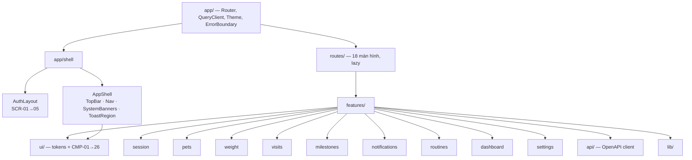
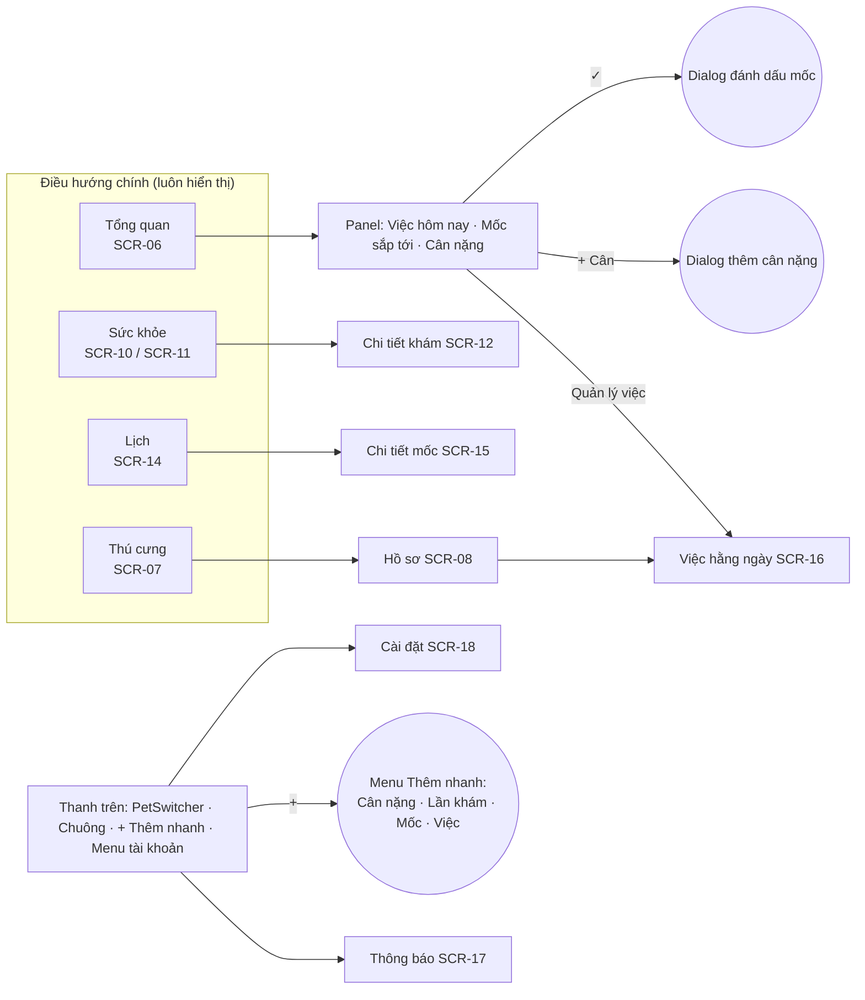
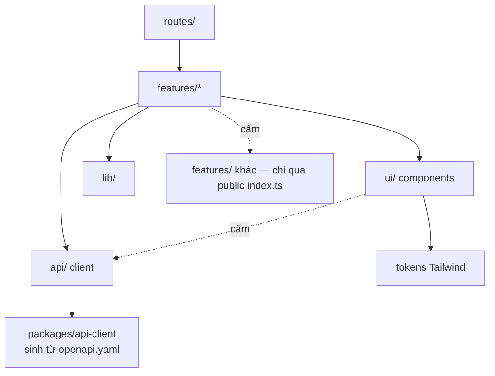
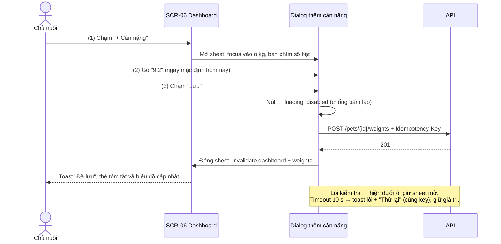
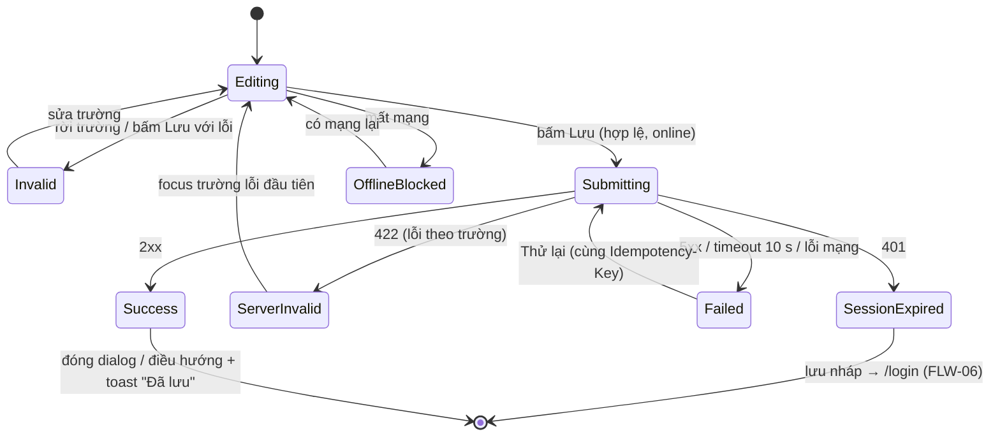
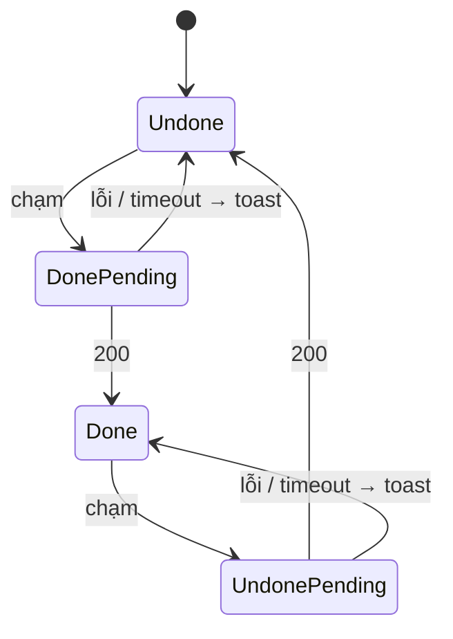

# Bản thiết kế UI/UX (Software Blueprint Design) — Pet Health Web

> **Chuẩn áp dụng:** IEEE 1016-2009 (Software Design Descriptions), áp cho **tầng giao diện** (web client)
> **Prompt nguồn:** `docs/design/bluePrint_design_prompt.md`
> **Tài liệu cha:** [SAD.md](SAD.md) v1.1 mô tả toàn hệ thống; tài liệu này đặc tả chi tiết phần **UI/UX** mà SAD §2.1 chỉ nêu ở mức kiến trúc.

---

## 1. Bối cảnh và đối tượng thiết kế

### 1.1 Định danh hệ thống

| Thuộc tính           | Giá trị                                                                                                                                                  |
| -------------------- | -------------------------------------------------------------------------------------------------------------------------------------------------------- |
| **Tên hệ thống**     | Pet Health — Nhật ký số theo dõi sức khỏe thú cưng (Web, Giai đoạn 1)                                                                                    |
| **Mã tài liệu**      | PH-UXD-001                                                                                                                                               |
| **Phiên bản SDD**    | v1.4 — bổ sung §3.9 Bản tin 2026-10-26 (v1.3 **Approved** — UXD-001→UXD-008 do Claude rà soát theo ủy quyền của Việt; UXD-009 Việt duyệt, 2026-10-23)    |
| **Ngày**             | 2026-10-23                                                                                                                                               |
| **Chủ sở hữu**       | Việt (Product Owner, kiêm thiết kế và phát triển); soạn với Claude                                                                                       |
| **Baseline đầu vào** | [SRS.md](../requirements/SRS.md) v1.0 · [PRD.md](../requirements/PRD.md) v1.3 · [SAD.md](SAD.md) v1.1 · [usecase_diagram.drawio](usecase_diagram.drawio) |
| **Thiết kế Figma**   | [Pet Health — UI/UX Design](https://www.figma.com/design/LFyXuFes0btRKxTORNwgpo) · 89 frame (48 phone, 23 tablet, 18 desktop)                            |

**Lịch sử phiên bản**

| Phiên bản | Ngày       | Tác giả                | Thay đổi                                                                                                                                                                                                                                                 |
| --------- | ---------- | ---------------------- | -------------------------------------------------------------------------------------------------------------------------------------------------------------------------------------------------------------------------------------------------------- |
| 1.0       | 2026-10-23 | Việt                   | Bản đầu tiên: design system, kiến trúc thông tin, 18 màn hình, 26 component, 8 view IEEE 1016 cho tầng UI, ma trận truy vết                                                                                                                              |
| 1.1       | 2026-10-23 | Claude (Việt ủy quyền) | Duyệt UXD-001→UXD-008. Sửa UXD-004/005: nút **"+" Thêm nhanh** trên thanh trên ở mọi breakpoint (đúng wireframe phone PRD §4.1), để mọi thao tác tạo mới ≤ 2 chạm                                                                                        |
| 1.2       | 2026-10-23 | Việt                   | Đổi màu chủ đạo sang **hồng cánh sen**: nền hồng nhạt, điểm nhấn hồng nhạt `--primary-soft`, nút/liên kết hồng cánh sen đậm (UXD-001). Tính lại tương phản                                                                                               |
| 1.3       | 2026-10-23 | Việt                   | Thêm UXD-009 và §3.1.5 **mẫu bố cục theo màn hình** cho tablet/desktop (danh sách + chi tiết, lưới thú cưng, form 2 cột, đăng nhập chia đôi, modal); sửa rộng SideRail 72 → 88 px cho khớp Figma; ghi liên kết file Figma                                |
| 1.4       | 2026-10-26 | Claude (Việt yêu cầu)  | Thêm §3.9 **Bản tin (Giai đoạn 2)**: UXD-010→016, SCR-19→25, CMP-27→35, FLW-08→10; thanh điều hướng 6 mục; đăng ký thêm nickname, ngày sinh, nhập lại mật khẩu; ảnh > 5 MB được nén ở trình duyệt (mọi chỗ tải ảnh). Các màn bản tin chưa có frame Figma |

**Quy ước mã:** `SCR-xx` = màn hình · `CMP-xx` = component · `FLW-xx` = luồng tương tác · `ST-xx` = máy trạng thái UI · `TK-` = design token · `UXD-xxx` = quyết định thiết kế chờ duyệt · `UXC-xx` = mối quan tâm UX của bên liên quan · `QS-xx` = kịch bản chất lượng. Mã `FR-`, `NFR-`, `IF-` tham chiếu SRS; `US-`, `IX-`, `PD-` tham chiếu PRD; `AD-` tham chiếu SAD.

### 1.2 Phạm vi và ranh giới ngoài

| Loại ranh giới                    | Mô tả                                                                                                                                                                                                      |
| --------------------------------- | ---------------------------------------------------------------------------------------------------------------------------------------------------------------------------------------------------------- |
| **Mục đích hệ thống**             | Giúp chủ nuôi ghi một lần và được nhắc đúng lúc: hồ sơ ≤ 10 thú cưng, cân nặng so với mục tiêu, sổ y tế kèm ảnh, mốc y tế tự lặp kèm **nhắc trong app** (banner + mục Thông báo), checklist việc hằng ngày |
| **Trong phạm vi tài liệu**        | SPA React tại `https://app.pethealth.example`: bố cục, điều hướng, màn hình, component, trạng thái UI, nội dung chữ, trợ năng, hiệu năng phía client                                                       |
| **Ngoài phạm vi tài liệu**        | Logic nghiệp vụ và dữ liệu (ở server, SAD §2.2–§3); email tài khoản (chỉ nội dung chữ được nêu ở §3.5.4)                                                                                                   |
| **Hệ thống ngoài mà UI chạm tới** | Pet Health API `/api/v1` (cùng origin, REST/JSON); `/media/*` (ảnh qua URL ký 15 phút); hộp chọn tệp và camera của trình duyệt; bộ chọn ngày gốc của trình duyệt; `localStorage` / `sessionStorage`        |
| **Người dùng**                    | **Khách** (chưa đăng nhập) · **Chủ nuôi** (đã đăng nhập; đã hoặc chưa xác minh email). Không có vai trò quản trị                                                                                           |
| **Giao diện ngoài**               | REST `/api/v1` (OpenAPI, client sinh tự động); `POST /api/v1/analytics/events`; liên kết trong email (`/verify-email#token=`, `/reset-password#token=`)                                                    |
| **Ranh giới tin cậy**             | Trình duyệt người dùng (không tin cậy) → Cloudflare edge (TLS) → máy chủ tự dựng. UI **không** giữ bí mật nào; mọi kiểm tra ở client chỉ để báo lỗi sớm, server kiểm lại (NFR-SEC-007)                     |
| **Môi trường triển khai**         | Safari (iOS, iPadOS, macOS) và Chrome (Android, desktop), 2 phiên bản chính mới nhất (NFR-PRT-001); viewport 360–1366 px là vùng kiểm thử bắt buộc, thiết bị chuẩn là iPad 10,5" (834 × 1112)              |

### 1.3 Giả định và ràng buộc

| Loại                    | Mô tả                                                                                                                                                                                                                                                                               |
| ----------------------- | ----------------------------------------------------------------------------------------------------------------------------------------------------------------------------------------------------------------------------------------------------------------------------------- |
| **Ràng buộc kỹ thuật**  | React 19 + Vite + TanStack Router/Query + Tailwind CSS (SAD AD-004); JS ban đầu < 250 KB gzip (NFR-PERF-003); không WebSocket/SSE (DC-003); không lưu dữ liệu nghiệp vụ offline (DC-002); mọi tính toán nghiệp vụ (tuổi, "hôm nay", nhãn "còn N ngày") nhận từ server (NFR-MNT-002) |
| **Ràng buộc nghiệp vụ** | Giao diện **chỉ tiếng Việt** (NFR-USA-007); một người thiết kế và phát triển nên design system phải nhỏ, dùng lại tối đa; chi phí bằng 0 (không dùng công cụ trả phí, không font thương mại)                                                                                        |
| **Giả định môi trường** | Người dùng dùng mạng 4G hoặc Wi-Fi gia đình; máy chủ tự dựng có thể chậm hơn cloud nên UI phải chịu được độ trễ 300–800 ms mà vẫn mượt (skeleton, optimistic update); thiết bị phổ thông 2–4 năm tuổi                                                                               |
| **Giả định dữ liệu**    | ≤ 10 thú cưng/tài khoản; ≤ 20 việc/thú cưng; ≤ 5 ảnh/bản ghi; sổ y tế có thể vài trăm bản ghi (phân trang 20); biểu đồ cân nặng vài chục điểm/năm; thông báo giữ 90 ngày                                                                                                            |

### 1.4 Quyết định thiết kế (đã duyệt)

Việt ủy quyền rà soát và duyệt ngày 2026-10-23. Kết quả rà soát ở cột cuối.

| ID      | Quyết định                                                                                                                                                                                                                                                                                                                                                                                                           | Lý do                                                                                                                                                       | Rà soát                                                                                                                                                                                                                                                                   |
| ------- | -------------------------------------------------------------------------------------------------------------------------------------------------------------------------------------------------------------------------------------------------------------------------------------------------------------------------------------------------------------------------------------------------------------------- | ----------------------------------------------------------------------------------------------------------------------------------------------------------- | ------------------------------------------------------------------------------------------------------------------------------------------------------------------------------------------------------------------------------------------------------------------------- |
| UXD-001 | Màu chủ đạo **hồng cánh sen** (Việt chọn, v1.2): nền trang hồng rất nhạt `#FDF7F9`, điểm nhấn **hồng cánh sen nhạt** `#FCE4EE`, nút và liên kết **hồng cánh sen đậm** `#C2185B` (tối: `#F5A3C7`)                                                                                                                                                                                                                     | Dịu, ấm, thân thiện với chủ đề chăm sóc thú cưng. Hồng nhạt chỉ dùng làm nền vì tương phản với nền trắng chỉ 1,2:1; chữ và nút dùng tông đậm để đạt WCAG AA | ✅ Duyệt. Tương phản đã tính: nút/liên kết 5,9:1 (sáng) và 8,9:1 (tối); chữ trên nền hồng nhạt 6,6:1. Màu đỏ "Quá hạn" khá gần tông hồng đậm (1,1:1) nên **trạng thái luôn đi kèm icon, nhãn chữ và nền chip riêng**, và màu chủ đạo không bao giờ dùng để báo trạng thái |
| UXD-002 | **Font hệ thống** (`-apple-system, "Segoe UI", Roboto, …`), không tải webfont                                                                                                                                                                                                                                                                                                                                        | 0 KB tải thêm, hỗ trợ đủ dấu tiếng Việt, LCP tốt (SAD §2.1.1)                                                                                               | ✅ Duyệt. Font hệ thống của iOS, Android, macOS, Windows đều hiển thị đúng dấu tiếng Việt                                                                                                                                                                                 |
| UXD-003 | Bộ icon **Lucide** (import từng icon, ~1 KB/icon) thay cho emoji trong wireframe PRD                                                                                                                                                                                                                                                                                                                                 | Đồng nhất, có thể đặt `aria-hidden`, đổi màu theo theme. Emoji trong wireframe PRD chỉ là ký hiệu                                                           | ✅ Duyệt. Emoji hiển thị khác nhau giữa các hệ điều hành và không đổi màu theo theme được                                                                                                                                                                                 |
| UXD-004 | Thanh điều hướng **4 mục**: Tổng quan · Sức khỏe · Lịch · Thú cưng (đúng PRD §4.1). _(Giai đoạn 2: thành 6 mục, xem UXD-010 ở §3.9.1.)_ "Việc hằng ngày" truy cập từ panel Dashboard và hồ sơ thú cưng; "Cài đặt" từ menu tài khoản trên thanh trên cùng (phone) hoặc mục ⚙ cuối thanh bên (tablet/desktop). Thanh trên có nút **"+" Thêm nhanh** ở mọi breakpoint (Cân nặng · Lần khám · Mốc y tế · Việc hằng ngày) | Giữ đúng 4 mục PRD; việc hằng ngày chủ yếu thao tác ngay trên Dashboard                                                                                     | ✅ Duyệt, **có sửa**: thêm nút "+" cho phone (PRD wireframe phone đã có `[+]`)                                                                                                                                                                                            |
| UXD-005 | **Sức khỏe** là một màn hình có 2 tab: _Cân nặng_ và _Sổ y tế_                                                                                                                                                                                                                                                                                                                                                       | Gom hai loại dữ liệu sức khỏe của cùng một thú cưng                                                                                                         | ✅ Duyệt, **có sửa**: bản đầu cần 3 thao tác để thêm lần khám khi đang ở tab Cân nặng; nút "+" (UXD-004) đưa về 2 thao tác                                                                                                                                                |
| UXD-006 | Bottom sheet trên phone, modal giữa màn hình trên tablet/desktop, dùng chung một component `ResponsiveDialog` (CMP-12)                                                                                                                                                                                                                                                                                               | IX-2; một nguồn code                                                                                                                                        | ✅ Duyệt                                                                                                                                                                                                                                                                  |
| UXD-007 | Toast hiển thị ở **đáy màn hình, trên bottom nav** (phone) và **góc dưới phải** (tablet/desktop)                                                                                                                                                                                                                                                                                                                     | Gần ngón tay cái trên phone; không che checklist ở cột phải trên tablet                                                                                     | ✅ Duyệt. Toast undo phải nằm trên bottom nav để không che nút điều hướng                                                                                                                                                                                                 |
| UXD-008 | Không có tour hướng dẫn nhiều bước. Onboarding = empty state có hành động chính + 1 dòng gợi ý theo ngữ cảnh                                                                                                                                                                                                                                                                                                         | Ít màn hình phải làm; PRD đã định nghĩa empty state cho từng màn hình                                                                                       | ✅ Duyệt. Kiểm lại sau khi đo FLW-01 với 3 người dùng thử; nếu > 3 phút thì xem xét thêm gợi ý                                                                                                                                                                            |
| UXD-009 | Ở tablet và desktop (≥ 768 px), **Sổ y tế**, **Lịch mốc** và **Cài đặt** dùng bố cục **danh sách + chi tiết** trên cùng một màn hình; các màn khác mở rộng theo §3.1.5                                                                                                                                                                                                                                               | Tận dụng bề ngang, xem chi tiết không phải chuyển trang, giảm thao tác quay lại                                                                             | ✅ Việt duyệt (v1.3). Route chi tiết (`/visits/:id`, `/milestones/:id`) vẫn giữ để mở từ thông báo và liên kết; khi ≥ 768 px route đó hiển thị trong khung chi tiết                                                                                                       |

---

## 2. Các bên liên quan và mối quan tâm

### 2.1 Xác định bên liên quan

| Bên liên quan                                  | Vai trò                                                                | Quan tâm chính                                                                |
| ---------------------------------------------- | ---------------------------------------------------------------------- | ----------------------------------------------------------------------------- |
| **Chủ nuôi chu đáo** (persona chính, PRD §2.1) | Người dùng cuối, 1–3 thú cưng, dùng tablet ở nhà và phone khi ra ngoài | Nhập nhanh, thấy ngay việc cần làm và mốc sắp tới, không bỏ lỡ nhắc, đọc dễ   |
| **Chủ nuôi nhiều thú cưng** (persona phụ)      | Người dùng cuối, 4–10 thú cưng                                         | Chuyển thú cưng 1 chạm, xem tổng hợp "Tất cả", không lẫn dữ liệu              |
| **Khách**                                      | Người chưa đăng nhập                                                   | Đăng ký và đăng nhập nhanh, thông báo lỗi rõ                                  |
| **Việt — Product Owner**                       | Duyệt thiết kế, đo KR                                                  | Đạt KR2.1 (≤ 20 s ghi cân nặng), KR2.2 (1 chạm tick việc), KR3.x (Web Vitals) |
| **Việt — Lập trình viên frontend**             | Cài đặt UI                                                             | Ít component, token rõ, trạng thái đủ, dễ test                                |
| **QA**                                         | Kiểm thử G-4 (thiết bị), G-6 (Web Vitals), AC-028 (không cuộn ngang)   | Mỗi màn hình có đặc tả trạng thái và tiêu chí đo được                         |
| **Người dùng cần trợ năng**                    | Người dùng trình đọc màn hình, bàn phím, mắt kém                       | WCAG 2.1 AA (NFR-USA-002)                                                     |

### 2.2 Mối quan tâm của bên liên quan

| ID     | Bên liên quan           | Mối quan tâm                                          | Ưu tiên | Tiêu chí chấp nhận                                                                                      |
| ------ | ----------------------- | ----------------------------------------------------- | ------- | ------------------------------------------------------------------------------------------------------- |
| UXC-01 | Chủ nuôi                | Ghi cân nặng nhanh từ Dashboard                       | High    | ≤ 3 thao tác, trung vị ≤ 20 s (NFR-USA-006, KR2.1)                                                      |
| UXC-02 | Chủ nuôi                | Tick việc hằng ngày bằng 1 chạm, phản hồi ngay        | High    | Đúng 1 chạm; trạng thái đổi trong ≤ 100 ms, không chờ server (FR-RT-003, KR2.2)                         |
| UXC-03 | Chủ nuôi                | Không bỏ lỡ nhắc mốc y tế                             | High    | Nhắc chưa xem hiển thị ở vùng nhìn thấy đầu tiên của Dashboard trên mọi breakpoint (FR-NTF-009, BR-043) |
| UXC-04 | Chủ nuôi                | Hiểu trạng thái mốc mà không phụ thuộc màu            | High    | Mọi trạng thái có nhãn chữ + icon (NFR-USA-003, IX-7)                                                   |
| UXC-05 | Chủ nuôi                | Dùng tốt trên tablet 10,5" cả 2 hướng và phone 360 px | High    | Bố cục đúng FR-DSH-004; 0 thanh cuộn ngang ở 360–1366 px (NFR-PRT-002)                                  |
| UXC-06 | Chủ nuôi                | Không mất nội dung đang nhập                          | High    | Mất mạng, timeout, hết phiên đều giữ form (FR-GEN-003, 004, 006)                                        |
| UXC-07 | Chủ nuôi nhiều thú cưng | Chuyển thú cưng nhanh, không lẫn dữ liệu              | High    | 1 chạm chọn; tên thú cưng hiển thị trên mọi màn hình dữ liệu (FR-PET-007)                               |
| UXC-08 | Khách                   | Đăng ký/đăng nhập rõ ràng, an toàn                    | Med     | Lỗi hiển thị dưới trường; thông báo đăng nhập sai chung chung (FR-AUTH-005)                             |
| UXC-09 | Người dùng trợ năng     | Dùng được bằng bàn phím và trình đọc màn hình         | High    | WCAG 2.1 AA; axe-core 0 lỗi nghiêm trọng (NFR-USA-002)                                                  |
| UXC-10 | Product Owner           | App nhanh trên 4G                                     | High    | LCP < 2,5 s, INP < 200 ms, CLS < 0,1 ở p75 (NFR-PERF-001)                                               |
| UXC-11 | Lập trình viên          | Design system nhỏ, nhất quán                          | Med     | Toàn bộ UI dựng từ ≤ 30 component và token ở §3.2.4; không màu/khoảng cách "cứng" ngoài token (lint)    |
| UXC-12 | QA                      | Mỗi màn hình có đủ trạng thái để kiểm                 | Med     | Mỗi SCR có đặc tả loading / empty / error / offline (§3.5)                                              |
| UXC-13 | Chủ nuôi                | Thao tác phá hủy không xảy ra do nhầm                 | High    | Mọi thao tác xóa có xác nhận; xóa thú cưng phải nhập tên (FR-GEN-010, FR-PET-008)                       |

### 2.3 Kịch bản thuộc tính chất lượng (6 phần)

| ID    | Thuộc tính               | Nguồn          | Kích thích                          | Thành phần                | Môi trường                               | Phản hồi                                                                     | Thước đo                                                                      |
| ----- | ------------------------ | -------------- | ----------------------------------- | ------------------------- | ---------------------------------------- | ---------------------------------------------------------------------------- | ----------------------------------------------------------------------------- |
| QS-01 | Hiệu năng                | Chủ nuôi       | Mở Dashboard sau đăng nhập          | SCR-06, `GET /dashboard`  | Phone tầm trung, 4G giả lập, cache trống | Skeleton hiện ngay, nội dung thay skeleton không xô lệch                     | LCP < 2,5 s, CLS < 0,1 (Lighthouse mobile)                                    |
| QS-02 | Hiệu năng                | Chủ nuôi       | Chạm checkbox việc hằng ngày        | CMP-19                    | Mạng 4G, server trễ 500 ms               | Tick hiển thị ngay (optimistic); lưu nền                                     | INP < 200 ms; rollback + toast nếu lỗi trong ≤ 10 s                           |
| QS-03 | Tính sẵn sàng (cảm nhận) | Mạng           | Mất kết nối khi đang điền form      | AppShell, CMP-05          | Bất kỳ màn hình                          | Banner offline, vô hiệu nút Lưu, giữ nội dung                                | Banner xuất hiện ≤ 2 s sau sự kiện `offline` hoặc lần fetch lỗi mạng đầu tiên |
| QS-04 | Bảo mật                  | Khách          | Mở trang dữ liệu bằng URL trực tiếp | Router guard              | Chưa đăng nhập                           | Chuyển `/login?next=…`, không render dữ liệu nào                             | 0 request dữ liệu trước khi `GET /auth/session` trả 200 (FR-AUTH-014)         |
| QS-05 | Khả năng bảo trì         | Lập trình viên | Đổi màu trạng thái "Quá hạn"        | Token `--status-danger-*` | Code base                                | Một chỗ sửa áp cho chip, banner, chấm lịch                                   | 1 tệp thay đổi                                                                |
| QS-06 | Khả năng kiểm thử        | QA             | Chạy E2E luồng nhắc với đồng hồ giả | FLW-03, FLW-04            | CI                                       | Selector ổn định theo vai trò/nhãn                                           | 100% phần tử tương tác có role + accessible name (Playwright `getByRole`)     |
| QS-07 | Khả năng triển khai      | Việt           | Deploy bản SPA mới                  | Caddy + Cloudflare        | Người dùng đang mở app                   | Lần điều hướng kế tiếp tải chunk mới; chunk cũ thiếu thì tải lại trang 1 lần | 0 màn hình trắng do lỗi `ChunkLoadError`                                      |
| QS-08 | Quan sát được            | Chủ nuôi       | Gặp lỗi 5xx                         | CMP-24                    | Bất kỳ                                   | Thông báo chung + mã `ref`                                                   | Mã `ref` hiển thị, chọn và sao chép được (FR-GEN-011)                         |

### 2.4 Kịch bản chất lượng UX/UI

| Thuộc tính                   | Kịch bản UX/UI                                                                                                                                                                                                                                          |
| ---------------------------- | ------------------------------------------------------------------------------------------------------------------------------------------------------------------------------------------------------------------------------------------------------- |
| **Usability**                | Người dùng mới hoàn tất đăng ký → tạo thú cưng đầu tiên → tạo mốc đầu tiên trong ≤ 3 phút, không cần trợ giúp; ghi một số đo cân nặng từ Dashboard ≤ 3 thao tác (FLW-02)                                                                                |
| **Accessibility**            | Mọi phần tử tương tác dùng được bằng bàn phím (Tab/Shift+Tab/Enter/Space/Esc), có focus ring rõ; trình đọc màn hình đọc đúng nhãn, trạng thái checkbox, nội dung banner và toast (`aria-live`); biểu đồ có bảng dữ liệu thay thế (WCAG 2.1 AA)          |
| **Performance**              | LCP < 2,5 s, INP < 200 ms, CLS < 0,1 (p75, 4G); skeleton xuất hiện trong ≤ 100 ms sau điều hướng; JS ban đầu < 250 KB gzip                                                                                                                              |
| **Responsiveness**           | Bố cục đổi đúng ở 768 px và 1280 px; nội dung tối đa 1280 px căn giữa; không cuộn ngang ở 360–1366 px, cả dọc và ngang                                                                                                                                  |
| **Visual Consistency**       | 100% màu, cỡ chữ, khoảng cách, bo góc lấy từ token §3.2.4 (Tailwind config chỉ chứa token, cấm giá trị tùy ý `[...]` qua lint)                                                                                                                          |
| **Error Recovery**           | Lỗi kiểm tra hiển thị ngay dưới trường, focus chuyển tới trường lỗi đầu tiên; lỗi mạng/timeout có nút "Thử lại" giữ nguyên form; không bao giờ cần tải lại trang để sửa lỗi                                                                             |
| **Feedback & Affordance**    | Mọi nút có trạng thái hover/pressed/focus/disabled; thao tác > 300 ms hiển thị spinner trong nút; thành công có toast "Đã lưu" 3 s (IX-6)                                                                                                               |
| **Information Architecture** | Từ bất kỳ màn hình nào tới mọi chức năng chính trong ≤ 2 thao tác (bảng §3.1.3)                                                                                                                                                                         |
| **Internationalization**     | Chỉ tiếng Việt (NFR-USA-007); ngày `dd/MM/yyyy`, thập phân dấu phẩy (FR-GEN-002); bố cục chịu được chuỗi dài hơn 30% (tên giống thú cưng, ghi chú) bằng xuống dòng/cắt ba chấm có tooltip; chuỗi UI gom ở một tệp `vi.ts` để sẵn sàng thêm ngôn ngữ sau |
| **Mobile Experience**        | Vùng chạm ≥ 44 × 44 px (NFR-USA-001); ô số dùng `inputmode="decimal"`; ô nhập font ≥ 16 px để iOS không tự phóng to; bottom sheet kéo xuống để đóng; không dùng cử chỉ ẩn làm cách duy nhất cho một chức năng                                           |

### 2.5 Ma trận ràng buộc UX/UI

| Ràng buộc                  | Yêu cầu                                                                                                                                                            | Tiêu chuẩn / công cụ             | Phương pháp kiểm chứng                                                |
| -------------------------- | ------------------------------------------------------------------------------------------------------------------------------------------------------------------ | -------------------------------- | --------------------------------------------------------------------- |
| **Tương phản màu**         | Chữ thường ≥ 4,5:1; chữ lớn và thành phần UI (viền ô nhập, icon, focus ring) ≥ 3:1. Bảng màu ở §3.2.4 đã tính: chữ ≥ 5,1:1, viền ≥ 3,3:1                           | WCAG 2.1 AA (1.4.3, 1.4.11)      | axe-core trong E2E + kiểm thủ công cả 2 theme                         |
| **Typography**             | Body 16 px, tối thiểu 14 px cho chữ phụ, 12 px chỉ cho nhãn badge; line-height ≥ 1,5 cho đoạn; co giãn đúng khi người dùng tăng cỡ chữ trình duyệt tới 200%        | WCAG 1.4.4; design system §3.2.4 | Kiểm thủ công zoom 200%                                               |
| **Vùng chạm**              | ≥ 44 × 44 px; khoảng cách giữa 2 vùng chạm ≥ 8 px                                                                                                                  | Apple HIG; NFR-USA-001           | Test tự động đo `getBoundingClientRect` các phần tử có role tương tác |
| **Trạng thái tải**         | Skeleton ngay khi điều hướng; spinner trong nút nếu thao tác > 300 ms; không spinner toàn trang                                                                    | UX best practice                 | Playwright với mạng chậm (throttle)                                   |
| **Thông báo lỗi**          | Rõ ràng, nói cách sửa, không lộ chi tiết kỹ thuật; nội dung theo PRD §4.2 và danh mục §3.5.4                                                                       | Hướng dẫn viết UX §3.5.4         | Rà soát nội dung                                                      |
| **Empty state**            | Mỗi danh sách/biểu đồ trống có câu giải thích + 1 hành động chính (PRD §4.2)                                                                                       | FR-GEN-012                       | Kiểm kê UI (bảng §3.5.3)                                              |
| **Thông báo nhắc**         | Banner nhắc không chặn thao tác (không modal), đóng được, chỉ trên Dashboard; chuông luôn ở thanh trên; không âm thanh, không pop-up                               | FR-NTF-008, 009; IX-9            | Kiểm thử thủ công + E2E                                               |
| **Trợ giúp và onboarding** | Không có tour; empty state hướng dẫn bước kế tiếp; dòng gợi ý ngữ cảnh (ví dụ "Thêm số đo tháng sau để thấy xu hướng"); nhãn trường rõ, có ví dụ trong placeholder | UXD-008                          | Đo thời gian hoàn thành FLW-01 khi thử với 3 người                    |
| **Chuyển động**            | Hiệu ứng ≤ 200 ms; tắt hiệu ứng khi `prefers-reduced-motion: reduce`                                                                                               | WCAG 2.3.3                       | Kiểm thủ công                                                         |

---

## 3. Các view thiết kế (IEEE 1016-2009)

Tám view dưới đây áp các viewpoint của IEEE 1016 cho tầng giao diện. Mỗi view ghi rõ mối quan tâm (UXC) mà nó trả lời.

| View                                    | Viewpoint IEEE 1016 | Mối quan tâm chính       |
| --------------------------------------- | ------------------- | ------------------------ |
| §3.1 Composition                        | Composition         | UXC-11 (bảo trì), UXC-07 |
| §3.2 Logical — Design system            | Logical             | UXC-04, UXC-09, UXC-11   |
| §3.3 Dependency                         | Dependency          | UXC-11, QS-05            |
| §3.4 Information                        | Information         | UXC-06, UXC-07           |
| §3.5 Interface — Đặc tả màn hình        | Interface           | UXC-01→UXC-13            |
| §3.6 Interaction — Luồng tương tác      | Interaction         | UXC-01, 02, 03           |
| §3.7 State dynamics — Trạng thái UI     | State dynamics      | UXC-06, UXC-12           |
| §3.8 Resource — Hiệu năng và tài nguyên | Resource            | UXC-10, QS-01            |

---

### 3.1 Composition View

**Mục đích:** cách SPA được ghép từ các khối: shell, route, màn hình, component, hạ tầng client.
**Mối quan tâm:** UXC-11, UXC-07.

#### 3.1.1 Phân rã

| Thành phần               | Loại          | Cha    | Trách nhiệm                                                                                       | Phụ thuộc                 |
| ------------------------ | ------------- | ------ | ------------------------------------------------------------------------------------------------- | ------------------------- |
| `app/`                   | Gốc ứng dụng  | —      | Khởi tạo router, QueryClient, theme, i18n, error boundary                                         | Tất cả                    |
| `app/shell`              | Layout        | `app/` | `AuthLayout` (màn hình khách) và `AppShell` (thanh trên, điều hướng, banner hệ thống, vùng toast) | `ui/`, `features/session` |
| `routes/`                | Route module  | `app/` | Mỗi route = 1 màn hình SCR, có `loader` lấy dữ liệu mới (FR-GEN-008) và chunk lazy riêng          | `features/*`              |
| `features/session`       | Feature       | `app/` | Phiên, CSRF token, guard đăng nhập, bản nháp khi hết phiên                                        | `api/`                    |
| `features/pets`          | Feature       | `app/` | Danh sách, hồ sơ, bộ chọn thú cưng, thú cưng đang chọn                                            | `api/`, `ui/`             |
| `features/weight`        | Feature       | `app/` | Form số đo, mục tiêu, biểu đồ (lazy), thẻ tóm tắt                                                 | `api/`, `ui/`, `uplot`    |
| `features/visits`        | Feature       | `app/` | Danh sách khám, form, ảnh đính kèm, trình xem ảnh                                                 | `api/`, `ui/`             |
| `features/milestones`    | Feature       | `app/` | Danh sách mốc theo nhóm, form, đánh dấu đã thực hiện + hoàn tác                                   | `api/`, `ui/`             |
| `features/notifications` | Feature       | `app/` | Chuông + badge, banner nhắc, danh sách thông báo                                                  | `api/`, `ui/`             |
| `features/routines`      | Feature       | `app/` | Checklist hôm nay, CRUD việc                                                                      | `api/`, `ui/`             |
| `features/dashboard`     | Feature       | `app/` | Ghép 3 panel + banner từ một request `/dashboard`                                                 | `features/*`, `api/`      |
| `features/settings`      | Feature       | `app/` | Múi giờ, đổi mật khẩu, đổi email, xóa tài khoản                                                   | `api/`, `ui/`             |
| `ui/`                    | Design system | `app/` | Token + 26 component dùng chung (CMP-01→CMP-26)                                                   | Tailwind, Lucide          |
| `api/`                   | Hạ tầng       | `app/` | Client sinh từ OpenAPI, bọc fetch (timeout 10 s, CSRF, Idempotency-Key, parse problem+json)       | `packages/api-client`     |
| `lib/`                   | Tiện ích      | `app/` | `useOnline`, `formatDate`, `formatKg`, `track()` analytics, lưu `localStorage` an toàn            | —                         |
| `i18n/vi.ts`             | Tài nguyên    | `app/` | Toàn bộ chuỗi giao diện tiếng Việt                                                                | —                         |



#### 3.1.2 Sơ đồ màn hình (sitemap)

| ID     | Màn hình                                                              | Route                                              | Layout                      | Truy cập  | Chunk           |
| ------ | --------------------------------------------------------------------- | -------------------------------------------------- | --------------------------- | --------- | --------------- |
| SCR-01 | Đăng nhập                                                             | `/login`                                           | Auth                        | Khách     | `auth`          |
| SCR-02 | Đăng ký                                                               | `/register`                                        | Auth                        | Khách     | `auth`          |
| SCR-03 | Quên mật khẩu                                                         | `/forgot-password`                                 | Auth                        | Khách     | `auth`          |
| SCR-04 | Đặt lại mật khẩu                                                      | `/reset-password#token=`                           | Auth                        | Khách     | `auth`          |
| SCR-05 | Xác minh email                                                        | `/verify-email#token=`                             | Auth                        | Mọi người | `auth`          |
| SCR-06 | **Dashboard (Tổng quan)**                                             | `/`                                                | App                         | Chủ nuôi  | **ban đầu**     |
| SCR-07 | Danh sách thú cưng                                                    | `/pets`                                            | App                         | Chủ nuôi  | `pets`          |
| SCR-08 | Hồ sơ thú cưng                                                        | `/pets/:petId`                                     | App                         | Chủ nuôi  | `pets`          |
| SCR-09 | Tạo / sửa thú cưng                                                    | `/pets/new`, `/pets/:petId/edit`                   | App (trang riêng: form dài) | Chủ nuôi  | `pets`          |
| SCR-10 | Sức khỏe — tab Cân nặng                                               | `/pets/:petId/health/weight`                       | App                         | Chủ nuôi  | `weight`        |
| SCR-11 | Sức khỏe — tab Sổ y tế                                                | `/pets/:petId/health/visits`                       | App                         | Chủ nuôi  | `visits`        |
| SCR-12 | Chi tiết bản ghi khám (≥ 768 px: khung chi tiết cạnh SCR-11, UXD-009) | `/visits/:visitId`                                 | App                         | Chủ nuôi  | `visits`        |
| SCR-13 | Tạo / sửa bản ghi khám                                                | `/pets/:petId/visits/new`, `/visits/:visitId/edit` | App (trang riêng)           | Chủ nuôi  | `visits`        |
| SCR-14 | Lịch mốc y tế                                                         | `/pets/:petId/milestones`                          | App                         | Chủ nuôi  | `milestones`    |
| SCR-15 | Chi tiết mốc (≥ 768 px: khung chi tiết cạnh SCR-14, UXD-009)          | `/milestones/:milestoneId`                         | App                         | Chủ nuôi  | `milestones`    |
| SCR-16 | Việc hằng ngày                                                        | `/pets/:petId/routines`                            | App                         | Chủ nuôi  | `routines`      |
| SCR-17 | Thông báo                                                             | `/notifications`                                   | App                         | Chủ nuôi  | `notifications` |
| SCR-18 | Cài đặt tài khoản                                                     | `/settings`                                        | App                         | Chủ nuôi  | `settings`      |
| SCR-19 | Bản tin _(GĐ2)_                                                       | `/feed`                                            | App                         | Chủ nuôi  | `feed`          |
| SCR-20 | Soạn bài _(GĐ2)_                                                      | `/feed/new`                                        | App                         | Chủ nuôi  | `feed`          |
| SCR-21 | Tìm người _(GĐ2)_                                                     | `/search`                                          | App                         | Chủ nuôi  | `search`        |
| SCR-22 | Hồ sơ công khai _(GĐ2)_                                               | `/u/:username`                                     | App                         | Chủ nuôi  | `social`        |
| SCR-23 | Chi tiết bài _(GĐ2)_                                                  | `/p/:postId`                                       | App                         | Chủ nuôi  | `social`        |
| SCR-24 | Danh sách theo dõi _(GĐ2)_                                            | `/u/:username/followers`, `/following`             | App                         | Chủ nuôi  | `social`        |
| SCR-25 | Thông báo — tab Hoạt động _(GĐ2)_                                     | `/notifications?tab=activity`                      | App                         | Chủ nuôi  | `notifications` |

Form ngắn (thêm cân nặng, mục tiêu, tạo/sửa mốc, đánh dấu đã thực hiện, tạo/sửa việc, các xác nhận) **không phải màn hình riêng** mà mở bằng `ResponsiveDialog` (CMP-12) trên màn hình hiện tại (IX-2). Mỗi dialog vẫn có query string (`?dialog=add-weight`) để nút Back của trình duyệt/Android đóng dialog.

#### 3.1.3 Điều hướng và kiến trúc thông tin



_Giai đoạn 2 (§3.9):_ thanh điều hướng thêm **Bản tin** (SCR-19, giữa Sức khỏe và Lịch) và **Hồ sơ** (SCR-22 của chính mình, cuối thanh); menu "+" thêm "Bài đăng" (SCR-20).

**Kiểm tra "≤ 2 thao tác" từ màn hình bất kỳ** (QS IA):

| Mục tiêu                  | Thao tác                                    |
| ------------------------- | ------------------------------------------- |
| Thêm cân nặng             | Tổng quan → "+ Cân" (2)                     |
| Tick việc hôm nay         | Tổng quan → chạm việc (2)                   |
| Đánh dấu mốc đã thực hiện | Tổng quan → ✓ trên mốc hoặc banner (2)      |
| Thêm bản ghi khám         | "+" → Lần khám (2), từ mọi màn hình         |
| Tạo mốc y tế              | "+" → Mốc y tế, hoặc Lịch → "+ Tạo mốc" (2) |
| Xem thông báo             | Chuông (1)                                  |
| Đổi thú cưng              | PetSwitcher → chọn (2)                      |
| Cài đặt                   | Menu tài khoản / ⚙ (1–2)                    |

#### 3.1.4 Bố cục theo breakpoint (FR-DSH-004)

| Breakpoint  | Bề rộng     | Khung                                                                    | Điều hướng                                                                               | Dashboard                                                                     |
| ----------- | ----------- | ------------------------------------------------------------------------ | ---------------------------------------------------------------------------------------- | ----------------------------------------------------------------------------- |
| **Phone**   | < 768 px    | 1 cột, lề 16 px                                                          | Bottom nav 4 mục (Giai đoạn 2: 6 mục, UXD-010) (cao 64 px + safe-area), thanh trên 56 px | Banner → Việc hôm nay → Mốc sắp tới → Cân nặng                                |
| **Tablet**  | 768–1279 px | 2 cột 60/40, lề 24 px, khoảng cách cột 24 px                             | Rail trái 88 px (icon + nhãn nhỏ), ⚙ ở đáy rail                                          | Banner trải 2 cột; trái: Cân nặng + Mốc; phải: Việc hôm nay (sticky khi cuộn) |
| **Desktop** | ≥ 1280 px   | Như tablet, nội dung tối đa 1280 px căn giữa (khung thiết kế 1440 × 900) | Rail trái 88 px                                                                          | Như tablet                                                                    |

iPad 10,5" dọc (834 px) và ngang (1112 px) đều rơi vào Tablet (PRD §4.1).

#### 3.1.5 Mẫu bố cục theo màn hình (UXD-009)

Trên phone mọi màn hình là 1 cột. Từ 768 px trở lên, các màn hình dùng mẫu dưới đây; Figma có frame tương ứng ở trang _Screens · Tablet_ và _Screens · Desktop_.

| Màn hình                      | Phone (< 768)                            | Tablet (768–1279)                                                                  | Desktop (≥ 1280)                                                         |
| ----------------------------- | ---------------------------------------- | ---------------------------------------------------------------------------------- | ------------------------------------------------------------------------ |
| SCR-01→05 Tài khoản           | 1 cột, form toàn màn hình                | Thẻ form 440 px giữa nền `--primary-soft`                                          | **Chia đôi**: trái 640 px giới thiệu (nền `--primary`), phải form 400 px |
| SCR-06 Dashboard              | Banner → Việc → Mốc → Cân nặng           | Banner + 2 cột 60/40 (§3.1.4)                                                      | Như tablet, trong khung 1280 px                                          |
| SCR-07 Thú cưng               | Danh sách 1 cột                          | Lưới **2 cột**                                                                     | Lưới **3 cột**                                                           |
| SCR-08 Hồ sơ thú cưng         | 1 cột: avatar, đặc điểm, 4 lối tắt 2 × 2 | **2 cột**: thẻ hồ sơ 340 px (avatar 112, nút xóa) · phải: đặc điểm + lối tắt 2 × 2 | 2 cột: thẻ hồ sơ 380 px · phải: đặc điểm + 4 lối tắt trên 1 hàng         |
| SCR-09 / SCR-13 Form tạo, sửa | 1 cột, nút Lưu dính đáy                  | Ảnh bên trái + thẻ form, các trường ngắn ghép **2 cột**, nút Hủy / Lưu căn phải    | Như tablet; Thêm lần khám ghép 3 trường trên 1 hàng                      |
| SCR-10 Cân nặng               | Thẻ tóm tắt → biểu đồ → lịch sử          | Tóm tắt 300 px + biểu đồ (có tooltip) trên 1 hàng; lịch sử bên dưới                | Như tablet, biểu đồ rộng hơn                                             |
| SCR-11 + SCR-12 Sổ y tế       | Danh sách → trang chi tiết riêng         | **Danh sách 360 px + chi tiết** cạnh nhau; mục đang chọn có viền `--primary`       | Danh sách 440 px + chi tiết, ảnh 160 px                                  |
| SCR-14 + SCR-15 Lịch mốc      | Danh sách → trang chi tiết riêng         | **Danh sách + chi tiết 340 px**; mục đang chọn nền `--primary-soft`                | Danh sách + chi tiết 420 px                                              |
| SCR-16 Việc hằng ngày         | Checklist hôm nay → danh sách việc       | **2 cột**: checklist hôm nay · danh sách quản lý                                   | Như tablet                                                               |
| SCR-17 Thông báo              | Danh sách toàn chiều rộng                | Danh sách tối đa 720 px                                                            | Danh sách tối đa 760 px                                                  |
| SCR-18 Cài đặt                | Các nhóm xếp dọc                         | **2 cột**: menu mục 220 px · nội dung                                              | 2 cột: menu mục 240 px · nội dung (gồm Vùng nguy hiểm)                   |
| Hộp thoại (CMP-12/13/14)      | Bottom sheet                             | **Modal 480 px** giữa màn hình trên scrim                                          | Modal 480 px                                                             |

Quy tắc chung: chiều rộng tối đa của dòng chữ dài khoảng 760 px để dễ đọc; khung chi tiết luôn ở bên phải; chọn mục trong danh sách không làm mất vị trí cuộn của danh sách.

---

### 3.2 Logical View — Design System

**Mục đích:** các phần tử logic của giao diện: token, kiểu chữ, lưới, component và quy tắc dùng.
**Mối quan tâm:** UXC-04, UXC-09, UXC-11, QS-05.

#### 3.2.1 Nguyên tắc thiết kế

| #    | Nguyên tắc                              | Ví dụ áp dụng                                                                                  |
| ---- | --------------------------------------- | ---------------------------------------------------------------------------------------------- |
| DP-1 | **Việc hôm nay trước tiên**             | Dashboard là màn hình đầu; banner nhắc ở trên cùng; checklist trên phone đứng đầu              |
| DP-2 | **Ít chạm nhất**                        | Ngày mặc định hôm nay; tick 1 chạm; form ngắn trong dialog; nhớ thú cưng đang chọn             |
| DP-3 | **Trạng thái luôn có chữ**              | Chip "Quá hạn 2 ngày" thay vì chỉ chấm đỏ                                                      |
| DP-4 | **Không bao giờ mất dữ liệu đang nhập** | Offline, timeout, hết phiên đều giữ form                                                       |
| DP-5 | **Bình tĩnh**                           | Không pop-up, không âm thanh; nhắc chỉ là banner đóng được; màu đỏ chỉ dùng cho Quá hạn và lỗi |

#### 3.2.2 Lưới và khoảng cách

- Đơn vị cơ sở **4 px**. Thang: `space-1` 4 · `space-2` 8 · `space-3` 12 · `space-4` 16 · `space-5` 20 · `space-6` 24 · `space-8` 32 · `space-12` 48.
- Lề trang: 16 px (phone), 24 px (tablet/desktop). Khoảng cách giữa card: 16 px (phone), 24 px (tablet/desktop). Padding trong card: 16 px.
- Bo góc: `radius-sm` 6 (chip), `radius-md` 8 (ô nhập, nút), `radius-lg` 12 (card), `radius-xl` 16 (bottom sheet góc trên), `radius-full` (badge, avatar).

#### 3.2.3 Kiểu chữ

Font: `-apple-system, BlinkMacSystemFont, "Segoe UI", Roboto, "Helvetica Neue", Arial, sans-serif` (UXD-002). Số dùng `font-variant-numeric: tabular-nums` trong bảng và biểu đồ.

| Token              | Cỡ / line-height | Độ đậm | Dùng cho                                         |
| ------------------ | ---------------- | ------ | ------------------------------------------------ |
| `text-display`     | 28 / 36          | 700    | Số cân nặng lớn trên thẻ tóm tắt                 |
| `text-h1`          | 24 / 32          | 700    | Tiêu đề màn hình                                 |
| `text-h2`          | 20 / 28          | 600    | Tiêu đề panel, tiêu đề dialog                    |
| `text-body`        | 16 / 24          | 400    | Nội dung, ô nhập (≥ 16 px để iOS không phóng to) |
| `text-body-strong` | 16 / 24          | 600    | Tên việc, tên mốc                                |
| `text-small`       | 14 / 20          | 400    | Thông tin phụ, nhãn trường, lỗi dưới trường      |
| `text-caption`     | 12 / 16          | 600    | Badge chuông, nhãn trục biểu đồ, nhãn rail       |

#### 3.2.4 Token màu

Tỷ lệ tương phản đã tính theo công thức WCAG 2.1 (chữ trên nền tương ứng).

| Token                         | Sáng                  | Tối                   | Dùng cho                                                                                                                                      | Tương phản (sáng / tối)                    |
| ----------------------------- | --------------------- | --------------------- | --------------------------------------------------------------------------------------------------------------------------------------------- | ------------------------------------------ |
| `--bg`                        | `#FDF7F9`             | `#121212`             | Nền trang (hồng rất nhạt)                                                                                                                     | —                                          |
| `--surface`                   | `#FFFFFF`             | `#1C1C1E`             | Card, dialog, thanh trên                                                                                                                      | —                                          |
| `--surface-2`                 | `#F7EEF2`             | `#2A2A2D`             | Hover, ô nhập disabled, skeleton                                                                                                              | —                                          |
| `--text`                      | `#1C1B1A`             | `#F2F2F0`             | Chữ chính                                                                                                                                     | 17,2 / 15,2 trên surface; 16,3 trên `--bg` |
| `--text-muted`                | `#5F5D58`             | `#A8A6A0`             | Chữ phụ, placeholder                                                                                                                          | 6,6 / 7,0 trên surface; 6,2 trên `--bg`    |
| `--border`                    | `#8A877F`             | `#6F6D68`             | Viền ô nhập, checkbox (UI)                                                                                                                    | 3,6 / 3,3 trên surface; 3,4 trên `--bg`    |
| `--divider`                   | `#F1DCE5`             | `#2F2F32`             | Đường kẻ trang trí (không mang thông tin)                                                                                                     | —                                          |
| `--primary`                   | `#C2185B`             | `#F5A3C7`             | **Hồng cánh sen đậm**: nút chính, liên kết, icon mục điều hướng đang chọn                                                                     | 5,9 / 8,9 trên surface; 5,6 trên `--bg`    |
| `--on-primary`                | `#FFFFFF`             | `#4A0D2B`             | Chữ trên nút chính                                                                                                                            | 5,9 / 7,9                                  |
| `--primary-soft`              | `#FCE4EE`             | `#3A1A28`             | **Hồng cánh sen nhạt**: nền mục điều hướng đang chọn, tab đang chọn, nền avatar mặc định, nền thẻ tóm tắt cân nặng, vùng chọn của PetSwitcher | Chỉ làm nền, không dùng làm chữ            |
| `--primary-soft-fg`           | `#9D174D`             | `#F5A3C7`             | Chữ và icon trên `--primary-soft`                                                                                                             | 6,6 / 8,1                                  |
| `--focus`                     | `#2563EB`             | `#60A5FA`             | Focus ring 2 px + offset 2 px                                                                                                                 | 5,2 / 6,7                                  |
| `--status-danger-fg` / `-bg`  | `#B42318` / `#FEE4E2` | `#FDA29B` / `#55160C` | **Quá hạn**, lỗi                                                                                                                              | 5,5 / 7,2                                  |
| `--status-warning-fg` / `-bg` | `#93370D` / `#FEF0C7` | `#FEC84B` / `#4E1D09` | **Còn ≤ 7 ngày**, banner D7/D1, offline                                                                                                       | 6,6 / 9,0                                  |
| `--status-success-fg` / `-bg` | `#067647` / `#DCFAE6` | `#75E0A7` / `#053321` | **Đã thực hiện**, toast thành công                                                                                                            | 5,1 / 8,6                                  |
| `--status-neutral-fg` / `-bg` | `#475467` / `#F2F4F7` | `#D0D5DD` / `#344054` | **Còn > 7 ngày**, Đã hủy                                                                                                                      | 7,0 / 7,1                                  |

Theme theo `prefers-color-scheme` (NFR-USA-004); không có nút chuyển theme trong Giai đoạn 1.

**Ánh xạ trạng thái mốc (IX-7, FR-MS-013)** — luôn có icon + chữ:

| Trạng thái hiển thị | Màu                     | Icon (Lucide)    | Nhãn                                  |
| ------------------- | ----------------------- | ---------------- | ------------------------------------- |
| Quá hạn             | danger                  | `alert-circle`   | "Quá hạn N ngày"                      |
| Còn ≤ 7 ngày        | warning                 | `clock`          | "Còn N ngày" / "Ngày mai" / "Hôm nay" |
| Còn > 7 ngày        | neutral                 | `calendar`       | "Còn N ngày (dd/MM)"                  |
| Đã thực hiện        | success                 | `check-circle-2` | "Đã thực hiện dd/MM/yyyy"             |
| Đã hủy              | neutral, chữ gạch ngang | `x-circle`       | "Đã hủy"                              |

**Icon loại mốc:** Tiêm vaccine `syringe` · Nhỏ gáy `droplet` · Tẩy giun `pill`.

#### 3.2.5 Chuyển động và độ nổi

| Token            | Giá trị                       | Dùng cho                               |
| ---------------- | ----------------------------- | -------------------------------------- |
| `motion-fast`    | 120 ms ease-out               | Hover, pressed, tick checkbox          |
| `motion-base`    | 200 ms ease-out               | Mở/đóng dialog, sheet trượt lên, toast |
| `shadow-card`    | `0 1px 2px rgb(0 0 0 / .06)`  | Card                                   |
| `shadow-overlay` | `0 8px 24px rgb(0 0 0 / .16)` | Dialog, sheet, menu                    |
| Scrim            | `rgb(0 0 0 / .4)`             | Nền sau dialog                         |

`prefers-reduced-motion: reduce` → mọi chuyển động thành 0 ms, giữ thay đổi trạng thái.

#### 3.2.6 Danh mục component

| ID     | Component                                  | Biến thể / trạng thái                                                                                                           | Quy tắc trợ năng                                                                                        | Dùng ở                                               |
| ------ | ------------------------------------------ | ------------------------------------------------------------------------------------------------------------------------------- | ------------------------------------------------------------------------------------------------------- | ---------------------------------------------------- |
| CMP-01 | `Button`                                   | primary, secondary, ghost, danger; md (44 px), sm (36 px, chỉ trên desktop); loading (spinner, giữ bề rộng); disabled           | `<button>`, nhãn chữ; nút chỉ icon phải có `aria-label`                                                 | Mọi nơi                                              |
| CMP-02 | `IconButton`                               | 44 × 44, tròn                                                                                                                   | `aria-label` bắt buộc                                                                                   | Chuông, đóng, menu                                   |
| CMP-03 | `TopBar`                                   | Phone: PetSwitcher + Chuông + "+" Thêm nhanh + Menu; Tablet/desktop: tiêu đề màn hình + PetSwitcher + Chuông + "+ Thêm"         | `<header>`; landmark                                                                                    | AppShell                                             |
| CMP-04 | `PetSwitcher`                              | Avatar + tên + `▾`; danh sách ≤ 10 + "Tất cả" (chỉ trên Dashboard) + "+ Thêm thú cưng" (disabled kèm chú thích khi đủ 10)       | `combobox`/`listbox`, điều khiển được bằng phím mũi tên                                                 | TopBar                                               |
| CMP-05 | `SystemBanner`                             | offline (warning), verify-email (neutral), lỗi phiên                                                                            | `role="status"`; offline dùng `aria-live="polite"`                                                      | AppShell                                             |
| CMP-06 | `ReminderBanner`                           | level OVERDUE (danger) / D1, D7 (warning); dòng "+N nhắc khác"; nút Xem, Đã thực hiện, ✕                                        | `role="region"` + `aria-label="Nhắc nhở"`; nội dung đọc được; ✕ có `aria-label="Đóng nhắc nhở"`         | SCR-06                                               |
| CMP-07 | `BellButton`                               | badge 1–9, "9+", ẩn khi 0                                                                                                       | `aria-label="Thông báo, 2 chưa xem"`                                                                    | TopBar                                               |
| CMP-08 | `BottomNav` / `SideRail`                   | 4 mục (Giai đoạn 2: 6 mục, UXD-010); mục đang chọn có nền viên thuốc `--primary-soft`, icon và chữ `--primary-soft-fg`, chữ đậm | `<nav aria-label="Điều hướng chính">`, `aria-current="page"`                                            | AppShell                                             |
| CMP-09 | `Card` / `Panel`                           | tiêu đề + hành động phải + nội dung                                                                                             | `<section aria-labelledby>`                                                                             | Dashboard, hồ sơ                                     |
| CMP-10 | `Toast`                                    | success, error (có "Thử lại"), undo (có "Hoàn tác" + thanh đếm 10 s)                                                            | Vùng `aria-live="polite"`; error dùng `assertive`; không tự ẩn khi đang focus                           | ToastRegion                                          |
| CMP-11 | `Skeleton`                                 | text, card, chart, list item; kích thước cố định                                                                                | `aria-busy="true"` trên vùng cha                                                                        | Mọi màn hình                                         |
| CMP-12 | `ResponsiveDialog`                         | Phone: bottom sheet (kéo xuống để đóng, chiều cao theo nội dung, tối đa 90vh); ≥ 768: modal 480 px giữa màn hình                | `role="dialog"`, `aria-modal`, bẫy focus, Esc đóng, trả focus về nút mở                                 | Mọi form ngắn                                        |
| CMP-13 | `ConfirmDialog`                            | thường, nguy hiểm (nút đỏ)                                                                                                      | Focus mặc định vào nút **Hủy**                                                                          | Mọi thao tác xóa                                     |
| CMP-14 | `TypeToConfirmDialog`                      | Nhập lại tên thú cưng / mật khẩu; nút Xóa chỉ bật khi khớp (SD-009)                                                             | Nhãn nêu rõ cần nhập gì                                                                                 | Xóa thú cưng, xóa tài khoản                          |
| CMP-15 | `FormField`                                | label trên, gợi ý, lỗi dưới (đỏ + icon), bắt buộc (*)                                                                           | `<label for>`, `aria-describedby` trỏ tới gợi ý và lỗi, `aria-invalid`                                  | Mọi form                                             |
| CMP-16 | `DateField`                                | `<input type="date">` gốc, mặc định hôm nay, `max` = hôm nay khi cần (IX-3)                                                     | Dùng control gốc                                                                                        | Ngày đo, khám, thực hiện, sinh                       |
| CMP-17 | `DecimalField`                             | `inputmode="decimal"`, nhận `,` và `.`, hậu tố "kg" (IX-4)                                                                      | Hậu tố được đọc qua `aria-describedby`                                                                  | Cân nặng, mục tiêu                                   |
| CMP-18 | `TextAreaCounter`                          | bộ đếm "120 / 2000", đỏ + chặn lưu khi vượt                                                                                     | Bộ đếm `aria-live="polite"` khi còn ≤ 10%                                                               | Triệu chứng, chẩn đoán, đơn thuốc, đặc điểm, ghi chú |
| CMP-19 | `ChecklistItem`                            | chưa xong / xong (gạch ngang, xuống cuối) / đang lưu / lỗi (rung nhẹ + rollback); vùng chạm toàn dòng                           | `role="checkbox"` + `aria-checked`; Space bật/tắt                                                       | Dashboard, SCR-16                                    |
| CMP-20 | `MilestoneItem`                            | icon loại + tên + ghi chú + StatusChip + nút ✓                                                                                  | Nút ✓ có `aria-label="Đánh dấu đã thực hiện: Tiêm vaccine Dại"`                                         | Dashboard, SCR-14                                    |
| CMP-21 | `StatusChip`                               | 5 trạng thái §3.2.4                                                                                                             | Chữ luôn hiển thị                                                                                       | Mốc, thông báo                                       |
| CMP-22 | `WeightChart`                              | đường số đo + đường mục tiêu nét đứt; tooltip; 0/1/n điểm; bản thu gọn (Dashboard)                                              | `<figure>` + `<figcaption>`; bảng dữ liệu `sr-only` thay thế; điểm tooltip điều khiển được bằng mũi tên | SCR-06, SCR-10                                       |
| CMP-23 | `PhotoUploader` + `PhotoGrid` + `Lightbox` | mỗi ảnh: đang tải (%) / đang xử lý / sẵn sàng / lỗi + "Thử lại"; tối đa 5                                                       | Ảnh có `alt` "Ảnh đính kèm 2/5 — lần khám 20/09/2026"                                                   | SCR-12, SCR-13, SCR-09                               |
| CMP-24 | `ErrorState`                               | lỗi tải màn hình (có "Thử lại"), 404, 5xx kèm mã `ref` (nút sao chép)                                                           | Tiêu đề h1, nút rõ                                                                                      | Mọi màn hình                                         |
| CMP-25 | `EmptyState`                               | icon minh họa + câu + 1 nút chính (nội dung PRD §4.2)                                                                           | —                                                                                                       | Mọi danh sách                                        |
| CMP-26 | `NotificationItem`                         | chưa xem (chấm + đậm), đã xem, đã xử lý (mờ + nhãn)                                                                             | `<a>` có nhãn đầy đủ; trạng thái đọc bằng chữ ẩn "Chưa xem"                                             | SCR-17                                               |

---

### 3.3 Dependency View

**Mục đích:** quy tắc phụ thuộc giữa các lớp client, giữ thay đổi cục bộ.
**Mối quan tâm:** UXC-11, QS-05.



| Quy tắc                                                      | Lý do                                                   | Cách kiểm                                               |
| ------------------------------------------------------------ | ------------------------------------------------------- | ------------------------------------------------------- |
| `ui/` không import `api/` hay `features/`                    | Component thuần hiển thị, dễ test, dùng lại được        | `dependency-cruiser` trong CI                           |
| `features/A` chỉ dùng `features/B` qua `features/B/index.ts` | Thay đổi nội bộ một feature không lan sang feature khác | `dependency-cruiser`                                    |
| Không feature nào tự gọi `fetch`; mọi lời gọi qua `api/`     | Timeout, CSRF, Idempotency-Key, xử lý 401 ở một chỗ     | ESLint `no-restricted-globals: fetch` ngoài `api/`      |
| Không giá trị màu/khoảng cách ngoài token                    | QS-05                                                   | `eslint-plugin-tailwindcss` cấm class `[...]` tùy ý     |
| Không thư viện múi giờ ở client                              | Ngày giờ nghiệp vụ do server tính (NFR-MNT-002)         | `size-limit` + ESLint cấm import `luxon`, `date-fns-tz` |

**Phụ thuộc bên thứ ba ở client:** `react`, `react-dom`, `@tanstack/react-router`, `@tanstack/react-query`, `react-hook-form`, `zod` (mini), `openapi-fetch`, `lucide-react` (import từng icon), `uplot` (lazy). Không thêm thư viện UI kit; dialog, toast, combobox tự viết trong `ui/` để kiểm soát bundle và trợ năng.

---

### 3.4 Information View

**Mục đích:** dữ liệu mà UI giữ, nguồn gốc, vòng đời và nơi lưu.
**Mối quan tâm:** UXC-06, UXC-07.

#### 3.4.1 Phân loại dữ liệu ở client

| Dữ liệu                                 | Nguồn                                      | Nơi giữ                                              | Vòng đời                                                                    | Ghi chú                                  |
| --------------------------------------- | ------------------------------------------ | ---------------------------------------------------- | --------------------------------------------------------------------------- | ---------------------------------------- |
| Phiên (user, `csrfToken`, `userIdHash`) | `GET /auth/session`                        | TanStack Query `['session']`                         | Tới khi đăng xuất / 401                                                     | Cookie phiên HttpOnly, JS không đọc được |
| Dữ liệu màn hình                        | API tương ứng                              | TanStack Query theo key                              | `staleTime: 0`, loader luôn lấy mới (FR-GEN-008)                            | Không persist ra đĩa (DC-002)            |
| Số chưa xem + banner                    | `GET /notifications/summary`, `/dashboard` | `['notifications','summary']`                        | Lấy lại khi đổi route, khi tab được chọn lại, sau mutation mốc (FR-NTF-010) | Không polling                            |
| Thú cưng đang chọn                      | Người dùng chọn                            | `localStorage` `ph.selectedPetId`                    | Theo thiết bị (FR-PET-007)                                                  | ID không hợp lệ → chọn thú cưng đầu tiên |
| Bộ lọc Dashboard                        | Người dùng chọn                            | `localStorage` `ph.dashboardFilter` (`all` \| petId) | Theo thiết bị                                                               |                                          |
| Tab Sức khỏe gần nhất                   | Người dùng chọn                            | `localStorage` `ph.healthTab`                        | Theo thiết bị                                                               | Phục vụ "≤ 2 thao tác"                   |
| Bản nháp khi hết phiên                  | Form đang nhập                             | `sessionStorage` `ph.draft.<route>`                  | Xóa sau khi khôi phục hoặc khi đóng tab (FR-GEN-006)                        | Không lưu mật khẩu                       |
| Idempotency-Key                         | `crypto.randomUUID()`                      | Trạng thái form                                      | Từ lúc mở form tới khi lưu thành công; "Thử lại" dùng lại key (FR-GEN-005)  |                                          |
| Ảnh đang tải lên                        | Tệp người dùng chọn                        | Bộ nhớ (object URL để xem trước)                     | Tới khi `READY` hoặc người dùng bỏ                                          | `URL.revokeObjectURL` khi xong           |

#### 3.4.2 View model chính

Server trả sẵn mọi giá trị hiển thị nghiệp vụ; client chỉ định dạng.

| View model        | Trường hiển thị                                                                        | Định dạng ở client                                        |
| ----------------- | -------------------------------------------------------------------------------------- | --------------------------------------------------------- |
| `PetCard`         | `name`, `ageText` ("7 năm 7 tháng"), `breed`, `sex`, `avatarThumbUrl`                  | Giới tính `MALE` → "Đực", `FEMALE` → "Cái"                |
| `WeightSummary`   | `latest.weightKg`, `latest.measuredOn`, `delta`, `target`                              | `9.3` → "9,3 kg"; `delta 0.3` → "+0,3"; ngày `dd/MM/yyyy` |
| `MilestoneRow`    | `type`, `note`, `dueOn`, `displayStatus`, `daysUntilDue`, `petName`                    | Nhãn chip theo §3.2.4 từ `displayStatus` + `daysUntilDue` |
| `ReminderBanner`  | `top{level,label,petName,type,note,dueOn,milestoneId}`, `moreCount`                    | "Tiêm vaccine (Dại) của Mochi — ngày mai, 15/11/2026"     |
| `NotificationRow` | `level`, `label`, `appearOn`, `read`, `resolution`, `petName`, `type`, `note`, `dueOn` | Nhóm theo ngày: "Hôm nay", "Hôm qua", `dd/MM/yyyy`        |
| `ChecklistRow`    | `name`, `timeOfDay`, `done`, `petName?`                                                | "07:00"; `petName` chỉ hiện khi lọc "Tất cả"              |

#### 3.4.3 Quy tắc định dạng (FR-GEN-002)

| Loại            | Quy tắc                                                                                  | Ví dụ             |
| --------------- | ---------------------------------------------------------------------------------------- | ----------------- |
| Ngày            | `dd/MM/yyyy`; trong danh sách cùng năm hiện tại có thể rút gọn `dd/MM` kèm năm ở tooltip | 15/11/2026        |
| Giờ             | `HH:mm` 24 giờ                                                                           | 07:00             |
| Cân nặng        | 1 chữ số thập phân, dấu phẩy, khoảng trắng không ngắt trước "kg"                         | 9,2 kg            |
| Chênh lệch      | Luôn có dấu `+` / `−` (dấu trừ U+2212), 1 chữ số thập phân                               | +0,3 kg · −0,2 kg |
| Số lượng        | "x/y xong"                                                                               | 2/4 xong          |
| Ô nhập cân nặng | Nhận `9,2` và `9.2`; gửi server dạng chuỗi `"9.2"`                                       |                   |

---

### 3.5 Interface View — Đặc tả màn hình

**Mục đích:** hợp đồng của từng màn hình với người dùng (bố cục, thành phần, hành động, trạng thái) và với API.
**Mối quan tâm:** UXC-01→UXC-13.

Quy ước chung cho mọi màn hình App:

- **Loading:** skeleton đúng hình khối nội dung (CMP-11); không spinner toàn trang.
- **Lỗi tải:** `ErrorState` trong vùng nội dung, AppShell vẫn dùng được.
- **Offline:** `SystemBanner` offline; nút Lưu disabled kèm chú thích "Cần kết nối mạng".
- **Tiêu đề trang:** `<title>` = "Tên màn hình · Pet Health"; khi đổi route, focus chuyển về `h1`.

#### 3.5.1 Màn hình khách (SCR-01 → SCR-05)

Khung chung: thẻ giữa màn hình rộng tối đa 400 px, logo + tên "Pet Health" ở trên, nền `--bg`.

| SCR                     | Thành phần                                                                                                                                                                         | Hành động & quy tắc                                                                                                                             | API                          | FR                 |
| ----------------------- | ---------------------------------------------------------------------------------------------------------------------------------------------------------------------------------- | ----------------------------------------------------------------------------------------------------------------------------------------------- | ---------------------------- | ------------------ |
| SCR-01 Đăng nhập        | Email, Mật khẩu (nút hiện/ẩn), nút "Đăng nhập", liên kết "Quên mật khẩu?", "Chưa có tài khoản? Đăng ký"                                                                            | Sai → lỗi chung trên form "Email hoặc mật khẩu không đúng"; bị khóa → "Thử lại sau 15 phút" kèm thời gian còn lại; thành công → `next` hoặc `/` | `POST /auth/login`           | AUTH-005, 006, 014 |
| SCR-02 Đăng ký          | Email, Nickname, Ngày sinh, Mật khẩu (8–128, đồng hồ độ dài), Nhập lại mật khẩu, Múi giờ, nút "Đăng ký", liên kết đăng nhập _(Nickname, Ngày sinh, Nhập lại mật khẩu thêm ở v1.4)_ | Kiểm tra tại chỗ khi rời trường; email trùng → lỗi dưới trường "Email đã được sử dụng"; thành công → vào thẳng Dashboard (empty state)          | `POST /auth/register`        | AUTH-001, 002      |
| SCR-03 Quên mật khẩu    | Email, nút "Gửi liên kết"                                                                                                                                                          | Luôn hiện cùng một thông báo "Nếu email có tài khoản, liên kết đặt lại đã được gửi. Kiểm tra cả thư mục Spam."                                  | `POST /auth/password/forgot` | AUTH-008           |
| SCR-04 Đặt lại mật khẩu | Mật khẩu mới, nút "Đặt mật khẩu"                                                                                                                                                   | Token đọc từ fragment; hết hạn → `ErrorState` + "Gửi lại liên kết"                                                                              | `POST /auth/password/reset`  | AUTH-008, 009      |
| SCR-05 Xác minh email   | Trạng thái: đang xác minh → thành công ("Email đã được xác minh" + "Vào Tổng quan") / hết hạn / đã dùng / sai (kèm "Gửi lại email xác minh")                                       | Tự gọi API khi mở                                                                                                                               | `POST /auth/verify-email`    | AUTH-004           |

#### 3.5.2 Màn hình chủ nuôi

**SCR-06 — Dashboard (Tổng quan)** · US-060, 061, 062 · FR-DSH-001→007, FR-NTF-009, FR-RT-002

_Tablet (ngang 1112 px):_

```
┌──────┬───────────────────────────────────────────────────────────────────┐
│ ◉    │  Tổng quan                      [Mochi ▾]        🔔2   [+ Thêm ▾] │ ← TopBar
│ Tổng │───────────────────────────────────────────────────────────────────│
│ quan │ ┃⚠ Tẩy giun của Mochi đã quá hạn 2 ngày (12/11)                    │ ← ReminderBanner
│ ♡    │ ┃  +1 nhắc khác             [Đã thực hiện]  [Xem]            ✕     │   (danger)
│ Sức  │───────────────────────────────────────────────────────────────────│
│ khỏe │ ┌─ CÂN NẶNG ─────────── Mục tiêu 9,0 kg ┐ ┌─ HÔM NAY ── 2/4 xong ┐ │
│ ▦    │ │ 9,3 kg  +0,3 so với lần trước        │ │ ☐ 18:00 Cho ăn tối    │ │
│ Lịch │ │ [biểu đồ thu gọn 6 tháng]  - - - - -  │ │ ☐ 19:00 Đi dạo        │ │
│ 🐾   │ │                         [+ Cân nặng] │ │ ☑ 07:00 Cho ăn sáng   │ │
│ Thú  │ └──────────────────────────────────────┘ │ ☑ 07:30 Đi dạo        │ │
│ cưng │ ┌─ MỐC SẮP TỚI ────────────── Xem tất cả┐ │                       │ │
│      │ │ 💊 Tẩy giun   [⚠ Quá hạn 2 ngày]  [✓] │ │ [+ Thêm việc]         │ │
│      │ │ 💉 Vaccine Dại [⏱ Còn 3 ngày]      [✓] │ │ Quản lý việc →        │ │
│ ⚙    │ │ 💧 Nhỏ gáy    [📅 Còn 21 ngày]     [✓] │ └───────────────────────┘ │
└──────┴─┴──────────────────────────────────────┴───────────────────────────┘
          ←────────── 60% ──────────→               ←──── 40% ────→
```

_Phone (390 px):_

```
┌──────────────────────────────┐
│ [Mochi ▾]      🔔2  [+]  ☰   │
├──────────────────────────────┤
│┃⚠ Tẩy giun quá hạn 2 ngày    │
│┃ +1 nhắc khác  [✓] [Xem]  ✕  │
├──────────────────────────────┤
│ HÔM NAY            2/4 xong  │
│ ☐ 18:00 Cho ăn tối           │
│ ☐ 19:00 Đi dạo               │
│ ☑ 07:00 Cho ăn sáng          │
│ [+ Thêm việc]                │
├──────────────────────────────┤
│ MỐC SẮP TỚI       Xem tất cả │
│ 💊 Tẩy giun  ⚠Quá hạn 2  [✓] │
│ 💉 Vaccine   ⏱Còn 3      [✓] │
├──────────────────────────────┤
│ CÂN NẶNG    9,3 kg (+0,3)    │
│ [biểu đồ thu gọn]  [+ Cân]   │
├──────────────────────────────┤
│  ◉Tổng quan ♡Sức khỏe ▦Lịch 🐾│
└──────────────────────────────┘
```

| Vùng                                | Quy tắc                                                                                                                                                                                                      |
| ----------------------------------- | ------------------------------------------------------------------------------------------------------------------------------------------------------------------------------------------------------------ |
| Thứ tự                              | Phone: SystemBanner → ReminderBanner → Việc hôm nay → Mốc sắp tới → Cân nặng (FR-DSH-004). Tablet/desktop: banner trải 2 cột, rồi 2 cột 60/40                                                                |
| ReminderBanner                      | Chỉ khi `unreadCount > 0` trong phạm vi bộ lọc; hiện **1** nhắc khẩn cấp nhất + "+N nhắc khác"; nút "Đã thực hiện" mở dialog FLW-04; "Xem" → SCR-17; ✕ → đánh dấu đã xem, banner thu lại 200 ms (FR-NTF-009) |
| SystemBanner xác minh               | Dưới ReminderBanner, nhỏ hơn, màu neutral: "Xác minh email để có thể lấy lại mật khẩu khi quên · Gửi lại" (FR-DSH-007)                                                                                       |
| Bộ lọc                              | PetSwitcher có thêm mục "Tất cả" chỉ ở Dashboard; "Tất cả" → việc và mốc gộp, mỗi dòng có tên thú cưng; panel Cân nặng hiện của thú cưng đầu tiên kèm nhãn tên (FR-DSH-005)                                  |
| Panel Mốc                           | Tối đa 5: quá hạn trước, rồi ≤ 30 ngày tới (FR-DSH-003); "Xem tất cả" → SCR-14                                                                                                                               |
| Panel Việc                          | Sắp theo giờ, việc xong xuống cuối, gạch ngang; bộ đếm "x/y xong" (FR-RT-002)                                                                                                                                |
| Nút "+" Thêm nhanh (mọi breakpoint) | Menu: Cân nặng · Lần khám · Mốc y tế · Việc hằng ngày; áp cho thú cưng đang chọn (khi lọc "Tất cả" thì hỏi chọn thú cưng trước)                                                                              |
| Empty — chưa có thú cưng            | Thay toàn bộ panel bằng EmptyState "Thêm thú cưng đầu tiên để bắt đầu" + "+ Thêm thú cưng" (FR-DSH-006)                                                                                                      |
| Empty từng panel                    | Theo PRD §4.2 (bảng §3.5.3)                                                                                                                                                                                  |
| Loading                             | Skeleton 3 panel kích thước cố định; vùng banner **không** chiếm chỗ cho tới khi dữ liệu về (banner trượt xuống, nằm trên cùng nên không xô nội dung đã đọc)                                                 |
| API                                 | `GET /dashboard?pet=all                                                                                                                                                                                      | {id}` (một request) |

**SCR-07 — Danh sách thú cưng** · US-015 · FR-PET-002, 007
Lưới card (1 cột phone, 2 cột tablet, 3 cột desktop): avatar 64 px, tên, tuổi, giống. Nút "+ Thêm thú cưng" disabled kèm chú thích "Đã đạt tối đa 10 thú cưng" khi đủ 10. Chạm card → SCR-08.

**SCR-08 — Hồ sơ thú cưng** · US-010→014 · FR-PET-003→008
Đầu trang: avatar 96 px, tên (h1), "7 năm 7 tháng · Poodle · Cái", nút "Sửa". Các khối: Đặc điểm nhận dạng; lối tắt "Cân nặng", "Sổ y tế", "Lịch mốc", "Việc hằng ngày". Cuối trang: vùng nguy hiểm "Xóa thú cưng" → TypeToConfirmDialog (nhập đúng tên, so khớp bỏ khoảng trắng và không phân biệt hoa thường).

**SCR-09 — Tạo / sửa thú cưng** · FR-PET-001, 004, 005, 006
Trường: Ảnh đại diện (tùy chọn, CMP-23 một ảnh), Tên*, Giống*, Giới tính* (segmented Đực/Cái), Ngày sinh* (DateField, max hôm nay), Đặc điểm nhận dạng (TextAreaCounter 2.000). Nút "Lưu" dính đáy trên phone. Sau khi tạo: thú cưng mới thành thú cưng đang chọn, về SCR-06 kèm toast "Đã thêm Mochi".

**SCR-10 — Sức khỏe / Cân nặng** · US-020→023 · FR-WGT-001→010
Thẻ tóm tắt (số đo gần nhất `text-display`, chênh lệch, mục tiêu + "Sửa"); biểu đồ đầy đủ (CMP-22, cao 240 px phone / 320 px tablet); danh sách số đo giảm dần, mỗi dòng có menu Sửa/Xóa. "+ Thêm cân nặng" mở dialog: DecimalField (focus tự động), DateField (mặc định hôm nay), nút Lưu.

- 0 số đo: EmptyState "Chưa có số đo nào. Cân bé và ghi lại để theo dõi xu hướng."
- 1 số đo: 1 điểm + gợi ý "Thêm số đo tháng sau để thấy xu hướng".
- Chưa có mục tiêu: biểu đồ vẫn hiện, kèm liên kết "Đặt cân nặng mục tiêu".
- Tooltip điểm: "01/11/2026 · 9,3 kg · +0,3 so với mục tiêu".

**SCR-11 — Sức khỏe / Sổ y tế** · US-030, 031 · FR-VIS-002
Danh sách 20 mục/trang, tải thêm khi cuộn tới cuối (nút "Tải thêm" dự phòng cho bàn phím). Mỗi dòng: ngày khám, chẩn đoán rút gọn 1 dòng (hoặc triệu chứng nếu không có chẩn đoán), biểu tượng ảnh + số ảnh. "+ Thêm lần khám" → SCR-13.

**SCR-12 — Chi tiết bản ghi khám** · US-032→034 · FR-VIS-003, 004, 007, 008
Ngày (h1), các khối Triệu chứng / Chẩn đoán / Đơn thuốc (giữ xuống dòng), lưới ảnh thumbnail 3 cột (chạm → Lightbox có vuốt trái/phải và nút ←/→), menu Sửa / Xóa (ConfirmDialog: "Xóa lần khám này và 3 ảnh đính kèm?").

**SCR-13 — Tạo / sửa bản ghi khám** · FR-VIS-001, 005, 006
Ngày khám* (mặc định hôm nay), Triệu chứng, Chẩn đoán, Đơn thuốc (TextAreaCounter), ghi chú "Cần ít nhất triệu chứng hoặc chẩn đoán" hiển thị cố định dưới 2 trường đó. Khối ảnh: nút "Thêm ảnh" (mở camera hoặc thư viện, `accept="image/jpeg,image/png,image/heic,.heic"`), mỗi ảnh một ô có trạng thái riêng (ST-04). Khi tạo mới: bản ghi được lưu trước, ảnh tải lên sau với `visitId` mới (người dùng không phải đợi ảnh để lưu chữ).

**SCR-14 — Lịch mốc y tế** · US-040, 044, 046, 047 · FR-MS-001, 006, 007, 012, 013
Segmented control 4 nhóm: **Sắp tới · Quá hạn · Đã thực hiện · Đã hủy** (badge số lượng trên Quá hạn). Mặc định mở nhóm Quá hạn nếu có, ngược lại Sắp tới. Mỗi mục CMP-20. "+ Tạo mốc" mở dialog: Loại* (3 thẻ chọn có icon), Ngày đến hạn* (DateField, cho phép quá khứ kèm cảnh báo vàng "Ngày này đã qua"), Ghi chú (≤ 500), Chu kỳ lặp (chỉ hiện với Nhỏ gáy/Tẩy giun: ô số + chip nhanh 1 · 3 · 6 tháng; với Vaccine hiện dòng cố định "Tự lặp mỗi 12 tháng").

**SCR-15 — Chi tiết mốc** · FR-MS-003→010
Loại + ghi chú (h1), StatusChip, ngày đến hạn, chu kỳ, nguồn gốc ("Tạo tự động từ lần tiêm 14/11/2026" nếu AUTO). Hành động: "Đã thực hiện" (primary), "Sửa", "Hủy mốc" (ConfirmDialog). Loại mốc hiển thị chỉ đọc khi sửa (FR-MS-010). Mở từ thông báo → cuộn tới và tô nhẹ khối hành động trong 1 s.

**SCR-16 — Việc hằng ngày** · US-050→053, 045 · FR-RT-001→007
Checklist hôm nay (giống panel Dashboard) + danh sách quản lý (tên, giờ, menu Sửa/Xóa). "+ Thêm việc" mở dialog: Tên* (≤ 100), Giờ* (`<input type="time">`). Đạt 20 việc → nút disabled kèm "Đã đạt tối đa 20 việc".

**SCR-17 — Thông báo** · US-049 · FR-NTF-007, 008, 010, 011
Nhóm theo ngày xuất hiện ("Hôm nay", "Hôm qua", `dd/MM/yyyy`). Mỗi mục CMP-26: icon loại mốc, "Mochi · Tiêm vaccine (Dại)", "đến hạn 15/11/2026 · ngày mai", chấm chưa xem. Nút "Đánh dấu tất cả đã xem" ở đầu (ẩn khi không có mục chưa xem). Chạm mục → đánh dấu đã xem (optimistic) + mở SCR-15. Phân trang 20, tải thêm khi cuộn. _(v1.4: màn có 2 tab "Nhắc lịch" — nội dung trên — và "Hoạt động", xem SCR-25 §3.9.)_

**SCR-18 — Cài đặt tài khoản** · US-004, 005, 008 · FR-AUTH-010, 011, 015, 016
Các nhóm: **Tài khoản** (email + trạng thái xác minh, "Đổi email"), **Múi giờ** (select tìm kiếm được, mặc định Asia/Ho_Chi_Minh, hiển thị giờ hiện tại theo múi đã chọn), **Bảo mật** ("Đổi mật khẩu", "Đăng xuất"), **Vùng nguy hiểm** ("Xóa tài khoản" → TypeToConfirmDialog nhập mật khẩu, nêu rõ "Toàn bộ thú cưng, sổ y tế và ảnh sẽ bị xóa vĩnh viễn và không khôi phục được"). _(v1.4: nhóm Tài khoản thêm "Nickname và ngày sinh", "Hồ sơ công khai", "Đã chặn", xem §3.9.2.)_

#### 3.5.3 Danh mục empty state (FR-GEN-012)

| Vị trí                                            | Nội dung                                                                                         | Hành động chính |
| ------------------------------------------------- | ------------------------------------------------------------------------------------------------ | --------------- |
| Dashboard, chưa có thú cưng                       | "Thêm thú cưng đầu tiên để bắt đầu"                                                              | + Thêm thú cưng |
| Panel Cân nặng / SCR-10, 0 số đo                  | "Chưa có số đo nào. Cân bé và ghi lại để theo dõi xu hướng."                                     | + Thêm cân nặng |
| SCR-11 Sổ y tế trống                              | "Chưa có lần khám nào được ghi."                                                                 | + Thêm lần khám |
| Panel Mốc / SCR-14 Sắp tới trống                  | "Không có lịch nào trong 30 ngày tới 🎉"                                                         | + Tạo mốc y tế  |
| SCR-14 nhóm Quá hạn / Đã thực hiện / Đã hủy trống | "Không có mốc nào ở nhóm này."                                                                   | —               |
| Panel Việc / SCR-16 trống                         | "Thêm việc như cho ăn, đi dạo để theo dõi mỗi ngày."                                             | + Thêm việc     |
| SCR-17 Thông báo trống                            | "Chưa có nhắc nhở nào. Nhắc sẽ xuất hiện ở đây trước 7 ngày và 1 ngày tới hạn của mỗi mốc y tế." | —               |

#### 3.5.4 Hướng dẫn nội dung chữ (UX writing)

- Xưng hô trung tính, câu ngắn, động từ ở đầu nút ("Lưu", "Thêm cân nặng", "Đánh dấu đã thực hiện"). Gọi thú cưng bằng tên khi có.
- Lỗi nói **cách sửa**, không đổ lỗi, không mã kỹ thuật (trừ `ref`).

| Tình huống                        | Nội dung                                                                                                                                                         | Nguồn            |
| --------------------------------- | ---------------------------------------------------------------------------------------------------------------------------------------------------------------- | ---------------- |
| Trường bắt buộc                   | "Trường bắt buộc"                                                                                                                                                | PRD §4.2         |
| Ngày tương lai                    | "Ngày không được ở tương lai"                                                                                                                                    | BRU-002          |
| Cân nặng sai                      | "Cân nặng phải từ 0,1 đến 150 kg, tối đa 1 chữ số thập phân"                                                                                                     | PD-008           |
| Chu kỳ sai                        | "Chu kỳ phải là số tháng nguyên từ 1 đến 60"                                                                                                                     | SD-006           |
| Ảnh                               | "Ảnh quá lớn (tối đa 50 MB)" (từ v1.4: ảnh > 5 MB được nén trước khi gửi, UXD-014) · "Tối đa 5 ảnh mỗi lần khám" · "Định dạng không hỗ trợ (chỉ JPG, PNG, HEIC)" | BRU-010          |
| Thú cưng thứ 11                   | "Đã đạt tối đa 10 thú cưng"                                                                                                                                      | BRU-009          |
| Đăng nhập sai                     | "Email hoặc mật khẩu không đúng"                                                                                                                                 | FR-AUTH-005      |
| Offline                           | "Mất kết nối — thay đổi chưa được lưu"                                                                                                                           | FR-GEN-003       |
| Timeout                           | "Không lưu được. Kiểm tra kết nối rồi thử lại." + [Thử lại]                                                                                                      | FR-GEN-004       |
| Lỗi server                        | "Có lỗi xảy ra, vui lòng thử lại sau. Mã: 7KQ2M9XD"                                                                                                              | FR-GEN-011       |
| Lưu thành công                    | "Đã lưu"                                                                                                                                                         | IX-6             |
| Đánh dấu mốc                      | "Đã đánh dấu thực hiện" + [Hoàn tác]                                                                                                                             | FR-MS-005        |
| Mốc kế tiếp                       | "Đã tạo lịch tiêm tiếp theo: 14/11/2027"                                                                                                                         | FR-MS-008        |
| Email xác minh / đặt lại mật khẩu | Tiêu đề "Xác minh email Pet Health" / "Đặt lại mật khẩu Pet Health"; 1 câu giải thích; 1 nút; dòng "Liên kết hết hạn sau 24 giờ / 60 phút"                       | FR-AUTH-002, 008 |

---

### 3.6 Interaction View — Luồng tương tác

**Mục đích:** trình tự tương tác người dùng ↔ UI ↔ API cho các luồng quan trọng.
**Mối quan tâm:** UXC-01, UXC-02, UXC-03, UXC-06.

#### FLW-01 Bắt đầu lần đầu (onboarding)

`SCR-02 Đăng ký` → Dashboard trống → "+ Thêm thú cưng" → `SCR-09` (4 trường bắt buộc) → Dashboard với 3 panel trống, mỗi panel có hành động → "+ Tạo mốc y tế" ở panel Mốc → dialog tạo mốc → toast "Đã lưu". Banner xác minh email hiện suốt quá trình nhưng không chặn. **Mục tiêu:** ≤ 3 phút, 0 màn hình hướng dẫn riêng (UXD-008).

#### FLW-02 Ghi cân nặng từ Dashboard (≤ 3 thao tác, KR2.1)



#### FLW-03 Thấy nhắc và xử lý từ banner

```mermaid
sequenceDiagram
    actor U as Chủ nuôi
    participant D as SCR-06
    participant B as ReminderBanner
    participant API as API
    U->>D: Mở app (ngày 14/11)
    D->>API: GET /dashboard (server tự đồng bộ thông báo)
    API-->>D: banner{level D1, "ngày mai"}, unreadCount 2
    D->>B: Hiển thị nhắc khẩn cấp nhất + "+1 nhắc khác"; chuông 🔔2
    alt Chạm "Đã thực hiện"
        U->>B: Đã thực hiện
        B->>U: Dialog đánh dấu (FLW-04)
    else Chạm "Xem"
        U->>B: Xem
        B->>U: Chuyển SCR-17
    else Chạm ✕
        U->>B: Đóng
        B->>API: POST /notifications/read {ids}
        B-->>U: Banner thu lại; chuông giảm
    end
```

#### FLW-04 Đánh dấu mốc đã thực hiện + hoàn tác

1. Chạm ✓ trên mốc (Dashboard, SCR-14, SCR-15 hoặc banner) → dialog "Đánh dấu đã thực hiện" với DateField (mặc định hôm nay, max hôm nay) và nút "Xác nhận".
2. Xác nhận → `POST /milestones/{id}/complete` → đóng dialog → toast **undo** (CMP-10): "Đã đánh dấu thực hiện · [Hoàn tác]" kèm thanh đếm 10 s. Nếu có mốc kế tiếp: toast thứ hai (sau khi toast undo hết hạn hoặc ngay dưới) "Đã tạo lịch tiêm tiếp theo: 14/11/2027".
3. Mốc biến khỏi panel "Mốc sắp tới" (hiệu ứng thu gọn 200 ms); banner liên quan ẩn; chuông cập nhật.
4. Chạm "Hoàn tác" trong 10 s → `POST /milestones/{id}/undo-complete` → mốc hiện lại đúng vị trí, toast "Đã hoàn tác". Server trả `409 UNDO_WINDOW_EXPIRED` → toast "Đã quá thời gian hoàn tác".
5. Toast undo **không tự ẩn khi đang có focus bàn phím hoặc con trỏ** ở trên (WCAG 2.2.1); thời gian 10 s vẫn do server quyết định (AD-017).

#### FLW-05 Tick việc hằng ngày (1 chạm, optimistic)

Chạm dòng → `ChecklistItem` chuyển ngay sang "xong" (gạch ngang, chuyển xuống cuối sau 300 ms để mắt kịp thấy) → `PUT /routines/{id}/completion {done:true}` chạy nền. Lỗi hoặc 10 s không phản hồi → dòng quay lại "chưa xong", rung nhẹ (bỏ qua khi reduced motion), toast "Không lưu được" + [Thử lại] (FR-RT-003).

#### FLW-06 Phiên hết hạn khi đang nhập

Lưu form → API trả 401 → `api/` lưu giá trị form vào `sessionStorage` `ph.draft.<route>` → chuyển `/login?next=<route>` với thông báo "Phiên đăng nhập đã hết hạn. Đăng nhập lại để tiếp tục, nội dung đang nhập vẫn được giữ." → đăng nhập → quay lại route, form điền sẵn, toast "Đã khôi phục nội dung đang nhập" (FR-GEN-006).

#### FLW-07 Tải ảnh khám

Chọn nhiều ảnh → client kiểm định dạng/kích thước/số lượng ngay (báo lỗi từng ảnh, không chặn ảnh hợp lệ) → mỗi ảnh tải lên độc lập, hiện % → server trả `202` → ô ảnh "Đang xử lý" → thăm dò `GET /uploads/{id}` mỗi 1 s, tối đa 20 s → "Sẵn sàng" (hiện thumbnail) hoặc "Lỗi" + [Thử lại] (FR-VIS-006).

---

### 3.7 State Dynamics View — Trạng thái UI

**Mục đích:** máy trạng thái của các phần tử UI có hành vi phức tạp.
**Mối quan tâm:** UXC-06, UXC-12.

**ST-01 Form gửi dữ liệu** (mọi form)



**ST-02 Màn hình tải dữ liệu**

`Loading (skeleton)` → `Ready` | `Empty` | `Error (ErrorState + Thử lại)` | `NotFound (404: "Không tìm thấy" + về Tổng quan)`. Khi `Ready` mà mất mạng: giữ nội dung đang có, hiện banner offline (không xóa màn hình).

**ST-03 ChecklistItem (optimistic)**



**ST-04 Ô ảnh đính kèm**

```mermaid
stateDiagram-v2
    [*] --> Rejected: sai định dạng / > 50 MB / quá 5 ảnh (kiểm ở client; 5–50 MB được nén khi gửi, UXD-014)
    [*] --> Uploading: hợp lệ
    Uploading --> Processing: 202
    Uploading --> Failed: lỗi mạng / 413 / 415
    Processing --> Ready: status READY
    Processing --> Failed: FAILED / quá 20 s
    Failed --> Uploading: Thử lại
    Ready --> Deleting: Xóa (xác nhận)
    Deleting --> [*]
    Rejected --> [*]: người dùng bỏ
```

**ST-05 Thông báo và banner** (khớp SAD §3.1.4)

| Trạng thái server | NotificationItem                                        | Banner          | Chuông    |
| ----------------- | ------------------------------------------------------- | --------------- | --------- |
| UNREAD            | Chấm + chữ đậm, nhãn ẩn "Chưa xem"                      | Có thể hiển thị | Được đếm  |
| READ              | Chữ thường                                              | Không           | Không đếm |
| RESOLVED          | Mờ 60% + nhãn "Đã thực hiện" / "Đã hủy" / "Đã đổi lịch" | Không           | Không đếm |

Chạm mục / đóng banner / "đánh dấu tất cả" → cập nhật optimistic, gửi API; lỗi → hoàn lại + toast.

**ST-06 Kết nối mạng (AppShell)**

`Online` → `Offline` (sự kiện `offline` hoặc fetch lỗi mạng): banner warning cố định dưới TopBar, nút Lưu disabled. `Offline` → `Online` (sự kiện `online` + một request `GET /healthz` thành công): banner ẩn, nút Lưu bật lại, query của màn hình hiện tại được lấy lại.

---

### 3.8 Resource View — Hiệu năng và tài nguyên

**Mục đích:** ngân sách tài nguyên phía client và cách đạt mục tiêu Web Vitals.
**Mối quan tâm:** UXC-10, QS-01, QS-02.

| Tài nguyên                  | Ngân sách                                                                                | Cách đạt                                                                                | Kiểm                                 |
| --------------------------- | ---------------------------------------------------------------------------------------- | --------------------------------------------------------------------------------------- | ------------------------------------ |
| JS ban đầu (shell + SCR-06) | ≤ 180 KB gzip (giới hạn cứng 250 KB)                                                     | Code splitting theo route (§3.1.2); uPlot, Lightbox, PetSwitcher danh sách dài tải lazy | `size-limit` trong CI                |
| CSS                         | ≤ 25 KB gzip                                                                             | Tailwind purge, chỉ token                                                               | `size-limit`                         |
| Font                        | 0 KB                                                                                     | Font hệ thống (UXD-002)                                                                 | —                                    |
| Icon                        | ≤ 1 KB/icon, import riêng                                                                | `lucide-react` tree-shake                                                               | Bundle analyzer                      |
| Ảnh                         | Thumbnail 320 px (~30 KB), ảnh lớn 2048 px chỉ tải trong Lightbox; avatar dùng thumbnail | `loading="lazy"`, `width`/`height` cố định chống CLS                                    | Lighthouse                           |
| Request khi mở Dashboard    | 1 request dữ liệu (`/dashboard`) + 1 `auth/session`                                      | SAD §2.4.4                                                                              | DevTools                             |
| LCP                         | < 2,5 s (p75, 4G)                                                                        | `preload` chunk Dashboard; skeleton kích thước thật; không ảnh lớn ở màn hình đầu       | Lighthouse mobile + RUM `web_vitals` |
| INP                         | < 200 ms                                                                                 | Optimistic update; không tính toán nặng trên luồng chính; biểu đồ vẽ canvas             | RUM                                  |
| CLS                         | < 0,1                                                                                    | Mọi khối có chiều cao định trước; banner chèn ở đầu trước nội dung; ảnh có kích thước   | RUM                                  |
| Bộ nhớ                      | Giải phóng object URL ảnh xem trước; giới hạn cache TanStack Query `gcTime` 5 phút       | —                                                                                       | DevTools                             |

Đo thực tế: event `web_vitals` (LCP, INP, CLS, `device_class`) gửi về `POST /analytics/events` (SAD AD-015); `client_error` khi có lỗi JS hoặc API.

### 3.9 Bản tin ảnh thú cưng (Giai đoạn 2)

**Mục đích:** đặc tả tầng giao diện cho tính năng **Bản tin**: đăng ảnh thú cưng, theo dõi nhau, thả tim, bình luận, thông báo hoạt động, chặn. Phạm vi và quy tắc nghiệp vụ nằm trong task [F-02→F-13](../implement/tasks-feed/README.md); story US-070→079 ở [User Stories](User_Stories.md) E8.
**Mối quan tâm:** UXC-14 Chia sẻ ảnh nhanh, UXC-15 Không lộ dữ liệu sức khỏe qua bản tin, UXC-16 Tự bảo vệ khỏi người làm phiền.

> **Chưa có frame Figma.** Các màn SCR-19→SCR-25 được thiết kế thẳng trong code (`apps/web/src/features/social/`) theo design system §3.2 (token màu, kiểu chữ, CMP-01→26) và mẫu bố cục §3.1.5. Khi vẽ Figma cần lấy code làm chuẩn.

#### 3.9.1 Quyết định thiết kế

| ID      | Quyết định                                                                                                                                                                                                                                                                                                                                       | Lý do                                                                                                                                         |
| ------- | ------------------------------------------------------------------------------------------------------------------------------------------------------------------------------------------------------------------------------------------------------------------------------------------------------------------------------------------------ | --------------------------------------------------------------------------------------------------------------------------------------------- |
| UXD-010 | Thanh điều hướng **6 mục**: Tổng quan · Sức khỏe · **Bản tin** · Lịch · Thú cưng · **Hồ sơ** (thay 4 mục của UXD-004). "Hồ sơ" mở hồ sơ công khai của chính mình (`/u/me` chuyển tiếp tới username thật; chưa có hồ sơ → Bản tin để tạo). "Bản tin" sáng khi ở `/feed`, `/search`, `/p/…` và hồ sơ người khác; "Hồ sơ" sáng khi ở hồ sơ của mình | Bản tin và hồ sơ là điểm vào chính của Giai đoạn 2. Đã kiểm ở 360 px: 6 mục vẫn vừa, nhãn không xuống dòng                                    |
| UXD-011 | **Một bản tin, một hồ sơ** cho mỗi tài khoản, không chia theo thú cưng; gắn bé là tùy chọn và chỉ hiện tên bé                                                                                                                                                                                                                                    | Quyết định D5; dữ liệu sức khỏe không bao giờ hiện trên giao diện bản tin (D4)                                                                |
| UXD-012 | **Phản hồi lạc quan** cho theo dõi, thả tim, gửi bình luận: đổi giao diện ngay, lỗi thì hoàn lại + toast. Thả tim của cùng một bài gửi tuần tự                                                                                                                                                                                                   | Giống FLW-05; INP thấp                                                                                                                        |
| UXD-013 | **Cập nhật định kỳ**: chuông và tab Hoạt động hỏi lại mỗi 30 s khi tab đang hiển thị (dừng khi tab ẩn); bản tin hỏi "có bài mới?" mỗi 60 s và hiện nút nổi, không tự chèn bài                                                                                                                                                                    | Người dùng yêu cầu số thông báo tự nhảy (2026-10-26). Không tự chèn bài để không xô lệch nội dung đang đọc                                    |
| UXD-014 | **Ảnh lớn được nén ở trình duyệt**: ảnh > 5 MB (chọn được tới 50 MB) được thu về cạnh dài ≤ 3000 px và JPEG giảm dần chất lượng tới khi ≤ 5 MB rồi mới gửi. Áp dụng cho **mọi chỗ tải ảnh** (ảnh thú cưng, ảnh khám, ảnh hồ sơ, ảnh bài)                                                                                                         | Người dùng muốn đăng ảnh gốc từ điện thoại; server vẫn giữ giới hạn 5 MB. HEIC trên trình duyệt không đọc được (Chrome) vẫn báo "Ảnh quá lớn" |
| UXD-015 | Soạn bài **trên một màn**: ảnh, chú thích, gắn bé cùng lúc; nút "Đăng" ở thanh trên (phone 1 cột, ≥ 768 px 2 cột)                                                                                                                                                                                                                                | Ban đầu phone có bước "Tiếp"; người dùng yêu cầu bỏ (2026-10-26)                                                                              |
| UXD-016 | Đầu Bản tin không có tiêu đề hiển thị (giữ `h1` `sr-only`): ô **"Username hoặc tên…"** dạng viên thuốc mở màn Tìm người + nút tròn **"+"** đăng bài; ≥ 768 px có thêm "Làm mới" và "+ Đăng bài"                                                                                                                                                  | Gọn trên phone theo góp ý người dùng; tiêu đề đã có ở TopBar (≥ 768 px) và thanh điều hướng                                                   |

#### 3.9.2 Màn hình

| ID     | Màn hình                  | Route                                              | Nội dung chính                                                                                                                                                                                                                                                                                               | Story                      |
| ------ | ------------------------- | -------------------------------------------------- | ------------------------------------------------------------------------------------------------------------------------------------------------------------------------------------------------------------------------------------------------------------------------------------------------------------ | -------------------------- |
| SCR-19 | Bản tin                   | `/feed`                                            | Chưa có hồ sơ → màn "Tạo hồ sơ công khai". Có hồ sơ → thanh tìm + "+"; danh sách `PostCard` cuộn vô hạn (tải trước khi còn ~3 thẻ), kéo xuống làm mới (phone), nút nổi "↑ Có bài mới", trống → "Tìm người" + "Đăng bài đầu tiên"; sheet bình luận                                                            | US-070, 075, 076, 077      |
| SCR-20 | Soạn bài                  | `/feed/new`                                        | Lưới xem trước ảnh 3 cột (✕ bỏ, ←/→ đổi thứ tự), "Chọn ảnh"; chú thích `TextAreaCounter` 2.200; chip gắn bé (ẩn khi chưa có thú cưng); tiến trình từng ảnh + "Đã xong n/N ảnh"; "Thử lại" / "Bỏ ảnh lỗi rồi đăng"                                                                                            | US-071                     |
| SCR-21 | Tìm người                 | `/search`                                          | Ô tìm (chờ 300 ms), kết quả `PersonRow` có nút Theo dõi tại chỗ; gợi ý khi chưa gõ; "Không tìm thấy ai cho …"                                                                                                                                                                                                | US-074                     |
| SCR-22 | Hồ sơ công khai           | `/u/:username` (`/u/me` chuyển tiếp)               | Ảnh 96 px, 3 số (bài · người theo dõi · đang theo dõi, 2 số sau bấm được), tên, `@username`, giới thiệu; của mình: "Sửa hồ sơ"; người khác: Theo dõi / Đang theo dõi + menu "⋯" Chặn; đã chặn: "Bỏ chặn", ẩn lưới; lưới 3 cột 18 bài/trang                                                                   | US-070, 072, 074, 079      |
| SCR-23 | Chi tiết bài              | `/p/:postId`                                       | Đầu bài (avatar, tên, `@username`, thời gian tương đối) + menu "⋯" (chủ: Sửa bài / Xóa bài; người khác: Chặn); `PhotoCarousel`; `LikeBar`; chip thú cưng; chú thích có link `@username`; `CommentsPanel` (`#comments`). ≥ 1024 px: 2 cột ảnh / thông tin, tối đa 935 px. Bài không còn → "Bài này không còn" | US-072, 073, 076, 077, 079 |
| SCR-24 | Danh sách theo dõi        | `/u/:username/followers`, `/u/:username/following` | Nút quay về hồ sơ, `h1`, danh sách 30 người/trang + "Xem thêm", nút Theo dõi tại chỗ                                                                                                                                                                                                                         | US-074                     |
| SCR-25 | Thông báo — tab Hoạt động | `/notifications?tab=activity`                      | Segmented "Nhắc lịch" (giữ SCR-17) \| "Hoạt động": avatar, câu mô tả (tim gộp "A và N người khác"), trích bình luận, thời gian, nhãn "Mới", ảnh thu nhỏ bài                                                                                                                                                  | US-078                     |

**Màn khác thay đổi:**

- **SCR-02 Đăng ký:** thêm Nickname, Ngày sinh (`DateField`, `max` hôm nay), Nhập lại mật khẩu.
- **SCR-18 Cài đặt:** thêm dòng "Nickname và ngày sinh", "Hồ sơ công khai" (tạo / sửa, đổi ảnh đại diện), "Đã chặn" (danh sách + "Bỏ chặn").
- **AppShell:** hộp "Bổ sung thông tin tài khoản" cho tài khoản cũ thiếu nickname / ngày sinh.
- **Menu tài khoản (phone):** hiện nickname trên email.
- **Menu "+" Thêm nhanh:** thêm "Bài đăng" → SCR-20.
- **CMP-07 BellButton:** badge = nhắc lịch + hoạt động; `aria-label` "Thông báo, 3 nhắc lịch, 5 hoạt động mới".

#### 3.9.3 Component mới

| ID     | Component                   | Biến thể / trạng thái                                                                                                                                                  | Quy tắc trợ năng                                                                                  | Dùng ở                 |
| ------ | --------------------------- | ---------------------------------------------------------------------------------------------------------------------------------------------------------------------- | ------------------------------------------------------------------------------------------------- | ---------------------- |
| CMP-27 | `UserAvatar`                | 32 / 40 / 64 / 96 px; ảnh hoặc chữ cái đầu; URL ký hết hạn → tải lại một lần                                                                                           | `alt` "Ảnh đại diện của …"; chữ cái đầu `aria-hidden`                                             | SCR-19→25              |
| CMP-28 | `PostCard`                  | đầu bài, ảnh, `LikeBar`, chip bé, chú thích rút gọn 2 dòng + "xem thêm", "Xem N bình luận"                                                                             | `<article aria-label="Bài của …">`                                                                | SCR-19                 |
| CMP-29 | `PhotoCarousel`             | `scroll-snap` ngang, chấm vị trí, nút ←/→ (≥ 768 px), phím ←/→; nhấn đúp → tim lớn 600 ms (chỉ khi không giảm chuyển động); ảnh chưa xử lý → "Đang xử lý"              | `role="region"` + `aria-roledescription="carousel"`, slide "Ảnh 2/5", vùng `aria-live` đọc vị trí | SCR-19, SCR-23         |
| CMP-30 | `LikeBar`                   | ♥ (đỏ khi đã thích) + 💬; "N lượt thích" mở danh sách người thích                                                                                                      | ♥ có `aria-pressed` và nhãn "Thích, 12 lượt thích"                                                | SCR-19, SCR-23         |
| CMP-31 | `CommentsPanel`             | danh sách cũ trước + "Xem thêm"; bình luận đang gửi (mờ), lỗi (đỏ + "Thử lại"); ô nhập: Enter gửi, Shift+Enter xuống dòng, "Còn N ký tự" khi ≤ 50; menu "⋯" Xóa / Chặn | Ô nhập có nhãn ẩn "Viết bình luận"; nút gửi chỉ icon có `aria-label`                              | SCR-23, sheet ở SCR-19 |
| CMP-32 | `FollowButton`              | "Theo dõi" (primary) / "Đang theo dõi" (secondary → `ConfirmDialog` bỏ theo dõi)                                                                                       | `aria-pressed`                                                                                    | SCR-21, SCR-22, SCR-24 |
| CMP-33 | `UserMenu` + `BlockConfirm` | "⋯" → "Chặn @x" → `ConfirmDialog` nguy hiểm; `UnblockButton`                                                                                                           | Menu `role="menu"`, Esc đóng                                                                      | SCR-22, SCR-23, SCR-18 |
| CMP-34 | `PetChips`                  | chip chọn 0–5 bé, đủ 5 thì khóa chip còn lại                                                                                                                           | `fieldset` + `legend`, chip `aria-pressed`                                                        | SCR-20, sheet Sửa bài  |
| CMP-35 | `ProfileGrid`               | lưới 3 cột `aspect-square`, khoảng cách 2 px, icon nhiều ảnh, tự tải trang kế                                                                                          | Mỗi ô là link "Mở bài n"                                                                          | SCR-22                 |

`CMP-08 BottomNav / SideRail` đổi từ 4 sang **6 mục** (UXD-010).

#### 3.9.4 Luồng tương tác

**FLW-08 Đăng bài** — "+" (thanh Bản tin hoặc Thêm nhanh) → SCR-20 → chọn ảnh (kiểm định dạng; > 5 MB nén khi gửi; > 5 ảnh báo "Tối đa 5 ảnh") → chú thích, gắn bé → "Đăng" → `POST /posts` (Idempotency-Key giữ qua "Thử lại", đổi khi nội dung đổi) → tải ảnh song song tối đa 2, hỏi `GET /uploads/{id}` tới READY → toast "Đã đăng" → hồ sơ của mình. Hết phiên giữa chừng → giữ chú thích và lựa chọn bé vào bản nháp; khi khôi phục báo "Chọn lại ảnh để đăng".

**FLW-09 Thả tim và bình luận** — ♥ hoặc nhấn đúp ảnh → đổi ngay mọi cache chứa bài (bản tin, chi tiết) → `PUT/DELETE /posts/{id}/like` (tuần tự theo bài) → lỗi thì hoàn lại + toast "Không lưu được". Bình luận: Enter → hiện ngay (mờ) → `POST …/comments` → làm mới danh sách; lỗi → "Chưa gửi được" + "Thử lại" cùng khóa.

**FLW-10 Chặn** — "⋯" → "Chặn @x" → xác nhận "Họ sẽ không thấy bài và hồ sơ của bạn…" → `PUT /blocks/{username}` → làm mới mọi dữ liệu mạng xã hội; ở chi tiết bài thì về Bản tin. Bỏ chặn từ hồ sơ hoặc Cài đặt → Đã chặn. Toast báo kết quả dùng `mutateAsync` để không mất khi danh sách làm mới gỡ nút khỏi màn.

#### 3.9.5 Trạng thái, nội dung chữ, tài nguyên

- **Ô ảnh bài (SCR-20):** pending → uploading (%) → processing → ready, hoặc error ("Ảnh lỗi"). Giống ST-04 nhưng không còn nhánh "> 5 MB" bị từ chối (UXD-014).
- **Lỗi giới hạn chống spam:** mọi `429` của bản tin (đăng bài, bình luận, thích, theo dõi, chặn) hiện một câu "Bạn thao tác quá nhanh, thử lại sau N phút" (N từ `retryAfter`).
- **Lỗi riêng:** "Username đã có người dùng" · "Đổi username được sau N ngày nữa" · "Không thể tự theo dõi chính mình" · "Bạn đã chặn người này. Bài của họ bị ẩn." · "Bài này không còn".
- **Thời gian tương đối:** `Intl.RelativeTimeFormat` theo ngôn ngữ ("vừa xong", "5 phút trước", "3 giờ trước"); quá 7 ngày hiện ngày tháng.
- **Ngôn ngữ:** mọi chuỗi có ở `vi.ts` và `en.ts`; mã lỗi mới có câu tiếng Anh.
- **Ảnh:** ảnh bài 1080 px cạnh dài, thumbnail vuông 360 px cho lưới; `loading="lazy"`, khung `aspect-square` cố định chống CLS.
- **Trợ năng:** axe-core 0 lỗi serious/critical trên SCR-19→25; mọi nút ≥ 44 px trên phone (kiểm trong E2E `a11y.ui.spec.ts`).

---

## 4. Truy vết

### 4.1 Mối quan tâm → thiết kế → yêu cầu

| Mối quan tâm                             | Kịch bản          | Phần tử thiết kế                                | Yêu cầu                                   | Kiểm chứng                                                       |
| ---------------------------------------- | ----------------- | ----------------------------------------------- | ----------------------------------------- | ---------------------------------------------------------------- |
| UXC-01 Ghi cân nặng nhanh                | Usability, FLW-02 | SCR-06 panel Cân nặng, CMP-12, CMP-17, CMP-16   | NFR-USA-006, US-020, KR2.1                | E2E đếm thao tác; đo `app_opened` → `weight_logged`              |
| UXC-02 Tick 1 chạm                       | QS-02, FLW-05     | CMP-19, ST-03                                   | FR-RT-003, BR-023, KR2.2                  | E2E + INP                                                        |
| UXC-03 Không bỏ lỡ nhắc                  | FLW-03            | CMP-06, CMP-07, SCR-17, ST-05                   | FR-NTF-008→010, BR-042, BR-043            | E2E với FakeClock (9 ca SRS §2.6)                                |
| UXC-04 Trạng thái không chỉ bằng màu     | Accessibility     | §3.2.4 ánh xạ trạng thái, CMP-21                | NFR-USA-003, FR-MS-013, IX-7              | Kiểm thủ công ở chế độ thang xám                                 |
| UXC-05 Responsive                        | Responsiveness    | §3.1.4, CMP-08                                  | FR-DSH-004, NFR-PRT-001, 002, BR-028      | Playwright 4 viewport (360, 834, 1112, 1366) + thiết bị thật G-4 |
| UXC-06 Không mất dữ liệu nhập            | QS-03, FLW-06     | ST-01, ST-06, §3.4.1 bản nháp                   | FR-GEN-003, 004, 006                      | E2E mô phỏng offline/timeout/401                                 |
| UXC-07 Đổi thú cưng nhanh                | IA                | CMP-04, `ph.selectedPetId`                      | FR-PET-007, FR-DSH-005, US-015            | E2E                                                              |
| UXC-08 Đăng nhập rõ, an toàn             | QS-04             | SCR-01→05, router guard                         | FR-AUTH-001→014                           | E2E + test IDOR (server)                                         |
| UXC-09 Trợ năng                          | Accessibility     | §2.5, cột trợ năng §3.2.6, CMP-22 bảng thay thế | NFR-USA-002, IX-8                         | axe-core trong E2E, kiểm bàn phím + VoiceOver                    |
| UXC-10 Nhanh trên 4G                     | QS-01, §3.8       | Code splitting, 1 request Dashboard, skeleton   | NFR-PERF-001, 003, G-6, G-8               | Lighthouse + `size-limit`                                        |
| UXC-11 Design system nhất quán           | QS-05             | §3.2, §3.3                                      | NFR-MNT-001                               | Lint token + dependency-cruiser                                  |
| UXC-12 Đủ trạng thái để kiểm             | QS-06             | §3.5 quy ước chung, §3.7                        | FR-GEN-010→012                            | Checklist trạng thái từng SCR                                    |
| UXC-13 Không xóa nhầm                    | Error recovery    | CMP-13, CMP-14                                  | FR-GEN-010, FR-PET-008, FR-AUTH-016, IX-5 | E2E                                                              |
| UXC-14 Chia sẻ ảnh nhanh _(GĐ2)_         | FLW-08            | SCR-20, CMP-34, UXD-014, UXD-015                | US-071, F-04, F-05                        | E2E `social-posts.ui` (phone + tablet)                           |
| UXC-15 Không lộ dữ liệu sức khỏe _(GĐ2)_ | Privacy           | UXD-011, chip chỉ tên bé                        | US-070→079, F-13                          | IDOR quét rò rỉ `leak.idor.ts`                                   |
| UXC-16 Tự bảo vệ _(GĐ2)_                 | FLW-10            | CMP-33, SCR-18 Đã chặn                          | US-079, F-12                              | E2E `social-block.ui`                                            |

### 4.2 User story → màn hình

| User story             | Màn hình / luồng                          |
| ---------------------- | ----------------------------------------- |
| US-001→004             | SCR-01→SCR-05                             |
| US-005, US-008         | SCR-18                                    |
| US-006, 007            | Router guard; FR-GEN-008 (loader lấy mới) |
| US-010→015             | SCR-07, SCR-08, SCR-09, CMP-04            |
| US-020→023             | SCR-10, panel Cân nặng SCR-06, FLW-02     |
| US-030→034             | SCR-11, SCR-12, SCR-13, FLW-07            |
| US-040→047             | SCR-14, SCR-15, panel Mốc SCR-06, FLW-04  |
| US-048, US-049         | SCR-17, CMP-26                            |
| US-050→053, US-045     | SCR-16, panel Việc SCR-06, FLW-05         |
| US-060, US-061, US-062 | SCR-06, CMP-06                            |
| US-070 _(GĐ2)_         | SCR-19 (tạo hồ sơ), SCR-22, SCR-18        |
| US-071                 | SCR-20, FLW-08, CMP-34                    |
| US-072, US-073         | SCR-22, SCR-23, CMP-29, CMP-35            |
| US-074                 | SCR-21, SCR-22, SCR-24, CMP-32            |
| US-075                 | SCR-19, CMP-28                            |
| US-076, US-077         | SCR-19, SCR-23, CMP-30, CMP-31, FLW-09    |
| US-078                 | SCR-25, CMP-07                            |
| US-079                 | SCR-22, SCR-23, SCR-18, CMP-33, FLW-10    |

### 4.3 Quy tắc tương tác PRD → thiết kế

| IX                                                    | Thiết kế                                  |
| ----------------------------------------------------- | ----------------------------------------- |
| IX-1 Vùng chạm 44 px                                  | CMP-01 md, CMP-02, CMP-19 toàn dòng; §2.5 |
| IX-2 Sheet / modal                                    | CMP-12 (UXD-006)                          |
| IX-3 Ngày mặc định hôm nay, picker gốc                | CMP-16                                    |
| IX-4 Bàn phím số, nhận `,` và `.`                     | CMP-17                                    |
| IX-5 Xác nhận xóa, nhập tên thú cưng                  | CMP-13, CMP-14                            |
| IX-6 Toast "Đã lưu" 3 s, "Hoàn tác"                   | CMP-10, FLW-04                            |
| IX-7 Màu trạng thái + nhãn                            | §3.2.4, CMP-21                            |
| IX-8 Sáng/tối, WCAG AA                                | §3.2.4 (đã tính tương phản)               |
| IX-9 Chuông trên mọi màn hình, banner chỉ ở Dashboard | CMP-03, CMP-07, CMP-06                    |

---

## 5. Mức sẵn sàng

**Approved — v1.3.** UXD-001→UXD-008 đã được rà soát và duyệt (Việt ủy quyền, 2026-10-23); UXD-004 và UXD-005 có điều chỉnh như ghi ở §1.4. UXD-009 (mẫu bố cục tablet/desktop, §3.1.5) Việt duyệt. Thiết kế chi tiết: [file Figma](https://www.figma.com/design/LFyXuFes0btRKxTORNwgpo).

**v1.4 (2026-10-26):** §3.9 Bản tin (UXD-010→016) mô tả giao diện **đã code xong** trên máy dev; chưa vẽ Figma cho SCR-19→25 nên code là chuẩn.

Bước tiếp theo: dựng `ui/` (token + CMP-01→CMP-26) cùng trang Storybook nội bộ hoặc trang `/__ui` chỉ có ở môi trường dev, sau đó dựng AppShell và SCR-06 theo §3.5.2.
