# Pet Health — User Stories

2026-10-23 · Việt · cập nhật 2026-10-26 (thêm E8 — Bản tin, Giai đoạn 2)

## Giới thiệu

Pet Health Giai đoạn 1 có **40 user stories trong 7 epic**: 21 P0, 18 P1, 1 P2. Mỗi story dưới đây gồm câu chuyện, tiêu chí chấp nhận (AC) và ảnh màn hình **phone (390 × 844)** tương ứng trong file Figma.

Giai đoạn 2 thêm **E8 — Bản tin ảnh thú cưng** với 10 story (US-070→079). E8 chưa có frame Figma; xem [E8](#e8--bản-tin-ảnh-thú-cưng-giai-đoạn-2).

**Nguồn:** [PRD](../requirements/PRD.md) §3 (story và AC), [SRS](../requirements/SRS.md) §2 (FR), [UI/UX Blueprint](UI_UX_Blueprint.md) §3.5 (màn hình SCR-xx, luồng FLW-xx), file Figma [Pet Health](https://www.figma.com/design/LFyXuFes0btRKxTORNwgpo), trang _Screens · Phone_.

**Persona**

| Persona                       | Mô tả                                                                                                                                                             |
| ----------------------------- | ----------------------------------------------------------------------------------------------------------------------------------------------------------------- |
| Chủ nuôi chu đáo (chính)      | Nuôi 1–3 con, ít nhất một con tuổi trung niên. Dùng máy tính bảng ở nhà, điện thoại khi ra ngoài. Muốn không lỡ mốc tiêm, theo dõi cân nặng, có ngay lịch sử khám |
| Chủ nuôi nhiều thú cưng (phụ) | Nuôi 4–10 con. Cần chuyển nhanh giữa các con và xem mọi mốc trên một màn hình                                                                                     |

**Quy ước**

- **ID:** US-0xx theo PRD; E1 dùng US-001→008, E2 US-010→015, E3 US-020→023, E4 US-030→034, E5 US-040→049 (trừ 045), E6 US-045, US-050→053, E7 US-060→062. E8 (Giai đoạn 2) dùng US-070→079 và tham chiếu task F-xx thay cho FR.
- **Ưu tiên:** P0 = chặn launch gate; P1 = có trong bản ra mắt nhưng không chặn; P2 = làm khi còn thời gian.
- **AC:** dạng Given / When / Then. Story P1 chưa có AC đầy đủ trong PRD thì ghi điểm chính và tham chiếu AC của BRD.
- **Ảnh:** frame phone trong Figma, ghi tên frame và node ID dưới ảnh. Tablet và desktop có cùng tên màn hình ở trang _Screens · Tablet_ và _Screens · Desktop_.

## E1 — Tài khoản và truy cập

E1 có 8 story (4 P0, 3 P1, 1 P2), dùng các màn hình SCR-01 đến SCR-05 và SCR-18.

### US-001 · Đăng ký tài khoản

**P0** · BR-035 · FR-AUTH-001, FR-AUTH-002 · Màn hình SCR-02

> Là chủ nuôi, tôi muốn đăng ký tài khoản bằng email và mật khẩu, để dữ liệu thú cưng được lưu riêng cho tôi.

**Tiêu chí chấp nhận**

- **Given** khách chưa có tài khoản, **When** nhập email hợp lệ chưa dùng và mật khẩu ≥ 8 ký tự rồi bấm "Đăng ký", **Then** tài khoản được tạo ở trạng thái _chưa xác minh_ và email xác minh được gửi trong 1 phút.
- **Given** email đã có tài khoản, **When** đăng ký lại, **Then** hiển thị "Email đã được sử dụng" và không tạo tài khoản mới.
- **Given** mật khẩu < 8 ký tự hoặc email sai định dạng, **When** bấm "Đăng ký", **Then** lỗi hiển thị ngay dưới trường và không gửi yêu cầu lên server.
- _(Cập nhật 2026-10-26, Giai đoạn 2 / F-02)_ **Given** khách đang đăng ký, **Then** form có thêm **Nickname** (bắt buộc, 1–50 ký tự), **Ngày sinh** (bắt buộc, từ 1900-01-01 tới hôm nay theo múi giờ tài khoản) và **Nhập lại mật khẩu** (phải khớp, chỉ kiểm ở client). Tài khoản tạo trước thay đổi này được hỏi bổ sung nickname và ngày sinh một lần khi mở app; cả hai sửa được trong Cài đặt.

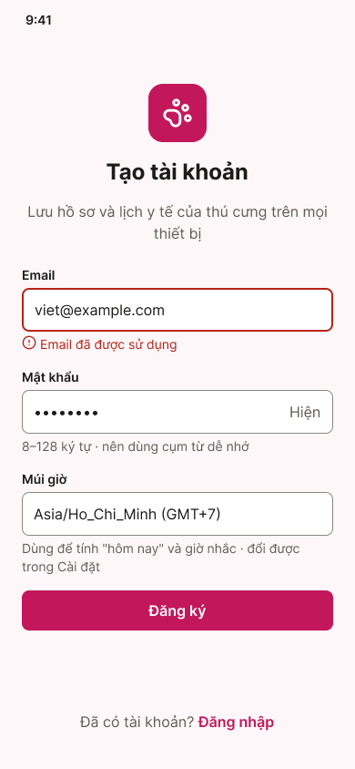

_Figma: SCR-02 · Đăng ký (node 14:1807), trạng thái lỗi "Email đã được sử dụng"._

### US-002 · Xác minh email

**P1** · BR-036 · FR-AUTH-002→004, FR-DSH-007 · Màn hình SCR-05

> Là chủ nuôi, tôi muốn xác minh địa chỉ email, để chắc chắn lấy lại được mật khẩu khi quên.

**Tiêu chí chấp nhận**

- **Given** tài khoản chưa xác minh, **When** mở liên kết xác minh trong 24 giờ, **Then** tài khoản chuyển sang _đã xác minh_ và vào thẳng Dashboard.
- **Given** liên kết đã quá 24 giờ, **When** mở liên kết, **Then** hiển thị "Liên kết đã hết hạn" kèm nút "Gửi lại email xác minh".
- **Given** tài khoản chưa xác minh, **When** đăng nhập, **Then** Dashboard hiển thị banner nhắc xác minh kèm nút gửi lại; mọi chức năng vẫn hoạt động.

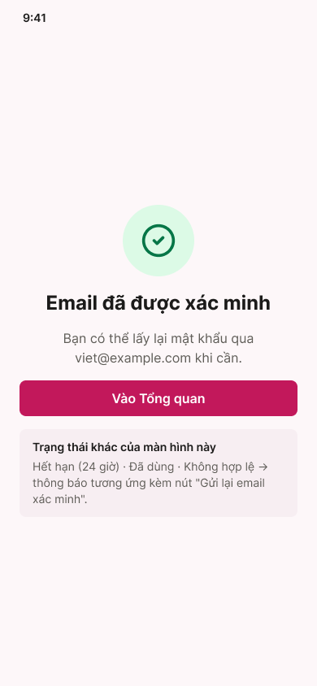

_Figma: SCR-05 · Xác minh email (node 14:1906). Trạng thái hết hạn: SCR-05 · Liên kết xác minh hết hạn (node 23:2902)._

### US-003 · Đăng nhập và đăng xuất

**P0** · BR-025, BR-027 · FR-AUTH-005→007, FR-AUTH-014 · Màn hình SCR-01

> Là chủ nuôi, tôi muốn đăng nhập và đăng xuất trên bất kỳ thiết bị nào, để dùng dữ liệu ở mọi nơi.

**Tiêu chí chấp nhận**

- **Given** tài khoản đã tồn tại, **When** nhập đúng email và mật khẩu, **Then** người dùng vào Dashboard.
- **Given** sai email hoặc mật khẩu, **When** đăng nhập, **Then** hiển thị "Email hoặc mật khẩu không đúng", không tiết lộ email có tồn tại hay không.
- **Given** 5 lần đăng nhập sai liên tiếp trong 15 phút, **When** thử lần thứ 6, **Then** tài khoản bị tạm khóa đăng nhập 15 phút.
- **Given** đã đăng nhập, **When** bấm "Đăng xuất", **Then** phiên kết thúc và mọi trang dữ liệu chuyển về trang đăng nhập.

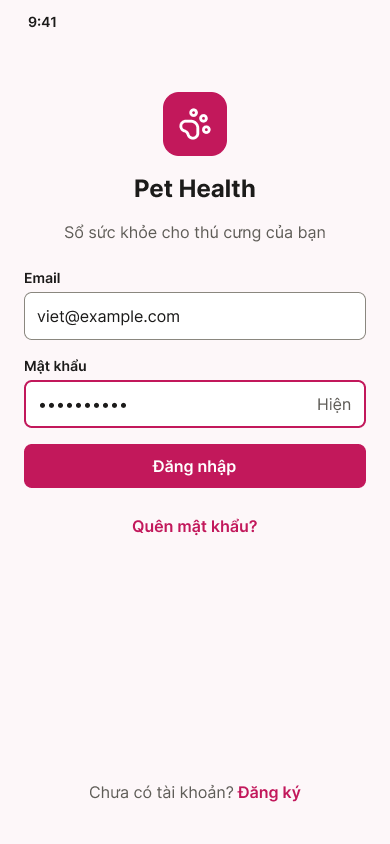

_Figma: SCR-01 · Đăng nhập (node 14:1772)._

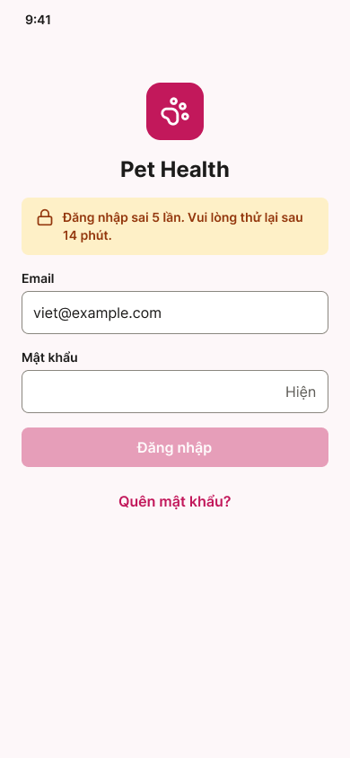

_Figma: SCR-01 · Tạm khóa đăng nhập (node 23:2868). Trạng thái sai mật khẩu: node 23:2828._

### US-004 · Đặt lại mật khẩu

**P1** · BR-037 · FR-AUTH-008, FR-AUTH-009 · Màn hình SCR-03, SCR-04

> Là chủ nuôi, tôi muốn đặt lại mật khẩu qua email khi quên, để không mất quyền truy cập dữ liệu.

**Tiêu chí chấp nhận** (PRD chưa ghi Given/When/Then; theo BRD AC-037 và SRS)

- Nhập email ở màn Quên mật khẩu thì luôn hiển thị màn "đã gửi", không tiết lộ email có tài khoản hay không.
- Liên kết đặt lại dùng một lần, hiệu lực 60 phút, mở màn SCR-04 để nhập mật khẩu mới.
- Đặt lại thành công thì mọi phiên đăng nhập khác bị hủy (FR-AUTH-009).

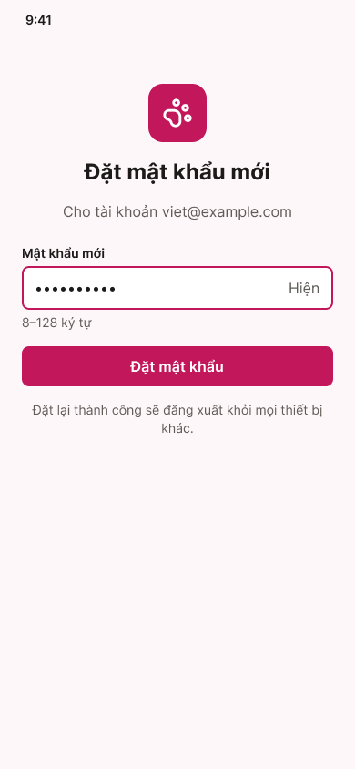

_Figma: SCR-04 · Đặt lại mật khẩu (node 14:1883). Bước trước: SCR-03 · Quên mật khẩu (đã gửi), node 14:1854._

### US-005 · Xóa tài khoản

**P2** · BR-038 · FR-AUTH-016 · Màn hình SCR-18

> Là chủ nuôi, tôi muốn xóa vĩnh viễn tài khoản và toàn bộ dữ liệu của mình, để kiểm soát dữ liệu cá nhân.

**Tiêu chí chấp nhận** (theo SRS FR-AUTH-016)

- Người dùng phải nhập lại mật khẩu trước khi xóa.
- Xóa xong thì toàn bộ thú cưng, số đo, bản ghi, ảnh, mốc và việc của tài khoản bị xóa; phiên kết thúc.

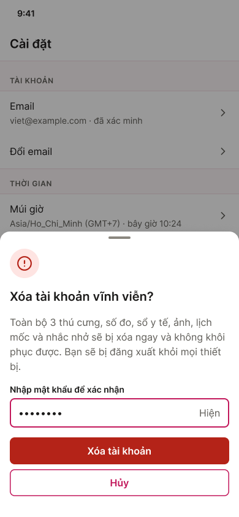

_Figma: SCR-18 · Xóa tài khoản (nhập mật khẩu), node 23:2776._

### US-006 · Phân quyền dữ liệu

**P0** · BR-026 · FR-AUTH-013, FR-AUTH-014, NFR-SEC-004 · Trạng thái 404

> Là chủ nuôi, tôi muốn chắc chắn không ai khác xem hoặc sửa được dữ liệu thú cưng của tôi.

**Tiêu chí chấp nhận**

- **Given** chưa đăng nhập, **When** truy cập trực tiếp URL trang dữ liệu, **Then** bị chuyển về trang đăng nhập, không có dữ liệu nào được trả về.
- **Given** tài khoản A đã đăng nhập, **When** A đọc, sửa hoặc xóa tài nguyên của B bằng ID trực tiếp, **Then** server trả 404 và dữ liệu của B không đổi.

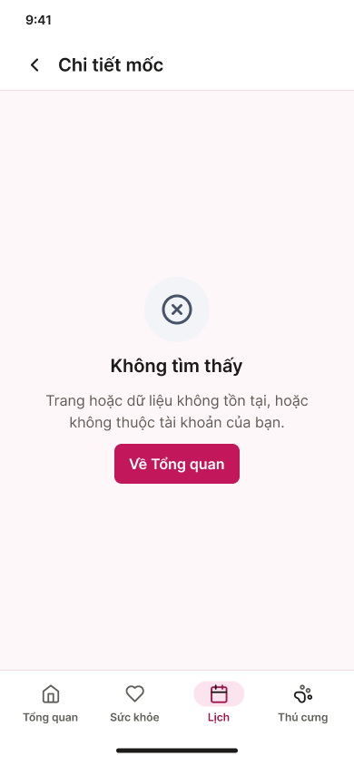

_Figma: Không tìm thấy 404 (ErrorState), node 23:2916 — màn A thấy khi mở ID của B._

### US-007 · Nhất quán đa thiết bị

**P0** · BR-027 · FR-GEN-007, FR-GEN-008 · Màn hình SCR-10

> Là chủ nuôi, tôi muốn dữ liệu vừa lưu trên điện thoại hiện ra khi tôi mở máy tính bảng.

**Tiêu chí chấp nhận**

- **Given** đã đăng nhập trên điện thoại và máy tính bảng, **When** lưu một số đo trên điện thoại, thấy "Đã lưu", rồi tải lại màn cân nặng trên máy tính bảng, **Then** số đo hiển thị trên máy tính bảng.

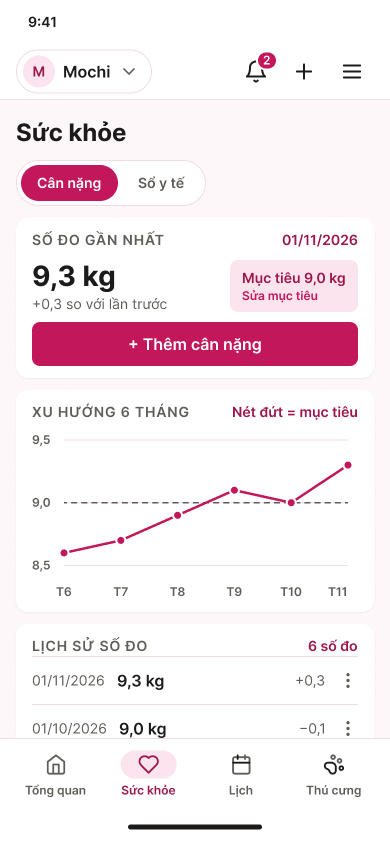

_Figma: SCR-10 · Sức khỏe / Cân nặng (node 10:576) — màn dùng để kiểm tra AC._

### US-008 · Đổi email tài khoản

**P1** · BR-044 · FR-AUTH-015 · Màn hình SCR-18

> Là chủ nuôi, tôi muốn đổi địa chỉ email của tài khoản, để sửa email gõ sai hoặc chuyển sang hộp thư mới mà vẫn lấy lại được mật khẩu.

**Tiêu chí chấp nhận** (theo PRD ghi chú P1, BRD AC-044)

- Mở từ Cài đặt tài khoản; nhập email mới và mật khẩu hiện tại.
- Email mới nhận liên kết xác minh (60 phút, dùng 1 lần) và chỉ có hiệu lực sau khi xác minh.
- Email cũ nhận thư "Email tài khoản vừa được đổi".

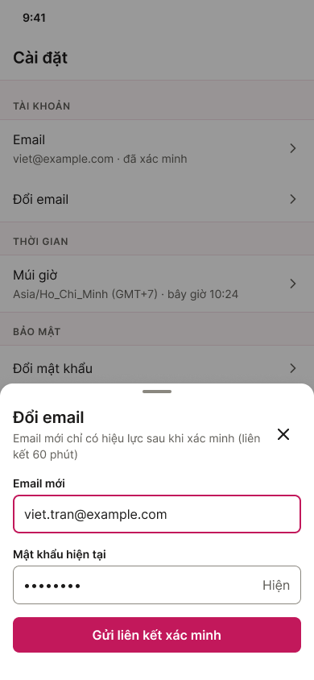

_Figma: SCR-18 · Đổi email (sheet), node 14:2014._

## E2 — Hồ sơ thú cưng

E2 có 6 story (3 P0, 3 P1), dùng các màn hình SCR-07 đến SCR-09 và bộ chọn thú cưng (PetSwitcher).

### US-010 · Tạo hồ sơ thú cưng

**P0** · BR-001 · FR-PET-001 · Màn hình SCR-09

> Là chủ nuôi, tôi muốn tạo hồ sơ thú cưng với tên, giống, giới tính, ngày sinh, để mọi dữ liệu sức khỏe gắn đúng con.

**Tiêu chí chấp nhận**

- **Given** có ít hơn 10 thú cưng, **When** nhập tên, giống, giới tính (Đực/Cái), ngày sinh không ở tương lai rồi bấm "Lưu", **Then** hồ sơ được tạo, xuất hiện trong bộ chọn và trở thành thú cưng đang chọn.
- **Given** thiếu trường bắt buộc, **When** bấm "Lưu", **Then** trường thiếu được đánh dấu đỏ kèm "Trường bắt buộc" và hồ sơ không được tạo.
- **Given** ngày sinh ở tương lai, **When** bấm "Lưu", **Then** hiển thị "Ngày sinh không được ở tương lai".

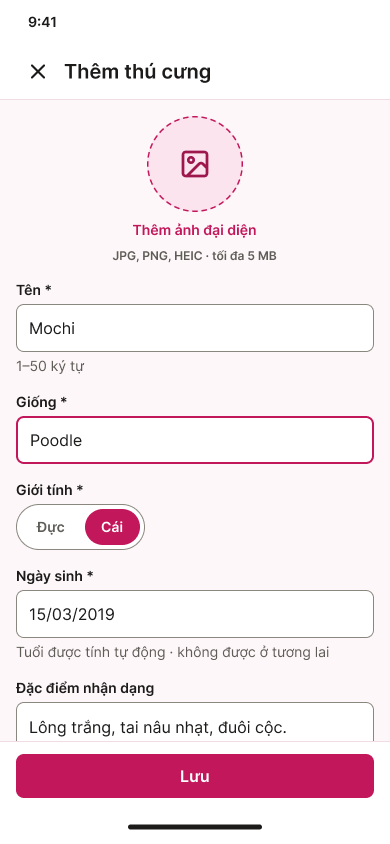

_Figma: SCR-09 · Thêm thú cưng (node 12:1728)._

### US-011 · Tự tính tuổi

**P1** · BR-002 · FR-PET-003 · Màn hình SCR-08

> Là chủ nuôi, tôi muốn thấy tuổi hiện tại của thú cưng được tính tự động, để không phải tự tính.

**Tiêu chí chấp nhận** (theo BRD AC-002, [SRS](../requirements/SRS.md) §2.10.1)

- Tuổi hiển thị dạng "N năm M tháng" tính từ ngày sinh tới hôm nay theo múi giờ tài khoản.
- Đổi ngày sinh thì tuổi được tính lại.

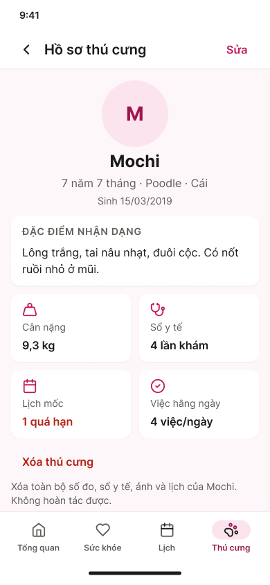

_Figma: SCR-08 · Hồ sơ thú cưng (node 12:1635) — "7 năm 7 tháng · Poodle · Cái"._

### US-012 · Đặc điểm nhận dạng và ảnh đại diện

**P1** · BR-003, BR-004 · FR-PET-004, FR-PET-005 · Màn hình SCR-08, SCR-09

> Là chủ nuôi, tôi muốn ghi đặc điểm nhận dạng và đặt ảnh đại diện, để nhận ra từng con.

**Tiêu chí chấp nhận** (theo BRD AC-003, AC-004, PD-002)

- Đặc điểm nhận dạng là văn bản tự do, hiển thị trong hồ sơ.
- Ảnh đại diện JPG/PNG/HEIC, tối đa 5 MB khi gửi lên server (từ 2026-10-26: ảnh lớn hơn, tới 50 MB, được nén ở trình duyệt trước khi gửi); đặt, thay hoặc gỡ được. Chưa có ảnh thì hiển thị chữ cái đầu của tên.

_Figma: SCR-09 · Thêm thú cưng (node 12:1728) — ô "Thêm ảnh đại diện" và "Đặc điểm nhận dạng". Kết quả hiển thị ở SCR-08 (ảnh trên)._

### US-013 · Sửa hồ sơ thú cưng

**P0** · BR-005 · FR-PET-006 · Màn hình SCR-09 (dạng sửa)

> Là chủ nuôi, tôi muốn sửa thông tin hồ sơ thú cưng, để thông tin luôn đúng.

**Tiêu chí chấp nhận**

- **Given** hồ sơ đã tồn tại, **When** sửa bất kỳ trường nào và lưu, **Then** giá trị mới hiển thị ở mọi nơi sau khi tải lại, và tuổi được tính lại nếu ngày sinh thay đổi.

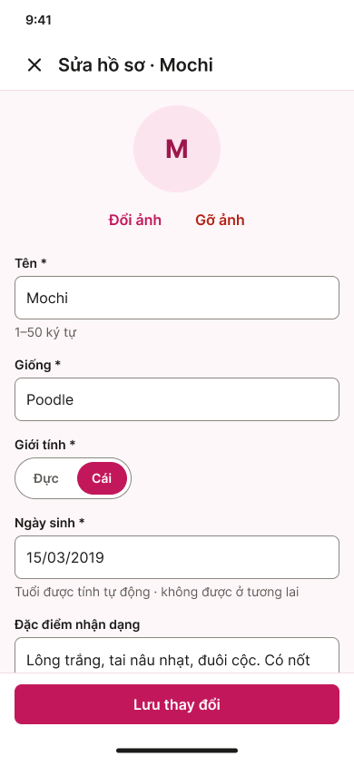

_Figma: SCR-09 · Sửa thú cưng (node 12:1791)._

### US-014 · Xóa hồ sơ thú cưng

**P1** · BR-039 · FR-PET-008 · Màn hình SCR-08

> Là chủ nuôi, tôi muốn xóa hồ sơ thú cưng cùng toàn bộ dữ liệu của nó, để dọn hồ sơ không còn dùng.

**Tiêu chí chấp nhận** (theo PRD ghi chú P1)

- Hộp xác nhận yêu cầu nhập lại đúng tên thú cưng; nút xóa chỉ bật khi tên khớp.
- Xóa xong thì mọi số đo, sổ y tế, ảnh, mốc và việc của thú cưng đó bị xóa; không hoàn tác được.

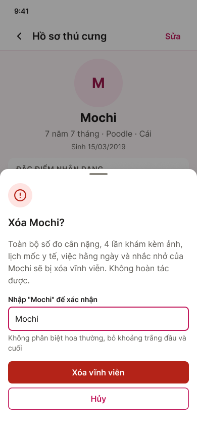

_Figma: SCR-08 · Xóa thú cưng (nhập tên để xác nhận), node 12:1851._

### US-015 · Quản lý tới 10 thú cưng

**P0** · BR-029 · FR-PET-002, FR-PET-007 · Màn hình SCR-07, PetSwitcher

> Là chủ nuôi nhiều thú cưng, tôi muốn quản lý tới 10 thú cưng và chuyển nhanh giữa chúng.

**Tiêu chí chấp nhận**

- **Given** tài khoản có 10 thú cưng, **When** chọn "Thêm thú cưng", **Then** nút bị vô hiệu kèm "Đã đạt tối đa 10 thú cưng"; API cũng từ chối con thứ 11.
- **Given** có ≥ 2 thú cưng, **When** chọn con khác trong bộ chọn, **Then** màn hình chuyển sang dữ liệu con đó trong ≤ 1 thao tác, không lẫn dữ liệu con khác.

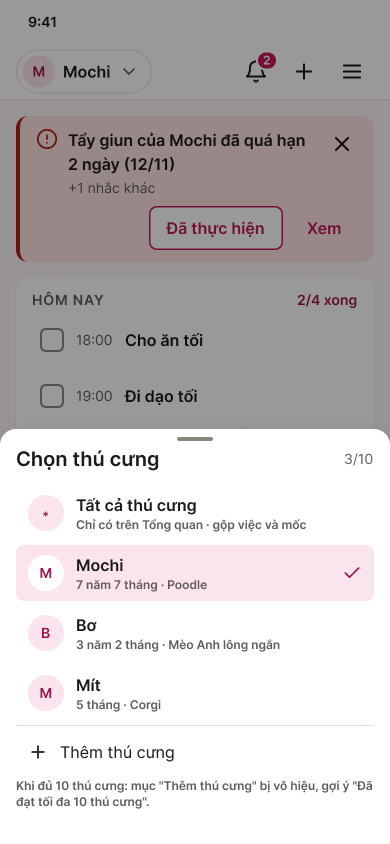

_Figma: PetSwitcher mở (chọn thú cưng), node 21:2115._

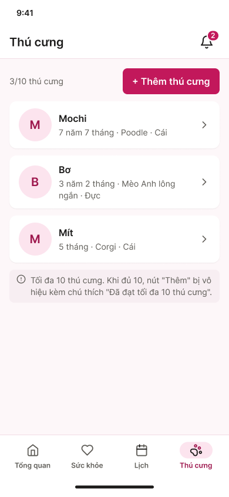

_Figma: SCR-07 · Danh sách thú cưng (node 12:1553)._

## E3 — Theo dõi cân nặng

E3 có 4 story (3 P0, 1 P1), dùng màn hình SCR-10 (tab Cân nặng) và luồng FLW-02.

### US-020 · Ghi số đo cân nặng

**P0** · BR-006 · FR-WGT-001, FR-WGT-002 · Luồng FLW-02

> Là chủ nuôi, tôi muốn ghi số đo cân nặng kèm ngày đo, để có chuỗi dữ liệu theo thời gian.

**Tiêu chí chấp nhận**

- **Given** đang xem một thú cưng, **When** bấm "Thêm cân nặng", nhập 9,2, giữ ngày đo mặc định hôm nay rồi lưu, **Then** số đo xuất hiện trong lịch sử và biểu đồ, tối đa 3 thao tác từ Dashboard.
- **Given** giá trị ≤ 0, > 150 hoặc nhiều hơn 1 chữ số thập phân, **When** lưu, **Then** hiển thị "Cân nặng phải từ 0,1 đến 150 kg, tối đa 1 chữ số thập phân".
- **Given** ngày đo ở tương lai, **When** lưu, **Then** bị từ chối.
- **Given** đã có số đo cùng ngày, **When** lưu số đo mới cho ngày đó, **Then** cả hai được giữ và biểu đồ hiển thị cả hai điểm.

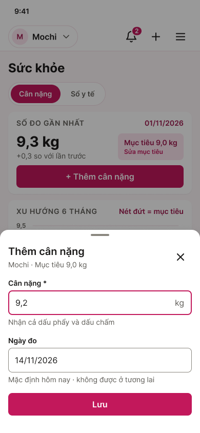

_Figma: FLW-02 · Thêm cân nặng (sheet), node 10:719._

### US-021 · Cân nặng mục tiêu

**P0** · BR-008 · FR-WGT-005 · Màn hình SCR-10

> Là chủ nuôi, tôi muốn đặt cân nặng mục tiêu cho từng thú cưng, để có mốc đối chiếu.

**Tiêu chí chấp nhận**

- **Given** thú cưng chưa có mục tiêu, **When** nhập 9 kg và lưu, **Then** mục tiêu hiển thị trên thẻ cân nặng và trên biểu đồ.
- **Given** đã có mục tiêu, **When** xóa giá trị mục tiêu, **Then** đường mục tiêu biến mất khỏi biểu đồ.

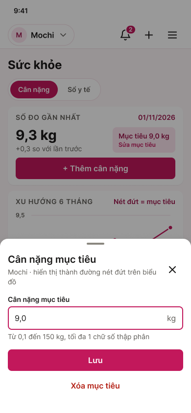

_Figma: Sửa cân nặng mục tiêu (sheet), node 10:817._

### US-022 · Biểu đồ cân nặng so với mục tiêu

**P0** · BR-007, BR-009 · FR-WGT-003, 004, 006→009 · Màn hình SCR-10

> Là chủ nuôi, tôi muốn xem biểu đồ đường cân nặng cùng đường mục tiêu, để biết con đang tăng hay giảm so với mức lý tưởng.

**Tiêu chí chấp nhận**

- **Given** có 6 số đo ở 6 tháng, **When** mở biểu đồ, **Then** hiển thị 6 điểm theo thời gian trên trục X và một đường ngang nét đứt biểu diễn mục tiêu.
- **Given** chạm hoặc rê chuột vào một điểm, **When** tương tác, **Then** tooltip hiển thị ngày đo, giá trị và chênh lệch so với mục tiêu (ví dụ "+0,2 kg").
- **Given** 0 số đo, **When** mở biểu đồ, **Then** hiển thị empty state thay vì biểu đồ trống.
- **Given** đúng 1 số đo, **When** mở biểu đồ, **Then** hiển thị 1 điểm và gợi ý "Thêm số đo tháng sau để thấy xu hướng".

_Figma: SCR-10 · Sức khỏe / Cân nặng (node 10:576)._

### US-023 · Sửa hoặc xóa số đo

**P1** · BR-010 · FR-WGT-010 · Màn hình SCR-10

> Là chủ nuôi, tôi muốn sửa hoặc xóa một số đo nhập sai.

**Tiêu chí chấp nhận** (theo BRD AC-010, SRS FR-GEN-010)

- Chọn một dòng trong lịch sử số đo thì mở lại form cân nặng ở dạng sửa, cùng quy tắc kiểm tra như US-020.
- Xóa phải qua bước xác nhận; biểu đồ cập nhật ngay sau khi lưu hoặc xóa.

_Figma chưa có frame riêng cho sửa số đo. Thao tác bắt đầu từ danh sách lịch sử trên SCR-10 (ảnh US-022) và dùng lại sheet FLW-02 (ảnh US-020)._

## E4 — Sổ y tế điện tử

E4 có 5 story (3 P0, 2 P1), dùng màn hình SCR-11 (tab Sổ y tế), SCR-12 (chi tiết lần khám) và SCR-13 (thêm/sửa lần khám).

### US-030 · Tạo bản ghi khám

**P0** · BR-011 · FR-VIS-001 · Màn hình SCR-13

> Là chủ nuôi, tôi muốn tạo bản ghi khám gồm ngày, triệu chứng, chẩn đoán, đơn thuốc.

**Tiêu chí chấp nhận**

- **Given** đang xem sổ y tế của một thú cưng, **When** nhập ngày khám (mặc định hôm nay) và ít nhất một trong triệu chứng hoặc chẩn đoán rồi lưu, **Then** bản ghi được tạo và nằm đầu danh sách.
- **Given** thiếu ngày khám hoặc thiếu cả triệu chứng lẫn chẩn đoán, **When** lưu, **Then** bị từ chối, lỗi hiển thị tại trường tương ứng.
- **Given** một trường văn bản vượt 2.000 ký tự, **When** nhập, **Then** bộ đếm ký tự chuyển đỏ và nút lưu bị vô hiệu.

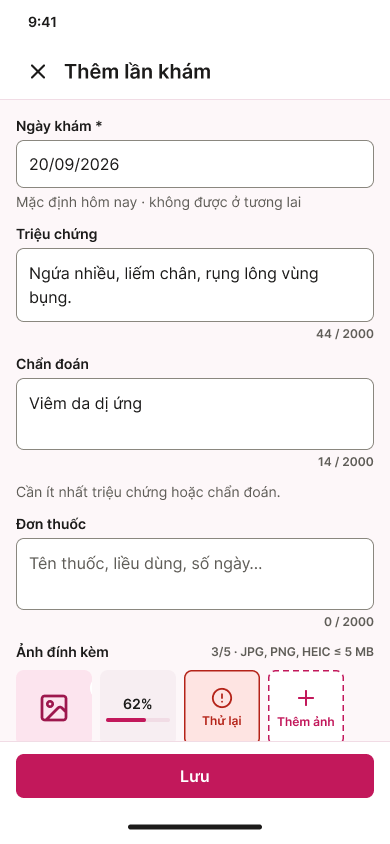

_Figma: SCR-13 · Thêm lần khám (node 10:1206)._

### US-031 · Danh sách lịch sử khám

**P0** · BR-012 · FR-VIS-002 · Màn hình SCR-11

> Là chủ nuôi, tôi muốn xem danh sách lịch sử khám, mới nhất trước, để trả lời bác sĩ nhanh.

**Tiêu chí chấp nhận**

- **Given** có bản ghi ngày 2026-01-10, 2026-05-02 và 2026-09-20, **When** mở sổ y tế, **Then** thứ tự là 09-20, 05-02, 01-10; mỗi dòng có ngày, chẩn đoán (rút gọn 1 dòng) và số ảnh đính kèm.
- **Given** có > 20 bản ghi, **When** cuộn tới cuối, **Then** 20 bản ghi tiếp theo được tải thêm.

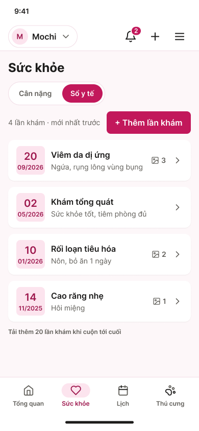

_Figma: SCR-11 · Sức khỏe / Sổ y tế (node 10:911)._

### US-032 · Sửa hoặc xóa bản ghi khám

**P0** · BR-013, BR-014 · FR-VIS-003, FR-VIS-004 · Màn hình SCR-12, SCR-13

> Là chủ nuôi, tôi muốn sửa hoặc xóa một bản ghi khám.

**Tiêu chí chấp nhận**

- **Given** bản ghi tồn tại, **When** sửa chẩn đoán và lưu, **Then** nội dung mới hiển thị sau khi tải lại.
- **Given** bản ghi tồn tại, **When** bấm "Xóa", **Then** hộp xác nhận hiện ra; "Hủy" giữ nguyên, "Xóa" xóa bản ghi cùng toàn bộ ảnh đính kèm.

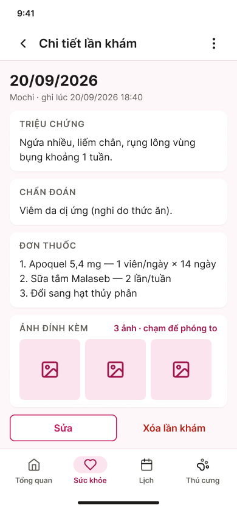

_Figma: SCR-12 · Chi tiết lần khám (node 10:1056) — nơi bắt đầu Sửa/Xóa._

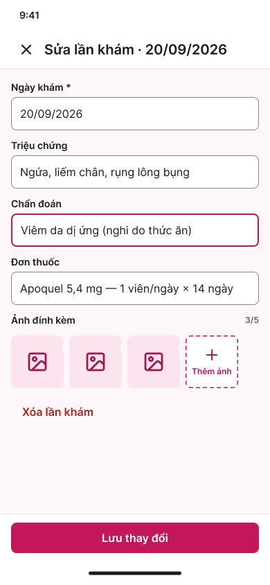

_Figma: SCR-13 · Sửa lần khám (node 23:3061)._

### US-033 · Đính kèm ảnh đơn thuốc và xét nghiệm

**P1** · BR-030 · FR-VIS-005, 006, 008 · Màn hình SCR-13, SCR-12 (lightbox)

> Là chủ nuôi, tôi muốn chụp hoặc tải ảnh đơn thuốc và kết quả xét nghiệm vào bản ghi khám.

**Tiêu chí chấp nhận** (theo PRD ghi chú P1, BRD AC-030)

- Tối đa 5 ảnh, mỗi ảnh ≤ 5 MB khi gửi lên server (từ 2026-10-26: ảnh lớn hơn, tới 50 MB, được nén ở trình duyệt trước khi gửi), định dạng JPG/PNG/HEIC.
- Trên điện thoại, nút "Thêm ảnh" mở cả camera và thư viện ảnh.
- Mỗi ảnh tải lên độc lập; ảnh lỗi có nút "Thử lại" và không chặn các ảnh khác.
- Ảnh HEIC được chuyển sang JPG khi lưu; xem ảnh lớn trong lightbox.

_Figma: SCR-13 · Thêm lần khám (node 10:1206) — vùng "Ảnh đính kèm 3/5" với các trạng thái đã tải, đang tải 62%, lỗi "Thử lại"._

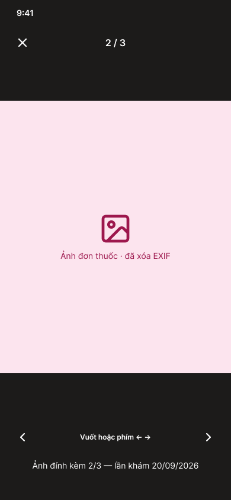

_Figma: SCR-12 · Lightbox ảnh (node 10:1173)._

### US-034 · Xóa ảnh đính kèm

**P1** · BR-031 · FR-VIS-007 · Màn hình SCR-13 (dạng sửa)

> Là chủ nuôi, tôi muốn xóa một ảnh đính kèm nhầm.

**Tiêu chí chấp nhận** (theo BRD AC-031)

- Mỗi ảnh có nút xóa riêng; xóa phải qua bước xác nhận.
- Xóa xong thì ảnh biến mất khỏi bản ghi và số ảnh trên danh sách giảm tương ứng.

_Figma: SCR-13 · Sửa lần khám (node 23:3061) — nơi gỡ từng ảnh đính kèm._

## E5 — Mốc y tế và nhắc nhở

E5 có 9 story (6 P0, 3 P1) và là giá trị cốt lõi của sản phẩm. Màn hình: SCR-14 (Lịch mốc), SCR-15 (Chi tiết mốc), SCR-17 (Thông báo), banner trên SCR-06 và luồng FLW-04.

### US-040 · Tạo mốc y tế

**P0** · BR-015 · FR-MS-001, FR-MS-002 · Sheet Tạo mốc

> Là chủ nuôi, tôi muốn tạo mốc y tế (Tiêm vaccine, Nhỏ gáy, Tẩy giun) với ngày đến hạn.

**Tiêu chí chấp nhận**

- **Given** đang xem một thú cưng, **When** chọn "Tiêm vaccine", nhập hạn 2026-11-15, ghi chú "Dại" rồi lưu, **Then** mốc ở trạng thái _Sắp tới_ trong danh sách mốc của thú cưng đó.
- **Given** ngày đến hạn đã qua, **When** lưu, **Then** mốc vẫn được tạo với trạng thái _Quá hạn_ và không tạo nhắc nào.

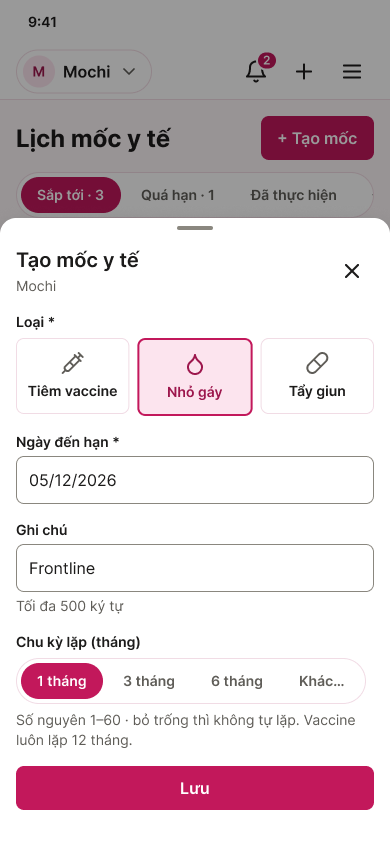

_Figma: Tạo mốc y tế (sheet), node 11:1299._

### US-041 · Nhắc trong app trước 7 ngày và 1 ngày

**P0** · BR-016, BR-017 · FR-NTF-001, 003→005, 007 · Banner trên SCR-06, SCR-17

> Là chủ nuôi, tôi muốn thấy nhắc nhở trong app trước 7 ngày và trước 1 ngày, để kịp sắp xếp đi tiêm hoặc mua thuốc.

**Tiêu chí chấp nhận** (ví dụ: mốc hạn 15/11/2026, múi giờ Asia/Ho\_Chi\_Minh)

- **When** mở app bất kỳ lúc nào ngày 08/11, **Then** có đúng 1 nhắc "Mochi · Tiêm vaccine (Dại) · đến hạn 15/11/2026 · còn 7 ngày" trên banner và trong mục Thông báo; chạm vào thì mở thẳng mốc.
- **Given** không mở app từ 08/11 tới 10/11, **When** mở ngày 11/11, **Then** nhắc D7 vẫn hiển thị với "còn 4 ngày".
- **When** mở app ngày 14/11, **Then** có đúng 1 nhắc "ngày mai"; nhắc D7 chưa xem tự chuyển sang đã xem (mỗi mốc tối đa 1 nhắc chưa xem).
- **Given** mốc tạo ngày 11/11 với hạn 15/11, **Then** không nhắc bù D7; nhắc D1 xuất hiện ngày 14/11.
- **Given** đổi hạn từ 15/11 sang 20/11 vào ngày 05/11, **Then** nhắc xuất hiện ngày 13/11 và 19/11.
- **Given** mở app trên 2 thiết bị và tải lại nhiều lần ngày 08/11, **Then** vẫn chỉ có đúng 1 nhắc D7.

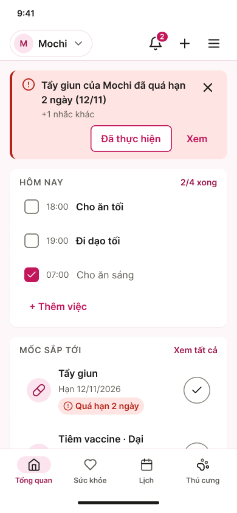

_Figma: SCR-06 · Dashboard (node 8:3) — banner nhắc ở đầu nội dung._

### US-042 · Đánh dấu mốc đã thực hiện

**P0** · BR-018, BR-019 · FR-MS-003→005, FR-NTF-006 · Luồng FLW-04

> Là chủ nuôi, tôi muốn đánh dấu một mốc đã thực hiện, để hệ thống ngừng nhắc mốc đó.

**Tiêu chí chấp nhận**

- **Given** mốc _Sắp tới_ hạn 15/11/2026, **When** bấm "Đã thực hiện" và chọn ngày 10/11 (mặc định hôm nay, không được ở tương lai), **Then** mốc chuyển sang _Đã thực hiện_, nhắc D7 chuyển sang "đã xử lý" và không có nhắc D1 vào 14/11.
- **Given** mốc vừa đánh dấu, **When** chọn "Hoàn tác" trong 10 giây, **Then** mốc và nhắc quay về trạng thái cũ, mốc kế tiếp tự tạo (nếu có) bị xóa.

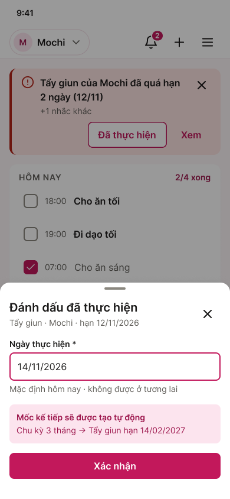

_Figma: FLW-04 · Đánh dấu mốc đã thực hiện (sheet), node 8:506._

### US-043 · Tự tạo mốc vaccine năm sau

**P0** · BR-032 · FR-MS-008, FR-MS-011 · Màn hình SCR-15

> Là chủ nuôi, tôi muốn hệ thống tự tạo mốc vaccine năm sau khi tôi đánh dấu đã tiêm, để không phải nhập lại.

**Tiêu chí chấp nhận**

- **Given** mốc "Tiêm vaccine" hạn 15/11/2026, **When** đánh dấu thực hiện ngày 14/11/2026, **Then** tạo đúng 1 mốc mới hạn **14/11/2027**, giữ ghi chú cũ, kèm thông báo "Đã tạo lịch tiêm tiếp theo: 14/11/2027".
- **Given** ngày thực hiện 29/02/2028, **When** tính mốc kế tiếp, **Then** hạn là 28/02/2029.

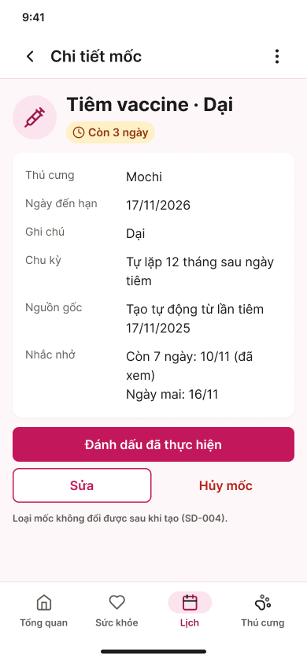

_Figma: SCR-15 · Chi tiết mốc (node 11:1195)._

### US-044 · Chu kỳ lặp cho Nhỏ gáy và Tẩy giun

**P1** · BR-033, BR-034 · FR-MS-001, FR-MS-009, FR-MS-011 · Sheet Tạo mốc

> Là chủ nuôi, tôi muốn đặt chu kỳ lặp (theo tháng) cho Nhỏ gáy và Tẩy giun, để mốc tiếp theo được tạo tự động.

**Tiêu chí chấp nhận** (theo PRD ghi chú P1, BRD AC-033, AC-034)

- Chu kỳ là số nguyên tháng, nhập bằng ô số kèm lựa chọn nhanh 1/3/6 tháng.
- Mốc có chu kỳ N chuyển sang _Đã thực hiện_ thì tạo đúng 1 mốc mới hạn = ngày thực hiện + N tháng.

_Figma: Tạo mốc y tế (sheet), node 11:1299 — trường chu kỳ lặp._

### US-046 · Sửa ngày hoặc hủy mốc

**P0** · BR-020 · FR-MS-006, FR-MS-007, FR-NTF-006 · Màn hình SCR-15

> Là chủ nuôi, tôi muốn sửa ngày hoặc hủy một mốc chưa thực hiện.

**Tiêu chí chấp nhận**

- **Given** mốc _Sắp tới_, **When** sửa ngày hạn và lưu, **Then** nhắc hiện có chuyển sang "đã xử lý" và nhắc mới được tính theo ngày hạn mới.
- **Given** mốc _Sắp tới_, **When** chọn "Hủy mốc" và xác nhận, **Then** mốc chuyển sang _Đã hủy_, không còn nhắc mới và không hiển thị trong danh sách sắp tới.

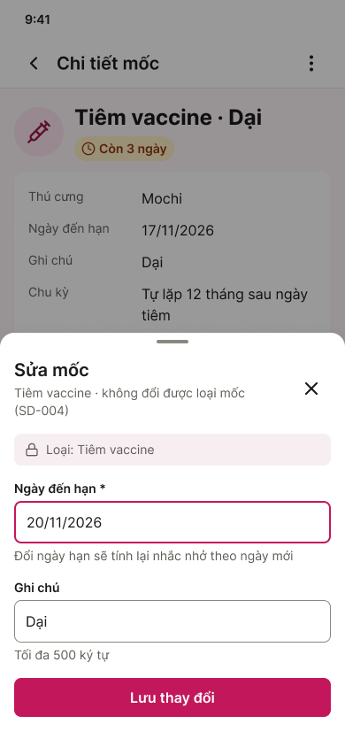

_Figma: SCR-15 · Sửa mốc (sheet), node 23:2983._

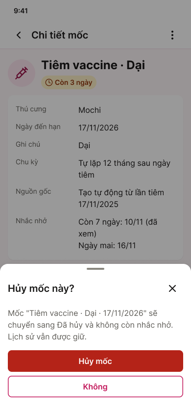

_Figma: Hủy mốc · xác nhận (sheet), node 11:1429._

### US-047 · Mốc sắp tới và quá hạn trên Dashboard

**P1** · BR-015, BO-001 · FR-DSH-003, FR-MS-012 · Màn hình SCR-06, SCR-14

> Là chủ nuôi, tôi muốn thấy các mốc sắp tới và mốc quá hạn của mọi thú cưng trên Dashboard.

**Tiêu chí chấp nhận** (theo PRD ghi chú P1)

- Dashboard hiển thị tối đa 5 mốc gần nhất trong 30 ngày tới.
- Mốc quá hạn được tô đỏ, luôn xếp đầu và luôn kèm nhãn chữ.
- Danh sách đầy đủ nằm ở màn Lịch mốc (SCR-14).

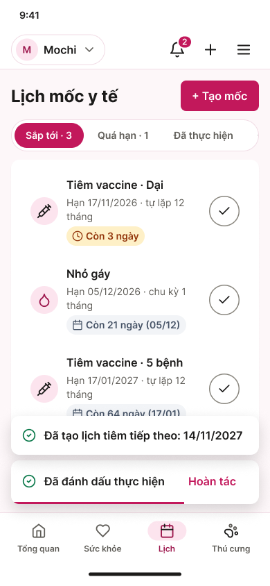

_Figma: SCR-14 · Lịch mốc y tế (node 11:999). Panel mốc trên Dashboard ở ảnh US-061._

### US-048 · Nhắc khi mốc đã quá hạn

**P1** · BR-041 · FR-NTF-002 · Màn hình SCR-17, banner SCR-06

> Là chủ nuôi, tôi muốn được nhắc lại khi một mốc đã quá hạn mà tôi chưa thực hiện, để không bỏ lỡ hẳn.

**Tiêu chí chấp nhận** (theo PRD ghi chú P1, BRD AC-041)

- Nhắc quá hạn xuất hiện từ ngày (hạn + 1) nếu mốc vẫn chưa thực hiện, nhãn "quá hạn N ngày".
- Trên banner, nhắc quá hạn được ưu tiên cao nhất và hiển thị màu đỏ kèm nhãn chữ.

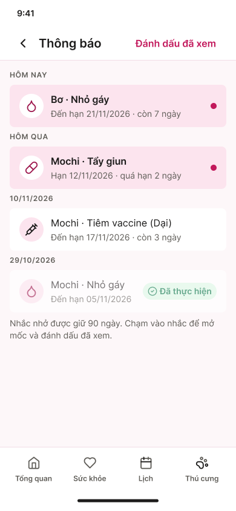

_Figma: SCR-17 · Thông báo (node 8:364) — có nhắc quá hạn._

### US-049 · Mục Thông báo

**P0** · BR-042 · FR-NTF-008, 010, 011 · Màn hình SCR-17

> Là chủ nuôi, tôi muốn có mục Thông báo liệt kê mọi nhắc nhở, biết nhắc nào chưa xem, để xem lại những gì đã bỏ qua.

**Tiêu chí chấp nhận**

- **Given** đã đăng nhập, **When** ở bất kỳ màn hình nào, **Then** thanh trên có chuông kèm số nhắc chưa xem (ẩn khi bằng 0, "9+" khi lớn hơn 9).
- **Given** có 3 nhắc, 2 chưa xem, **When** mở Thông báo, **Then** hiển thị cả 3, mới nhất trước, nhắc chưa xem tô đậm kèm chấm màu; mỗi nhắc có tên thú cưng, loại mốc, ghi chú, ngày hạn và nhãn "còn N ngày" / "ngày mai" / "hôm nay" / "quá hạn N ngày".
- **Given** nhắc chưa xem, **When** chạm vào, **Then** nhắc chuyển sang đã xem, số trên chuông giảm 1 và mở thẳng mốc; trạng thái đã xem giữ trên mọi thiết bị.
- **When** bấm "Đánh dấu tất cả đã xem", **Then** số trên chuông về 0.
- **Given** mốc đã thực hiện, hủy hoặc đổi hạn, **Then** nhắc cũ hiển thị mờ kèm nhãn "Đã thực hiện" / "Đã hủy" / "Đã đổi lịch" và không tính là chưa xem.

_Figma: SCR-17 · Thông báo (node 8:364)._

## E6 — Việc chăm sóc hằng ngày

E6 có 5 story, toàn bộ P1 nhưng vẫn có trong bản ra mắt vì đây là lý do người dùng mở app mỗi ngày (BRD DEC-014). Màn hình: SCR-16 và panel Việc hôm nay trên SCR-06.

### US-050 · Tạo việc hằng ngày

**P1** · BR-021 · FR-RT-001 · Sheet Thêm việc

> Là chủ nuôi, tôi muốn tạo việc lặp lại hằng ngày (tên và giờ) cho từng thú cưng.

**Tiêu chí chấp nhận** (theo BRD AC-021)

- Việc gồm tên (1–100 ký tự) và giờ (HH:MM, 24 giờ), gắn với một thú cưng; tối đa 20 việc mỗi thú cưng.
- Lưu xong thì việc xuất hiện ngay trong checklist hôm nay, sắp theo giờ.

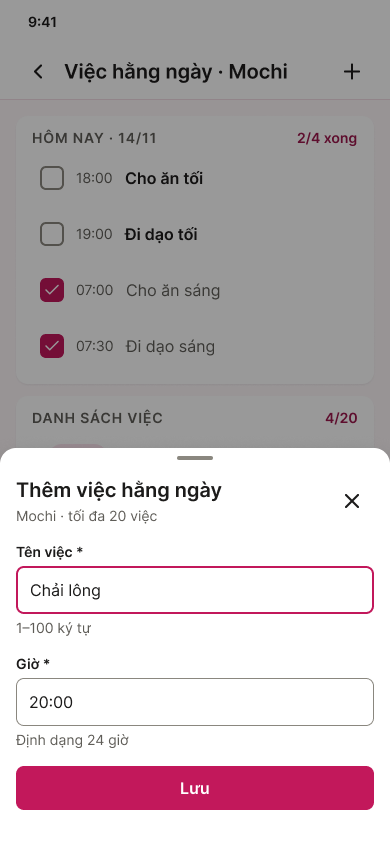

_Figma: Thêm việc hằng ngày (sheet), node 11:1615._

### US-051 · Checklist hôm nay khi mở app

**P1** · BR-022 · FR-RT-002, FR-DSH-001, FR-DSH-002 · Màn hình SCR-06

> Là chủ nuôi, tôi muốn thấy checklist hôm nay ngay khi mở app.

**Tiêu chí chấp nhận** (theo BRD AC-022)

- Màn hình đầu tiên sau đăng nhập là Dashboard, panel Việc hôm nay đứng đầu trên phone.
- Checklist sắp theo giờ tăng dần; việc đã xong chuyển xuống cuối và có gạch ngang.

_Figma: SCR-06 · Dashboard (node 8:3) — panel Việc hôm nay._

### US-052 · Chạm để đánh dấu xong

**P1** · BR-023 · FR-RT-003 · Màn hình SCR-16, SCR-06

> Là chủ nuôi, tôi muốn chạm một lần để đánh dấu một việc đã xong, và chạm lại để bỏ đánh dấu.

**Tiêu chí chấp nhận**

- **Given** việc "Cho ăn 07:00" chưa xong, **When** chạm vào việc, **Then** việc chuyển sang _xong_ ngay trên giao diện (optimistic update) và trạng thái được lưu.
- **Given** lưu thất bại, **Then** việc quay về _chưa xong_ kèm toast lỗi.

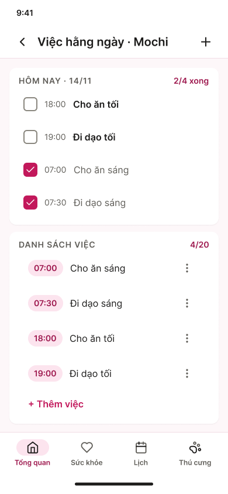

_Figma: SCR-16 · Việc hằng ngày (node 11:1490)._

### US-053 · Tự đặt lại lúc 00:00

**P1** · BR-024 · FR-RT-004, FR-RT-005 · Màn hình SCR-16

> Là chủ nuôi, tôi muốn checklist tự đặt lại lúc 00:00 mỗi ngày theo múi giờ của tôi.

**Tiêu chí chấp nhận**

- **Given** việc được đánh dấu xong lúc 23:50 ngày D, **When** tới 00:01 ngày D+1 (theo múi giờ tài khoản), **Then** việc hiển thị _chưa xong_.
- Lịch sử hoàn thành của ngày D vẫn được giữ để tính MET-003.

_Dùng chung màn SCR-16 · Việc hằng ngày (ảnh US-052). Việc đặt lại xảy ra ở server, không có frame riêng._

### US-045 · Sửa hoặc xóa việc hằng ngày

**P1** · BR-040 · FR-RT-006, FR-RT-007 · Sheet Sửa việc

> Là chủ nuôi, tôi muốn sửa hoặc xóa một việc hằng ngày.

**Tiêu chí chấp nhận** (theo SRS FR-RT-006, FR-RT-007)

- Sửa được tên và giờ của việc.
- Xóa phải qua bước xác nhận; việc biến mất khỏi checklist từ thời điểm xóa, lịch sử các ngày trước được giữ.

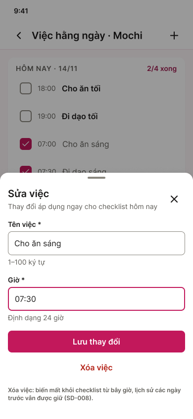

_Figma: SCR-16 · Sửa việc (sheet), node 23:3144._

## E7 — Dashboard

E7 có 3 story (2 P0, 1 P1), tập trung vào màn hình SCR-06.

### US-060 · Màn hình tổng quan

**P0** · BR-022, BR-028 · FR-DSH-001, 002, 004, 006 · Màn hình SCR-06

> Là chủ nuôi, tôi muốn một màn hình tổng quan cho thấy việc hôm nay, mốc sắp tới và xu hướng cân nặng của thú cưng đang chọn.

**Tiêu chí chấp nhận**

- **Given** đăng nhập trên máy tính bảng 10,5" xoay ngang, **When** Dashboard tải xong, **Then** bố cục 2 cột và không có thanh cuộn ngang.
- **Given** đăng nhập trên điện thoại rộng 360–430 px, **When** Dashboard tải xong, **Then** bố cục 1 cột theo thứ tự Việc hôm nay → Mốc sắp tới → Cân nặng.
- **Given** tài khoản mới chưa có thú cưng, **When** mở Dashboard, **Then** hiển thị empty state "Thêm thú cưng đầu tiên" thay cho các panel.

_Figma: SCR-06 · Dashboard (node 8:3). Bản dark mode: node 8:241; bản đang tải (skeleton): node 21:2473._

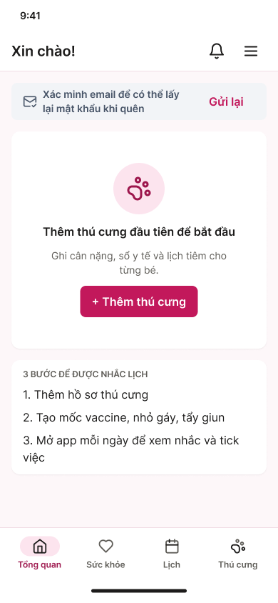

_Figma: SCR-06 · Dashboard trống (người dùng mới), node 8:281._

### US-061 · Lọc Dashboard theo thú cưng

**P1** · BR-029 · FR-DSH-005 · Màn hình SCR-06

> Là chủ nuôi nhiều thú cưng, tôi muốn lọc Dashboard theo "Tất cả" hoặc từng thú cưng.

**Tiêu chí chấp nhận** (theo SRS FR-DSH-005)

- Bộ lọc có "Tất cả" và từng thú cưng; "Tất cả" gộp việc và mốc của mọi con, mỗi dòng ghi tên thú cưng.
- Banner nhắc và các panel chỉ tính dữ liệu trong phạm vi bộ lọc đang chọn.

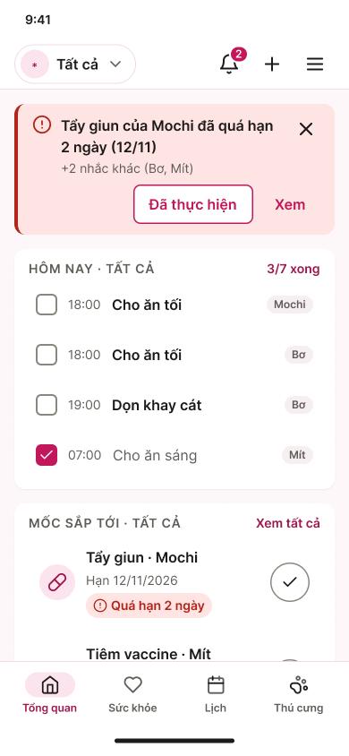

_Figma: SCR-06 · Dashboard · lọc "Tất cả" (node 21:2207)._

### US-062 · Banner nhắc chưa xem

**P0** · BR-043 · FR-NTF-009, FR-NTF-010, FR-DSH-002 · Màn hình SCR-06

> Là chủ nuôi, tôi muốn thấy ngay nhắc nhở chưa xem dưới dạng banner khi mở app, để không phải tự đi tìm.

**Tiêu chí chấp nhận**

- **Given** có ≥ 1 nhắc chưa xem, **When** Dashboard tải xong, **Then** banner ở đầu nội dung (dưới thanh chọn thú cưng) hiển thị nhắc khẩn cấp nhất (Quá hạn > D1 > D7; cùng mức thì hạn sớm hơn trước) và dòng "+N nhắc khác". Đỏ cho Quá hạn, cam cho D1/D7, luôn kèm nhãn chữ.
- **When** bấm "Xem", **Then** mở mục Thông báo. **When** bấm ✕, **Then** các nhắc trên banner chuyển sang đã xem và banner ẩn; chúng vẫn nằm trong Thông báo.
- **When** bấm "Đã thực hiện" trên banner, **Then** mở bottom sheet đánh dấu mốc như US-042.
- **Given** không có nhắc chưa xem, **Then** không hiển thị banner và không để lại khoảng trống.

_Dùng chung ảnh SCR-06 · Dashboard (node 8:3) ở US-060 — banner nằm ở đầu nội dung. Sheet mở từ nút "Đã thực hiện": ảnh FLW-04 ở US-042._

## E8 — Bản tin ảnh thú cưng (Giai đoạn 2)

E8 có 10 story (US-070→079) cho tính năng xã hội ở Giai đoạn 2: đăng ảnh thú cưng, theo dõi nhau, thả tim, bình luận, thông báo hoạt động và chặn. Bản tin chưa có PRD/SRS riêng; quy tắc nghiệp vụ lấy từ task [F-02→F-13](../implement/tasks-feed/README.md) và đã code xong trên máy dev (2026-10-26). Các màn của E8 **chưa có frame Figma** (thiết kế theo code); mã màn hình SCR-19→SCR-25 theo [UI/UX Blueprint](UI_UX_Blueprint.md) §3.9.

**Quyết định áp dụng cho cả epic:**

- Bài công khai với mọi tài khoản đã đăng nhập; không có trang cho khách (D1).
- Không có báo cáo nội dung; người dùng tự bảo vệ bằng chặn và giới hạn chống spam (D2).
- Dữ liệu sức khỏe không bao giờ hiện trên bản tin: bài chỉ hiện tên thú cưng được gắn (D4, D5).

**Ưu tiên:** ghi **GĐ2** (thuộc Giai đoạn 2, không tính vào 40 story của Giai đoạn 1).

### US-070 · Hồ sơ công khai

**GĐ2** · F-02 · Màn hình SCR-19, SCR-22

> Là chủ nuôi, tôi muốn có một hồ sơ công khai với username, tên hiển thị, giới thiệu và ảnh đại diện, để người khác tìm và theo dõi tôi mà không thấy email hay dữ liệu sức khỏe của thú cưng.

**Tiêu chí chấp nhận**

- **Given** tài khoản chưa có hồ sơ, **When** mở Bản tin, **Then** hiển thị màn "Tạo hồ sơ công khai"; tên hiển thị điền sẵn bằng nickname.
- **Given** đang nhập username, **When** ngừng gõ 400 ms, **Then** hiển thị "Username dùng được" hoặc "Username đã có người dùng". Username hợp lệ: 3–30 ký tự `a–z 0–9 . _`, không bắt đầu/kết thúc bằng `.`, không có `..`, không thuộc danh sách tên cấm.
- **Given** username đã có người dùng (không phân biệt hoa thường), **When** lưu, **Then** trả `409 USERNAME_TAKEN` và báo lỗi dưới trường.
- **Given** đã đổi username trong 14 ngày qua, **When** đổi lần nữa, **Then** trả `429` kèm số ngày còn lại. Lần đổi đầu tiên luôn được.
- **Given** người khác mở `/u/{username}`, **Then** phản hồi chỉ có tên, username, giới thiệu, ảnh, số bài / người theo dõi / đang theo dõi; không có email, ngày sinh hay dữ liệu sức khỏe.
- **Given** xóa tài khoản, **Then** hồ sơ và ảnh đại diện bị xóa; `/u/{username}` trả 404.

### US-071 · Đăng bài nhiều ảnh, gắn thú cưng tùy chọn

**GĐ2** · F-04, F-05 · Màn hình SCR-20

> Là chủ nuôi, tôi muốn đăng 1–5 ảnh kèm chú thích và tùy chọn gắn thú cưng của mình, để chia sẻ khoảnh khắc với bạn bè.

**Tiêu chí chấp nhận**

- **Given** đã có hồ sơ, **When** mở "Đăng bài", **Then** chọn ảnh, viết chú thích (≤ 2.200 ký tự) và gắn bé nằm trên **cùng một màn**; nút "Đăng" ở thanh trên.
- **Given** chọn 6 ảnh, **Then** chỉ nhận 5 và báo "Tối đa 5 ảnh". Ảnh lớn hơn 5 MB (tới 50 MB) được nén ở trình duyệt trước khi gửi.
- **Given** không gắn bé nào, **When** đăng, **Then** bài đăng thành công, không có chip thú cưng. **Given** gắn bé không phải của mình (gọi API trực tiếp), **Then** `422 PET_NOT_OWNED`.
- **When** bấm "Đăng", **Then** mỗi ảnh hiện % tải lên rồi "Đang xử lý". Ảnh cuối xử lý xong thì bài được đăng, app về hồ sơ và bài đứng đầu lưới.
- **Given** một ảnh lỗi, **Then** ảnh đó đánh dấu đỏ, có "Thử lại" hoặc "Bỏ ảnh lỗi rồi đăng".
- **Given** đã đăng 30 bài trong ngày (tài khoản < 24 giờ: 10 bài), **When** đăng thêm, **Then** `429` và thông báo "Bạn thao tác quá nhanh, thử lại sau N phút".
- Ảnh đăng lên bị bỏ toàn bộ EXIF, kể cả vị trí GPS.

### US-072 · Hồ sơ dạng lưới và chi tiết bài

**GĐ2** · F-06 · Màn hình SCR-22, SCR-23

> Là chủ nuôi, tôi muốn xem mọi bài của một người dưới dạng lưới ảnh và mở từng bài để vuốt qua các ảnh.

**Tiêu chí chấp nhận**

- **Given** mở `/u/{username}`, **Then** lưới 3 cột ô vuông, 18 bài/trang, cuộn tới cuối tự tải tiếp; bài nhiều ảnh có icon ở góc. Một hồ sơ chứa mọi bài, không chia theo thú cưng.
- **Given** mở `/p/{id}` của bài nhiều ảnh, **When** vuốt hoặc bấm phím ←/→, **Then** chuyển ảnh, chấm vị trí đổi theo và trình đọc màn hình đọc "Ảnh 2/5".
- Chi tiết bài có tên người đăng, thời gian tương đối ("3 giờ trước"), chip tên bé (chỉ khi có gắn), chú thích có `@username` thành link.
- **Given** bài đã bị xóa hoặc hai người đã chặn nhau, **When** mở link bài, **Then** hiển thị "Bài này không còn".

### US-073 · Sửa và xóa bài

**GĐ2** · F-04, F-06 · Màn hình SCR-23

> Là người đăng bài, tôi muốn sửa chú thích, bé được gắn hoặc xóa bài của mình.

**Tiêu chí chấp nhận**

- **Given** bài của mình, **When** mở menu "⋯" → "Sửa bài", **Then** sửa được chú thích và gắn / bỏ gắn bé; không đổi được ảnh.
- **When** chọn "Xóa bài" và xác nhận, **Then** bài, ảnh, tim, bình luận và thông báo liên quan bị xóa; app về hồ sơ với toast "Đã xóa bài"; URL ảnh cũ trả 404 sau khi job dọn ảnh chạy.
- **Given** bài của người khác, **Then** không có mục Sửa / Xóa; gọi API sửa hoặc xóa trả 404, dữ liệu không đổi.

### US-074 · Theo dõi và tìm người

**GĐ2** · F-07 · Màn hình SCR-21, SCR-22, SCR-24

> Là chủ nuôi, tôi muốn tìm bạn bè theo username hoặc tên và theo dõi họ ngay, không cần chờ duyệt.

**Tiêu chí chấp nhận**

- **Given** gõ trong ô tìm, **When** ngừng gõ 300 ms, **Then** hiện tối đa 20 người khớp tiền tố username hoặc một phần tên hiển thị, **không phân biệt dấu** ("meo ho" ra "Mèo Hồ"); username khớp chính xác lên đầu. Email không bao giờ tìm được.
- **When** bấm "Theo dõi", **Then** nút đổi sang "Đang theo dõi" và số người theo dõi +1 ngay; lỗi thì trả lại và báo toast.
- **When** bấm "Đang theo dõi", **Then** hỏi "Bỏ theo dõi @x?" trước khi bỏ.
- Bấm theo dõi nhiều lần (kể cả song song) chỉ tạo một lượt theo dõi; tự theo dõi chính mình bị từ chối.
- **When** chạm số "người theo dõi" / "đang theo dõi" trên hồ sơ, **Then** mở danh sách tương ứng, có nút Theo dõi tại chỗ.

### US-075 · Bản tin

**GĐ2** · F-08 · Màn hình SCR-19

> Là chủ nuôi, tôi muốn xem bài của mình và những người tôi theo dõi, mới nhất trước, cuộn liên tục.

**Tiêu chí chấp nhận**

- **Given** A theo dõi B và C, **Then** bản tin của A có bài của A, B, C xếp mới nhất trước, không có bài của người A không theo dõi; không có thuật toán xếp hạng.
- **When** cuộn, **Then** tự tải trang kế, không trùng, không sót (kể cả khi có bài mới đăng giữa lúc cuộn).
- **Given** đang mở bản tin, **When** người mình theo dõi đăng bài mới (kiểm mỗi 60 s), **Then** hiện nút nổi "↑ Có bài mới"; trên điện thoại kéo xuống ở đầu trang để làm mới.
- **Given** bỏ theo dõi B, **When** làm mới, **Then** không còn bài của B.
- **Given** chưa theo dõi ai và chưa đăng bài, **Then** hiện "Theo dõi bạn bè để xem ảnh thú cưng của họ" kèm nút "Tìm người" và "Đăng bài đầu tiên".

### US-076 · Thả tim

**GĐ2** · F-09, F-10 · Màn hình SCR-19, SCR-23

> Là chủ nuôi, tôi muốn thả tim bài mình thích bằng một chạm hoặc nhấn đúp ảnh.

**Tiêu chí chấp nhận**

- **When** bấm ♥, **Then** tim đỏ và số tim +1 ngay; bấm lại thì bỏ tim. Nút có nhãn "Thích, 12 lượt thích" và `aria-pressed`.
- **When** nhấn đúp ảnh, **Then** chỉ _thả_ tim (không bỏ), hiện tim lớn 600 ms giữa ảnh (tắt khi bật giảm chuyển động).
- Bấm nhiều lần nhanh thì trạng thái cuối khớp server; 10 request song song chỉ tạo một tim.
- **When** chạm "N lượt thích", **Then** mở danh sách người đã thích.

### US-077 · Bình luận

**GĐ2** · F-09, F-10 · Màn hình SCR-19 (sheet), SCR-23

> Là chủ nuôi, tôi muốn bình luận dưới bài và xóa bình luận không phù hợp trên bài của mình.

**Tiêu chí chấp nhận**

- Bình luận 1–500 ký tự sau trim; rỗng hoặc quá dài → lỗi; cũ trước, 20/trang.
- **When** gõ rồi bấm Enter, **Then** bình luận hiện ngay (mờ tới khi lưu xong); Shift+Enter xuống dòng. Lỗi thì đánh dấu "Chưa gửi được" + "Thử lại", không tạo bình luận trùng.
- **Given** đang mất mạng, **Then** nút gửi tắt, nội dung ô nhập giữ nguyên.
- **Given** người viết hoặc chủ bài, **When** chọn "Xóa bình luận" và xác nhận, **Then** bình luận bị xóa. Người khác gọi API xóa → 404.
- Tối đa 30 bình luận/10 phút (tài khoản < 24 giờ: 10) → `429`.

### US-078 · Thông báo hoạt động

**GĐ2** · F-11 · Màn hình SCR-25

> Là chủ nuôi, tôi muốn biết khi có người thích, bình luận bài của tôi hoặc theo dõi tôi, nhưng không lẫn với nhắc lịch y tế.

**Tiêu chí chấp nhận**

- **Given** B thích bài của A, **Then** chuông của A tăng (tự cập nhật trong tối đa 30 s khi tab đang mở); tự thích bài mình không tạo thông báo; bỏ tim rồi thích lại không tạo thêm.
- **Given** 6 người thích cùng một bài, **Then** tab "Hoạt động" có một dòng "mochi.cute và 5 người khác đã thích bài của bạn".
- Màn Thông báo có 2 tab "Nhắc lịch" | "Hoạt động"; thông báo hoạt động không xuất hiện ở tab Nhắc lịch, banner nhắc trên Dashboard không đổi.
- **When** chạm dòng, **Then** mở chi tiết bài (bình luận thì cuộn tới khối bình luận) hoặc hồ sơ người theo dõi. Mở tab thì đánh dấu đã xem.
- Thông báo hoạt động quá 90 ngày bị xóa.

### US-079 · Chặn người dùng

**GĐ2** · F-12 · Màn hình SCR-22, SCR-23, SCR-18

> Là chủ nuôi, tôi muốn chặn người làm phiền, để hai bên không thấy nhau nữa.

**Tiêu chí chấp nhận**

- **When** chọn "Chặn @x" (menu "⋯" trên hồ sơ, bài hoặc bình luận) và xác nhận, **Then** theo dõi hai chiều bị gỡ; tim, bình luận của người bị chặn trên bài mình bị xóa.
- **Given** A chặn B, **Then** B không thấy hồ sơ, bài, bình luận của A ở bản tin, tìm kiếm, chi tiết bài; B không theo dõi, thích, bình luận được bài của A (404).
- **Given** A chặn B, **Then** A vẫn mở được hồ sơ B (bài bị ẩn) để bấm "Bỏ chặn"; B không hiện trong kết quả tìm của A.
- **When** bỏ chặn (trên hồ sơ hoặc Cài đặt → Đã chặn), **Then** hai bên thấy lại nhau; theo dõi, tim, bình luận đã xóa không tự khôi phục.
- Tối đa 50 lượt chặn/ngày.

## Ma trận truy vết

Cả 40 story Giai đoạn 1 đều có FR trong SRS và có màn hình trong Figma. Ba story chưa có frame riêng và dùng lại màn khác: US-023, US-053, US-062. 10 story E8 (Giai đoạn 2) truy vết sang BR (BRD mục 16), FR-SOC (SRS §2.12), task F-xx và màn hình SCR-19→25 trong code, chưa có frame Figma (bảng thứ hai). Đăng ký có nickname, ngày sinh (BR-045, FR-AUTH-017/018) là phần mở rộng của US-001.

| Story  | Ưu tiên | BR             | FR (SRS)                    | Frame Figma (node)                                              |
| ------ | ------- | -------------- | --------------------------- | --------------------------------------------------------------- |
| US-001 | P0      | BR-035         | FR-AUTH-001, 002            | SCR-02 · Đăng ký (14:1807)                                      |
| US-002 | P1      | BR-036         | FR-AUTH-002→004, FR-DSH-007 | SCR-05 · Xác minh email (14:1906), hết hạn (23:2902)            |
| US-003 | P0      | BR-025, BR-027 | FR-AUTH-005→007, 014        | SCR-01 · Đăng nhập (14:1772), sai (23:2828), tạm khóa (23:2868) |
| US-004 | P1      | BR-037         | FR-AUTH-008, 009            | SCR-03 (14:1854), SCR-04 (14:1883)                              |
| US-005 | P2      | BR-038         | FR-AUTH-016                 | SCR-18 · Xóa tài khoản (23:2776)                                |
| US-006 | P0      | BR-026         | FR-AUTH-013, 014            | 404 ErrorState (23:2916)                                        |
| US-007 | P0      | BR-027         | FR-GEN-007, 008             | SCR-10 · Cân nặng (10:576)                                      |
| US-008 | P1      | BR-044         | FR-AUTH-015                 | SCR-18 · Đổi email (14:2014)                                    |
| US-010 | P0      | BR-001         | FR-PET-001                  | SCR-09 · Thêm thú cưng (12:1728)                                |
| US-011 | P1      | BR-002         | FR-PET-003                  | SCR-08 · Hồ sơ (12:1635)                                        |
| US-012 | P1      | BR-003, BR-004 | FR-PET-004, 005             | SCR-09 (12:1728), SCR-08 (12:1635)                              |
| US-013 | P0      | BR-005         | FR-PET-006                  | SCR-09 · Sửa thú cưng (12:1791)                                 |
| US-014 | P1      | BR-039         | FR-PET-008                  | SCR-08 · Xóa thú cưng (12:1851)                                 |
| US-015 | P0      | BR-029         | FR-PET-002, 007             | PetSwitcher (21:2115), SCR-07 (12:1553)                         |
| US-020 | P0      | BR-006         | FR-WGT-001, 002             | FLW-02 · Thêm cân nặng (10:719)                                 |
| US-021 | P0      | BR-008         | FR-WGT-005                  | Sửa cân nặng mục tiêu (10:817)                                  |
| US-022 | P0      | BR-007, BR-009 | FR-WGT-003, 004, 006→009    | SCR-10 · Cân nặng (10:576)                                      |
| US-023 | P1      | BR-010         | FR-WGT-010                  | Chưa có frame riêng; dùng SCR-10 + FLW-02                       |
| US-030 | P0      | BR-011         | FR-VIS-001                  | SCR-13 · Thêm lần khám (10:1206)                                |
| US-031 | P0      | BR-012         | FR-VIS-002                  | SCR-11 · Sổ y tế (10:911)                                       |
| US-032 | P0      | BR-013, BR-014 | FR-VIS-003, 004             | SCR-12 (10:1056), SCR-13 · Sửa (23:3061)                        |
| US-033 | P1      | BR-030         | FR-VIS-005, 006, 008        | SCR-13 (10:1206), Lightbox (10:1173)                            |
| US-034 | P1      | BR-031         | FR-VIS-007                  | SCR-13 · Sửa (23:3061)                                          |
| US-040 | P0      | BR-015         | FR-MS-001, 002              | Tạo mốc y tế (11:1299)                                          |
| US-041 | P0      | BR-016, BR-017 | FR-NTF-001, 003→005, 007    | SCR-06 banner (8:3), SCR-17 (8:364)                             |
| US-042 | P0      | BR-018, BR-019 | FR-MS-003→005, FR-NTF-006   | FLW-04 (8:506)                                                  |
| US-043 | P0      | BR-032         | FR-MS-008, 011              | SCR-15 · Chi tiết mốc (11:1195)                                 |
| US-044 | P1      | BR-033, BR-034 | FR-MS-001, 009, 011         | Tạo mốc y tế (11:1299)                                          |
| US-046 | P0      | BR-020         | FR-MS-006, 007, FR-NTF-006  | Sửa mốc (23:2983), Hủy mốc (11:1429)                            |
| US-047 | P1      | BR-015         | FR-DSH-003, FR-MS-012       | SCR-14 · Lịch mốc (11:999), SCR-06 (21:2207)                    |
| US-048 | P1      | BR-041         | FR-NTF-002                  | SCR-17 · Thông báo (8:364)                                      |
| US-049 | P0      | BR-042         | FR-NTF-008, 010, 011        | SCR-17 · Thông báo (8:364)                                      |
| US-050 | P1      | BR-021         | FR-RT-001                   | Thêm việc hằng ngày (11:1615)                                   |
| US-051 | P1      | BR-022         | FR-RT-002, FR-DSH-001, 002  | SCR-06 · Dashboard (8:3)                                        |
| US-052 | P1      | BR-023         | FR-RT-003                   | SCR-16 · Việc hằng ngày (11:1490)                               |
| US-053 | P1      | BR-024         | FR-RT-004, 005              | Chưa có frame riêng; dùng SCR-16                                |
| US-045 | P1      | BR-040         | FR-RT-006, 007              | SCR-16 · Sửa việc (23:3144)                                     |
| US-060 | P0      | BR-022, BR-028 | FR-DSH-001, 002, 004, 006   | SCR-06 (8:3), trống (8:281)                                     |
| US-061 | P1      | BR-029         | FR-DSH-005                  | SCR-06 · lọc Tất cả (21:2207)                                   |
| US-062 | P0      | BR-043         | FR-NTF-009, 010, FR-DSH-002 | Dùng SCR-06 (8:3) + FLW-04 (8:506)                              |

Mọi node ID thuộc trang _Screens · Phone_ của file [Pet Health](https://www.figma.com/design/LFyXuFes0btRKxTORNwgpo). Bản tablet và desktop cùng tên nằm ở trang _Screens · Tablet_ và _Screens · Desktop_.

**E8 — Bản tin (Giai đoạn 2)**

| Story | BR | FR (SRS) | Task | Màn hình (theo code, chưa có frame Figma) | Kiểm thử tự động |
|---|---|---|---|---|---|
| US-070 | BR-046 | FR-SOC-001→005 | F-02 | SCR-19 (tạo hồ sơ), SCR-22, Cài đặt → Hồ sơ công khai | E2E `social-profile.api`, unit username |
| US-071 | BR-047 | FR-SOC-006→009, FR-GEN-013 | F-04, F-05 | SCR-20 · Soạn bài | E2E `social-posts.api`, `social-posts.ui`, unit composer |
| US-072 | BR-046, BR-047 | FR-SOC-012, 013, 016 | F-06 | SCR-22 · Hồ sơ + lưới, SCR-23 · Chi tiết bài | E2E `social-posts.ui` |
| US-073 | BR-047 | FR-SOC-010, 011 | F-04, F-06 | SCR-23 · menu "⋯" | E2E `social-posts.api`, `social-posts.ui`, IDOR `/posts/:id` |
| US-074 | BR-048 | FR-SOC-014, 015, 017 | F-07 | SCR-21 · Tìm người, SCR-24 · Danh sách theo dõi, SCR-22 | E2E `social-feed.api`, `social-feed.ui`, integration tìm kiếm |
| US-075 | BR-049 | FR-SOC-018→021 | F-08 | SCR-19 · Bản tin | E2E `social-feed.*`, integration phân trang |
| US-076 | BR-050 | FR-SOC-022→024 | F-09, F-10 | SCR-19, SCR-23 (LikeBar, nhấn đúp) | E2E `social-engagement.*`, integration tim song song |
| US-077 | BR-050 | FR-SOC-025→027 | F-09, F-10 | SCR-23 · khối bình luận, sheet bình luận ở SCR-19 | E2E `social-engagement.*`, IDOR `/comments/:id` |
| US-078 | BR-051 | FR-SOC-028→033 | F-11 | SCR-25 · tab Hoạt động, chuông | E2E `social-engagement.*`, integration gộp tim |
| US-079 | BR-052, BR-053 | FR-SOC-034→040 | F-12 | SCR-22, SCR-23, SCR-18 · Đã chặn | E2E `social-block.ui`, `social-cross.api`, integration chặn |

Bảo vệ chung cho cả E8: ca quét rò rỉ trong bộ IDOR (`leak.idor.ts`) xác nhận phản hồi đọc của bản tin không có email, ngày sinh, giống, cân nặng hay dữ liệu sổ y tế.
