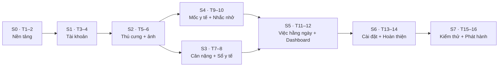
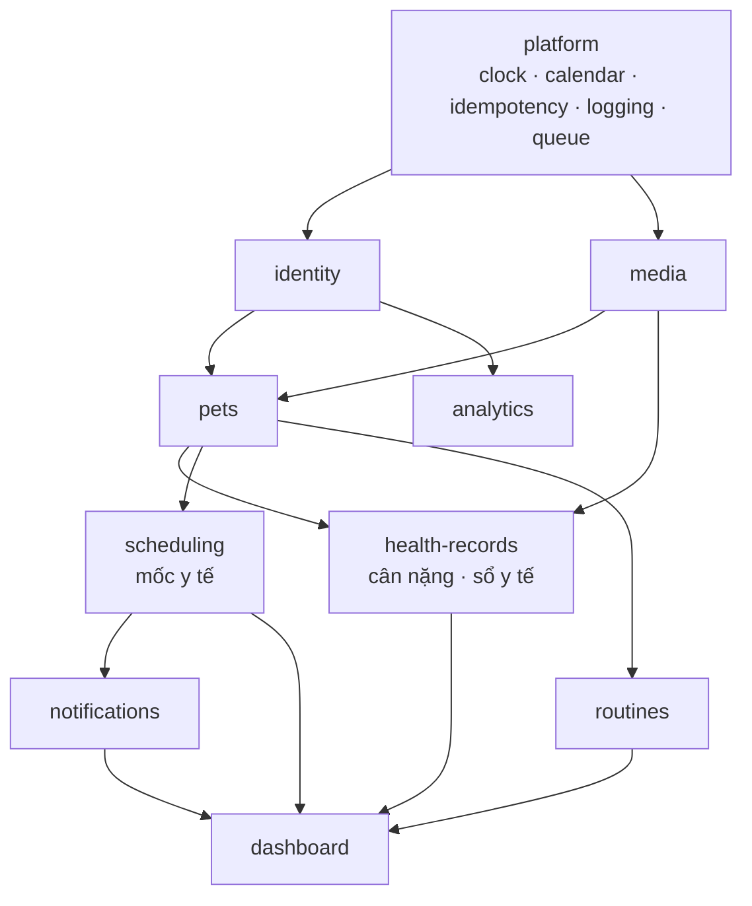

# Kế hoạch phát triển (Implementation Plan) — Pet Health Web, Giai đoạn 1

2026-10-23 · Việt

Giai đoạn 1 được xây trong **8 sprint × 2 tuần (16 tuần)** cho 40 user stories (21 P0, 18 P1, 1 P2), theo kiến trúc đã duyệt trong [SAD](../design/SAD.md) (AD-001→AD-017). Thứ tự xây đi theo phụ thuộc giữa các mô-đun: nền tảng → tài khoản → thú cưng → hồ sơ sức khỏe → mốc y tế và nhắc nhở → việc hằng ngày và Dashboard → hoàn thiện → phát hành. Mỗi sprint giao một lát cắt dọc chạy được: migration, API, giao diện theo Figma và test.

**Nguồn:** [SAD](../design/SAD.md), [User Stories](../design/User_Stories.md), [PRD](../requirements/PRD.md) §5.1 (launch gate G-1→G-18), [SRS](../requirements/SRS.md), [UI/UX Blueprint](../design/UI_UX_Blueprint.md), file Figma [Pet Health](https://www.figma.com/design/LFyXuFes0btRKxTORNwgpo).

---

## 1. Nguyên tắc triển khai

1. **Lát cắt dọc theo story.** Mỗi story đi đủ: migration → domain → use case → route + schema Zod → `openapi.yaml` → `api-client` → màn hình → test. Không làm "toàn bộ backend rồi mới tới frontend".
2. **P0 trước, P1 sau trong cùng sprint.** Hết sprint mà P1 chưa xong thì chuyển sang sprint sau; P0 không được trễ.
3. **Quy tắc nghiệp vụ là hàm thuần, viết test trước.** `todayIn`, `ageInMonths`, `addCalendarMonths`, `dueLevel`, `levelLabel`, `displayStatus` (SAD §2.2.3) có test dựng từ bảng ví dụ của SRS trước khi viết code.
4. **Bảo mật bật từ đầu, không để cuối.** Deny-by-default, RLS, IDOR test, lọc log có từ Sprint 0–1. Mỗi endpoint mới phải có ca IDOR ngay khi tạo.
5. **Contract là `openapi.yaml`.** File được sinh từ schema Zod và commit; CI báo lỗi khi file khác với code (SAD P2).
6. **Server là nguồn sự thật.** Tuổi, "hôm nay", mức nhắc, nhãn "còn N ngày" đều do API trả về; client không có logic múi giờ (SAD P1, MR-5).
7. **Mọi thứ test được với thời gian giả.** Use case nhận `ClockPort`; E2E dùng `FakeClock` qua `POST /__test/clock` (chỉ có khi `NODE_ENV=test`).

---

## 2. Lộ trình tổng quan

| Sprint | Tuần | Mục tiêu | Story | Màn hình Figma | Kết quả bàn giao |
|---|---|---|---|---|---|
| **S0** | T1–2 | Khung dự án, CI, nền tảng dùng chung | — | Foundations, Components | Monorepo chạy được, CI xanh, shell giao diện, hàm thuần lịch có test |
| **S1** | T3–4 | Tài khoản và phân quyền | US-001, 002, 003, 004, 006 | SCR-01→05 | Đăng ký, xác minh, đăng nhập, đặt lại mật khẩu; bộ test IDOR |
| **S2** | T5–6 | Hồ sơ thú cưng, pipeline ảnh, staging | US-010→015 | SCR-07→09, PetSwitcher | CRUD thú cưng, ảnh đại diện (HEIC, xóa EXIF, URL ký); staging chạy |
| **S3** | T7–8 | Cân nặng và sổ y tế | US-020→023, 030→034 | SCR-10→13, FLW-02 | Biểu đồ cân nặng, bản ghi khám kèm ảnh |
| **S4** | T9–10 | Mốc y tế và nhắc nhở (giá trị cốt lõi) | US-040→044, 046→049 | SCR-14, 15, 17, FLW-04 | Vòng đời mốc, mốc tự lặp, hoàn tác, nhắc D7/D1/Quá hạn, mục Thông báo; E2E G-3 |
| **S5** | T11–12 | Việc hằng ngày và Dashboard | US-045, 050→053, 060→062 | SCR-06, 16 | Checklist theo ngày địa phương, Dashboard 1 request có banner, lọc thú cưng |
| **S6** | T13–14 | Cài đặt, trạng thái hệ thống, analytics | US-005, 007, 008 + FR-GEN, FR-ANL | SCR-18, nhóm F–G trong Figma | Cài đặt tài khoản, xóa tài khoản, mất mạng / hết phiên / lỗi, dark mode, analytics |
| **S7** | T15–16 | Hạ tầng production và launch gate | — | — | Production chạy; G-1→G-18 (trừ G-13, G-16 đã rút) đạt |

**Mốc kiểm soát**

| Mốc | Cuối tuần | Điều kiện đạt |
|---|---|---|
| M1 · Nền tảng sẵn sàng | T2 | CI đủ các bước ở SAD §4.4.3 (trừ E2E); `docker compose -f compose.dev.yml up` dựng được stack |
| M2 · Đăng nhập được | T4 | Luồng đăng ký → email (Mailpit) → xác minh → đăng nhập chạy trên local |
| M3 · Staging | T6 | `staging.pethealth.example` sau Cloudflare Access chạy bản build từ `main` |
| M4 · Giá trị cốt lõi chạy được | T10 | E2E G-3 chạy qua API và qua giao diện với `FakeClock`; 9 ca SRS §2.6 Pass |
| M5 · Đủ tính năng | T14 | 40/40 story xong; mọi AC P0 Pass trên staging |
| M6 · Ra mắt | T16 | Launch gate đạt; production chạy tại `app.pethealth.example` |

---

## 3. Chi tiết từng sprint

### S0 · T1–2 — Nền tảng

**Mục tiêu:** dựng toàn bộ khung để từ S1 chỉ còn việc thêm tính năng.

| Hạng mục | Công việc | Tham chiếu |
|---|---|---|
| Repository | Monorepo pnpm theo SAD §4.4.2: `apps/web`, `apps/api` (2 entrypoint `main-api.ts`, `main-worker.ts`), `packages/api-client`, `packages/email-templates`, `infra/`. ESLint (cấm `dangerouslySetInnerHTML`, cấm `sql.raw` với dữ liệu người dùng), Prettier, `tsconfig` strict | AD-001, AD-002 |
| Môi trường dev | `compose.dev.yml`: PostgreSQL 16, Mailpit. `*.env.example`; `gitleaks` ở pre-commit | SAD §4.4.1, §4.1.6 |
| Backend khung | Fastify 5, Zod type provider, sinh `openapi.yaml`, Kysely + Migrator (expand → migrate → contract), pg-boss khởi tạo, `/healthz`, `/readyz` | AD-003, AD-006 |
| `platform/` | `ClockPort` + `FakeClock`; `calendar` (Luxon); logging `pino` với `redact` (SAD §4.1.7); lỗi `application/problem+json` có `ref`; middleware `Idempotency-Key` + bảng `idempotency_keys`; `requireSession` deny-by-default; `rate_limits`; hàm `set_config('app.user_id')` cho RLS | SAD §1.2.3, §2.4.1, §2.4.3 |
| Hàm thuần | `todayIn`, `ageInMonths` + `formatAge`, `addCalendarMonths`, `appearOn`, `dueLevel`, `levelLabel`, `displayStatus` — test đủ ca SRS §2.6, §2.10 và biên múi giờ trước khi code | SAD §2.2.3 |
| Frontend khung | Vite + React 19, Tailwind với token màu từ Figma Foundations (nền `#FDF7F9`, nhấn `#FCE4EE`, chính `#C2185B`, tối `#F5A3C7`), font hệ thống, icon Lucide. TanStack Router (route lazy) + Query (`staleTime: 0`). Component lõi: `TopBar`, `BottomNav` 4 mục, thanh bên ≥ 768 px, `ResponsiveDialog`, `Toast`, `EmptyState`, `ErrorState`, skeleton | UI/UX Blueprint UXD-001→009 |
| API client | `openapi-typescript` + `openapi-fetch` trong `packages/api-client`; timeout 10 s cho ghi; đọc lỗi problem+json | SAD §2.1.3 |
| CI | GitHub Actions: lint + typecheck + `dependency-cruiser` → unit (coverage gate) → integration (Testcontainers) → contract (`openapi.yaml` diff) → `pnpm audit` + OSV + gitleaks → `size-limit` < 250 KB | SAD §4.4.3 |
| Docker | `Dockerfile` app (libvips build kèm libheif + libde265 cho HEIC), `Dockerfile.caddy`, user không root | SAD §2.2.4, §4.1.5 |

**Hoàn thành khi:** M1 đạt; test hàm thuần ≥ 90% dòng; một request mẫu đi trọn web → Caddy → API → DB trên local.

### S1 · T3–4 — Tài khoản và phân quyền (E1)

| Story | Ưu tiên | Backend | Frontend | Test chính |
|---|---|---|---|---|
| US-001 Đăng ký | P0 | Bảng `users`, `sessions`, `auth_tokens`; Argon2id; `POST /auth/register`; enqueue `email.transactional` trong cùng transaction | SCR-02 | Email trùng, mật khẩu < 8 ký tự, email gửi trong 1 phút (Mailpit) |
| US-002 Xác minh email | P1 | `POST /auth/verify-email`, `/resend` (5 lần/giờ); token 24 h trong fragment URL | SCR-05, trạng thái hết hạn | Token hết hạn, đã dùng; banner nhắc xác minh (làm ở S5 cùng Dashboard) |
| US-003 Đăng nhập/đăng xuất | P0 | `POST /auth/login`, `/logout`, `GET /auth/session`; cookie `__Host-ph_sid`; CSRF; khóa 15 phút sau 5 lần sai; Argon2 trên hash giả khi không có user | SCR-01, đăng nhập sai, tạm khóa | Thời gian phản hồi như nhau; đăng xuất hủy phiên ngay |
| US-004 Đặt lại mật khẩu | P1 | `POST /auth/password/forgot`, `/reset`; liên kết 60 phút; hủy mọi phiên | SCR-03, SCR-04 | Phản hồi giống nhau dù email có hay không |
| US-006 Phân quyền dữ liệu | P0 | RLS cho mọi bảng nghiệp vụ; role `app_rw` không `BYPASSRLS`; 404 cho tài nguyên của người khác | Chuyển về đăng nhập khi chưa có phiên | **Bộ test IDOR** dùng chung, tự sinh ca cho mỗi route có path parameter |

Kèm theo: worker gửi email qua `nodemailer` (Mailpit ở local, Gmail ở staging/prod), đếm hạn mức ngày `SMTP_DAILY_LIMIT`; template React Email tiếng Việt có bản plain-text.

**Hoàn thành khi:** M2 đạt; IDOR suite chạy trong CI.

### S2 · T5–6 — Hồ sơ thú cưng, pipeline ảnh, staging (E2)

| Story | Ưu tiên | Backend | Frontend |
|---|---|---|---|
| US-010 Tạo hồ sơ | P0 | `POST /pets` (khóa `users FOR UPDATE` để đếm ≤ 10) | SCR-09 Thêm thú cưng |
| US-011 Tự tính tuổi | P1 | `ageText` trong response | SCR-08 Hồ sơ |
| US-012 Đặc điểm + ảnh đại diện | P1 | `PUT/DELETE /pets/{id}/avatar`; job `media.process`; URL ký HMAC 15 phút; `GET /media/{key}` | Ô ảnh đại diện, avatar chữ cái đầu |
| US-013 Sửa hồ sơ | P0 | `PATCH /pets/{id}` | SCR-09 dạng sửa |
| US-014 Xóa hồ sơ | P1 | `DELETE /pets/{id}` với `confirmName`; job `media.purge-prefix` | SCR-08 xác nhận nhập tên |
| US-015 Tới 10 thú cưng | P0 | `409 PET_LIMIT_REACHED` | PetSwitcher (nhớ `ph.selectedPetId`), SCR-07 Danh sách |

**Pipeline ảnh (dùng lại ở S3):** kiểm magic bytes ở API → `incoming/` → worker giải mã HEIC, xoay theo EXIF, **xóa toàn bộ metadata**, JPEG 2048 px + thumbnail 320 px → `u/{userId}/p/{petId}/...`. Integration test với ảnh HEIC thật từ iPhone (RSK-A06).

**Hạ tầng (song song):** cài máy chủ (Ubuntu, LUKS, `ufw`, SSH chỉ khóa, `unattended-upgrades`), Docker, `cloudflared`; compose project `ph-staging` sau Cloudflare Access; `ops/deploy.sh` (pull → migrate → up → chờ `/readyz`, tự quay về `.last-good`); CI build image `ph-app`, `ph-caddy` đẩy lên GHCR.

**Hoàn thành khi:** M3 đạt; ảnh HEIC hiển thị đúng trên Chrome; URL ký hết hạn sau 15 phút trả `403`.

### S3 · T7–8 — Cân nặng và sổ y tế (E3, E4)

| Story | Ưu tiên | Backend | Frontend |
|---|---|---|---|
| US-020 Ghi cân nặng | P0 | `POST /pets/{id}/weights`, `numeric(4,1)` 0,1–150 | FLW-02 sheet (≤ 3 thao tác từ Dashboard qua nút "+") |
| US-021 Cân nặng mục tiêu | P0 | `PUT/DELETE /pets/{id}/weight-target` | Sheet sửa mục tiêu |
| US-022 Biểu đồ | P0 | `GET /pets/{id}/weights` có `target`, `latest`, `deltaFromPrevious` | SCR-10: uPlot tải lazy, đường mục tiêu nét đứt, tooltip chênh lệch, empty state, gợi ý khi 1 điểm, bảng ẩn cho trình đọc màn hình |
| US-023 Sửa/xóa số đo | P1 | `PATCH/DELETE /weights/{id}` | Dùng lại FLW-02 dạng sửa (chưa có frame riêng) |
| US-030 Tạo bản ghi khám | P0 | `POST /pets/{id}/visits`; CHECK có triệu chứng hoặc chẩn đoán; ≤ 2.000 ký tự | SCR-13 có bộ đếm ký tự |
| US-031 Danh sách lịch sử | P0 | `GET /pets/{id}/visits` phân trang keyset 20 | SCR-11 cuộn tải thêm |
| US-032 Sửa/xóa bản ghi | P0 | `GET/PATCH/DELETE /visits/{id}`; xóa kèm ảnh | SCR-12 chi tiết, SCR-13 dạng sửa |
| US-033 Ảnh đính kèm | P1 | `POST /visits/{id}/photos` (≤ 5 ảnh, ≤ 5 MB, mỗi ảnh một request); `GET /uploads/{id}` | Vùng ảnh có tiến trình, "Thử lại" riêng; lightbox |
| US-034 Xóa ảnh | P1 | `DELETE /photos/{id}` | Nút xóa từng ảnh |

**Hoàn thành khi:** AC P0 của E3, E4 Pass; một ảnh lỗi không ảnh hưởng ảnh khác; bố cục danh sách + chi tiết của Sổ y tế ở ≥ 768 px (UXD-009).

### S4 · T9–10 — Mốc y tế và nhắc nhở (E5) — rủi ro cao nhất

Sprint này giao giá trị cốt lõi (động lực D1 trong SAD). Ưu tiên độ đúng hơn mọi thứ khác.

| Story | Ưu tiên | Backend | Frontend |
|---|---|---|---|
| US-040 Tạo mốc | P0 | Bảng `milestones` (có `due_set_on`); `POST /pets/{id}/milestones`; mốc quá hạn khi tạo không sinh nhắc | Sheet Tạo mốc |
| US-041 Nhắc D7/D1 | P0 | Bảng `notifications` với `UNIQUE(milestone_id, channel, level, due_on_snapshot)`; `syncNotifications` khi đọc, bỏ qua khi `notifications_synced_on = today`; supersede mức cũ | Chuông có số chưa xem; banner (gắn vào Dashboard ở S5) |
| US-042 Đánh dấu đã thực hiện | P0 | `POST /milestones/{id}/complete` trong một transaction: cập nhật mốc → resolve thông báo → tạo mốc kế tiếp; `undo-complete` cửa sổ 15 s ở server | FLW-04 sheet; toast "Hoàn tác" 10 s |
| US-043 Tự lặp vaccine | P0 | `addCalendarMonths(doneOn, 12)`; `UNIQUE(previous_id)` | Toast "Đã tạo lịch tiêm tiếp theo" |
| US-044 Chu kỳ Nhỏ gáy/Tẩy giun | P1 | `cycle_months` 1–60 | Lựa chọn nhanh 1/3/6 tháng |
| US-046 Sửa/hủy mốc | P0 | `PATCH /milestones/{id}` (resolve `RESCHEDULED`), `POST /milestones/{id}/cancel` | Sheet Sửa mốc, sheet xác nhận Hủy |
| US-047 Mốc trên Dashboard | P1 | Truy vấn ≤ 5 mốc, quá hạn trước (dùng ở S5) | SCR-14 Lịch mốc, SCR-15 Chi tiết |
| US-048 Nhắc quá hạn | P1 | Mức `OVERDUE` từ ngày hạn + 1 | Nhãn "quá hạn N ngày", màu đỏ kèm chữ |
| US-049 Mục Thông báo | P0 | `GET /notifications`, `/summary`, `POST /notifications/read`, `/read-all` (có `upTo`) | SCR-17; nhắc đã xử lý hiển thị mờ kèm nhãn |

**Kiểm thử bắt buộc trong sprint:**

- Unit: đủ **9 ca bảng SRS §2.6** cho `dueLevel`, kèm biên múi giờ và 29/02.
- Integration: hai request song song không tạo nhắc trùng (G-15); hoàn tác khôi phục đúng trạng thái đã xem/chưa xem; IDOR cho `POST /notifications/read` với ID của tài khoản khác.
- E2E (Playwright + `FakeClock`): luồng G-3 qua API (G-18) và qua giao diện.

**Hoàn thành khi:** M4 đạt.

### S5 · T11–12 — Việc hằng ngày và Dashboard (E6, E7)

| Story | Ưu tiên | Backend | Frontend |
|---|---|---|---|
| US-050 Tạo việc | P1 | Bảng `routine_tasks`; ≤ 20 việc/thú cưng; tên 1–100 ký tự, giờ HH:MM | Sheet Thêm việc |
| US-051 Checklist khi mở app | P1 | Phần `routines` trong `GET /dashboard` | Panel Việc hôm nay đứng đầu trên phone |
| US-052 Chạm để đánh dấu | P1 | `PUT /routines/{id}/completion`, `local_date` tính ở server | Optimistic update, rollback + toast khi lỗi |
| US-053 Đặt lại 00:00 | P1 | `routine_completions` theo `(task_id, local_date)`; không có job reset | — |
| US-045 Sửa/xóa việc | P1 | `PATCH/DELETE /routines/{id}` (xóa mềm, giữ lịch sử) | Sheet Sửa việc |
| US-060 Tổng quan | P0 | `GET /dashboard`: đồng bộ thông báo rồi 4 truy vấn song song; p95 < 150 ms | SCR-06: 1 cột phone, 2 cột tablet; skeleton cố định kích thước; empty state người dùng mới |
| US-061 Lọc theo thú cưng | P1 | `?pet=all\|{petId}`, mỗi mục kèm tên thú cưng | Bộ lọc "Tất cả" |
| US-062 Banner nhắc | P0 | Chọn nhắc khẩn cấp nhất (Quá hạn > D1 > D7) + `moreCount` | Banner đỏ/cam kèm chữ; "Xem", "✕", "Đã thực hiện" mở FLW-04; không để khoảng trống khi không có nhắc |

Kèm theo: banner "Xác minh email" (FR-DSH-007, phần còn lại của US-002); nút "+" Thêm nhanh ở mọi breakpoint (UXD-004).

**Hoàn thành khi:** AC US-060, US-062 Pass; Lighthouse mobile cho Dashboard đạt LCP < 2,5 s trên staging (kiểm sớm G-6).

### S6 · T13–14 — Cài đặt, trạng thái hệ thống, analytics

| Hạng mục | Nội dung | Story / FR |
|---|---|---|
| Cài đặt tài khoản | SCR-18: đổi múi giờ (đặt lại `notifications_synced_on`), đổi mật khẩu (hủy phiên khác), đổi email (liên kết 60 phút, thư báo tới email cũ) | US-008, FR-AUTH-010, 011, 015 |
| Xóa tài khoản | Nhập mật khẩu; cascade toàn bộ dữ liệu; `media.purge-prefix` | US-005 (P2), FR-AUTH-016 |
| Nhất quán đa thiết bị | Loader chờ dữ liệu mới; `refetchOnWindowFocus`; last-write-wins | US-007, FR-GEN-007, 008 |
| Trạng thái hệ thống | Banner mất kết nối; timeout 10 s + "Thử lại" cùng `Idempotency-Key`; hết phiên lưu bản nháp vào `sessionStorage` và khôi phục; trang 404, 5xx có mã `ref` | FR-GEN-003→006, 011 |
| Giao diện | Dark mode theo Figma; rà soát trợ năng (tương phản, `aria`, bảng thay thế cho biểu đồ) | UXD-001, NFR-USA |
| Analytics | `POST /analytics/events`, danh sách trắng thuộc tính theo PRD §5.2, `user_id_hash`, event `web_vitals` và `client_error`; view SQL cho 3 funnel | FR-ANL-001→005, AD-015 |
| Dọn dẹp | Job `maintenance.daily` (thông báo > 90 ngày, idempotency > 24 h, phiên hết hạn, upload bỏ dở) | FR-NTF-011, SAD §2.2.4 |

**Hoàn thành khi:** M5 đạt — 40/40 story xong, mọi AC P0 Pass trên staging.

### S7 · T15–16 — Hạ tầng production, kiểm thử và phát hành

| Hạng mục | Công việc | Gate |
|---|---|---|
| Production | Compose project `ph-prod`, Caddy với CSP và header bảo mật (SAD §4.1.4), `autoheal`, healthcheck, `restart: unless-stopped`, UPS + NUT, `ops/status.sh` | NFR-REL-001 |
| Cloudflare | DNS + Tunnel cho `app.pethealth.example`, HSTS, TLS ≥ 1.2, WAF managed rules, Bot Fight Mode, rate limit `/api/v1/auth/*`, bypass cache `/media/*` | G-10 |
| Email | Tài khoản Gmail riêng + App Password; thử gửi tới Gmail và Outlook, kiểm không vào spam | G-14 |
| Hiệu năng | k6 trên staging với dữ liệu seed theo SD-011: 50 req/s × 10 phút và kịch bản "sáng ngày đầu tháng"; Lighthouse mobile 4G | G-6, G-7, G-8 |
| Bảo mật | OWASP ZAP baseline trên staging; rà dependency; xác nhận IDOR 100% | G-9, G-11, G-12 |
| Contract | Schemathesis chạy trên `openapi.yaml` với API thật | G-17 |
| Thiết bị | iPad 10,5" Safari (2 hướng), iPhone Safari, Android Chrome, desktop Chrome; 0 lỗi Critical/High | G-4 |
| Thời gian | Đổi múi giờ, qua 00:00, D7/D1/Quá hạn bằng `FakeClock` | G-5 |
| Phát hành | `deploy.sh prod <sha>`; smoke test luồng G-3 trên production với tài khoản thật | — |

**Hoàn thành khi:** M6 đạt.

---

## 4. Thứ tự phụ thuộc giữa mô-đun

`scheduling` và `notifications` phải xong cùng một sprint (S4) vì các command của mốc resolve thông báo trong cùng transaction (SAD §2.2.2). `dashboard` chỉ đọc nên làm sau cùng (S5).

---

## 5. Định nghĩa Hoàn thành (Definition of Done)

Một story chỉ được tính là xong khi đạt đủ:

- [ ] Mọi AC Given/When/Then trong [User Stories](../design/User_Stories.md) có test tự động hoặc kịch bản kiểm thủ công đã Pass.
- [ ] Giao diện khớp frame Figma ở phone; tablet và desktop không có thanh cuộn ngang.
- [ ] Endpoint mới có schema Zod, có mặt trong `openapi.yaml`, có ca IDOR.
- [ ] `POST` tạo mới yêu cầu `Idempotency-Key`; lỗi trả `problem+json` với thông điệp tiếng Việt.
- [ ] Dữ liệu nhạy cảm không xuất hiện trong log.
- [ ] Coverage: `domain/` + `platform/calendar` ≥ 90%, toàn hệ thống ≥ 70% (G-2).
- [ ] CI xanh; bundle ban đầu < 250 KB gzip.
- [ ] Đã deploy lên staging và kiểm lại trên ít nhất một thiết bị thật.

---

## 6. Chiến lược kiểm thử

| Tầng | Công cụ | Phạm vi | Chạy ở |
|---|---|---|---|
| Unit | Vitest | Hàm thuần, use case với port giả | Mọi PR |
| Integration | Vitest + Testcontainers (PostgreSQL) | Repository, RLS, transaction, unique constraint, IDOR suite, pipeline ảnh | Mọi PR |
| Contract | `openapi.yaml` diff + Schemathesis | API khớp contract | Mọi PR (diff), S7 (Schemathesis đầy đủ) |
| E2E | Playwright + `FakeClock`, 4 viewport | Luồng G-3 qua giao diện và chỉ qua API | Sau deploy staging |
| Hiệu năng | k6, Lighthouse | G-6, G-7 | S5 (kiểm sớm), S7 |
| Bảo mật | OWASP ZAP, `pnpm audit`, OSV, gitleaks | G-12 | Mọi PR (quét dependency), S7 (ZAP) |
| Thủ công | Thiết bị thật | G-4, G-5 | Cuối mỗi sprint, S7 |

---

## 7. Ánh xạ launch gate → sprint

| Gate | Nội dung rút gọn | Bắt đầu | Hoàn tất |
|---|---|---|---|
| G-1 | 100% story P0 đạt AC | S1 | S6 |
| G-2 | Coverage ≥ 90% logic nghiệp vụ, ≥ 70% toàn hệ thống | S0 | S7 |
| G-3 | E2E đăng ký → mốc → nhắc → đánh dấu → mốc kế tiếp | S4 | S5 |
| G-4 | Kiểm thử thiết bị, 0 lỗi Critical/High | S5 | S7 |
| G-5 | Đổi múi giờ, chuyển ngày | S4 | S7 |
| G-6 | LCP < 2,5 s, INP < 200 ms, CLS < 0,1 | S5 | S7 |
| G-7 | API đọc p95 < 500 ms, ghi p95 < 800 ms | S5 | S7 |
| G-8 | Bundle < 250 KB | S0 | S7 |
| G-9 | IDOR 100% Pass | S1 | S7 |
| G-10 | HTTPS, Argon2id, cookie an toàn | S1 | S7 |
| G-11 | Ảnh riêng tư, URL ký ≤ 15 phút | S2 | S3 |
| G-12 | Không lỗ hổng High/Critical | S0 | S7 |
| G-13 | Sao lưu | — | Withdrawn (DEC-020) |
| G-14 | Email không vào spam Gmail/Outlook | S1 | S7 |
| G-15 | Nhắc nhở idempotent | S4 | S4 |
| G-16 | Cảnh báo job nhắc | — | Withdrawn (DEC-017) |
| G-17 | OpenAPI khớp 100% | S0 | S7 |
| G-18 | E2E chạy chỉ qua API | S4 | S4 |

---

## 8. Rủi ro triển khai

| ID | Rủi ro | Xác suất / Tác động | Giảm thiểu | Sprint |
|---|---|---|---|---|
| R1 | Sai logic nhắc nhở (múi giờ, `due_set_on`, supersede) | Med / High | Hàm thuần viết test trước từ 9 ca SRS; E2E `FakeClock`; dành trọn S4 cho E5 | S0, S4 |
| R2 | Build libvips + libheif lỗi, HEIC không chuyển được | Med / Med | Làm Dockerfile ở S0; test với ảnh HEIC thật ở S2 trước khi dùng cho sổ y tế | S0, S2 |
| R3 | Email Gmail vào spam hoặc App Password bị chặn | Low / Med | Kiểm G-14 sớm trên staging ở S2; `EmailPort` cho phép đổi sang SMTP khác | S2, S7 |
| R4 | Mất dữ liệu vì không có sao lưu | Low–Med / Very high | Chấp nhận ở Giai đoạn 1 (DEC-020); phương án SAD §4.2.4 phải bật trước khi mở cho người dùng ngoài | Sau S7 |
| R5 | Dashboard vượt ngân sách hiệu năng | Low / Med | Một request duy nhất, partial index, đo sớm ở S5 | S5 |

---

## 9. Ma trận story → sprint

| Sprint | Story P0 | Story P1 / P2 |
|---|---|---|
| S1 | US-001, US-003, US-006 | US-002, US-004 |
| S2 | US-010, US-013, US-015 | US-011, US-012, US-014 |
| S3 | US-020, US-021, US-022, US-030, US-031, US-032 | US-023, US-033, US-034 |
| S4 | US-040, US-041, US-042, US-043, US-046, US-049 | US-044, US-047, US-048 |
| S5 | US-060, US-062 | US-045, US-050, US-051, US-052, US-053, US-061 |
| S6 | US-007 | US-008, US-005 (P2) |
| **Tổng** | **21** | **19** |

