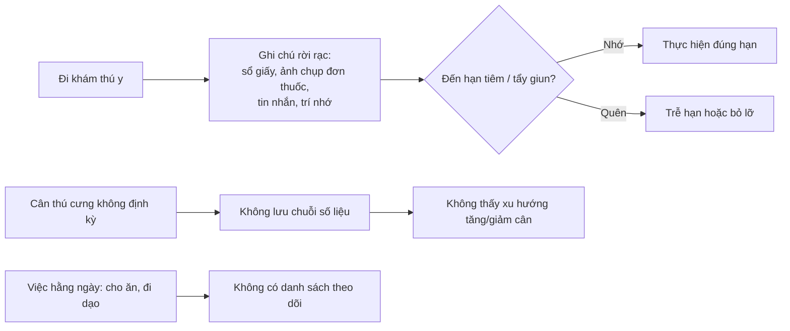
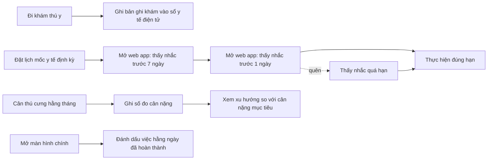

# Tài liệu Yêu cầu Nghiệp vụ (BRD) — Pet Health: Nhật ký số theo dõi sức khỏe thú cưng (Web)

> **Chuẩn áp dụng:** IEEE 29148-2018 · **Giai đoạn SDLC:** 5.2 Requirements & Discovery
> **Prompt nguồn:** `docs/BRD_Prompt_IEEE_standard.md` v1.0

---

## 0. Tóm tắt kiểm tra đầu vào (Validation summary)

**Đầu vào đã nhận**

| Mã | Nội dung | Ghi chú |
|---|---|---|
| SRC-001 | Mô tả nghiệp vụ dự án "Pet Health" (mục 2.1 của prompt): mục tiêu, nền tảng, phạm vi tính năng cốt lõi | Tác giả và ngày ban hành chưa ghi rõ |
| SRC-002 | Trả lời câu hỏi mở và phê duyệt của Việt ngày 2026-10-22 | Ghi nhận thành DEC-001→DEC-022, mục 12.1 |
| SRC-003 | PRD v1.0 (`docs/requirements/PRD.md`): quyết định sản phẩm PD-001→PD-008 và khoảng trống GAP-001→GAP-004 | Đã được Việt phê duyệt (DEC-012, DEC-013) |

**Đầu vào còn thiếu**

- Ngân sách, mốc thời gian → OQ-002, OQ-003.
- Phỏng vấn người dùng hoặc dữ liệu đo hiện trạng: **không áp dụng**, vì đây là dự án tự học (DEC-004).
- Mô hình kinh doanh (dùng cá nhân, miễn phí hay thu phí), quy mô người dùng dự kiến → OQ-007, OQ-008.
- Mục 2.2 (Source evidence) và mục 8 (Fill-in block) của prompt vẫn để trống.

**Ba rủi ro lớn nhất đối với chất lượng yêu cầu**

1. **Không có baseline và chỉ tiêu (target):** theo DEC-004, các chỉ số chỉ dùng để theo dõi và không có target. Lợi ích của dự án vì thế được đánh giá định tính (RSK-001, đã chấp nhận).
2. **Nguồn đầu vào lẫn yêu cầu nghiệp vụ với thiết kế** (line chart, data table, layout đa cột, email). Tài liệu này đã tách phần thiết kế thành ràng buộc (CON) hoặc ghi chú cho PRD. Nhà tài trợ đã chấp nhận cách tách (DEC-015).
3. **Chỉ có một nhóm người dùng được mô tả** (chủ nuôi). Chưa rõ có cần chia sẻ hồ sơ cho người cùng chăm sóc hoặc bác sĩ thú y hay không. Nếu có, phạm vi thay đổi đáng kể (OQ-010, OQ-011).

---

## 1. Kiểm soát tài liệu (Document control)

| Trường | Giá trị |
|---|---|
| Tiêu đề | BRD — Pet Health & Schedule Diary (Web Version) |
| Mã tài liệu | PH-BRD-001 |
| Phiên bản | **1.3** |
| Trạng thái | **Baselined** (v1.0 phê duyệt 2026-10-22, DEC-015; v1.1 theo DEC-016→DEC-018; v1.2 theo DEC-019→DEC-021; v1.3 theo DEC-022) |
| Loại dự án | Dự án tự học, cá nhân. Việt đảm nhiệm mọi vai trò: nhà tài trợ, chủ sở hữu nghiệp vụ, Product Owner, Business Analyst, người phê duyệt (DEC-001) |
| Tác giả | Việt (soạn với Claude) |
| Người đóng góp | Việt |
| Người review | Việt |
| Người phê duyệt | Việt |
| Phân loại bảo mật | Internal |

**Lịch sử phiên bản**

| Phiên bản | Ngày | Tác giả | Tóm tắt thay đổi |
|---|---|---|---|
| 0.1 | 2026-10-22 | Business Analyst | Bản nháp đầu tiên, dựng từ SRC-001 |
| 0.2 | 2026-10-22 | Việt | Đóng OQ-001, OQ-004→006, OQ-019, OQ-020 (DEC-001→DEC-004). Sửa BR-027, BR-029, AC-027, AC-029. Chấp nhận RSK-001, đóng RSK-005 |
| 0.3 | 2026-10-22 | Việt | Đóng OQ-016, OQ-017, OQ-018 (DEC-005→DEC-007). Thêm BR-030→BR-032, AC-030→AC-032, BRU-010, BRU-011. Mở OQ-028→OQ-030 |
| 0.4 | 2026-10-22 | Việt | Đóng OQ-028, OQ-029, OQ-030 (DEC-008→DEC-010). Chốt BRU-010, BRU-011. Thêm BR-033, BR-034, AC-033, AC-034, BRU-012 |
| 0.5 | 2026-10-22 | Việt | Đóng OQ-015 (DEC-011): Giai đoạn 2 là app điện thoại. Thêm CON-006 |
| 1.0 | 2026-10-22 | Việt | **Baseline.** Duyệt PD-001→PD-008 (DEC-012): chốt AC-004, AC-011, BRU-001→003, BRU-005, BRU-006, CON-001, CON-003; đóng OQ-014, OQ-021→026. Thêm BR-035→BR-040 từ GAP-001→004 (DEC-013). BR-020 Should → Must (DEC-014). Chấp nhận OQ-009 và phê duyệt baseline (DEC-015). Sửa định dạng bảng mục 7.3 và 7.4 |
| **1.1** | 2026-10-22 | Việt | **Bỏ email nhắc** (DEC-016): nhắc mốc y tế chỉ hiển thị trong web app. Sửa BR-016, BR-017, BR-019, BR-036, BRU-005, CON-002, ASM-001, DEP-001, RSK-002 và AC liên quan. Thêm BR-041→BR-043, AC-041→AC-043. Không xây hệ thống giám sát vận hành (DEC-017). Hạ tầng tự dựng, email tài khoản qua SMTP Gmail (DEC-018): sửa CON-003, DEP-002 |
| **1.2** | 2026-10-22 | Việt | Duyệt quy tắc nhắc trong app PD-009 và kiến trúc SAD (DEC-019). Chưa làm sao lưu dữ liệu ở Giai đoạn 1 (DEC-020): sửa DEP-002, thêm RSK-006. Dùng tên miền ví dụ `pethealth.example` tới khi có tên miền thật (DEC-021). Không thay đổi BR |
| **1.3** | 2026-10-23 | Việt | Duyệt SRS v1.0 kèm đề xuất OQ-S01 (DEC-022): thêm BR-044 (đổi email tài khoản), AC-044 |

> **Kiểm soát thay đổi:** từ v1.0, mọi thay đổi yêu cầu phải tăng phiên bản (1.x), ghi một DEC mới ở mục 12.1 và cập nhật PRD tương ứng. ID đã cấp không bao giờ đánh lại; yêu cầu bị bỏ được đánh dấu *Withdrawn*.

**Danh sách phân phối:** Việt.

**Quy ước từ ngữ chuẩn hóa (normative verbs):** **"phải"** = *shall* (bắt buộc); **"nên"** = *should* (mong muốn, có cách thay thế); **"được phép"** = *may* (tùy chọn).

---

## 2. Tóm tắt điều hành (Executive summary)

**Vấn đề.** Chủ nuôi thú cưng, nhất là khi thú cưng bước vào tuổi trung niên, thường quên các mốc y tế định kỳ (tiêm vaccine, nhỏ gáy, tẩy giun). Họ cũng thiếu dữ liệu tập trung về cân nặng và lịch sử khám chữa bệnh để theo dõi sát sức khỏe (SRC-001). Mức độ ảnh hưởng không được đo, vì đây là dự án tự học (DEC-004).

**Thay đổi đề xuất.** Cung cấp cho chủ nuôi một nhật ký sức khỏe số, truy cập qua trình duyệt trên máy tính bảng và điện thoại. Nhật ký lưu tập trung hồ sơ định danh thú cưng, chuỗi cân nặng theo tháng và sổ y tế điện tử. Hệ thống chủ động nhắc các mốc y tế ngay trong web app (banner trên màn hình chính và mục Thông báo) trước 7 ngày, trước 1 ngày và khi quá hạn, đồng thời hiển thị danh sách việc chăm sóc hằng ngày để đánh dấu hoàn thành.

**Lợi ích và chỉ số chứng minh.** Tăng tỷ lệ mốc y tế được thực hiện đúng hạn (MET-001), tăng độ đầy đủ của dữ liệu cân nặng (MET-002), duy trì thói quen chăm sóc hằng ngày (MET-003). Đây là dự án tự học nên các chỉ số chỉ dùng để theo dõi, không đặt baseline hay target (DEC-004).

**Đầu tư, tiến độ, rủi ro chính.** Ngân sách: [TBD: OQ-002]. Tiến độ: [TBD: OQ-003]. Rủi ro chính: chủ nuôi không mở web app nên không thấy nhắc (RSK-002), người dùng bỏ việc nhập liệu (RSK-003), nghĩa vụ bảo vệ dữ liệu cá nhân (RSK-004).

**Quyết định.** Ngày 2026-10-22, Việt đã phê duyệt phạm vi Giai đoạn 1 (mục 5) và 40 yêu cầu nghiệp vụ (mục 7) làm baseline v1.0 (DEC-015). Bản 1.1 bỏ email nhắc, chuyển nhắc nhở vào trong web app và nâng tổng số yêu cầu lên 43 (DEC-016). Đây là đầu vào cho SRS và SAD.

---

## 3. Bối cảnh nghiệp vụ và phát biểu vấn đề

### 3.1 Quy trình hiện tại

Không có tài liệu mô tả quy trình hiện tại. Sơ đồ dưới đây được suy ra từ phát biểu vấn đề trong SRC-001 và **[Unverified]** (OQ-012).

### 3.2 Quy trình đề xuất (mức nghiệp vụ)

### 3.3 Đối tượng bị ảnh hưởng

| Đối tượng | Ảnh hưởng | Bằng chứng |
|---|---|---|
| Chủ nuôi thú cưng | Quên lịch y tế, thiếu dữ liệu thống kê khi chăm sóc thú cưng trung niên | SRC-001 |
| Thú cưng | Nguy cơ sức khỏe khi lỡ mốc vaccine hoặc ký sinh trùng, hoặc khi thay đổi cân nặng không được phát hiện | SRC-001 (suy ra); mức độ **[Unverified]** |

### 3.4 Chi phí nếu không làm (Cost of inaction)

- **Sức khỏe:** mốc vaccine, nhỏ gáy, tẩy giun bị trễ. Thay đổi cân nặng ở thú cưng trung niên không được phát hiện sớm. **[Unverified]**, chưa có số liệu (OQ-004).
- **Chi phí cho chủ nuôi:** chi phí điều trị phát sinh do phòng ngừa không đúng hạn. **[Unverified]** (OQ-004).
- **Thông tin:** khi đi khám, chủ nuôi không cung cấp được lịch sử bệnh và dùng thuốc đầy đủ cho bác sĩ thú y. **[Unverified]** (OQ-011).

### 3.5 Nguyên nhân gốc và triệu chứng

| Triệu chứng | Nguyên nhân gốc |
|---|---|
| Quên lịch tiêm vaccine, nhỏ gáy, tẩy giun | Không có cơ chế nhắc chủ động trước hạn. Lịch chỉ nằm trong trí nhớ hoặc sổ giấy |
| Không thấy xu hướng cân nặng | Số đo không được ghi định kỳ và không lưu thành chuỗi theo thời gian |
| Thiếu lịch sử khám và dùng thuốc | Thông tin khám rải rác ở nhiều nơi, không có kho lưu tập trung |
| Việc chăm sóc hằng ngày bị bỏ sót | Không có danh sách việc lặp lại để đánh dấu |

### 3.6 Tại sao là bây giờ

SRC-001 nêu bối cảnh thú cưng "bước vào độ tuổi trung niên, đòi hỏi việc giám sát sát sao các chỉ số thể chất và lịch sử dùng thuốc". Chưa có mốc thời gian hay sự kiện kích hoạt cụ thể: [TBD: OQ-003].

---

## 4. Động lực nghiệp vụ và mục tiêu

| ID | Động lực | Mục tiêu (kết quả) | Chỉ số | Baseline | Target | Thời hạn | Nguồn |
|---|---|---|---|---|---|---|---|
| BO-001 | Chủ nuôi quên lịch y tế định kỳ | Các mốc y tế định kỳ được thực hiện đúng hạn | MET-001 | Không áp dụng (DEC-004) | Không áp dụng (DEC-004) | [TBD: OQ-003] | SRC-001 |
| BO-002 | Thiếu dữ liệu thống kê thể chất | Chủ nuôi có chuỗi cân nặng liên tục theo tháng để nhận biết xu hướng | MET-002 | Không áp dụng (DEC-004) | Không áp dụng (DEC-004) | [TBD: OQ-003] | SRC-001 |
| BO-003 | Lịch sử khám và dùng thuốc rời rạc | Toàn bộ lịch sử thăm khám của thú cưng nằm tập trung tại một nơi | MET-004 | Không áp dụng (DEC-004) | Không áp dụng (DEC-004) | [TBD: OQ-003] | SRC-001 |
| BO-004 | Việc chăm sóc hằng ngày bị bỏ sót | Việc chăm sóc hằng ngày được theo dõi và hoàn thành đều đặn | MET-003 | Không áp dụng (DEC-004) | Không áp dụng (DEC-004) | [TBD: OQ-003] | SRC-001 |
| BO-005 | Chủ nuôi dùng nhiều thiết bị | Dữ liệu sức khỏe dùng được trên máy tính bảng và điện thoại bất kỳ lúc nào | MET-005 | Không áp dụng (sản phẩm mới) | [TBD: OQ-013] | [TBD: OQ-003] | SRC-001 |

### Định nghĩa chỉ số

| ID | Định nghĩa | Công thức | Nguồn dữ liệu | Chủ sở hữu | Tần suất | Ngày baseline |
|---|---|---|---|---|---|---|
| MET-001 | Tỷ lệ mốc y tế đúng hạn | Số mốc được đánh dấu đã thực hiện không muộn hơn ngày đến hạn ÷ tổng số mốc đến hạn trong kỳ × 100% | Lịch mốc y tế trong hệ thống; baseline lấy qua khảo sát người dùng | Việt | Hằng tháng | Không áp dụng (DEC-004) |
| MET-002 | Độ đầy đủ dữ liệu cân nặng | Số tháng có ít nhất 1 số đo ÷ số tháng kể từ khi tạo hồ sơ thú cưng × 100% | Dữ liệu cân nặng trong hệ thống | Việt | Hằng tháng | Không áp dụng (DEC-004) |
| MET-003 | Tỷ lệ hoàn thành việc hằng ngày | Số việc được đánh dấu hoàn thành trong ngày ÷ số việc đã lên lịch trong ngày × 100%, lấy trung bình theo tháng | Dữ liệu checklist trong hệ thống | Việt | Hằng tuần | Không áp dụng (DEC-004) |
| MET-004 | Mức tập trung lịch sử khám | Số lần khám có bản ghi trong hệ thống ÷ số lần khám thực tế do chủ nuôi tự báo × 100% | Hệ thống + tự ghi nhận | Việt | Hằng quý | Không áp dụng (DEC-004) |
| MET-005 | Khả năng truy cập đa thiết bị | Tỷ lệ phiên dùng thành công trên máy tính bảng và trên điện thoại so với tổng số phiên | Phân tích sử dụng | Việt | Hằng tháng | Ngày ra mắt |

> Theo DEC-004, MET-001→MET-005 là chỉ số **theo dõi** (tracking), không phải tiêu chí thành công có target. Không dùng chúng để chấp nhận hay từ chối dự án.

---

## 5. Phạm vi (Scope)

### 5.1 Trong phạm vi (Giai đoạn 1)

- **Năng lực nghiệp vụ:** hồ sơ định danh thú cưng; theo dõi cân nặng theo tháng; sổ y tế điện tử; lịch và nhắc mốc y tế định kỳ; checklist việc chăm sóc hằng ngày; tài khoản người dùng và truy cập đa thiết bị.
- **Kênh:** trình duyệt web trên máy tính bảng và điện thoại (CON-001, CON-004).
- **Kênh thông báo:** chỉ trong web app: banner trên màn hình chính và mục Thông báo (CON-002, DEC-016). Email chỉ dùng cho tài khoản (xác minh, đặt lại mật khẩu).
- **Miền dữ liệu:** thông tin định danh thú cưng, ảnh đại diện, cân nặng, bản ghi khám, lịch mốc y tế, việc hằng ngày, thông tin tài khoản chủ nuôi.
- **Địa lý và ngôn ngữ:** Việt Nam; giao diện, thông báo và email tài khoản tiếng Việt; múi giờ mặc định Asia/Ho_Chi_Minh, chủ nuôi đổi được (DEC-012).

### 5.2 Ngoài phạm vi

| Hạng mục | Lý do |
|---|---|
| Ứng dụng di động native (iOS/Android) | SRC-001 chỉ định Giai đoạn 1 chạy hoàn toàn trên web |
| Push notification | SRC-001: web khó đẩy push ổn định như app native |
| Email nhắc mốc y tế | DEC-016: nhắc nhở chỉ hiển thị trong web app |
| Tư vấn hoặc chẩn đoán y tế tự động | Không có trong SRC-001; vượt khỏi vai trò nhật ký **[Unverified]** |
| Kết nối với hệ thống phòng khám thú y | Không có trong SRC-001 |
| Đặt lịch hẹn trực tiếp với phòng khám | Không có trong SRC-001 |
| Theo dõi chỉ số thể chất ngoài cân nặng (nhiệt độ, vòng bụng…) | DEC-005: Giai đoạn 1 chỉ theo dõi cân nặng |
| Đính kèm tệp không phải hình ảnh (PDF, tài liệu) vào bản ghi khám | DEC-006 chỉ cho phép hình ảnh |

### 5.3 Hoãn sang giai đoạn sau

| Hạng mục | Ghi chú |
|---|---|
| App điện thoại (iOS, Android) và push notification | **Giai đoạn 2** (DEC-011). Dùng chung tài khoản và dữ liệu với web. Thời điểm và công nghệ: xem PRD §1.3 |

### 5.4 Ranh giới

Sáng kiến bắt đầu khi chủ nuôi tạo tài khoản và hồ sơ thú cưng. Sáng kiến kết thúc ở việc ghi nhận, hiển thị và nhắc nhở. Hệ thống không thực hiện, xác nhận hay can thiệp vào hoạt động y tế thực tế.

---

## 6. Các bên liên quan và nhu cầu

| ID | Bên liên quan | Vai trò | Mối quan tâm | Ảnh hưởng | Nhu cầu | Nguồn |
|---|---|---|---|---|---|---|
| STK-001 | Chủ nuôi thú cưng | Người dùng chính, nhập và tiêu thụ dữ liệu | Không quên lịch y tế; nắm được sức khỏe thú cưng | High | SN-001 → SN-007 | SRC-001 |
| STK-002 | Thú cưng (đối tượng được chăm sóc) | Người hưởng lợi gián tiếp, không tương tác | Được chăm sóc đúng hạn | Low | (gián tiếp, qua SN của STK-001) | SRC-001 |
| STK-003 | Bác sĩ thú y | Người tạo ra thông tin khám; có thể là người đọc lịch sử | Có lịch sử bệnh và thuốc đầy đủ khi khám | Low | SN-008 **[Unverified]** | Suy ra từ SRC-001 (OQ-011) |
| STK-004 | Việt: nhà tài trợ, chủ sở hữu sản phẩm, người phê duyệt | Ra quyết định phạm vi; tự học quy trình SDLC | Hoàn thành dự án tự học theo chuẩn | High | SN-009 | SRC-002 (DEC-001) |
| STK-005 | Người cùng chăm sóc (thành viên gia đình, người trông hộ) | Có thể cần xem hoặc đánh dấu việc hằng ngày | Phối hợp chăm sóc | Med | [TBD: OQ-010] | **[Unverified]** |

> **Bên liên quan tiêu cực hoặc có thể cản trở áp dụng:** chưa xác định được bên nào. Rủi ro cản trở lớn nhất nằm ở chính STK-001: người dùng bỏ nhập liệu nếu thao tác tốn công (RSK-003).

| ID | Bên liên quan | Phát biểu nhu cầu | Khó khăn hiện tại | Bằng chứng | Ưu tiên |
|---|---|---|---|---|---|
| SN-001 | STK-001 | "Tôi cần một hồ sơ nhận dạng thú cưng, có ảnh và đặc điểm, để mọi thông tin gắn đúng với con vật." | Thông tin không tập trung | SRC-001 | Must |
| SN-002 | STK-001 | "Tôi cần biết tuổi hiện tại của thú cưng mà không phải tự tính." | Phải tự tính tuổi | SRC-001 | Should |
| SN-003 | STK-001 | "Tôi cần ghi cân nặng hằng tháng và thấy cân nặng đang đi lên hay đi xuống so với mức lý tưởng (ví dụ 9 kg)." | Không có chuỗi số liệu | SRC-001 | Must |
| SN-004 | STK-001 | "Tôi cần lưu lại mỗi lần đi khám: ngày, triệu chứng, chẩn đoán, đơn thuốc." | Lịch sử rời rạc | SRC-001 | Must |
| SN-005 | STK-001 | "Tôi cần được nhắc trước khi đến lịch tiêm vaccine, nhỏ gáy hoặc tẩy giun." | Quên lịch | SRC-001 | Must |
| SN-006 | STK-001 | "Tôi cần một danh sách việc hằng ngày (cho ăn, đi dạo) để đánh dấu đã làm." | Bỏ sót việc | SRC-001 | Should |
| SN-007 | STK-001 | "Tôi cần mở dữ liệu trên máy tính bảng hoặc điện thoại, ở bất kỳ đâu." | Dữ liệu gắn với một nơi hoặc một thiết bị | SRC-001 | Must |
| SN-008 | STK-003 | Có lịch sử khám và dùng thuốc của thú cưng khi khám | Chủ nuôi không nhớ đầy đủ | **[Unverified]** (OQ-011) | Could |
| SN-009 | STK-004 | "Tôi cần một tập yêu cầu đủ rõ để tự thiết kế, xây dựng và kiểm thử sản phẩm theo quy trình SDLC." | Không áp dụng | SRC-002 (DEC-001) | Must |

---

## 7. Yêu cầu nghiệp vụ

Phương pháp kiểm chứng: **T** = Test, **D** = Demonstration, **I** = Inspection, **A** = Analysis, **R** = Review. Mọi yêu cầu ở trạng thái **Approved** (baseline v1.0).

### 7.1 Hồ sơ định danh thú cưng

| ID | Yêu cầu | Lý do | Nguồn | Ưu tiên | AC | Kiểm chứng |
|---|---|---|---|---|---|---|
| BR-001 | Chủ nuôi **phải** tạo được hồ sơ thú cưng gồm tên, giống, giới tính và ngày sinh. | Hồ sơ là thực thể gốc của mọi dữ liệu sức khỏe | BO-003 / SN-001 | Must | AC-001 | T |
| BR-002 | Hệ thống **phải** hiển thị tuổi hiện tại của thú cưng, tính từ ngày sinh theo BRU-001. | Chủ nuôi không phải tự tính tuổi | SN-002 | Should | AC-002 | T |
| BR-003 | Chủ nuôi **phải** ghi được đặc điểm nhận dạng dạng mô tả tự do (ví dụ: lông trắng, đuôi cộc) cho mỗi thú cưng. | Phân biệt và nhận dạng thú cưng | SN-001 | Should | AC-003 | T |
| BR-004 | Chủ nuôi **phải** gắn được một ảnh đại diện cho mỗi thú cưng. | Nhận diện trực quan | SN-001 | Should | AC-004 | D |
| BR-005 | Chủ nuôi **phải** sửa được mọi trường thông tin trong hồ sơ thú cưng đã tạo. | Thông tin định danh có thể cần cập nhật | SN-001 | Must | AC-005 | T |
| BR-039 | Chủ nuôi **phải** xóa được một hồ sơ thú cưng cùng toàn bộ dữ liệu gắn với nó, sau khi xác nhận bằng cách nhập lại tên thú cưng. | Dọn hồ sơ không còn dùng; giải phóng chỗ trong giới hạn 10 (BRU-009) | SN-001 (DEC-013) | Should | AC-039 | T |

### 7.2 Theo dõi cân nặng

| ID | Yêu cầu | Lý do | Nguồn | Ưu tiên | AC | Kiểm chứng |
|---|---|---|---|---|---|---|
| BR-006 | Chủ nuôi **phải** ghi được số đo cân nặng của thú cưng, gồm ngày đo và giá trị theo BRU-003. | Tạo chuỗi dữ liệu thể chất | BO-002 / SN-003 | Must | AC-006 | T |
| BR-007 | Hệ thống **phải** hiển thị toàn bộ số đo cân nặng của một thú cưng dưới dạng trực quan, theo thứ tự thời gian, để thấy xu hướng. | Nhận biết tăng hoặc giảm cân | BO-002 / SN-003 | Must | AC-007 | D |
| BR-008 | Chủ nuôi **phải** đặt được một mức cân nặng mục tiêu cho mỗi thú cưng. | Có mốc để đối chiếu (ví dụ 9 kg) | SN-003 | Must | AC-008 | T |
| BR-009 | Hệ thống **phải** hiển thị mức cân nặng mục tiêu cùng với xu hướng cân nặng của thú cưng đó. | Đối chiếu số thực tế với mục tiêu | BO-002 / SN-003 | Must | AC-009 | D |
| BR-010 | Chủ nuôi **phải** sửa hoặc xóa được một số đo cân nặng đã ghi. | Sửa sai sót nhập liệu | SN-003 | Should | AC-010 | T |

> *Ghi chú cho PRD:* SRC-001 nêu "biểu đồ đường (Line Chart)". Đây là lựa chọn thiết kế cho BR-007/BR-009, không phải yêu cầu nghiệp vụ.

### 7.3 Sổ y tế điện tử

| ID | Yêu cầu | Lý do | Nguồn | Ưu tiên | AC | Kiểm chứng |
|---|---|---|---|---|---|---|
| BR-011 | Chủ nuôi **phải** tạo được bản ghi thăm khám gồm ngày khám, triệu chứng, chẩn đoán và đơn thuốc. | Lưu tập trung lịch sử khám | BO-003 / SN-004 | Must | AC-011 | T |
| BR-012 | Hệ thống **phải** hiển thị danh sách bản ghi thăm khám của một thú cưng, sắp xếp theo ngày khám mới nhất trước. | Tra cứu lịch sử | BO-003 / SN-004 | Must | AC-012 | T |
| BR-013 | Chủ nuôi **phải** sửa được một bản ghi thăm khám đã tạo. | Bổ sung hoặc sửa thông tin | SN-004 | Must | AC-013 | T |
| BR-014 | Chủ nuôi **phải** xóa được một bản ghi thăm khám sau khi xác nhận thao tác xóa. | Loại bỏ bản ghi sai, tránh xóa nhầm | SN-004 | Must | AC-014 | T |
| BR-030 | Chủ nuôi **phải** đính kèm được hình ảnh (ví dụ: ảnh đơn thuốc, kết quả xét nghiệm) vào một bản ghi thăm khám, theo giới hạn ở BRU-010. | Lưu bằng chứng gốc của lần khám, tránh chép tay sai | BO-003 / SN-004 | Should | AC-030 | T |
| BR-031 | Chủ nuôi **phải** xóa được một hình ảnh đã đính kèm khỏi bản ghi thăm khám. | Loại bỏ ảnh đính kèm nhầm | SN-004 | Should | AC-031 | T |

> *Ghi chú cho PRD:* "Data table" và "CRUD" trong SRC-001 là thiết kế. Cách hiển thị và xem ảnh đính kèm (thumbnail, phóng to) thuộc phạm vi PRD.

### 7.4 Lịch và nhắc nhở mốc y tế định kỳ

| ID | Yêu cầu | Lý do | Nguồn | Ưu tiên | AC | Kiểm chứng |
|---|---|---|---|---|---|---|
| BR-015 | Chủ nuôi **phải** tạo được một mốc y tế định kỳ cho thú cưng, gồm loại mốc (theo BRU-004) và ngày đến hạn. | Có lịch để nhắc | BO-001 / SN-005 | Must | AC-015 | T |
| BR-016 | Hệ thống **phải** hiển thị cho chủ nuôi một nhắc nhở trong web app từ 7 ngày trước ngày đến hạn của mỗi mốc y tế (BRU-005). *(Sửa theo DEC-016: trước đây là email.)* | Đủ thời gian chuẩn bị | BO-001 / SN-005 | Must | AC-016 | T |
| BR-017 | Hệ thống **phải** hiển thị cho chủ nuôi một nhắc nhở trong web app từ 1 ngày trước ngày đến hạn của mỗi mốc y tế (BRU-005). *(Sửa theo DEC-016.)* | Nhắc lần cuối sát ngày | BO-001 / SN-005 | Must | AC-017 | T |
| BR-018 | Chủ nuôi **phải** đánh dấu được một mốc y tế là đã thực hiện, kèm ngày thực hiện. | Đo MET-001; ngừng nhắc mốc đã xong | BO-001 / SN-005 | Must | AC-018 | T |
| BR-019 | Hệ thống **phải không** hiển thị nhắc nhở mới cho mốc y tế đã được đánh dấu thực hiện hoặc đã hủy, và **phải** đánh dấu các nhắc nhở hiện có của mốc đó là đã xử lý. *(Sửa theo DEC-016.)* | Tránh nhắc sai, giảm "mỏi thông báo" | SN-005 | Must | AC-019 | T |
| BR-020 | Chủ nuôi **phải** sửa hoặc hủy được một mốc y tế chưa thực hiện. | Lịch có thể thay đổi; mốc tự tạo (BR-032, BR-034) cần chỉnh được theo chỉ định thực tế của bác sĩ | SN-005 | **Must** (DEC-014) | AC-020 | T |
| BR-032 | Khi một mốc loại "Tiêm vaccine" được đánh dấu đã thực hiện, hệ thống **phải** tự tạo mốc "Tiêm vaccine" kế tiếp cho cùng thú cưng, với ngày đến hạn tính theo BRU-011. | Không phải nhập lại lịch vaccine hằng năm; giảm nguy cơ quên (DEC-007) | BO-001 / SN-005 | Must | AC-032 | T |
| BR-033 | Chủ nuôi **phải** đặt được một chu kỳ lặp (tính theo tháng, BRU-012) cho mốc loại "Nhỏ gáy" hoặc "Tẩy giun". | Mỗi thú cưng dùng thuốc với chu kỳ khác nhau, nên để chủ nuôi tự nhập (DEC-010) | BO-001 / SN-005 | Should | AC-033 | T |
| BR-034 | Khi một mốc "Nhỏ gáy" hoặc "Tẩy giun" có chu kỳ lặp được đánh dấu đã thực hiện, hệ thống **phải** tự tạo mốc kế tiếp cùng loại, với ngày đến hạn = ngày thực hiện + chu kỳ lặp. | Không phải nhập lại lịch định kỳ | BO-001 / SN-005 | Should | AC-034 | T |
| BR-041 | Hệ thống **phải** hiển thị cho chủ nuôi một nhắc nhở trong web app từ ngày sau ngày đến hạn của mỗi mốc y tế chưa thực hiện (quá hạn, BRU-005). | Không còn email nên cần nhắc lại khi đã lỡ hạn | BO-001 / SN-005 (DEC-016) | Should | AC-041 | T |
| BR-042 | Chủ nuôi **phải** xem được danh sách mọi nhắc nhở đã nhận, phân biệt được nhắc chưa xem và đã xem, và đánh dấu được nhắc là đã xem. | Xem lại nhắc đã bỏ qua; biết còn bao nhiêu việc cần chú ý | BO-001 / SN-005 (DEC-016) | Must | AC-042 | T |
| BR-043 | Hệ thống **phải** hiển thị nhắc nhở chưa xem ngay trên màn hình đầu tiên sau khi đăng nhập, không cần điều hướng thêm. | Nhắc trong app chỉ có giá trị khi chủ nuôi thấy ngay lúc mở | BO-001 / SN-005 (DEC-016) | Must | AC-043 | D |

> *Ghi chú:* mốc tự tạo theo BR-032 và BR-034 được nhắc như mọi mốc khác (BR-016, BR-017, BR-041) và sửa hoặc hủy được theo BR-020.
>
> *Ghi chú cho PRD:* hình thức hiển thị là **banner trên màn hình chính** và **mục Thông báo** (CON-002).

### 7.5 Việc chăm sóc hằng ngày

| ID | Yêu cầu | Lý do | Nguồn | Ưu tiên | AC | Kiểm chứng |
|---|---|---|---|---|---|---|
| BR-021 | Chủ nuôi **phải** định nghĩa được một việc chăm sóc lặp lại hằng ngày, gồm tên việc và giờ thực hiện (ví dụ: cho ăn 07:00, đi dạo 18:00). | Nền tảng của checklist | BO-004 / SN-006 | Should | AC-021 | T |
| BR-022 | Hệ thống **phải** hiển thị danh sách việc hằng ngày của ngày hiện tại ngay trên màn hình đầu tiên sau khi đăng nhập. | Thấy ngay việc cần làm | BO-004 / SN-006 | Should | AC-022 | D |
| BR-023 | Chủ nuôi **phải** đánh dấu một việc hằng ngày là hoàn thành bằng đúng một thao tác. | Giảm công sức, tăng duy trì (RSK-003) | BO-004 / SN-006 | Should | AC-023 | D |
| BR-024 | Hệ thống **phải** đặt lại trạng thái mọi việc hằng ngày về "chưa hoàn thành" khi bắt đầu ngày mới theo BRU-006. | Checklist mỗi ngày bắt đầu lại từ đầu | BO-004 / SN-006 | Should | AC-024 | T |
| BR-040 | Chủ nuôi **phải** sửa hoặc xóa được một việc hằng ngày đã định nghĩa. | Lịch chăm sóc thay đổi theo thời gian | SN-006 (DEC-013) | Should | AC-040 | T |

> *Ghi chú:* các BR của mục 7.5 là *Should*, nhưng theo DEC-014 chúng vẫn được đưa vào bản ra mắt Giai đoạn 1.

### 7.6 Tài khoản, truy cập và dữ liệu

| ID | Yêu cầu | Lý do | Nguồn | Ưu tiên | AC | Kiểm chứng |
|---|---|---|---|---|---|---|
| BR-025 | Chủ nuôi **phải** đăng nhập bằng tài khoản cá nhân trước khi truy cập bất kỳ dữ liệu thú cưng nào. | Bảo vệ dữ liệu riêng tư | SN-007 | Must | AC-025 | T |
| BR-026 | Hệ thống **phải** chỉ cho phép chủ tài khoản xem và thay đổi dữ liệu thú cưng thuộc tài khoản đó. | Quyền riêng tư (RSK-004) | SN-007 | Must | AC-026 | T |
| BR-027 | Khi chủ nuôi mở hoặc tải lại một màn hình trên bất kỳ thiết bị nào, hệ thống **phải** hiển thị mọi dữ liệu đã được lưu thành công trước thời điểm đó, kể cả dữ liệu lưu từ thiết bị khác (BRU-008). | Dùng dữ liệu nhất quán trên nhiều thiết bị; không yêu cầu cập nhật tức thời (DEC-002) | BO-005 / SN-007 | Must | AC-027 | T |
| BR-028 | Mọi chức năng ở mục 7.1–7.5 **phải** dùng được trên trình duyệt máy tính bảng 10,5 inch và trên trình duyệt điện thoại, không cần cuộn ngang. | Truy cập đa thiết bị | BO-005 / SN-007 | Must | AC-028 | D |
| BR-029 | Một tài khoản chủ nuôi **phải** quản lý được tối đa 10 thú cưng (BRU-009). | Chủ nuôi có thể nuôi nhiều con | SN-001 | Must | AC-029 | T |
| BR-035 | Chủ nuôi **phải** tự tạo được tài khoản cá nhân bằng địa chỉ email. | Điều kiện để có tài khoản đăng nhập (BR-025) | SN-007 (DEC-013) | Must | AC-035 | T |
| BR-036 | Hệ thống **phải** cho chủ nuôi xác minh quyền sở hữu địa chỉ email của tài khoản. *(Sửa theo DEC-016: không còn email nhắc nên xác minh chỉ phục vụ khôi phục tài khoản, hạ từ Must xuống Should.)* | Bảo đảm email khôi phục mật khẩu (BR-037) đến đúng người, phát hiện sớm email gõ sai | SN-007 (DEC-012, DEC-013, DEC-016) | Should | AC-036 | T |
| BR-037 | Chủ nuôi **phải** lấy lại được quyền truy cập tài khoản khi quên mật khẩu, thông qua email đã xác minh. | Không mất toàn bộ dữ liệu vì quên mật khẩu | SN-007 (DEC-013) | Should | AC-037 | T |
| BR-038 | Chủ nuôi **được phép** xóa vĩnh viễn tài khoản cùng toàn bộ dữ liệu của mình. | Quyền kiểm soát dữ liệu cá nhân (RSK-004) | SN-007 (DEC-013) | Could | AC-038 | T |
| BR-044 | Chủ nuôi **phải** đổi được địa chỉ email của tài khoản; email mới chỉ có hiệu lực sau khi được xác minh. | Sửa email gõ sai khi đăng ký hoặc đổi hộp thư, để vẫn khôi phục được mật khẩu (BR-037) | SN-007 (DEC-022) | Should | AC-044 | T |

> *Ghi chú cho PRD:* layout dashboard đa cột trên máy tính bảng (biểu đồ một bên, to-do một bên) và layout một cột trên điện thoại là đầu vào thiết kế UX của BR-028, xem CON-004.

### 7.7 Tiêu chí chấp nhận

| AC | Cho BR | Tiêu chí (khách quan, đo được) |
|---|---|---|
| AC-001 | BR-001 | Tạo hồ sơ với đủ 4 trường thì lưu thành công và hồ sơ xuất hiện trong danh sách thú cưng. Thiếu bất kỳ trường bắt buộc nào thì không lưu được và có thông báo chỉ rõ trường thiếu. |
| AC-002 | BR-002 | Với ngày sinh 2019-03-15 và ngày xem 2026-10-22, tuổi hiển thị đúng "7 năm 7 tháng" theo BRU-001. Ngày sinh ở tương lai bị từ chối. |
| AC-003 | BR-003 | Nhập mô tả "lông trắng, đuôi cộc", lưu rồi mở lại hồ sơ thì nội dung hiển thị giống hệt đã nhập. |
| AC-004 | BR-004 | Gắn một ảnh hợp lệ thì ảnh hiển thị tại hồ sơ. Tệp không phải JPG/PNG/HEIC, hoặc lớn hơn 5 MB, bị từ chối kèm thông báo (DEC-012). |
| AC-005 | BR-005 | Sửa từng trường của BR-001/003/004, lưu, tải lại thì giá trị mới được giữ. |
| AC-006 | BR-006 | Ghi số đo 9,2 kg ngày 2026-10-01, sau đó số đo xuất hiện trong lịch sử cân nặng với đúng ngày và giá trị. Giá trị ≤ 0 bị từ chối. |
| AC-007 | BR-007 | Với 6 số đo ở 6 tháng khác nhau, phần trực quan hiển thị đủ 6 điểm theo đúng thứ tự thời gian. |
| AC-008 | BR-008 | Đặt mục tiêu 9 kg, lưu, mở lại thì giá trị mục tiêu là 9 kg. |
| AC-009 | BR-009 | Khi đã có mục tiêu 9 kg và ít nhất 1 số đo, mục tiêu hiển thị cùng màn hình và cùng thang đo với xu hướng cân nặng. |
| AC-010 | BR-010 | Sửa số đo từ 9,2 thành 9,1 thì xu hướng phản ánh 9,1. Xóa số đo thì điểm đó biến mất khỏi xu hướng. |
| AC-011 | BR-011 | Tạo bản ghi đủ 4 trường thì lưu thành công. Bắt buộc có ngày khám và ít nhất một trong triệu chứng hoặc chẩn đoán; đơn thuốc không bắt buộc (DEC-012). Thiếu điều kiện này thì không lưu được. |
| AC-012 | BR-012 | Với 3 bản ghi ngày 2026-01-10, 2026-05-02, 2026-09-20, danh sách hiển thị theo thứ tự 09-20, 05-02, 01-10. |
| AC-013 | BR-013 | Sửa chẩn đoán của một bản ghi, lưu, tải lại thì nội dung mới được hiển thị. |
| AC-014 | BR-014 | Chọn xóa thì hệ thống yêu cầu xác nhận. Hủy thì bản ghi còn nguyên; xác nhận thì bản ghi không còn trong danh sách. |
| AC-015 | BR-015 | Tạo mốc "Tiêm vaccine" hạn 2026-11-15 thì mốc xuất hiện trong lịch của thú cưng với đúng loại và ngày. |
| AC-016 | BR-016 | Với mốc hạn 2026-11-15 tạo ngày 2026-11-01, mở web app lúc 00:01 ngày 2026-11-08 (giờ địa phương) thì có đúng 1 nhắc "còn 7 ngày" cho mốc đó. Mở lúc 23:59 ngày 2026-11-07 thì chưa có nhắc nào (BRU-005). |
| AC-017 | BR-017 | Với mốc hạn 2026-11-15, mở web app ngày 2026-11-14 thì có đúng 1 nhắc "ngày mai" cho mốc đó. |
| AC-018 | BR-018 | Đánh dấu mốc đã thực hiện ngày 2026-11-14 thì mốc ở trạng thái "Đã thực hiện" với ngày 2026-11-14. |
| AC-019 | BR-019 | Mốc hạn 2026-11-15 được đánh dấu thực hiện ngày 2026-11-10 thì nhắc "còn 7 ngày" của nó chuyển sang "đã xử lý", và mở web app ngày 2026-11-14 không có nhắc "ngày mai" nào cho mốc đó. |
| AC-020 | BR-020 | Đổi hạn từ 11-15 sang 11-20 (thực hiện ngày 11-05) thì nhắc xuất hiện từ ngày 11-13 và 11-19, không còn nhắc nào theo hạn cũ. Hủy mốc thì không có nhắc mới nào cho mốc đó. |
| AC-021 | BR-021 | Tạo việc "Cho ăn – 07:00" thì việc xuất hiện trong checklist mọi ngày kể từ ngày tạo. |
| AC-022 | BR-022 | Sau khi đăng nhập, checklist ngày hiện tại hiển thị trên màn hình đầu tiên mà không cần điều hướng thêm. |
| AC-023 | BR-023 | Một thao tác chọn (click hoặc tap) vào một việc thì việc đó chuyển sang "hoàn thành" và trạng thái được lưu sau khi tải lại trang. |
| AC-024 | BR-024 | Việc hoàn thành lúc 23:50 ngày D hiển thị "chưa hoàn thành" lúc 00:01 ngày D+1. |
| AC-025 | BR-025 | Truy cập bất kỳ trang dữ liệu nào khi chưa đăng nhập đều bị chuyển tới trang đăng nhập, không lộ dữ liệu. |
| AC-026 | BR-026 | Tài khoản A không xem được và không sửa được bất kỳ dữ liệu nào của tài khoản B, kể cả khi biết trực tiếp mã định danh dữ liệu. |
| AC-027 | BR-027 | Lưu số đo trên thiết bị 1 và nhận xác nhận lưu thành công. Sau đó mở hoặc tải lại màn hình cân nặng trên thiết bị 2 thì số đo hiển thị. Không yêu cầu thiết bị 2 tự cập nhật khi chưa tải lại. |
| AC-028 | BR-028 | Thực hiện toàn bộ kịch bản AC-001→AC-024 trên máy tính bảng 10,5 inch và trên điện thoại (Safari, Chrome) thì mọi kịch bản đạt và không xuất hiện thanh cuộn ngang. |
| AC-029 | BR-029 | Tạo đủ 10 thú cưng trong một tài khoản thì mỗi thú cưng có dữ liệu cân nặng, sổ y tế, mốc y tế riêng, không lẫn nhau. Tạo thú cưng thứ 11 thì bị từ chối, kèm thông báo đã đạt giới hạn 10. |
| AC-030 | BR-030 | Đính kèm 1 ảnh JPG hợp lệ vào bản ghi khám, lưu, mở lại thì ảnh hiển thị trong bản ghi. Tệp không phải hình ảnh, hoặc vượt số lượng hay dung lượng ở BRU-010, bị từ chối kèm thông báo. |
| AC-031 | BR-031 | Xóa 1 trong 2 ảnh đã đính kèm thì bản ghi còn đúng 1 ảnh. Các trường khác của bản ghi không thay đổi. |
| AC-032 | BR-032 | Mốc "Tiêm vaccine" hạn 2026-11-15 được đánh dấu thực hiện ngày 2026-11-14 thì có đúng 1 mốc "Tiêm vaccine" mới ở trạng thái chưa thực hiện, ngày đến hạn 2027-11-14 (theo BRU-011). Mốc mới không phụ thuộc ngày đến hạn cũ (15/11). |
| AC-033 | BR-033 | Đặt chu kỳ 3 tháng cho mốc "Tẩy giun", lưu, mở lại thì chu kỳ là 3 tháng. Chu kỳ 0, số âm hoặc số lẻ thập phân bị từ chối. Bỏ trống chu kỳ vẫn lưu được mốc. |
| AC-034 | BR-034 | Mốc "Tẩy giun" chu kỳ 3 tháng, thực hiện ngày 2026-11-14, thì có đúng 1 mốc "Tẩy giun" mới, hạn 2027-02-14. Thực hiện một mốc "Nhỏ gáy" không có chu kỳ thì không có mốc mới nào được tạo. |
| AC-035 | BR-035 | Đăng ký bằng email chưa dùng thì tài khoản được tạo. Đăng ký lại bằng email đã có tài khoản thì bị từ chối kèm thông báo, và không có tài khoản thứ hai. |
| AC-036 | BR-036 | Sau khi đăng ký, chủ nuôi nhận email chứa liên kết xác minh. Mở liên kết thì tài khoản chuyển sang "đã xác minh". Tài khoản chưa xác minh vẫn dùng được mọi chức năng và vẫn thấy nhắc nhở trong web app. |
| AC-037 | BR-037 | Yêu cầu đặt lại mật khẩu thì nhận được email chứa liên kết. Đặt mật khẩu mới qua liên kết đó thì đăng nhập được bằng mật khẩu mới và không còn đăng nhập được bằng mật khẩu cũ. |
| AC-038 | BR-038 | Xóa tài khoản sau khi xác nhận thì không đăng nhập lại được bằng tài khoản đó, và không còn dữ liệu hay nhắc nhở nào của tài khoản trong hệ thống. |
| AC-039 | BR-039 | Xóa thú cưng sau khi nhập đúng tên thì thú cưng biến mất khỏi danh sách, cùng mọi số đo, bản ghi khám, ảnh và mốc y tế của nó, và không còn nhắc nhở nào cho các mốc đó. Nhập sai tên thì nút xóa không hoạt động. |
| AC-040 | BR-040 | Đổi giờ việc "Cho ăn" từ 07:00 sang 07:30 thì checklist hôm sau hiển thị 07:30. Xóa việc thì việc không còn xuất hiện trong checklist từ lúc xóa. |
| AC-041 | BR-041 | Mốc hạn 2026-11-15 chưa thực hiện thì mở web app ngày 2026-11-16 có đúng 1 nhắc "quá hạn" cho mốc đó. Mốc đã thực hiện trước 11-16 thì không có nhắc quá hạn. |
| AC-042 | BR-042 | Có 3 nhắc, trong đó 2 chưa xem, thì mục Thông báo hiển thị đủ 3 nhắc và số chưa xem là 2. Chọn một nhắc chưa xem thì số chưa xem còn 1, và trạng thái đó được giữ khi mở trên thiết bị khác. |
| AC-043 | BR-043 | Có ít nhất 1 nhắc chưa xem thì ngay sau khi đăng nhập, màn hình đầu tiên hiển thị nhắc đó mà không cần điều hướng thêm. Không có nhắc chưa xem thì không hiển thị gì. |
| AC-044 | BR-044 | Yêu cầu đổi email sang một địa chỉ chưa dùng (kèm nhập lại mật khẩu) thì email mới nhận liên kết xác minh, còn email cũ vẫn dùng để đăng nhập. Mở liên kết thì đăng nhập được bằng email mới và không còn đăng nhập được bằng email cũ. Đổi sang email đã có tài khoản khác thì bị từ chối. |

---

## 8. Quy tắc nghiệp vụ

| ID | Quy tắc | Loại | Phạm vi | Chủ thể thực thi | Nguồn |
|---|---|---|---|---|---|
| BRU-001 | Tuổi = khoảng thời gian từ ngày sinh tới ngày hiện tại, hiển thị "X năm Y tháng" theo tháng tròn. Thú cưng dưới 1 tuổi hiển thị "Y tháng". | Calculation | Hồ sơ thú cưng | Hệ thống | SRC-001, DEC-012 |
| BRU-002 | Ngày sinh, ngày đo cân, ngày khám và ngày thực hiện mốc không được ở tương lai so với ngày nhập. Ngày đến hạn của mốc được phép ở quá khứ. | Decision | Toàn bộ | Hệ thống | DEC-012 |
| BRU-003 | Cân nặng ghi theo đơn vị kg, trong khoảng 0,1–150 kg, độ chính xác tới 0,1 kg. | Calculation | Cân nặng | Hệ thống | SRC-001, DEC-012 |
| BRU-004 | Loại mốc y tế định kỳ gồm tối thiểu: Tiêm vaccine, Nhỏ gáy, Tẩy giun. | Policy | Nhắc nhở | Product Owner | SRC-001 |
| BRU-005 | Mỗi mốc y tế chưa thực hiện có tối đa 3 mức nhắc trong web app, xuất hiện từ 00:00 giờ địa phương của chủ nuôi vào ngày (hạn − 7), ngày (hạn − 1) và ngày (hạn + 1, quá hạn). Một mức chỉ được tạo nếu ngày xuất hiện **sau** ngày mốc được tạo hoặc được đổi ngày hạn (không nhắc bù cho mốc vừa nhập). Nếu nhiều mức đã tới khi chủ nuôi mở app, chỉ hiển thị mức muộn nhất. Mỗi mốc có tối đa 1 nhắc chưa xem tại một thời điểm. | Policy | Nhắc nhở | Hệ thống | SRC-001, DEC-012, DEC-016 |
| BRU-006 | "Ngày mới" của checklist bắt đầu lúc 00:00 theo múi giờ cài đặt trong tài khoản chủ nuôi (mặc định Asia/Ho_Chi_Minh). | Decision | Việc hằng ngày | Hệ thống | DEC-012 |
| BRU-007 | Mục tiêu cân nặng do chủ nuôi tự đặt cho từng thú cưng. Hệ thống không tự đề xuất. | Policy | Cân nặng | Product Owner | SRC-001 ("ví dụ: mốc duy trì 9kg") |
| BRU-008 | Dữ liệu chỉ cần nhất quán giữa các thiết bị ở lần mở hoặc tải lại màn hình kế tiếp. Không yêu cầu đẩy cập nhật tức thời (real-time) sang các thiết bị đang mở. | Decision | Truy cập đa thiết bị | Việt | SRC-002 (DEC-002) |
| BRU-009 | Mỗi tài khoản có tối đa 10 hồ sơ thú cưng. | Policy | Hồ sơ thú cưng | Việt | SRC-002 (DEC-003) |
| BRU-010 | Tệp đính kèm bản ghi khám chỉ được là hình ảnh định dạng JPG, PNG hoặc HEIC. Tối đa 5 ảnh mỗi bản ghi, mỗi ảnh tối đa 5 MB. | Policy | Sổ y tế | Việt | SRC-002 (DEC-006, DEC-008) |
| BRU-011 | Chu kỳ tiêm vaccine là 12 tháng. Ngày đến hạn của mốc kế tiếp = **ngày tiêm thực tế** của mốc hiện tại + 12 tháng, không tính theo ngày đến hạn cũ. | Calculation | Nhắc nhở | Việt | SRC-002 (DEC-007, DEC-009) |
| BRU-012 | Chu kỳ lặp của mốc Nhỏ gáy hoặc Tẩy giun do chủ nuôi nhập, là số nguyên dương tính theo tháng. Không nhập chu kỳ nghĩa là mốc không tự lặp. Ngày đến hạn kế tiếp tính từ ngày thực hiện thực tế, nhất quán với BRU-011. | Calculation | Nhắc nhở | Việt | SRC-002 (DEC-010) |

---

## 9. Ràng buộc

| ID | Ràng buộc | Loại | Bên áp đặt | Tác động | Nguồn |
|---|---|---|---|---|---|
| CON-001 | Giai đoạn 1 chỉ triển khai dưới dạng ứng dụng chạy trên trình duyệt web, hỗ trợ 2 phiên bản chính mới nhất của Safari (iOS, iPadOS, macOS) và Chrome (Android, desktop). | Technical | Nhà tài trợ | Loại trừ app native ở Giai đoạn 1 | SRC-001, DEC-012 |
| CON-002 | Nhắc nhở của Giai đoạn 1 chỉ hiển thị trong web app, dưới dạng banner trên màn hình chính và mục Thông báo. Không gửi email nhắc, không push. | Technical | Nhà tài trợ | Chủ nuôi chỉ thấy nhắc khi mở web app (RSK-002) | SRC-001, DEC-016 |
| CON-003 | Dữ liệu lưu tập trung trên máy chủ, không lưu cục bộ trên thiết bị người dùng. Máy chủ là hạ tầng tự dựng của nhà tài trợ, truy cập qua tên miền đã quản lý trên Cloudflare (DEC-018). | Technical | Nhà tài trợ | Cần kết nối mạng. Khi offline, giải pháp chỉ báo trạng thái mất kết nối và không cho lưu dữ liệu (DEC-012) | SRC-001, DEC-012, DEC-018 |
| CON-004 | Giao diện phải responsive, tối ưu cho máy tính bảng 10,5 inch (bố cục nhiều cột) và tự chuyển sang một cột trên điện thoại. | Technical | Nhà tài trợ | Định hướng thiết kế UX trong PRD | SRC-001 |
| CON-006 | Giải pháp Giai đoạn 1 phải cho phép một app điện thoại ở Giai đoạn 2 dùng chung tài khoản, dữ liệu và logic nghiệp vụ, không phải xây lại. | Technical | Việt | Định hướng kiến trúc (chi tiết tại PRD §1.3.1) | SRC-002 (DEC-011) |
| CON-005 | Ngân sách: [TBD: OQ-002]. Tiến độ: [TBD: OQ-003]. | Budget / Time | Nhà tài trợ | Chưa đánh giá được tính khả thi của toàn bộ tập yêu cầu | — |

---

## 10. Giả định, phụ thuộc và rủi ro

| ID | Hạng mục | Loại | Mô tả | Tác động nếu sai / mức độ | Chủ thể | Kiểm chứng / giảm thiểu | Hạn |
|---|---|---|---|---|---|---|---|
| ASM-001 | Chủ nuôi mở web app ít nhất vài lần mỗi tuần | Giả định | Nhắc nhở chỉ hiển thị khi mở app (CON-002) | Nhắc nhở không đến được người dùng, BO-001 thất bại | Product Owner | Đo tần suất mở app (`app_opened`) và tỷ lệ nhắc được xem trước hạn | [TBD: OQ-003] |
| ASM-002 | Chủ nuôi tự cân thú cưng được ít nhất hằng tháng | Giả định | SRC-001 nêu "nhập liệu cân nặng hàng tháng" | MET-002 không đạt | Product Owner | Khảo sát người dùng | [TBD: OQ-003] |
| ASM-003 | Ngày đến hạn của mốc y tế do chủ nuôi nhập (thường theo chỉ định của bác sĩ thú y); hệ thống không tự suy ra phác đồ, ngoại trừ chu kỳ vaccine 12 tháng (BRU-011) và chu kỳ do chủ nuôi tự nhập (BRU-012) | Giả định | Tránh trách nhiệm tư vấn y tế | Nếu cần phác đồ tự động thì phạm vi tăng mạnh | Product Owner | Đã xác nhận (DEC-007, DEC-010) | [TBD: OQ-003] |
| DEP-001 | Dịch vụ gửi email: SMTP Gmail (DEC-018) | Phụ thuộc | BR-036, BR-037 cần gửi email xác minh và đặt lại mật khẩu | Không xác minh hoặc khôi phục được tài khoản | Nhóm kỹ thuật | Cấu hình trong SAD | [TBD: OQ-003] |
| DEP-002 | Máy chủ tự dựng lưu dữ liệu và ảnh (DEC-018) | Phụ thuộc | CON-003 | Máy chủ hoặc đường mạng gặp sự cố thì không truy cập được dữ liệu | Nhóm kỹ thuật | Cấu hình trong SAD. Chưa có sao lưu (DEC-020), xem RSK-006 | [TBD: OQ-003] |
| RSK-001 | Thiếu baseline và target | Rủi ro | Không có dữ liệu hiện trạng → không xác định target → không chứng minh định lượng được lợi ích | Low (**Chấp nhận**, DEC-004) | Việt | Dự án tự học. Chỉ số chỉ dùng để theo dõi | Đã đóng 2026-10-22 |
| RSK-002 | Chủ nuôi không mở web app nên không thấy nhắc | Rủi ro | Nhắc chỉ hiển thị trong app (DEC-016) → chủ nuôi không mở app nhiều ngày → mốc y tế bị lỡ | High | Product Owner | Checklist hằng ngày tạo thói quen mở app (DEC-014); nhắc chưa xem hiển thị ngay khi mở (BR-043); nhắc quá hạn (BR-041); đo tỷ lệ nhắc được xem trước hạn; push ở Giai đoạn 2 | [TBD: OQ-003] |
| RSK-003 | Người dùng bỏ nhập liệu | Rủi ro | Nhập liệu tốn công → dữ liệu không đầy đủ → xu hướng và nhắc nhở mất giá trị | Med | Product Owner | BR-023 (một thao tác); đo MET-002, MET-003 | [TBD: OQ-003] |
| RSK-004 | Nghĩa vụ bảo vệ dữ liệu cá nhân | Rủi ro | Hệ thống lưu email và thông tin chủ nuôi → có thể thuộc phạm vi pháp luật về dữ liệu cá nhân → phát sinh nghĩa vụ pháp lý (đồng ý, xóa dữ liệu…) | Med | Việt | Rà soát pháp lý theo thị trường mục tiêu (OQ-027) | Trước khi ra mắt |
| RSK-006 | Mất dữ liệu vĩnh viễn vì không có sao lưu | Rủi ro | Giai đoạn 1 chưa sao lưu (DEC-020) → hỏng ổ đĩa, lỗi thao tác hoặc mất máy chủ → mất toàn bộ hồ sơ, sổ y tế, ảnh và lịch mốc của mọi chủ nuôi, không khôi phục được | High (**Chấp nhận** tạm thời, DEC-020) | Việt | Bật sao lưu trước khi mở cho người dùng ngoài Việt (SAD §4.2.4 đã có sẵn phương án) | Trước khi mở cho người dùng ngoài |
| RSK-005 | Hiểu "thời gian thực" khác nhau | Rủi ro | Từ ngữ mơ hồ → kỳ vọng khác nhau → tranh chấp nghiệm thu BR-027 | **Đã đóng** | Việt | DEC-002 bỏ yêu cầu real-time; BR-027 viết lại theo BRU-008 | Đã đóng 2026-10-22 |

---

## 11. Truy vết (Traceability)

| Mục tiêu | Nhu cầu | Yêu cầu | AC | PRD (user story) | SRS |
|---|---|---|---|---|---|
| BO-003 | SN-001 | BR-001 | AC-001 | US-010 | FR-PET-001 |
| — | SN-002 | BR-002 | AC-002 | US-011 | FR-PET-003 |
| — | SN-001 | BR-003, BR-004 | AC-003, AC-004 | US-012 | FR-PET-004, FR-PET-005 |
| — | SN-001 | BR-005 | AC-005 | US-013 | FR-PET-006 |
| — | SN-001 | BR-039 | AC-039 | US-014 | FR-PET-008 |
| BO-002 | SN-003 | BR-006 | AC-006 | US-020 | FR-WGT-001, FR-WGT-002 |
| BO-002 | SN-003 | BR-007, BR-009 | AC-007, AC-009 | US-022 | FR-WGT-003, FR-WGT-004, FR-WGT-006 |
| — | SN-003 | BR-008 | AC-008 | US-021 | FR-WGT-005 |
| — | SN-003 | BR-010 | AC-010 | US-023 | FR-WGT-010 |
| BO-003 | SN-004 | BR-011 | AC-011 | US-030 | FR-VIS-001 |
| BO-003 | SN-004 | BR-012 | AC-012 | US-031 | FR-VIS-002 |
| — | SN-004 | BR-013, BR-014 | AC-013, AC-014 | US-032 | FR-VIS-003, FR-VIS-004 |
| BO-003 | SN-004 | BR-030 | AC-030 | US-033 | FR-VIS-005, FR-VIS-006, FR-VIS-008 |
| — | SN-004 | BR-031 | AC-031 | US-034 | FR-VIS-007 |
| BO-001 | SN-005 | BR-015 | AC-015 | US-040, US-047 | FR-MS-001, FR-MS-012 |
| BO-001 | SN-005 | BR-016, BR-017 | AC-016, AC-017 | US-041 | FR-MS-002, FR-NTF-001, FR-NTF-003→FR-NTF-005, FR-NTF-007 |
| BO-001 | SN-005 | BR-018, BR-019 | AC-018, AC-019 | US-042 | FR-MS-003, FR-MS-004, FR-NTF-006 |
| — | SN-005 | BR-020 | AC-020 | US-046 | FR-MS-006, FR-MS-007, FR-NTF-006 |
| BO-001 | SN-005 | BR-032 | AC-032 | US-043 | FR-MS-008, FR-MS-011 |
| BO-001 | SN-005 | BR-033, BR-034 | AC-033, AC-034 | US-044 | FR-MS-001, FR-MS-009, FR-MS-011 |
| BO-001 | SN-005 | BR-041 | AC-041 | US-048 | FR-NTF-002 |
| BO-001 | SN-005 | BR-042 | AC-042 | US-049 | FR-NTF-008, FR-NTF-010, FR-NTF-011 |
| BO-001 | SN-005 | BR-043 | AC-043 | US-062 | FR-NTF-009, FR-NTF-010 |
| — | SN-007 | BR-036 | AC-036 | US-002 | FR-AUTH-002, FR-AUTH-003, FR-AUTH-004, FR-DSH-007 |
| BO-004 | SN-006 | BR-021 | AC-021 | US-050 | FR-RT-001 |
| BO-004 | SN-006 | BR-022 | AC-022 | US-051, US-060 | FR-RT-002, FR-DSH-001, FR-DSH-002 |
| BO-004 | SN-006 | BR-023 | AC-023 | US-052 | FR-RT-003 |
| BO-004 | SN-006 | BR-024 | AC-024 | US-053 | FR-RT-004 |
| — | SN-006 | BR-040 | AC-040 | US-045 | FR-RT-006, FR-RT-007 |
| — | SN-007 | BR-025 | AC-025 | US-003 | FR-AUTH-005, FR-AUTH-014 |
| — | SN-007 | BR-026 | AC-026 | US-006 | FR-AUTH-013, NFR-SEC-004 |
| BO-005 | SN-007 | BR-027 | AC-027 | US-007 | FR-GEN-007, FR-GEN-008 |
| BO-005 | SN-007 | BR-028 | AC-028 | US-060 | FR-DSH-004, NFR-PRT-001, NFR-PRT-002 |
| — | SN-001 | BR-029 | AC-029 | US-015, US-061 | FR-PET-002, FR-PET-007, FR-DSH-005 |
| — | SN-007 | BR-035 | AC-035 | US-001 | FR-AUTH-001 |
| — | SN-007 | BR-037 | AC-037 | US-004 | FR-AUTH-008, FR-AUTH-009 |
| — | SN-007 | BR-038 | AC-038 | US-005 | FR-AUTH-016 |
| — | SN-007 | BR-044 | AC-044 | US-008 | FR-AUTH-015 |

**Báo cáo độ phủ**

- **Mục tiêu không có yêu cầu:** không có. BO-001→BO-005 đều có ít nhất một BR.
- **Yêu cầu mồ côi (không có BO hoặc SN):** không có.
- **Nhu cầu không có yêu cầu:** SN-008 (STK-003, bác sĩ thú y). Chủ ý chưa đặt yêu cầu cho đến khi trả lời OQ-011.
- **Yêu cầu thiếu AC hoặc phương pháp kiểm chứng:** không có. Không còn AC nào chứa tham số [TBD].
- **Yêu cầu chưa có user story trong PRD:** không có (44/44).
- **SN-009 (STK-004):** được đáp ứng bởi toàn bộ tập BR-001→BR-040, không cần BR riêng.
- **Cột SRS:** điền từ SRS v1.0 §8.1 (2026-10-23).

---

## 12. Câu hỏi mở và quyết định

| ID | Câu hỏi / quyết định cần | Tại sao quan trọng | Chủ thể | Hạn | Trạng thái |
|---|---|---|---|---|---|
| OQ-001 | Ai là nhà tài trợ, chủ sở hữu nghiệp vụ, người review và người phê duyệt? | Không có người phê duyệt thì không baseline được BRD | Việt | 2026-10-29 | **Closed** → DEC-001 |
| OQ-002 | Ngân sách Giai đoạn 1? | Đánh giá tính khả thi (CON-005) | Việt | 2026-11-05 | Open |
| OQ-003 | Mốc thời gian ra mắt Giai đoạn 1, và lý do cần làm ngay lúc này? | Hạn của các mục tiêu, giả định, rủi ro | Việt | 2026-11-05 | Open |
| OQ-004 | Baseline và target của MET-001 (tỷ lệ mốc y tế đúng hạn)? | BO-001 chưa kiểm chứng được | Việt | 2026-11-12 | **Closed** → DEC-004 |
| OQ-005 | Baseline và target của MET-002 và MET-004? | BO-002, BO-003 chưa kiểm chứng được | Việt | 2026-11-12 | **Closed** → DEC-004 |
| OQ-006 | Baseline và target của MET-003? | BO-004 chưa kiểm chứng được | Việt | 2026-11-12 | **Closed** → DEC-004 |
| OQ-007 | Mô hình kinh doanh: dùng cá nhân, miễn phí, freemium hay trả phí? | Ảnh hưởng phạm vi, đăng ký tài khoản, chi phí vận hành | Việt | 2026-11-05 | Open |
| OQ-008 | Số người dùng dự kiến ở năm đầu? | Quy mô hạ tầng tự dựng | Việt | 2026-11-05 | Open |
| OQ-009 | Nhà tài trợ có đồng ý tách line chart, data table và layout đa cột thành đầu vào thiết kế (PRD) thay vì yêu cầu nghiệp vụ? | Ranh giới BRD/PRD | Việt | 2026-10-29 | **Closed** → DEC-015 |
| OQ-010 | Có cần chia sẻ tài khoản hoặc thú cưng cho người cùng chăm sóc (STK-005) không? | Thay đổi mô hình quyền (BR-026) | Việt | 2026-11-05 | Open |
| OQ-011 | Bác sĩ thú y có cần xem hoặc nhận lịch sử khám (chia sẻ, xuất file) không? | SN-008 hiện chưa có yêu cầu | Việt | 2026-11-05 | Open |
| OQ-012 | Xác nhận quy trình hiện tại (mục 3.1) qua phỏng vấn người dùng | Sơ đồ hiện đang [Unverified] | Business Analyst | 2026-11-12 | Open |
| OQ-013 | Target cho MET-005? | BO-005 | Việt | 2026-11-12 | Open |
| OQ-014 | Thị trường, ngôn ngữ giao diện và múi giờ mục tiêu? | BRU-006, RSK-004, nội dung thông báo | Việt | 2026-11-05 | **Closed** → DEC-012 |
| OQ-015 | Nội dung các giai đoạn sau (native app, push…)? | Ranh giới phạm vi hoãn | Việt | 2026-11-19 | **Closed** → DEC-011 |
| OQ-016 | "Chỉ số thể chất" ở Giai đoạn 1 chỉ là cân nặng, hay còn chỉ số khác (nhiệt độ, vòng bụng…)? | Có thể thiếu yêu cầu | Việt | 2026-11-05 | **Closed** → DEC-005 |
| OQ-017 | Bản ghi khám có cần đính kèm tệp (ảnh đơn thuốc, xét nghiệm) không? | Phạm vi sổ y tế và dung lượng lưu trữ | Việt | 2026-11-05 | **Closed** → DEC-006 |
| OQ-018 | Mốc y tế có tự lặp theo chu kỳ (ví dụ vaccine 12 tháng) không? | Có thể cần thêm BR mới | Việt | 2026-11-05 | **Closed** → DEC-007 |
| OQ-019 | Định lượng "đồng bộ thời gian thực": dữ liệu phải hiện trên thiết bị khác trong tối đa bao nhiêu giây? | BR-027 / AC-027 | Việt | 2026-11-05 | **Closed** → DEC-002 |
| OQ-020 | Số thú cưng tối đa mỗi tài khoản? | BR-029 / AC-029 | Việt | 2026-11-05 | **Closed** → DEC-003 |
| OQ-021 | Định dạng và dung lượng tối đa của ảnh đại diện? | AC-004 | Product Owner | 2026-11-12 | **Closed** → DEC-012 |
| OQ-022 | Trường nào của bản ghi khám là bắt buộc? | AC-011 | Product Owner | 2026-11-12 | **Closed** → DEC-012 |
| OQ-023 | Xác nhận BRU-001/002/003 (cách hiển thị tuổi, chặn ngày tương lai, độ chính xác 0,1 kg) | Các quy tắc đang [Unverified] | Product Owner | 2026-11-12 | **Closed** → DEC-012 |
| OQ-024 | Giờ gửi email nhắc trong ngày? Xử lý ra sao khi mốc được tạo lúc còn ít hơn 7 ngày tới hạn? | BRU-005, AC-016 | Product Owner | 2026-11-12 | **Closed** → DEC-012; phần giờ gửi email bị thay bởi DEC-016 |
| OQ-025 | Phiên bản Safari/Chrome tối thiểu cần hỗ trợ? | CON-001, AC-028 | Product Owner | 2026-11-12 | **Closed** → DEC-012 |
| OQ-026 | Có cần xem dữ liệu khi mất mạng không? | CON-003 | Việt | 2026-11-12 | **Closed** → DEC-012 |
| OQ-027 | Luật bảo vệ dữ liệu cá nhân nào áp dụng tại thị trường mục tiêu (ví dụ tại Việt Nam)? Có cần chức năng xóa tài khoản hoặc xuất dữ liệu không? | RSK-004; có thể phát sinh BR bắt buộc | Việt | Trước khi mở cho người dùng ngoài Việt | Open. Đã có BR-038 (xóa tài khoản); phần rà soát pháp lý còn mở |
| OQ-028 | Mỗi bản ghi khám được đính kèm tối đa bao nhiêu ảnh, mỗi ảnh tối đa bao nhiêu MB, định dạng nào? | BRU-010, AC-030; dung lượng lưu trữ (DEP-002) | Việt | 2026-11-12 | **Closed** → DEC-008 |
| OQ-029 | Mốc vaccine kế tiếp tính từ **ngày thực hiện** thực tế hay từ **ngày đến hạn** của mốc trước? | BRU-011, AC-032. Hai cách cho kết quả khác nhau khi tiêm sớm hoặc trễ | Việt | 2026-11-12 | **Closed** → DEC-009 |
| OQ-030 | Mốc Nhỏ gáy và Tẩy giun có tự lặp không? Nếu có, chu kỳ bao lâu (ví dụ 1 tháng, 3 tháng)? | Có thể cần thêm BR tương tự BR-032 | Việt | 2026-11-12 | **Closed** → DEC-010 |

### 12.1 Nhật ký quyết định

| ID | Quyết định | Đóng câu hỏi | Người quyết định | Ngày | Lý do | Ảnh hưởng |
|---|---|---|---|---|---|---|
| DEC-001 | Việt là nhà tài trợ, chủ sở hữu nghiệp vụ, Product Owner, người review và người phê duyệt | OQ-001 | Việt | 2026-10-22 | Dự án tự học, cá nhân | Mục 1, STK-004, SN-009, mục 14 |
| DEC-002 | Không yêu cầu đồng bộ real-time. Dữ liệu chỉ cần hiển thị đúng ở lần mở hoặc tải lại màn hình kế tiếp | OQ-019 | Việt | 2026-10-22 | Mức "tương đối" là đủ cho nhu cầu cá nhân | BR-027, AC-027, BRU-008; thay phần "đồng bộ theo thời gian thực" trong SRC-001 |
| DEC-003 | Mỗi tài khoản quản lý tối đa 10 thú cưng | OQ-020 | Việt | 2026-10-22 | Đủ cho một hộ nuôi | BR-029, AC-029, BRU-009 |
| DEC-004 | Không xác định baseline và target cho MET-001→MET-004; chỉ số chỉ dùng để theo dõi | OQ-004, OQ-005, OQ-006 | Việt | 2026-10-22 | Dự án tự học, không cần chứng minh hiệu quả đầu tư | Mục 4; RSK-001 chuyển sang Chấp nhận |
| DEC-005 | Giai đoạn 1 chỉ theo dõi cân nặng, không theo dõi chỉ số thể chất nào khác | OQ-016 | Việt | 2026-10-22 | Giữ phạm vi gọn | Mục 5.2 (chuyển từ "Hoãn" sang "Ngoài phạm vi") |
| DEC-006 | Cho phép đính kèm hình ảnh (ảnh đơn thuốc, kết quả xét nghiệm) vào bản ghi khám | OQ-017 | Việt | 2026-10-22 | Lưu bằng chứng gốc của lần khám | BR-030, BR-031, AC-030, AC-031, BRU-010; mở OQ-028 |
| DEC-007 | Lịch tiêm vaccine tự lặp lại hằng năm | OQ-018 | Việt | 2026-10-22 | Không phải nhập lại lịch hằng năm | BR-032, AC-032, BRU-011, ASM-003; mở OQ-029, OQ-030 |
| DEC-008 | Giới hạn ảnh đính kèm: tối đa 5 ảnh mỗi bản ghi khám, mỗi ảnh tối đa 5 MB, định dạng JPG/PNG/HEIC | OQ-028 | Việt (giao BA đề xuất) | 2026-10-22 | Đủ cho đơn thuốc và kết quả xét nghiệm của một lần khám. HEIC là định dạng ảnh mặc định trên iPhone | BRU-010, AC-030 |
| DEC-009 | Mốc vaccine kế tiếp tính từ ngày tiêm thực tế + 12 tháng | OQ-029 | Việt | 2026-10-22 | Phản ánh đúng thời điểm thú cưng thực sự được tiêm | BRU-011, AC-032 |
| DEC-010 | Mốc Nhỏ gáy và Tẩy giun lặp theo chu kỳ do chủ nuôi tự nhập; bỏ trống thì không lặp | OQ-030 | Việt | 2026-10-22 | Chu kỳ khác nhau tùy loại thuốc và thú cưng | BR-033, BR-034, AC-033, AC-034, BRU-012 |
| DEC-011 | Giai đoạn 2 làm app điện thoại, dùng chung tài khoản và dữ liệu với web | OQ-015 | Việt | 2026-10-22 | Web không đẩy được push notification ổn định; app cho phép nhắc nhở chủ động hơn | Mục 5.3, CON-006, PRD §1.3 |
| DEC-012 | Phê duyệt quyết định sản phẩm PD-001→PD-008 của PRD: xác minh email bắt buộc; ảnh đại diện JPG/PNG/HEIC ≤ 5 MB; trường bắt buộc của bản ghi khám; email gửi 08:00; hỗ trợ 2 phiên bản Safari/Chrome mới nhất; offline chỉ báo trạng thái; tiếng Việt và múi giờ Asia/Ho_Chi_Minh; xác nhận BRU-001→003 | OQ-014, OQ-021→OQ-026 | Việt | 2026-10-22 | Chấp nhận đề xuất của PM | AC-004, AC-011, AC-016, BRU-001→003, BRU-005, BRU-006, CON-001, CON-003, mục 5.1 |
| DEC-013 | Bổ sung 4 khoảng trống từ PRD (GAP-001→004) thành yêu cầu nghiệp vụ | — | Việt | 2026-10-22 | Sản phẩm cần các chức năng này để vận hành được | BR-035→BR-040, AC-035→AC-040 |
| DEC-014 | Nâng BR-020 (sửa, hủy mốc) từ Should lên Must. Đưa toàn bộ mục 7.5 (việc hằng ngày) vào bản ra mắt dù là Should | — | Việt | 2026-10-22 | Mốc tự tạo cần chỉnh được; checklist là lý do người dùng mở app mỗi ngày | BR-020; phạm vi ra mắt PRD |
| DEC-015 | Chấp nhận cách tách thiết kế sang PRD; chấp nhận OKR của PRD §1.2; **phê duyệt BRD v1.0 và PRD v1.0 làm baseline** | OQ-009 | Việt | 2026-10-22 | Đủ điều kiện chuyển sang SRS và SAD | Mục 1, 14, 15.2 |
| DEC-016 | **Bỏ email nhắc.** Nhắc mốc y tế chỉ hiển thị trong web app: banner trên màn hình chính và mục Thông báo. Email chỉ còn dùng cho tài khoản (xác minh, đặt lại mật khẩu) | — | Việt | 2026-10-22 | Việt quyết định đơn giản hóa kênh nhắc. Chi tiết quy tắc (mức quá hạn, không nhắc bù, 1 nhắc chưa xem mỗi mốc) do PM đề xuất theo hướng tối thiểu, Việt đã duyệt ở DEC-019 | BR-016, BR-017, BR-019, BR-036, BR-041→043, BRU-005, CON-002, ASM-001, DEP-001, RSK-002; PRD v1.1; SRS v0.2 |
| DEC-017 | Không xây hệ thống giám sát vận hành (monitoring, cảnh báo) ở Giai đoạn 1 | — | Việt | 2026-10-22 | Chưa cần ở quy mô dự án cá nhân | PRD G-16 (Withdrawn); SRS NFR-REL-004 (Withdrawn) |
| DEC-018 | Hạ tầng tự dựng (máy chủ local) thay cho dịch vụ đám mây; tên miền đã quản lý trên Cloudflare; email tài khoản gửi qua SMTP Gmail | OQ-002 (một phần) | Việt | 2026-10-22 | Chi phí thấp, chủ động hạ tầng | CON-003, DEP-001, DEP-002; SAD v0.2 |
| DEC-019 | Duyệt PD-009 (quy tắc nhắc trong app) của PRD và AD-001→AD-017 của SAD | — | Việt | 2026-10-22 | Chấp nhận đề xuất | PRD v1.2; SAD v1.0 |
| DEC-020 | **Chưa làm sao lưu dữ liệu** ở Giai đoạn 1 | — | Việt | 2026-10-22 | Chưa cần ở giai đoạn tự dùng | PRD G-13 (Withdrawn); SRS NFR-REL-002 (Withdrawn), SD-012; RSK-006 |
| DEC-021 | Dùng tên miền ví dụ `pethealth.example` (`app.pethealth.example`, `staging.pethealth.example`) trong tài liệu; thay bằng tên miền thật trên Cloudflare khi triển khai | — | Việt | 2026-10-22 | Tên miền thật cung cấp sau | SAD (đóng OQ-A01) |
| DEC-022 | **Phê duyệt SRS v1.0 làm baseline**, gồm SD-001→SD-014 và đề xuất của OQ-S01: cho đổi email tài khoản (Should) | OQ-S01 (SRS) | Việt | 2026-10-23 | Chấp nhận đề xuất | BR-044, AC-044; PRD US-008; SRS FR-AUTH-015 |

### 12.2 Câu hỏi còn mở sau baseline

Các câu dưới đây không chặn Giai đoạn 1 và được giữ để xem xét sau khi ra mắt:

| ID | Nội dung | Khi nào xem lại |
|---|---|---|
| OQ-002, OQ-003 | Ngân sách và mốc ra mắt | Khi lập kế hoạch dự án |
| OQ-007, OQ-008 | Mô hình kinh doanh, quy mô người dùng | Trước khi mở cho người dùng ngoài Việt |
| OQ-010, OQ-011 | Chia sẻ cho người cùng chăm sóc và bác sĩ thú y | Ứng viên cho bản 1.x hoặc Giai đoạn 2 |
| OQ-012, OQ-013 | Xác nhận quy trình hiện tại; target MET-005 | Sau khi ra mắt |
| OQ-027 | Rà soát pháp lý về dữ liệu cá nhân | Trước khi mở cho người dùng ngoài Việt |
| RSK-006 | Bật sao lưu dữ liệu (DEC-020) | Trước khi mở cho người dùng ngoài Việt |

---

## 13. Thuật ngữ và tài liệu tham chiếu

| Thuật ngữ | Định nghĩa |
|---|---|
| Chủ nuôi | Người sở hữu tài khoản và chịu trách nhiệm chăm sóc thú cưng (STK-001) |
| Mốc y tế định kỳ | Sự kiện y tế phòng ngừa có ngày đến hạn: tiêm vaccine, nhỏ gáy, tẩy giun (BRU-004) |
| Nhỏ gáy | Phương pháp phòng và trị ve, rận, bọ chét bằng thuốc nhỏ lên vùng gáy thú cưng |
| Ngày đến hạn | Ngày mốc y tế cần được thực hiện, do chủ nuôi nhập |
| Cân nặng mục tiêu | Mức cân nặng lý tưởng do chủ nuôi đặt cho một thú cưng (BRU-007) |
| Việc hằng ngày | Việc chăm sóc lặp lại mỗi ngày (cho ăn, đi dạo), đặt lại trạng thái mỗi ngày (BRU-006) |
| Bản ghi thăm khám | Thông tin một lần đi khám thú y: ngày, triệu chứng, chẩn đoán, đơn thuốc |
| Đồng bộ đa thiết bị | Dữ liệu đã lưu thành công trên một thiết bị hiển thị trên thiết bị khác ở lần mở hoặc tải lại màn hình kế tiếp. Không phải real-time (BRU-008, DEC-002) |
| Responsive | Giao diện tự điều chỉnh bố cục theo kích thước màn hình |
| Thú cưng trung niên | Giai đoạn tuổi cần theo dõi sát hơn; ngưỡng tuổi cụ thể chưa xác định **[Unverified]** |
| BRD / PRD / SRS / SAD | Business Requirements / Product Requirements / Software Requirements Specification / Software Architecture Document |

**Tài liệu tham chiếu**

| Tên | Phiên bản | Vị trí | Ngày truy cập |
|---|---|---|---|
| IEEE 29148-2018, Systems and software engineering — Requirements engineering | 2018 | IEEE Standards | 2026-10-22 |
| BRD Prompt (IEEE standard) | 1.0 | `docs/BRD_Prompt_IEEE_standard.md` | 2026-10-22 |
| SRC-001 — Mô tả nghiệp vụ Pet Health | Không ghi | `docs/BRD_Prompt_IEEE_standard.md` §2.1 | 2026-10-22 |
| SRC-002 — Trả lời câu hỏi mở của Việt | 2026-10-22 | Mục 12.1 của tài liệu này | 2026-10-22 |
| SRC-003 — PRD Pet Health | 1.0 | `docs/requirements/PRD.md` | 2026-10-22 |

---

## 14. Phê duyệt

| Vai trò | Tên | Quyết định | Chữ ký / ngày |
|---|---|---|---|
| Nhà tài trợ, chủ sở hữu nghiệp vụ, Product Owner | Việt | **Approve** | Việt — 2026-10-22 (DEC-015) |
| Pháp lý (nếu áp dụng) | Không áp dụng cho dự án tự học, cho đến khi có người dùng ngoài (OQ-027) | — | — |

**Phiên bản được phê duyệt:** **1.3 (Baselined)**, cùng PRD v1.3 và SRS v1.0. (v1.0 phê duyệt 2026-10-22 theo DEC-015; v1.1 theo DEC-016→DEC-018; v1.2 theo DEC-019→DEC-021; v1.3 theo DEC-022.)
**Điều kiện kèm theo:** không có. Các câu hỏi ở mục 12.2 được theo dõi tiếp nhưng không ảnh hưởng baseline.

---

## 15. Phụ lục

### 15.1 Kết quả rà soát theo checklist (mục 5 của prompt)

| Hạng mục | Kết quả | Ghi chú |
|---|---|---|
| Mọi BR dùng cú pháp "phải" (shall) với một nghĩa vụ duy nhất | Đạt | BR-010, BR-020 gom "sửa hoặc xóa / hủy" trên cùng một đối tượng; có thể tách khi lập PRD |
| Không có ngôn ngữ giải pháp trong BR | Đạt | Chi tiết thiết kế đã chuyển sang ghi chú PRD hoặc CON |
| Định lượng ở nơi cần | Đạt | BR-027 (DEC-002), BR-029 (DEC-003) |
| Không còn từ ngữ mơ hồ | Đạt | "thời gian thực" đã thay bằng BRU-008 |
| Thuật ngữ chuyên biệt có trong glossary | Đạt | |
| Không trùng lặp hay mâu thuẫn | Đạt | |
| ID duy nhất, cố định | Đạt | |
| Mỗi BO có ít nhất một BR | Đạt | |
| Mỗi BR truy vết được tới BO hoặc SN | Đạt | |
| Mỗi BR có AC và phương pháp kiểm chứng | Đạt | 44/44 BR; không còn tham số TBD |
| Mỗi nhóm bên liên quan có nhu cầu | Một phần | STK-004 có SN-009. STK-005 chờ OQ-010 |
| Scope, loại trừ, giả định, phụ thuộc, rủi ro đầy đủ | Đạt | |
| Mọi OQ có chủ thể và hạn | Đạt | |
| Vấn đề có bằng chứng, không chỉ khẳng định | Một phần | SRC-001 là mô tả của chính nhà tài trợ. Quy trình hiện tại chờ OQ-012 |
| Baseline và target có nguồn, đo được | Không áp dụng | DEC-004; RSK-001 đã chấp nhận |
| Lợi ích và chi phí nêu bằng ngôn ngữ nghiệp vụ | Một phần | Chi phí chưa có (OQ-002) |
| Nhà tài trợ đã xác nhận | Đạt | Việt phê duyệt 2026-10-22 (DEC-015) |
| Người đọc nghiệp vụ hiểu được | Đạt | |

### 15.2 Tuyên bố mức sẵn sàng

**Baselined — v1.3, cập nhật 2026-10-23 (DEC-016→DEC-022).** 44 yêu cầu nghiệp vụ (25 Must, 18 Should, 1 Could) đều đạt checklist chất lượng và có tiêu chí chấp nhận quyết định được. Tài liệu là đầu vào chính thức cho SRS và SAD. Mọi thay đổi tiếp theo đi qua quy trình kiểm soát thay đổi ở mục 1.
