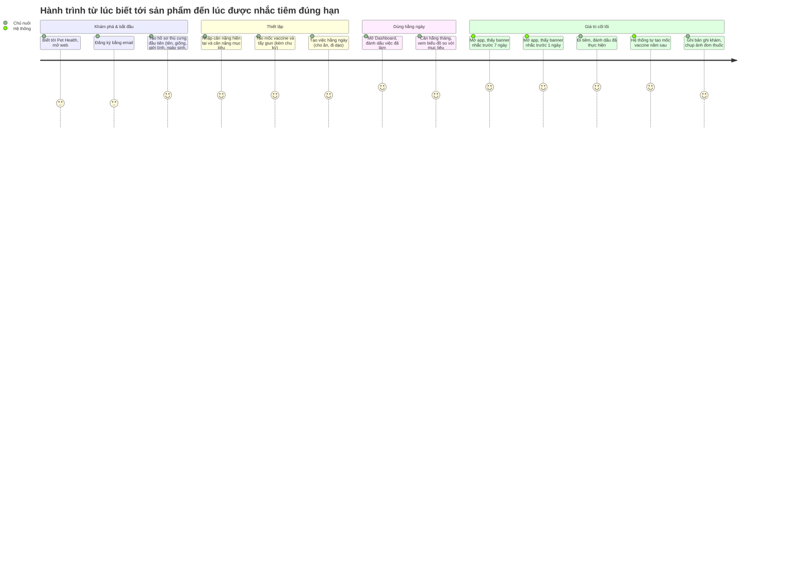

# Tài liệu Yêu cầu Sản phẩm (PRD) — Pet Health: Nhật ký số theo dõi sức khỏe thú cưng (Web)

| Trường | Giá trị |
|---|---|
| Mã tài liệu | PH-PRD-001 |
| Phiên bản | **1.2 (Baselined)**. v0.2: thêm lộ trình app (§1.3). v1.0: Việt duyệt PD-001→008, GAP-001→004, ưu tiên và OKR (BRD DEC-012→DEC-015). v1.1: bỏ email nhắc, chuyển nhắc nhở vào web app (banner + mục Thông báo), bỏ launch gate giám sát (BRD DEC-016→DEC-018). v1.2: duyệt PD-009, bỏ gate sao lưu G-13 (BRD DEC-019, DEC-020) |
| Ngày | 2026-10-22 |
| Product Owner / Người phê duyệt | Việt |
| Tài liệu nguồn | [BRD.md](BRD.md) v1.2 (PH-BRD-001) |
| Chuẩn áp dụng | IEEE 29148-2018 (truy vết BR → User Story → AC) |
| Prompt nguồn | `docs/requirements/PRD_Prompt_IEEE_standard.md` |

**Quy ước:** `US-xxx` = user story · `PD-xxx` = quyết định sản phẩm (đã được Việt duyệt) · `GAP-xxx` = điểm BRD chưa đề cập nhưng sản phẩm cần · **P0** = bắt buộc khi ra mắt (tương ứng *Must* trong BRD) · **P1** = nên có (*Should*) · **P2** = có thì tốt (*Could*).

---

## 0. Kiểm tra các trụ cột sản phẩm (Product pillars validation)

### 0.1 Product foundation

| Mục | Nội dung | Nguồn |
|---|---|---|
| Tên sản phẩm | Pet Health — Pet Health & Schedule Diary (Web Version) | BRD §1 |
| Người dùng mục tiêu | Chủ nuôi thú cưng, đặc biệt thú cưng trung niên cần theo dõi sát | BRD STK-001 |
| Vấn đề | Quên lịch y tế định kỳ (vaccine, nhỏ gáy, tẩy giun); không có chuỗi dữ liệu cân nặng; lịch sử khám và thuốc nằm rải rác | BRD §3 |
| Giải pháp cốt lõi | Một nhật ký sức khỏe tập trung trên web. Hệ thống **tự nhắc ngay trong web app** (banner trên màn hình chính và mục Thông báo) trước 7 ngày, trước 1 ngày và khi quá hạn, **tự lặp lịch** vaccine và thuốc định kỳ, hiển thị **xu hướng cân nặng** so với mục tiêu, và **checklist việc hằng ngày** ngay trên màn hình chính | BRD §2, BR-015→034, BR-041→043 |
| Trụ cột UX | Responsive; tối ưu máy tính bảng 10,5" (dashboard đa cột); điện thoại dùng một cột; mỗi việc hằng ngày đánh dấu xong bằng 1 chạm; cloud-first, dùng được trên mọi thiết bị | BRD CON-001→004, BR-023, BR-028 |

### 0.2 Đánh giá

| Trụ cột | Đánh giá | Hệ quả cho PRD |
|---|---|---|
| Web-only + nhắc trong app (DEC-016) | ⚠️ Đơn giản, không phụ thuộc dịch vụ email, nhưng chủ nuôi **chỉ thấy nhắc khi mở app** (BRD RSK-002, High) | Nhắc chưa xem hiển thị ngay trên Dashboard (US-062); nhắc quá hạn (US-048); checklist hằng ngày (E6) tạo thói quen mở app; đo tỷ lệ nhắc được xem trước hạn (KR1.2) |
| Tablet-first, phone một cột | ✅ Rõ ràng, đo được | Breakpoint cụ thể ở §4.1 |
| Không yêu cầu real-time | ✅ Đơn giản hóa kiến trúc (BRU-008) | Dữ liệu tải mới khi mở hoặc tải lại màn hình |
| Cloud-first, không offline | ⚠️ BRD chưa chốt hành vi khi mất mạng (OQ-026) | PD-006: chỉ báo trạng thái offline, không ghi dữ liệu khi offline |
| Nhập liệu ít thao tác | ✅ Là đòn bẩy giữ chân người dùng (RSK-003) | Ràng buộc số thao tác trong AC |

### 0.3 Khoảng trống phát hiện khi chuyển BRD sang PRD

| ID | Khoảng trống | Đề xuất trong PRD | Kết quả (BRD v1.0, DEC-013) |
|---|---|---|---|
| GAP-001 | BRD có đăng nhập (BR-025) nhưng không có đăng ký, xác minh email, quên mật khẩu | US-001→US-004 | ✅ BR-035, BR-036, BR-037 |
| GAP-002 | BRD không có chức năng xóa hồ sơ thú cưng | US-014 (P1) | ✅ BR-039 |
| GAP-003 | BRD không có chức năng sửa hoặc xóa việc hằng ngày | US-045 (P1) | ✅ BR-040 |
| GAP-004 | Không có quyết định về xóa tài khoản và dữ liệu (liên quan OQ-027) | US-005 (P2) | ✅ BR-038 |

### 0.4 Quyết định sản phẩm đề xuất (đóng các OQ chi tiết của BRD)

| ID | Quyết định đề xuất | Đóng OQ BRD | Trạng thái |
|---|---|---|---|
| PD-001 | Gửi email xác minh khi đăng ký. *(Sửa theo DEC-016: không còn email nhắc; xác minh chỉ để bảo đảm khôi phục mật khẩu được, không chặn chức năng nào.)* | (mới) | ✅ Approved (DEC-012), sửa theo DEC-016 |
| PD-002 | Ảnh đại diện: JPG/PNG/HEIC, tối đa 5 MB (đồng bộ với BRU-010) | OQ-021 | ✅ Approved (DEC-012) |
| PD-003 | Bản ghi khám: bắt buộc *ngày khám* và ít nhất một trong *triệu chứng* hoặc *chẩn đoán*. *Đơn thuốc* không bắt buộc | OQ-022 | ✅ Approved (DEC-012) |
| PD-004 | ~~Email nhắc gửi lúc 08:00 giờ địa phương~~ | OQ-024 | **Superseded** bởi PD-009 (DEC-016) |
| PD-005 | Hỗ trợ 2 phiên bản chính mới nhất của Safari (iOS/iPadOS/macOS) và Chrome (Android/desktop) | OQ-025 | ✅ Approved (DEC-012) |
| PD-006 | Khi offline: hiển thị banner "Mất kết nối", vô hiệu hóa nút lưu, giữ nội dung đang nhập trên form. Không lưu offline | OQ-026 | ✅ Approved (DEC-012) |
| PD-007 | Giao diện tiếng Việt. Múi giờ mặc định Asia/Ho_Chi_Minh, đổi được trong cài đặt tài khoản | OQ-014 | ✅ Approved (DEC-012) |
| PD-008 | Xác nhận BRU-001→003: tuổi hiển thị "X năm Y tháng" (dưới 1 tuổi: "Y tháng"); chặn ngày ở tương lai; cân nặng chính xác tới 0,1 kg, giới hạn 0,1–150 kg | OQ-023 | ✅ Approved (DEC-012) |
| PD-009 | **Nhắc nhở trong app** (BRU-005 v1.1): 3 mức nhắc **D7** (hạn − 7), **D1** (hạn − 1), **Quá hạn** (hạn + 1), xuất hiện từ 00:00 giờ địa phương. Không nhắc bù cho mức có ngày xuất hiện không sau ngày tạo hoặc đổi ngày hạn. Mở app khi nhiều mức đã tới thì chỉ tạo mức muộn nhất. Mỗi mốc tối đa 1 nhắc chưa xem: nhắc mới thay nhắc cũ. Đóng banner = đánh dấu đã xem các nhắc đang hiển thị trên banner. Nhắc lưu 90 ngày | DEC-016 | ✅ Approved (DEC-019) |

---

## 1. Tóm tắt điều hành và chiến lược

### 1.1 Tầm nhìn sản phẩm

> **Không chủ nuôi nào phải nhớ lịch y tế của thú cưng bằng trí nhớ.** Pet Health trở thành "sổ sức khỏe" duy nhất của mỗi thú cưng: ghi một lần, được nhắc đúng lúc, và luôn có đủ lịch sử để mang theo khi đi khám.

Giai đoạn 1 xây nền tảng ghi chép và nhắc nhở trên web. Giai đoạn 2 mang sản phẩm lên **app điện thoại** (BRD DEC-011), xem §1.3.

### 1.2 OKRs

BRD (DEC-004) không đặt target nghiệp vụ. Các OKR dưới đây là **mục tiêu chất lượng sản phẩm** do PM đề xuất, đo được ngay khi ra mắt. Đã được Việt chấp nhận (BRD DEC-015).

**O1 — Không bỏ lỡ mốc y tế nào vì hệ thống**

| KR | Chỉ số | Target | Cách đo |
|---|---|---|---|
| KR1.1 | Nhắc nhở xuất hiện đúng ngày và đúng mức theo BRU-005 / PD-009, không trùng | 100% các ca kiểm thử | Test tự động AC-016, AC-017, AC-019, AC-020, AC-041 (giả lập đồng hồ) |
| KR1.2 | Tỷ lệ nhắc D7/D1 được chủ nuôi xem trước ngày đến hạn | Theo dõi, không phải gate (DEC-004) | `notification_opened` hoặc `banner_shown` trước `due_on` ÷ `notification_created` (D7, D1), hằng tuần |
| KR1.3 | Mốc vaccine kế tiếp được tạo đúng ngày theo BRU-011 | 100% các ca kiểm thử | Test tự động AC-032 |

> *v1.1:* KR1.1 và KR1.2 cũ đo email (tỷ lệ gửi đúng ngày, bounce/spam) không còn áp dụng sau DEC-016.

**O2 — Ghi chép đủ nhanh để thành thói quen**

| KR | Chỉ số | Target | Cách đo |
|---|---|---|---|
| KR2.1 | Thời gian từ mở app đến lưu xong một số đo cân nặng | ≤ 20 giây (trung vị) | Khoảng thời gian giữa `app_opened` và `weight_logged` |
| KR2.2 | Số thao tác để đánh dấu xong một việc hằng ngày | Đúng 1 | Kiểm thử AC-023 |
| KR2.3 | MET-002 (độ đầy đủ dữ liệu cân nặng) sau 3 tháng sử dụng | ≥ 80% (tham khảo, không phải gate) | BRD MET-002 |

**O3 — Nhanh và dùng tốt trên tablet lẫn điện thoại**

| KR | Chỉ số | Target | Cách đo |
|---|---|---|---|
| KR3.1 | Largest Contentful Paint của Dashboard trên mạng 4G | < 2,5 giây (p75) | Web Vitals RUM |
| KR3.2 | Interaction to Next Paint | < 200 ms (p75) | Web Vitals RUM |
| KR3.3 | Màn hình có thanh cuộn ngang ở viewport 360–1366 px | 0 | Kiểm thử AC-028 |

### 1.3 Lộ trình sản phẩm (Roadmap)

| Giai đoạn | Nền tảng | Phạm vi chính | Kênh nhắc nhở | Thời điểm |
|---|---|---|---|---|
| **1 — Web** (PRD này) | Web responsive (tablet 10,5" + điện thoại qua trình duyệt) | E1→E7 | Thông báo trong web app (banner + mục Thông báo) | [TBD: BRD OQ-003] |
| **2 — App điện thoại** | App iOS và Android | Toàn bộ chức năng Giai đoạn 1, dùng chung tài khoản và dữ liệu với web | **Push notification** + thông báo trong app | Sau khi Giai đoạn 1 ra mắt và ổn định. Ngày cụ thể: **Deferred** (OQ-P01) |

**Phạm vi dự kiến của Giai đoạn 2** (sẽ có PRD riêng):
- Push notification cho mốc y tế (trước 7 ngày, trước 1 ngày) và nhắc việc hằng ngày đúng giờ. Đây là lý do chính để làm app, vì web không đẩy được push ổn định (BRD SRC-001).
- Chụp ảnh đơn thuốc trực tiếp bằng camera trong app.
- Đăng nhập bằng sinh trắc học (Face ID, vân tay).
- Người dùng chọn kênh nhắc cho từng mốc: push, trong app hoặc cả hai.

**Deferred (OQ-P02):** app native (Swift/Kotlin), cross-platform (React Native/Flutter) hay PWA nâng cao. Sẽ quyết định khi bắt đầu Giai đoạn 2. Hiện ưu tiên phát triển web.

#### 1.3.1 Yêu cầu chuẩn bị cho app ngay từ Giai đoạn 1

Để Giai đoạn 2 không phải viết lại backend, Giai đoạn 1 phải đáp ứng các yêu cầu sau. Chúng không thay đổi chức năng người dùng thấy, nhưng là ràng buộc cho SAD và SRS.

| ID | Yêu cầu | Lý do |
|---|---|---|
| MR-1 | Mọi chức năng đi qua **API tách biệt khỏi giao diện web**. Giao diện web chỉ là một client của API | App gọi chung API đó |
| MR-2 | API có tài liệu đặc tả (OpenAPI) và có version (ví dụ `/api/v1`) | App và web nâng cấp độc lập, không phá nhau |
| MR-3 | Cơ chế xác thực hỗ trợ được cả trình duyệt (cookie) và app (token có refresh). Không gắn chặt với session của trình duyệt | App không dùng được cookie session của web |
| MR-4 | Nhắc nhở thiết kế theo **kênh** (`channel`): Giai đoạn 1 chỉ có `in_app`; Giai đoạn 2 thêm `push` mà không đổi quy tắc tạo nhắc (BRU-005, PD-009) | Tái sử dụng quy tắc nhắc và cơ chế chống trùng (G-15) |
| MR-5 | Logic nghiệp vụ (tính tuổi, tạo mốc kế tiếp, reset checklist, tạo nhắc nhở) nằm ở **server**, không nằm ở giao diện web | Web và app cho cùng một kết quả |
| MR-6 | Ảnh lưu ở storage dùng chung và trả về qua URL ký (G-11), không phụ thuộc web | App hiển thị được ảnh |
| MR-7 | Analytics có thuộc tính `platform` (`web` / `ios` / `android`) và dùng chung tên event | So sánh funnel giữa các nền tảng |
| MR-8 | Thời gian lưu dạng UTC; múi giờ lấy theo cài đặt tài khoản (PD-007), không theo thiết bị | Nhắc nhở nhất quán trên mọi thiết bị |

---

## 2. Persona và hành trình người dùng

### 2.1 Persona

**Persona chính: "Chủ nuôi chu đáo", người có thú cưng bước vào tuổi trung niên**

| Thuộc tính | Mô tả |
|---|---|
| Hoàn cảnh | Nuôi 1–3 thú cưng. Ít nhất một con đang ở tuổi trung niên, có mức cân lý tưởng cần duy trì (ví dụ 9 kg) |
| Thiết bị | Máy tính bảng 10,5" ở nhà (xem tổng quan, nhập dữ liệu dài), điện thoại khi ra ngoài hoặc ở phòng khám |
| Mục tiêu | Không lỡ mũi tiêm hay lần tẩy giun; phát hiện sớm thay đổi cân nặng; có ngay lịch sử khám khi bác sĩ hỏi |
| Nỗi đau | Lịch nằm trong trí nhớ hoặc sổ giấy; đơn thuốc chụp ảnh lẫn trong thư viện ảnh; không biết con đang tăng hay giảm cân |
| Hành vi | Mở app mỗi sáng để xem việc trong ngày; cân thú cưng khoảng một lần mỗi tháng; đi khám vài lần mỗi năm |
| Nguồn | BRD STK-001, SN-001→SN-007 |

**Persona phụ: "Chủ nuôi nhiều thú cưng"**

| Thuộc tính | Mô tả |
|---|---|
| Hoàn cảnh | Nuôi 4–10 con (giới hạn BRU-009) |
| Nhu cầu khác biệt | Chuyển nhanh giữa các thú cưng; thấy việc và mốc y tế của tất cả các con trên một màn hình |
| Nguồn | BRD BR-029, DEC-003 |

**Ngoài phạm vi Giai đoạn 1:** người cùng chăm sóc (BRD STK-005, OQ-010) và bác sĩ thú y (STK-003, OQ-011) không có tài khoản hay quyền truy cập riêng.

### 2.2 Hành trình người dùng tổng quát



**Định nghĩa "kích hoạt thành công" (activation):** trong 7 ngày đầu, người dùng tạo ≥ 1 thú cưng, tạo ≥ 1 mốc y tế và quay lại mở app ở ít nhất 3 ngày khác nhau. Đây là điều kiện tối thiểu để người dùng nhận được giá trị cốt lõi là nhắc nhở trong app (vốn chỉ hiển thị khi mở app).

---

## 3. Yêu cầu chức năng và User Stories

### 3.0 Ma trận Epic

| Epic | Tên | BR nguồn (BRD) | Số story | P0 | P1 | P2 |
|---|---|---|---|---|---|---|
| E1 | Tài khoản và truy cập | BR-025→BR-028, BR-035→BR-038 | 7 | 4 | 2 | 1 |
| E2 | Hồ sơ thú cưng | BR-001→BR-005, BR-029 | 6 | 3 | 3 | 0 |
| E3 | Theo dõi cân nặng | BR-006→BR-010 | 4 | 3 | 1 | 0 |
| E4 | Sổ y tế điện tử | BR-011→BR-014, BR-030, BR-031 | 5 | 3 | 2 | 0 |
| E5 | Mốc y tế và nhắc nhở | BR-015→BR-020, BR-032→BR-034, BR-041, BR-042 | 9 | 6 | 3 | 0 |
| E6 | Việc chăm sóc hằng ngày | BR-021→BR-024 | 5 | 0 | 5 | 0 |
| E7 | Dashboard | BR-022, BR-028, BR-043 | 3 | 2 | 1 | 0 |

> Theo BRD, toàn bộ E6 là *Should* nên ở PRD là P1. Tuy vậy E6 là lý do người dùng mở app mỗi ngày (O2), nên **E6 được đưa vào bản ra mắt** (BRD DEC-014), dù không chặn launch gate.

---

### E1 — Tài khoản và truy cập

| ID | User story | Ưu tiên | BR |
|---|---|---|---|
| US-001 | Là chủ nuôi, tôi muốn đăng ký tài khoản bằng email và mật khẩu, để dữ liệu thú cưng được lưu riêng cho tôi. | P0 | BR-035 |
| US-002 | Là chủ nuôi, tôi muốn xác minh địa chỉ email, để chắc chắn lấy lại được mật khẩu khi quên. | P1 | BR-036 |
| US-003 | Là chủ nuôi, tôi muốn đăng nhập và đăng xuất trên bất kỳ thiết bị nào, để dùng dữ liệu ở mọi nơi. | P0 | BR-025, BR-027 |
| US-004 | Là chủ nuôi, tôi muốn đặt lại mật khẩu qua email khi quên, để không mất quyền truy cập dữ liệu. | P1 | BR-037 |
| US-005 | Là chủ nuôi, tôi muốn xóa vĩnh viễn tài khoản và toàn bộ dữ liệu của mình, để kiểm soát dữ liệu cá nhân. | P2 | BR-038 |
| US-006 | Là chủ nuôi, tôi muốn chắc chắn không ai khác xem hoặc sửa được dữ liệu thú cưng của tôi. | P0 | BR-026 |
| US-007 | Là chủ nuôi, tôi muốn dữ liệu vừa lưu trên điện thoại hiện ra khi tôi mở máy tính bảng. | P0 | BR-027 |

**AC — US-001 (Đăng ký)**
- **Given** khách chưa có tài khoản ở trang đăng ký, **When** nhập email hợp lệ chưa dùng và mật khẩu ≥ 8 ký tự rồi bấm "Đăng ký", **Then** tài khoản được tạo ở trạng thái *chưa xác minh* và hệ thống gửi email xác minh trong vòng 1 phút.
- **Given** email đã có tài khoản, **When** đăng ký lại với email đó, **Then** hệ thống hiển thị "Email đã được sử dụng" và không tạo tài khoản mới.
- **Given** mật khẩu ngắn hơn 8 ký tự hoặc email sai định dạng, **When** bấm "Đăng ký", **Then** lỗi hiển thị ngay dưới trường tương ứng và không gửi yêu cầu lên server.

**AC — US-002 (Xác minh email)**
- **Given** tài khoản chưa xác minh, **When** người dùng mở liên kết xác minh trong vòng 24 giờ, **Then** tài khoản chuyển sang *đã xác minh* và người dùng vào thẳng Dashboard.
- **Given** liên kết đã quá 24 giờ, **When** mở liên kết, **Then** hiển thị "Liên kết đã hết hạn" kèm nút "Gửi lại email xác minh".
- **Given** tài khoản chưa xác minh, **When** đăng nhập, **Then** Dashboard hiển thị banner "Xác minh email để có thể lấy lại mật khẩu khi quên" kèm nút gửi lại. Mọi chức năng, kể cả nhắc nhở trong app, vẫn hoạt động bình thường.

**AC — US-003 (Đăng nhập, đăng xuất)**
- **Given** tài khoản đã tồn tại, **When** nhập đúng email và mật khẩu, **Then** người dùng vào Dashboard.
- **Given** sai email hoặc mật khẩu, **When** đăng nhập, **Then** hiển thị "Email hoặc mật khẩu không đúng", không tiết lộ email có tồn tại hay không.
- **Given** 5 lần đăng nhập sai liên tiếp trong 15 phút, **When** thử lần thứ 6, **Then** tài khoản bị tạm khóa đăng nhập 15 phút.
- **Given** người dùng đã đăng nhập, **When** bấm "Đăng xuất", **Then** phiên kết thúc và mọi trang dữ liệu chuyển về trang đăng nhập.

**AC — US-006 (Phân quyền dữ liệu)** ↔ BRD AC-025, AC-026
- **Given** người dùng chưa đăng nhập, **When** truy cập trực tiếp URL của bất kỳ trang dữ liệu nào, **Then** bị chuyển về trang đăng nhập và không có dữ liệu nào được trả về.
- **Given** tài khoản A đã đăng nhập, **When** A gọi đọc, sửa hoặc xóa một tài nguyên (thú cưng, cân nặng, bản ghi, ảnh, mốc, việc) thuộc tài khoản B bằng ID trực tiếp, **Then** server trả lỗi 404 và dữ liệu của B không đổi.

**AC — US-007 (Nhất quán đa thiết bị)** ↔ BRD AC-027
- **Given** người dùng đã đăng nhập trên điện thoại và máy tính bảng, **When** lưu một số đo trên điện thoại và nhận thông báo "Đã lưu", rồi tải lại màn hình cân nặng trên máy tính bảng, **Then** số đo hiển thị trên máy tính bảng.

---

### E2 — Hồ sơ thú cưng

| ID | User story | Ưu tiên | BR |
|---|---|---|---|
| US-010 | Là chủ nuôi, tôi muốn tạo hồ sơ thú cưng với tên, giống, giới tính, ngày sinh, để mọi dữ liệu sức khỏe gắn đúng con. | P0 | BR-001 |
| US-011 | Là chủ nuôi, tôi muốn thấy tuổi hiện tại của thú cưng được tính tự động, để không phải tự tính. | P1 | BR-002 |
| US-012 | Là chủ nuôi, tôi muốn ghi đặc điểm nhận dạng và đặt ảnh đại diện, để nhận ra từng con. | P1 | BR-003, BR-004 |
| US-013 | Là chủ nuôi, tôi muốn sửa thông tin hồ sơ thú cưng, để thông tin luôn đúng. | P0 | BR-005 |
| US-014 | Là chủ nuôi, tôi muốn xóa hồ sơ thú cưng cùng toàn bộ dữ liệu của nó, để dọn hồ sơ không còn dùng. | P1 | BR-039 |
| US-015 | Là chủ nuôi nhiều thú cưng, tôi muốn quản lý tới 10 thú cưng và chuyển nhanh giữa chúng. | P0 | BR-029 |

**AC — US-010 (Tạo hồ sơ)** ↔ BRD AC-001
- **Given** người dùng có ít hơn 10 thú cưng, **When** nhập tên, giống, giới tính (Đực/Cái), ngày sinh không ở tương lai rồi bấm "Lưu", **Then** hồ sơ được tạo, xuất hiện trong bộ chọn thú cưng và trở thành thú cưng đang chọn.
- **Given** thiếu bất kỳ trường bắt buộc nào, **When** bấm "Lưu", **Then** trường thiếu được đánh dấu đỏ kèm thông báo "Trường bắt buộc" và hồ sơ không được tạo.
- **Given** ngày sinh ở tương lai, **When** bấm "Lưu", **Then** hiển thị "Ngày sinh không được ở tương lai" (BRU-002).

**AC — US-013 (Sửa hồ sơ)** ↔ BRD AC-005
- **Given** hồ sơ đã tồn tại, **When** sửa bất kỳ trường nào và lưu, **Then** giá trị mới hiển thị ở mọi nơi trên giao diện sau khi tải lại, và tuổi được tính lại nếu ngày sinh thay đổi.

**AC — US-015 (Nhiều thú cưng)** ↔ BRD AC-029
- **Given** tài khoản có 10 thú cưng, **When** chọn "Thêm thú cưng", **Then** nút bị vô hiệu kèm chú thích "Đã đạt tối đa 10 thú cưng". API cũng từ chối yêu cầu tạo con thứ 11.
- **Given** tài khoản có ≥ 2 thú cưng, **When** chọn một thú cưng khác trong bộ chọn, **Then** màn hình chuyển sang dữ liệu của thú cưng đó trong ≤ 1 thao tác, và không có dữ liệu nào của thú cưng khác hiển thị lẫn vào.

**Ghi chú P1:** US-011 tuân theo BRU-001/PD-008, kiểm chứng bằng BRD AC-002. US-012 kiểm chứng bằng AC-003, AC-004 và PD-002. US-014 yêu cầu hộp xác nhận nhập lại tên thú cưng trước khi xóa, vì thao tác không hoàn tác được.

---

### E3 — Theo dõi cân nặng

| ID | User story | Ưu tiên | BR |
|---|---|---|---|
| US-020 | Là chủ nuôi, tôi muốn ghi số đo cân nặng kèm ngày đo, để có chuỗi dữ liệu theo thời gian. | P0 | BR-006 |
| US-021 | Là chủ nuôi, tôi muốn đặt cân nặng mục tiêu cho từng thú cưng, để có mốc đối chiếu. | P0 | BR-008 |
| US-022 | Là chủ nuôi, tôi muốn xem biểu đồ đường cân nặng cùng đường mục tiêu, để biết con đang tăng hay giảm so với mức lý tưởng. | P0 | BR-007, BR-009 |
| US-023 | Là chủ nuôi, tôi muốn sửa hoặc xóa một số đo nhập sai. | P1 | BR-010 |

**AC — US-020 (Ghi cân nặng)** ↔ BRD AC-006
- **Given** đang xem một thú cưng, **When** bấm "Thêm cân nặng", nhập 9,2 và giữ ngày đo mặc định là hôm nay, rồi lưu, **Then** số đo xuất hiện trong lịch sử và biểu đồ, với tối đa 3 thao tác tính từ Dashboard.
- **Given** giá trị ≤ 0, > 150 hoặc nhiều hơn 1 chữ số thập phân, **When** lưu, **Then** hiển thị "Cân nặng phải từ 0,1 đến 150 kg, tối đa 1 chữ số thập phân" (PD-008).
- **Given** ngày đo ở tương lai, **When** lưu, **Then** bị từ chối (BRU-002).
- **Given** đã có số đo cùng ngày, **When** lưu số đo mới cho ngày đó, **Then** cả hai được giữ và biểu đồ hiển thị cả hai điểm.

**AC — US-021 (Cân nặng mục tiêu)** ↔ BRD AC-008
- **Given** thú cưng chưa có mục tiêu, **When** nhập 9 kg và lưu, **Then** mục tiêu hiển thị trên thẻ cân nặng và trên biểu đồ.
- **Given** đã có mục tiêu, **When** xóa giá trị mục tiêu, **Then** đường mục tiêu biến mất khỏi biểu đồ.

**AC — US-022 (Biểu đồ)** ↔ BRD AC-007, AC-009
- **Given** thú cưng có 6 số đo ở 6 tháng, **When** mở biểu đồ, **Then** biểu đồ đường hiển thị 6 điểm theo thứ tự thời gian trên trục X, cùng một đường ngang nét đứt biểu diễn mục tiêu trên cùng trục Y.
- **Given** con trỏ hoặc ngón tay chạm vào một điểm, **When** tương tác, **Then** tooltip hiển thị ngày đo, giá trị và chênh lệch so với mục tiêu (ví dụ "+0,2 kg").
- **Given** thú cưng có 0 số đo, **When** mở biểu đồ, **Then** hiển thị empty state (§4.2) thay vì một biểu đồ trống.
- **Given** thú cưng có đúng 1 số đo, **When** mở biểu đồ, **Then** hiển thị 1 điểm và dòng gợi ý "Thêm số đo tháng sau để thấy xu hướng".

---

### E4 — Sổ y tế điện tử

| ID | User story | Ưu tiên | BR |
|---|---|---|---|
| US-030 | Là chủ nuôi, tôi muốn tạo bản ghi khám gồm ngày, triệu chứng, chẩn đoán, đơn thuốc. | P0 | BR-011 |
| US-031 | Là chủ nuôi, tôi muốn xem danh sách lịch sử khám, mới nhất trước, để trả lời bác sĩ nhanh. | P0 | BR-012 |
| US-032 | Là chủ nuôi, tôi muốn sửa hoặc xóa một bản ghi khám. | P0 | BR-013, BR-014 |
| US-033 | Là chủ nuôi, tôi muốn chụp hoặc tải ảnh đơn thuốc và kết quả xét nghiệm vào bản ghi khám. | P1 | BR-030 |
| US-034 | Là chủ nuôi, tôi muốn xóa một ảnh đính kèm nhầm. | P1 | BR-031 |

**AC — US-030 (Tạo bản ghi)** ↔ BRD AC-011
- **Given** đang xem sổ y tế của một thú cưng, **When** nhập ngày khám (mặc định hôm nay) và ít nhất một trong triệu chứng hoặc chẩn đoán rồi lưu, **Then** bản ghi được tạo và nằm đầu danh sách (PD-003).
- **Given** thiếu ngày khám hoặc thiếu cả triệu chứng lẫn chẩn đoán, **When** lưu, **Then** bị từ chối, hiển thị lỗi tại trường tương ứng.
- **Given** một trường văn bản vượt 2.000 ký tự, **When** nhập, **Then** bộ đếm ký tự chuyển đỏ và nút lưu bị vô hiệu.

**AC — US-031 (Danh sách)** ↔ BRD AC-012
- **Given** có các bản ghi ngày 2026-01-10, 2026-05-02 và 2026-09-20, **When** mở sổ y tế, **Then** thứ tự hiển thị là 09-20, 05-02, 01-10. Mỗi dòng có ngày, chẩn đoán (rút gọn 1 dòng) và số ảnh đính kèm.
- **Given** có > 20 bản ghi, **When** cuộn tới cuối danh sách, **Then** 20 bản ghi tiếp theo được tải thêm.

**AC — US-032 (Sửa, xóa)** ↔ BRD AC-013, AC-014
- **Given** một bản ghi tồn tại, **When** sửa chẩn đoán và lưu, **Then** nội dung mới hiển thị sau khi tải lại.
- **Given** một bản ghi tồn tại, **When** bấm "Xóa", **Then** hộp xác nhận hiện ra. "Hủy" giữ nguyên bản ghi; "Xóa" xóa bản ghi cùng toàn bộ ảnh đính kèm của nó.

**Ghi chú P1 — US-033:** ràng buộc theo BRU-010 (≤ 5 ảnh, ≤ 5 MB mỗi ảnh, JPG/PNG/HEIC). Trên điện thoại, nút "Thêm ảnh" mở cả camera và thư viện ảnh. Ảnh HEIC được chuyển sang JPG khi lưu để hiển thị được trên Chrome. Kiểm chứng bằng BRD AC-030, AC-031.

---

### E5 — Mốc y tế và nhắc nhở

| ID | User story | Ưu tiên | BR |
|---|---|---|---|
| US-040 | Là chủ nuôi, tôi muốn tạo mốc y tế (Tiêm vaccine, Nhỏ gáy, Tẩy giun) với ngày đến hạn. | P0 | BR-015 |
| US-041 | Là chủ nuôi, tôi muốn thấy nhắc nhở trong app trước 7 ngày và trước 1 ngày, để kịp sắp xếp đi tiêm hoặc mua thuốc. | P0 | BR-016, BR-017 |
| US-042 | Là chủ nuôi, tôi muốn đánh dấu một mốc đã thực hiện, để hệ thống ngừng nhắc mốc đó. | P0 | BR-018, BR-019 |
| US-043 | Là chủ nuôi, tôi muốn hệ thống tự tạo mốc vaccine năm sau khi tôi đánh dấu đã tiêm, để không phải nhập lại. | P0 | BR-032 |
| US-044 | Là chủ nuôi, tôi muốn đặt chu kỳ lặp (theo tháng) cho Nhỏ gáy và Tẩy giun, để mốc tiếp theo được tạo tự động. | P1 | BR-033, BR-034 |
| US-046 | Là chủ nuôi, tôi muốn sửa ngày hoặc hủy một mốc chưa thực hiện. | P0 | BR-020 |
| US-047 | Là chủ nuôi, tôi muốn thấy các mốc sắp tới và mốc quá hạn của mọi thú cưng trên Dashboard. | P1 | BR-015, BO-001 |
| US-048 | Là chủ nuôi, tôi muốn được nhắc lại khi một mốc đã quá hạn mà tôi chưa thực hiện, để không bỏ lỡ hẳn. | P1 | BR-041 |
| US-049 | Là chủ nuôi, tôi muốn có mục Thông báo liệt kê mọi nhắc nhở, biết nhắc nào chưa xem, để xem lại những gì đã bỏ qua. | P0 | BR-042 |

> *Ghi chú:* BR-020 là *Should* trong BRD. PRD nâng lên **P0** vì khi chưa sửa được ngày hạn thì mốc vaccine tự tạo (US-043) không điều chỉnh được theo chỉ định thực tế của bác sĩ. Đã duyệt: BRD nâng BR-020 lên Must (DEC-014).

**AC — US-040 (Tạo mốc)** ↔ BRD AC-015
- **Given** đang xem một thú cưng, **When** chọn loại "Tiêm vaccine", nhập ngày đến hạn 2026-11-15, ghi chú tùy chọn (ví dụ "Dại") rồi lưu, **Then** mốc ở trạng thái *Sắp tới* và hiển thị trong danh sách mốc của thú cưng đó.
- **Given** ngày đến hạn đã qua, **When** lưu, **Then** mốc vẫn được tạo với trạng thái *Quá hạn* và không có nhắc nào được tạo cho mốc này (PD-009).

**AC — US-041 (Nhắc trong app)** ↔ BRD AC-016, AC-017, AC-020
- **Given** mốc hạn 2026-11-15 tạo ngày 2026-11-01, múi giờ Asia/Ho_Chi_Minh, **When** chủ nuôi mở app bất kỳ lúc nào trong ngày 2026-11-08, **Then** có đúng 1 nhắc mới "Mochi · Tiêm vaccine (Dại) · đến hạn 15/11/2026 · còn 7 ngày", hiển thị trên banner Dashboard và trong mục Thông báo. Chạm vào nhắc thì mở thẳng mốc đó.
- **Given** chủ nuôi không mở app từ 11-08 tới 11-10, **When** mở app ngày 11-11, **Then** nhắc D7 vẫn hiển thị với nội dung "còn 4 ngày" (số ngày tính tại lúc hiển thị).
- **Given** cùng mốc trên, **When** mở app ngày 2026-11-14, **Then** có đúng 1 nhắc "ngày mai", và nhắc D7 (nếu chưa xem) tự chuyển sang đã xem (mỗi mốc tối đa 1 nhắc chưa xem).
- **Given** mốc được tạo ngày 2026-11-11 với hạn 2026-11-15, **When** mở app ngày 11-11, **Then** chưa có nhắc nào. Nhắc D1 xuất hiện ngày 11-14 (không nhắc bù D7, PD-009).
- **Given** chủ nuôi không mở app suốt từ 11-07 tới 11-14, **When** mở app ngày 11-14, **Then** chỉ có 1 nhắc D1, không có nhắc D7.
- **Given** ngày hạn đổi từ 11-15 sang 11-20 vào ngày 11-05, **When** hệ thống tính lại, **Then** nhắc xuất hiện ngày 11-13 và 11-19.
- **Given** chủ nuôi mở app trên 2 thiết bị và tải lại nhiều lần trong ngày 11-08, **When** xem mục Thông báo, **Then** vẫn chỉ có đúng 1 nhắc D7 cho mốc đó.

**AC — US-042 (Đánh dấu đã thực hiện)** ↔ BRD AC-018, AC-019
- **Given** mốc *Sắp tới* hạn 2026-11-15, **When** bấm "Đã thực hiện" và chọn ngày 2026-11-10 (mặc định hôm nay, không được ở tương lai), **Then** mốc chuyển sang *Đã thực hiện* với ngày 2026-11-10, nhắc D7 của mốc chuyển sang "đã xử lý", và không có nhắc D1 nào vào ngày 11-14.
- **Given** mốc đã thực hiện, **When** người dùng chọn "Hoàn tác" trong vòng 10 giây, **Then** mốc quay về trạng thái trước đó, nhắc vừa bị đánh dấu "đã xử lý" trở lại như trước, và mốc kế tiếp tự tạo (nếu có) bị xóa.

**AC — US-043 (Tự lặp vaccine)** ↔ BRD AC-032, BRU-011
- **Given** mốc "Tiêm vaccine" hạn 2026-11-15, **When** được đánh dấu thực hiện ngày 2026-11-14, **Then** hệ thống tạo đúng 1 mốc "Tiêm vaccine" mới hạn **2027-11-14**, giữ nguyên ghi chú của mốc cũ, kèm thông báo "Đã tạo lịch tiêm tiếp theo: 14/11/2027".
- **Given** ngày thực hiện là 29/02/2028, **When** tính mốc kế tiếp, **Then** ngày hạn là 28/02/2029.

**AC — US-046 (Sửa, hủy mốc)** ↔ BRD AC-020
- **Given** mốc *Sắp tới*, **When** sửa ngày hạn và lưu, **Then** nhắc hiện có của mốc chuyển sang "đã xử lý" và các nhắc mới được tính theo ngày hạn mới.
- **Given** mốc *Sắp tới*, **When** chọn "Hủy mốc" và xác nhận, **Then** mốc chuyển sang *Đã hủy*, không còn nhắc mới nào cho mốc này, và mốc không hiển thị trong danh sách sắp tới.

**AC — US-049 (Mục Thông báo)** ↔ BRD AC-042
- **Given** người dùng đã đăng nhập, **When** ở bất kỳ màn hình nào, **Then** thanh trên cùng có biểu tượng chuông kèm số nhắc chưa xem (ẩn khi bằng 0, hiển thị "9+" khi lớn hơn 9).
- **Given** có 3 nhắc trong đó 2 chưa xem, **When** mở mục Thông báo, **Then** danh sách hiển thị cả 3, mới nhất trước, nhắc chưa xem được tô đậm kèm chấm màu; mỗi nhắc có tên thú cưng, loại mốc, ghi chú, ngày hạn và nhãn "còn N ngày" / "ngày mai" / "hôm nay" / "quá hạn N ngày".
- **Given** một nhắc chưa xem, **When** chạm vào nhắc, **Then** nhắc chuyển sang đã xem, số trên chuông giảm 1, và màn hình mở thẳng mốc tương ứng. Trạng thái đã xem được giữ trên mọi thiết bị.
- **Given** có nhắc chưa xem, **When** bấm "Đánh dấu tất cả đã xem", **Then** số trên chuông về 0.
- **Given** một mốc đã được thực hiện, hủy hoặc đổi ngày hạn, **When** xem nhắc cũ của mốc đó, **Then** nhắc hiển thị mờ kèm nhãn "Đã thực hiện" / "Đã hủy" / "Đã đổi lịch" và không được tính là chưa xem.

**Ghi chú P1 — US-044:** chu kỳ là số nguyên tháng, nhập bằng ô số kèm các lựa chọn nhanh 1/3/6 tháng (BRU-012). Kiểm chứng bằng BRD AC-033, AC-034. US-047: Dashboard hiển thị tối đa 5 mốc gần nhất trong 30 ngày tới, mốc quá hạn được tô đỏ và luôn xếp đầu. US-048: nhắc quá hạn xuất hiện từ ngày (hạn + 1) nếu mốc vẫn chưa thực hiện, kiểm chứng bằng BRD AC-041.

---

### E6 — Việc chăm sóc hằng ngày (toàn bộ P1)

| ID | User story | Ưu tiên | BR |
|---|---|---|---|
| US-050 | Là chủ nuôi, tôi muốn tạo việc lặp lại hằng ngày (tên và giờ) cho từng thú cưng. | P1 | BR-021 |
| US-051 | Là chủ nuôi, tôi muốn thấy checklist hôm nay ngay khi mở app. | P1 | BR-022 |
| US-052 | Là chủ nuôi, tôi muốn chạm một lần để đánh dấu một việc đã xong, và chạm lại để bỏ đánh dấu. | P1 | BR-023 |
| US-053 | Là chủ nuôi, tôi muốn checklist tự đặt lại lúc 00:00 mỗi ngày theo múi giờ của tôi. | P1 | BR-024 |
| US-045 | Là chủ nuôi, tôi muốn sửa hoặc xóa một việc hằng ngày. | P1 | BR-040 |

Do là P1, E6 không bắt buộc Given-When-Then theo prompt. Vì E6 được khuyến nghị đưa vào bản ra mắt, các AC chính vẫn được ghi:

- **US-052:** **Given** việc "Cho ăn 07:00" chưa xong, **When** chạm vào việc, **Then** việc chuyển sang *xong* ngay trên giao diện (optimistic update) và trạng thái được lưu. Nếu lưu thất bại, việc quay về *chưa xong* kèm toast lỗi.
- **US-053:** **Given** việc được đánh dấu xong lúc 23:50 ngày D, **When** tới 00:01 ngày D+1 (theo múi giờ tài khoản), **Then** việc hiển thị *chưa xong*. Lịch sử hoàn thành của ngày D vẫn được giữ để tính MET-003.
- **Sắp xếp:** checklist sắp theo giờ tăng dần; việc đã xong chuyển xuống cuối và có gạch ngang.

---

### E7 — Dashboard

| ID | User story | Ưu tiên | BR |
|---|---|---|---|
| US-060 | Là chủ nuôi, tôi muốn một màn hình tổng quan cho thấy việc hôm nay, mốc sắp tới và xu hướng cân nặng của thú cưng đang chọn. | P0 | BR-022, BR-028 |
| US-061 | Là chủ nuôi nhiều thú cưng, tôi muốn lọc Dashboard theo "Tất cả" hoặc từng thú cưng. | P1 | BR-029 |
| US-062 | Là chủ nuôi, tôi muốn thấy ngay nhắc nhở chưa xem dưới dạng banner khi mở app, để không phải tự đi tìm. | P0 | BR-043 |

**AC — US-060** ↔ BRD AC-022, AC-028
- **Given** người dùng đăng nhập trên máy tính bảng 10,5" xoay ngang, **When** Dashboard tải xong, **Then** bố cục 2 cột hiển thị đúng §4.1 và không có thanh cuộn ngang.
- **Given** người dùng đăng nhập trên điện thoại rộng 360–430 px, **When** Dashboard tải xong, **Then** bố cục 1 cột theo thứ tự: Việc hôm nay → Mốc sắp tới → Cân nặng.
- **Given** tài khoản mới chưa có thú cưng, **When** mở Dashboard, **Then** hiển thị empty state "Thêm thú cưng đầu tiên" thay cho các panel.

**AC — US-062 (Banner nhắc)** ↔ BRD AC-043
- **Given** có ≥ 1 nhắc chưa xem, **When** Dashboard tải xong, **Then** banner ở đầu nội dung (trên các panel, dưới thanh chọn thú cưng) hiển thị nhắc khẩn cấp nhất (Quá hạn > D1 > D7; cùng mức thì ngày hạn sớm hơn trước) và dòng "+N nhắc khác" nếu còn. Banner đỏ cho Quá hạn, cam cho D1/D7, luôn kèm nhãn chữ.
- **Given** banner đang hiển thị, **When** bấm "Xem", **Then** mở mục Thông báo. **When** bấm nút đóng (✕), **Then** các nhắc đang tóm tắt trên banner chuyển sang đã xem và banner ẩn; chúng vẫn nằm trong mục Thông báo.
- **Given** có nhắc trên banner, **When** bấm "Đã thực hiện" ngay trên banner, **Then** mở bottom sheet / modal đánh dấu mốc như US-042.
- **Given** không có nhắc chưa xem, **When** Dashboard tải xong, **Then** không hiển thị banner nhắc và không để lại khoảng trống bố cục.
- Dashboard lọc theo một thú cưng thì banner chỉ tính nhắc của thú cưng đó; "Tất cả" thì tính mọi thú cưng.

---

## 4. Yêu cầu UX và UI

### 4.1 Bố cục và luồng tương tác chính

**Breakpoint** (đáp ứng CON-004, BR-028)

| Tên | Bề rộng viewport | Bố cục |
|---|---|---|
| Phone | < 768 px | 1 cột. Thanh điều hướng dưới đáy gồm 4 mục: Tổng quan · Sức khỏe · Lịch · Thú cưng |
| Tablet (mục tiêu chính) | 768–1279 px | 2 cột: trái 60% (biểu đồ cân nặng và mốc sắp tới), phải 40% (checklist hôm nay). Thanh điều hướng bên trái dạng icon |
| Desktop | ≥ 1280 px | Như Tablet, nội dung giới hạn tối đa 1280 px và căn giữa |

> Máy tính bảng 10,5" (ví dụ iPad Air 10,5") có viewport khoảng 834 × 1112 px khi đứng và 1112 × 834 px khi ngang. **Cả hai hướng đều phải dùng bố cục Tablet.**

**Wireframe Dashboard — Tablet (ngang)**

```
┌────┬──────────────────────────────────────────────────────────────┐
│ 🏠 │  [Ảnh] Mochi ▾  · 7 năm 7 tháng · Poodle · Cái  🔔² [+ Thêm]  │
│    ├──────────────────────────────────────────────────────────────┤
│ 📈 │ ⚠ Tẩy giun của Mochi đã quá hạn 2 ngày  +1 nhắc khác [Xem] ✕ │
│    ├──────────────────────────────────────┬───────────────────────┤
│ 📅 │  CÂN NẶNG          Mục tiêu: 9,0 kg  │  HÔM NAY  (2/4 xong)  │
│ 🐾 │   9.4 ┤        ●                     │  ☑ 07:00 Cho ăn sáng  │
│ ⚙  │   9.0 ┤ - - - - - - - - - - - - -    │  ☑ 07:30 Đi dạo       │
│    │   8.6 ┤ ●──●──●                      │  ☐ 18:00 Cho ăn tối   │
│    │       └──────────────────────        │  ☐ 19:00 Đi dạo       │
│    │  Gần nhất: 9,3 kg (+0,3)  [+ Cân]    │                       │
│    ├──────────────────────────────────────┤  [+ Thêm việc]        │
│    │  MỐC Y TẾ SẮP TỚI                    │                       │
│    │  🔴 Tẩy giun     quá hạn 2 ngày   [✓]│                       │
│    │  💉 Vaccine dại  còn 6 ngày (15/11)[✓]│                       │
│    │  💧 Nhỏ gáy      còn 21 ngày      [✓]│                       │
└────┴──────────────────────────────────────┴───────────────────────┘
```

**Wireframe Dashboard — Phone**

```
┌──────────────────────────┐
│ [Ảnh] Mochi ▾   🔔² [+]  │
├──────────────────────────┤
│ ⚠ Tẩy giun quá hạn 2 ngày│
│ +1 nhắc khác   [Xem]  ✕  │
├──────────────────────────┤
│ HÔM NAY (2/4)            │
│ ☑ 07:00 Cho ăn sáng      │
│ ☐ 18:00 Cho ăn tối       │
├──────────────────────────┤
│ MỐC SẮP TỚI              │
│ 🔴 Tẩy giun  quá hạn  [✓]│
│ 💉 Vaccine   6 ngày   [✓]│
├──────────────────────────┤
│ CÂN NẶNG  9,3 kg (+0,3)  │
│ [ biểu đồ thu gọn ]      │
├──────────────────────────┤
│  🏠    📈    📅    🐾    │
└──────────────────────────┘
```

**Quy tắc tương tác**

| # | Quy tắc |
|---|---|
| IX-1 | Vùng chạm tối thiểu 44 × 44 px cho mọi nút và checkbox |
| IX-2 | Các thao tác ghi nhanh (thêm cân nặng, đánh dấu mốc đã thực hiện) mở trong **bottom sheet** trên phone và **modal** trên tablet, không chuyển trang |
| IX-3 | Các trường ngày mặc định là hôm nay, dùng date picker gốc của trình duyệt |
| IX-4 | Ô cân nặng dùng bàn phím số (`inputmode="decimal"`) và chấp nhận cả dấu `,` lẫn `.` |
| IX-5 | Mọi thao tác xóa đều cần xác nhận; xóa thú cưng cần nhập lại tên |
| IX-6 | Sau khi lưu thành công: toast "Đã lưu" 3 giây. Với thao tác đánh dấu, toast có nút "Hoàn tác" |
| IX-7 | Màu trạng thái mốc: Quá hạn = đỏ, ≤ 7 ngày = cam, > 7 ngày = trung tính, Đã thực hiện = xanh. Luôn có nhãn chữ đi kèm màu |
| IX-8 | Hỗ trợ chế độ sáng và tối theo cài đặt hệ thống; độ tương phản đạt WCAG 2.1 AA |
| IX-9 | Biểu tượng chuông (mục Thông báo) nằm cố định ở thanh trên cùng của mọi màn hình sau đăng nhập, trên cả phone, tablet và desktop. Banner nhắc chỉ xuất hiện trên Dashboard |

**Các màn hình chính:** Đăng ký / Đăng nhập / Quên mật khẩu · Dashboard · Danh sách và hồ sơ thú cưng · Cân nặng (biểu đồ + lịch sử) · Sổ y tế (danh sách + chi tiết bản ghi + ảnh) · Lịch mốc y tế (Sắp tới / Quá hạn / Đã thực hiện / Đã hủy) · **Thông báo** (danh sách nhắc nhở) · Việc hằng ngày · Cài đặt tài khoản (múi giờ, đổi mật khẩu, xóa tài khoản).

### 4.2 Edge case và trạng thái lỗi

**Mạng và hệ thống**

| Tình huống | Hành vi |
|---|---|
| Mất mạng khi đang dùng | Banner vàng cố định "Mất kết nối — thay đổi chưa được lưu". Nút lưu bị vô hiệu, nội dung form được giữ nguyên. Khi có mạng lại, banner tự ẩn và nút lưu hoạt động lại (PD-006) |
| Mất mạng ngay lúc bấm lưu | Request hết thời gian sau 10 giây. Toast "Không lưu được, thử lại" kèm nút "Thử lại", form không bị xóa |
| Bấm lưu nhiều lần liên tiếp | Nút bị vô hiệu kèm spinner sau lần bấm đầu. Server chống tạo trùng bằng idempotency key |
| Lỗi server (5xx) | Toast "Có lỗi xảy ra, vui lòng thử lại sau" kèm mã lỗi ngắn để tra log. Không hiển thị stack trace |
| Phiên đăng nhập hết hạn | Chuyển về trang đăng nhập; đăng nhập lại xong thì quay đúng màn hình cũ. Nội dung form đang nhập được giữ trong sessionStorage |
| Hai thiết bị sửa cùng bản ghi | Lần lưu sau ghi đè (last-write-wins), phù hợp BRU-008. Không cảnh báo xung đột ở Giai đoạn 1 |
| Upload ảnh thất bại giữa chừng | Ảnh đó hiển thị trạng thái lỗi kèm nút "Thử lại"; các ảnh khác và bản ghi không bị ảnh hưởng |
| Mở app sau nhiều ngày không dùng | Chỉ tạo nhắc ở mức muộn nhất của mỗi mốc (PD-009); banner tóm tắt nhắc khẩn cấp nhất và "+N nhắc khác", không xếp chồng nhiều banner |
| Nhắc xuất hiện khi app đang mở qua 00:00 | Không cập nhật tức thời (BRU-008). Nhắc mới hiện ở lần mở, tải lại màn hình hoặc khi tab được chọn lại |
| Email tài khoản (xác minh, đặt lại mật khẩu) không tới | Trang xác minh và quên mật khẩu có hướng dẫn "Kiểm tra thư mục Spam" kèm nút gửi lại |

**Empty state**

| Màn hình | Nội dung |
|---|---|
| Dashboard, chưa có thú cưng | Hình minh họa kèm "Thêm thú cưng đầu tiên để bắt đầu" và nút chính "+ Thêm thú cưng" |
| Cân nặng, 0 số đo | "Chưa có số đo nào. Cân bé và ghi lại để theo dõi xu hướng." kèm nút "+ Thêm cân nặng" |
| Cân nặng, chưa có mục tiêu | Biểu đồ vẫn hiển thị, kèm liên kết "Đặt cân nặng mục tiêu" |
| Sổ y tế trống | "Chưa có lần khám nào được ghi." kèm nút "+ Thêm lần khám" |
| Không có mốc sắp tới | "Không có lịch nào trong 30 ngày tới 🎉" kèm liên kết "+ Tạo mốc y tế" |
| Mục Thông báo trống | "Chưa có nhắc nhở nào. Nhắc sẽ xuất hiện ở đây trước 7 ngày và 1 ngày tới hạn của mỗi mốc y tế." |
| Chưa có việc hằng ngày | "Thêm việc như cho ăn, đi dạo để theo dõi mỗi ngày." kèm nút "+ Thêm việc" |

**Dữ liệu nhập không hợp lệ**

| Trường | Quy tắc | Thông báo |
|---|---|---|
| Ngày sinh, ngày đo, ngày khám, ngày thực hiện | Không ở tương lai (BRU-002) | "Ngày không được ở tương lai" |
| Ngày đến hạn của mốc | Được phép ở quá khứ (tạo mốc ở trạng thái Quá hạn) | Cảnh báo vàng "Ngày này đã qua" |
| Cân nặng | 0,1–150, tối đa 1 chữ số thập phân | "Cân nặng phải từ 0,1 đến 150 kg" |
| Chu kỳ lặp | Số nguyên 1–60 tháng | "Chu kỳ phải là số tháng nguyên từ 1 đến 60" |
| Ảnh | JPG/PNG/HEIC, ≤ 5 MB, ≤ 5 ảnh mỗi bản ghi | "Ảnh vượt 5 MB" / "Tối đa 5 ảnh mỗi lần khám" / "Định dạng không hỗ trợ" |
| Tên thú cưng | 1–50 ký tự, không chỉ toàn khoảng trắng | "Tên thú cưng là bắt buộc" |
| Văn bản dài (triệu chứng, chẩn đoán, đơn thuốc, đặc điểm) | ≤ 2.000 ký tự | Bộ đếm ký tự |
| Thú cưng thứ 11 | BRU-009 | "Đã đạt tối đa 10 thú cưng" |

---

## 5. Tiêu chí phát hành và chỉ số sau ra mắt

### 5.1 Launch gate (phải đạt hết để lên production)

**Chức năng và QA**

| # | Tiêu chí |
|---|---|
| G-1 | 100% story P0 đạt mọi AC Given-When-Then. Mọi AC tương ứng trong BRD (AC-001→AC-034 thuộc P0) có kết quả Pass |
| G-2 | Test tự động bao phủ: logic nghiệp vụ (BRU-001, BRU-005, BRU-011, BRU-012, quy tắc tạo nhắc PD-009) ≥ 90% dòng code; toàn hệ thống ≥ 70% |
| G-3 | Có E2E test cho các luồng: đăng ký → xác minh → tạo thú cưng → tạo mốc → nhắc xuất hiện trên banner và mục Thông báo (dùng mock clock) → đánh dấu đã thực hiện → mốc kế tiếp được tạo |
| G-4 | Kiểm thử thủ công thiết bị: iPad 10,5" (Safari, cả 2 hướng), iPhone (Safari), Android phone (Chrome), desktop Chrome. 0 lỗi mức Critical hoặc High còn mở |
| G-5 | Kiểm thử đổi múi giờ và chuyển ngày: checklist reset đúng 00:00; nhắc nhở xuất hiện đúng từ 00:00 địa phương của ngày D7, D1, Quá hạn |

**Hiệu năng**

| # | Tiêu chí |
|---|---|
| G-6 | Dashboard: LCP < 2,5 giây, INP < 200 ms, CLS < 0,1 (Lighthouse mobile, mạng 4G giả lập) |
| G-7 | API đọc p95 < 500 ms; API ghi p95 < 800 ms |
| G-8 | Bundle JS ban đầu < 250 KB (gzip) |

**Bảo mật và dữ liệu**

| # | Tiêu chí |
|---|---|
| G-9 | Test phân quyền IDOR cho mọi endpoint (US-006): 100% Pass |
| G-10 | Toàn bộ kết nối dùng HTTPS; mật khẩu băm bằng thuật toán chuyên dụng (bcrypt hoặc argon2); cookie phiên có `HttpOnly`, `Secure`, `SameSite` |
| G-11 | Ảnh lưu ở storage riêng tư, chỉ truy cập qua URL ký có thời hạn (≤ 15 phút) |
| G-12 | Không còn lỗ hổng mức High/Critical trong lần quét dependency và kiểm tra OWASP Top 10 cơ bản |
| G-13 | ~~Backup cơ sở dữ liệu hằng ngày; khôi phục thử thành công~~ — **Withdrawn** (DEC-020: chưa làm sao lưu ở Giai đoạn 1; rủi ro mất dữ liệu được chấp nhận tạm thời, BRD RSK-006) |

**Nhắc nhở (giá trị cốt lõi) và email tài khoản**

| # | Tiêu chí |
|---|---|
| G-14 | Email xác minh và đặt lại mật khẩu gửi qua SMTP Gmail tới được hộp thư chính (không vào spam) của Gmail và Outlook *(sửa theo DEC-016, DEC-018)* |
| G-15 | Tạo nhắc nhở idempotent: tải lại, mở trên nhiều thiết bị hoặc gửi yêu cầu song song không tạo nhắc trùng (có test) |
| G-16 | ~~Cảnh báo vận hành khi job nhắc lịch thất bại~~ — **Withdrawn** (DEC-017: không xây hệ thống giám sát; nhắc trong app không còn job gửi theo lịch) |

**Sẵn sàng cho app Giai đoạn 2**

| # | Tiêu chí |
|---|---|
| G-17 | Có tài liệu OpenAPI khớp 100% với API đang chạy (kiểm bằng contract test) — MR-1, MR-2 |
| G-18 | Mọi luồng E2E ở G-3 chạy được hoàn toàn qua API, không cần giao diện web — MR-5 |

### 5.2 Analytics và tracking

**Nguyên tắc:** không gửi nội dung y tế (triệu chứng, chẩn đoán, đơn thuốc), tên thú cưng hay email lên công cụ analytics. Chỉ gửi ID ẩn danh và thuộc tính phân loại. Mọi event có sẵn `user_id_hash`, `platform` (Giai đoạn 1 luôn là `web`, MR-7), `device_class` (phone/tablet/desktop), `viewport_w` và `timestamp`.

**Danh sách event**

| Event | Kích hoạt khi | Thuộc tính | Phục vụ |
|---|---|---|---|
| `signup_started` | Mở trang đăng ký | `source` | Funnel kích hoạt |
| `signup_completed` | Tạo tài khoản thành công | — | Funnel kích hoạt |
| `email_verified` | Xác minh email thành công | `hours_since_signup` | PD-001 |
| `login` | Đăng nhập thành công | `device_class` | MET-005 |
| `app_opened` | Tải Dashboard | `device_class`, `orientation` | Mức sử dụng, KR2.1 |
| `pet_created` | Tạo thú cưng | `pet_count_after`, `has_photo` | Funnel, BR-029 |
| `pet_limit_reached` | Bị chặn ở con thứ 11 | — | Đánh giá lại BRU-009 |
| `weight_logged` | Lưu số đo | `has_target`, `days_since_last_log`, `entry_point` (dashboard/weight_page) | MET-002, KR2.1 |
| `weight_target_set` | Lưu mục tiêu | — | BR-008 |
| `weight_chart_viewed` | Mở biểu đồ | `points_count` | Mức tương tác |
| `visit_created` | Lưu bản ghi khám | `has_prescription`, `photo_count` | MET-004 |
| `visit_photo_uploaded` | Upload ảnh thành công | `size_kb`, `format` | BRU-010 |
| `visit_photo_failed` | Upload ảnh thất bại | `reason` (size/format/network) | Edge case |
| `milestone_created` | Tạo mốc | `type`, `days_until_due`, `has_cycle`, `auto_generated` | Funnel, BR-015 |
| `milestone_completed` | Đánh dấu đã thực hiện | `type`, `days_from_due` (âm = sớm, dương = trễ) | **MET-001** |
| `milestone_completed_undone` | Hoàn tác | `type` | Chất lượng UX |
| `milestone_auto_created` | Hệ thống tạo mốc kế tiếp | `type`, `cycle_months` | BR-032, BR-034 |
| `notification_created` | Hệ thống tạo nhắc (server) | `level` (d7/d1/overdue), `type`, `days_until_due` | KR1.1, KR1.2 |
| `banner_shown` | Banner nhắc hiển thị | `level`, `unread_count` | KR1.2, BR-043 |
| `banner_dismissed` | Đóng banner | `unread_count` | Chất lượng UX |
| `notification_center_opened` | Mở mục Thông báo | `unread_count`, `entry_point` (bell/banner) | BR-042 |
| `notification_opened` | Chạm vào một nhắc | `level`, `type`, `days_until_due`, `entry_point` (banner/list) | KR1.2, hiệu quả nhắc nhở |
| `routine_created` | Tạo việc hằng ngày | `task_count_after` | BR-021 |
| `routine_checked` / `routine_unchecked` | Đánh dấu / bỏ đánh dấu | `minutes_from_scheduled` | MET-003 |
| `offline_banner_shown` | Phát hiện mất mạng | `screen` | PD-006 |
| `client_error` | Lỗi JS hoặc API phía client | `screen`, `code` | Chất lượng |

**Funnel cần theo dõi**

| Funnel | Các bước | Câu hỏi trả lời |
|---|---|---|
| Kích hoạt | `signup_started` → `signup_completed` → `pet_created` → `milestone_created` → `app_opened` ở ≥ 3 ngày khác nhau | Người dùng rơi ở bước nào trước khi nhận được giá trị cốt lõi? |
| Vòng nhắc nhở | `notification_created` → `banner_shown` / `notification_opened` → `milestone_completed` | Nhắc trong app có được thấy và dẫn tới hành động không? |
| Thói quen hằng ngày | `app_opened` → `routine_checked` | Checklist có kéo người dùng quay lại mỗi ngày không? |

**Dashboard chỉ số sau ra mắt** (xem hằng tuần): MET-001 (tính từ `milestone_completed.days_from_due ≤ 0`) · MET-002 · MET-003 · KR1.2 (tỷ lệ nhắc được xem trước hạn) · số ngày mở app mỗi tuần (ASM-001) · Web Vitals p75 theo `device_class` · tỷ lệ chuyển đổi của funnel kích hoạt.

---

## 6. Truy vết BRD → PRD

| BR (BRD) | User story | Ghi chú |
|---|---|---|
| BR-001 | US-010 | |
| BR-002 | US-011 | |
| BR-003, BR-004 | US-012 | |
| BR-005 | US-013 | |
| BR-006 | US-020 | |
| BR-007, BR-009 | US-022 | |
| BR-008 | US-021 | |
| BR-010 | US-023 | |
| BR-011 | US-030 | |
| BR-012 | US-031 | |
| BR-013, BR-014 | US-032 | |
| BR-015 | US-040, US-047 | |
| BR-016, BR-017 | US-041 | |
| BR-018, BR-019 | US-042 | |
| BR-020 | US-046 | BRD nâng Should → Must (DEC-014) |
| BR-021 | US-050 | |
| BR-022 | US-051, US-060 | |
| BR-023 | US-052 | |
| BR-024 | US-053 | |
| BR-025 | US-003 | |
| BR-026 | US-006 | |
| BR-027 | US-007 | |
| BR-028 | US-060 + §4.1 | |
| BR-029 | US-015, US-061 | |
| BR-030 | US-033 | |
| BR-031 | US-034 | |
| BR-032 | US-043 | |
| BR-033, BR-034 | US-044 | |
| BR-035 | US-001 | Từ GAP-001 |
| BR-036 | US-002 | Từ GAP-001, PD-001 |
| BR-037 | US-004 | Từ GAP-001 |
| BR-038 | US-005 | Từ GAP-004 |
| BR-039 | US-014 | Từ GAP-002 |
| BR-040 | US-045 | Từ GAP-003 |
| BR-041 | US-048 | DEC-016 |
| BR-042 | US-049 | DEC-016 |
| BR-043 | US-062 | DEC-016 |

**Độ phủ:** 43/43 BR có ít nhất một user story, và 39/39 user story truy vết về một BR. Không còn story mồ côi.

---

## 7. Quyết định phê duyệt baseline (2026-10-22)

Việt đã duyệt toàn bộ đề xuất. Mọi quyết định được ghi vào nhật ký quyết định của BRD:

| # | Hạng mục | Kết quả | BRD |
|---|---|---|---|
| 1 | **PD-001→PD-008** (§0.4) | ✅ Approved. Đóng OQ-014, OQ-021→OQ-026 | DEC-012 |
| 2 | **GAP-001→GAP-004** (§0.3) | ✅ Bổ sung thành BR-035→BR-040 | DEC-013 |
| 3 | **US-046 lên P0** và **ra mắt kèm E6** | ✅ BR-020 thành Must; E6 thuộc phạm vi ra mắt | DEC-014 |
| 4 | **OKRs** §1.2 | ✅ Chấp nhận làm mục tiêu chất lượng sản phẩm | DEC-015 |
| 5 | **Baseline** | ✅ BRD v1.0 + PRD v1.0 | DEC-015 |
| 6 | **Bỏ email nhắc, nhắc trong app** (banner + mục Thông báo); US-041 viết lại; thêm US-048, US-049, US-062; US-002 hạ P1; PD-004 thay bằng PD-009 | ✅ Hướng đi do Việt quyết định; PD-009 duyệt ở DEC-019 | DEC-016, DEC-019 |
| 7 | **Bỏ G-16** (không xây hệ thống giám sát); G-14 chuyển sang email tài khoản qua SMTP Gmail | ✅ | DEC-017, DEC-018 |
| 8 | **Bỏ G-13** (chưa sao lưu ở Giai đoạn 1) | ✅ Chấp nhận rủi ro RSK-006 | DEC-020 |

**Phạm vi ra mắt Giai đoạn 1:** toàn bộ P0 (gồm nhắc trong app US-041, US-049, US-062) (bắt buộc qua launch gate) + toàn bộ E6. Các story P1 khác được làm theo thứ tự backlog. P2 (US-005) làm nếu còn thời gian.

**Kiểm soát thay đổi:** từ v1.0, mọi thay đổi PRD phải tăng phiên bản (1.x) và có DEC tương ứng trong BRD nếu ảnh hưởng tới yêu cầu nghiệp vụ.

**Hạng mục hoãn**

- **Lộ trình app điện thoại** (§1.3): **OQ-P01** (thời điểm) và **OQ-P02** (công nghệ) đều **Deferred**. Việt quyết định ngày 2026-10-22: tập trung phát triển web trước, xem xét app sau khi Giai đoạn 1 ra mắt. Hai câu hỏi này không chặn Giai đoạn 1. MR-1→MR-8 vẫn giữ để không phải viết lại backend khi làm app.
