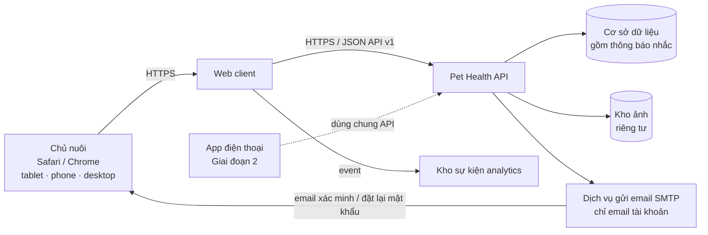
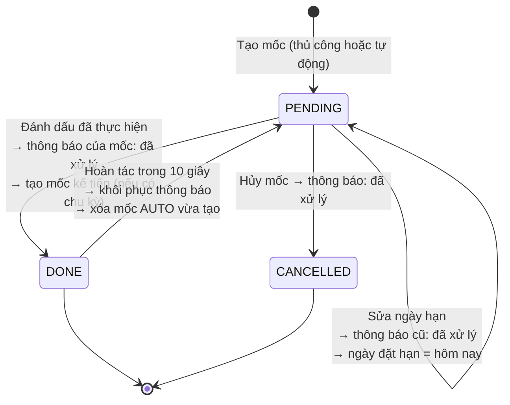
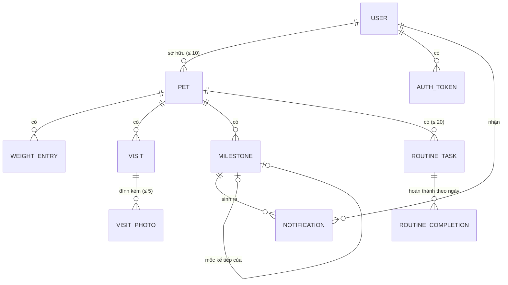
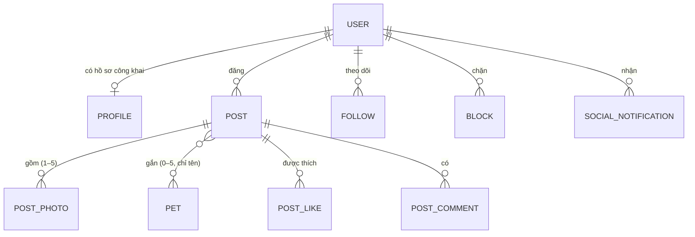

# Đặc tả Yêu cầu Phần mềm (SRS) — Pet Health: Nhật ký số theo dõi sức khỏe thú cưng (Web)

| Trường | Giá trị |
|---|---|
| Mã tài liệu | PH-SRS-001 |
| Phiên bản | **1.1** |
| Trạng thái | **Baselined** (Việt phê duyệt 2026-10-23, BRD DEC-022); v1.1 bổ sung Giai đoạn 2 — Bản tin (Việt duyệt khi triển khai, 2026-10-26) |
| Ngày | 2026-10-22 (v1.1: 2026-10-26) |
| Tác giả | Việt (soạn với Claude) |
| Người phê duyệt | Việt |
| Chuẩn áp dụng | IEEE 29148-2018, §9.6 (SRS content) |
| Baseline đầu vào | [BRD.md](BRD.md) v1.3 · [PRD.md](PRD.md) v1.3 |

**Lịch sử phiên bản**

| Phiên bản | Ngày | Tác giả | Tóm tắt |
|---|---|---|---|
| 0.1 | 2026-10-22 | Việt | Bản nháp đầu tiên, dựng từ BRD v1.0 và PRD v1.0 |
| 0.2 | 2026-10-22 | Việt | Theo BRD DEC-016→DEC-018: bỏ email nhắc, viết lại mô-đun NTF thành **nhắc nhở trong app** (banner + mục Thông báo); email chỉ còn cho tài khoản qua SMTP; bỏ yêu cầu giám sát (IF-SW-004, NFR-REL-004), webhook email (IF-COM-004), chỉ tiêu bounce (NFR-REL-005); bỏ SD-010; sửa SD-012 cho hạ tầng tự dựng; thêm DC-006 |
| 0.3 | 2026-10-22 | Việt | PD-009 được duyệt (DEC-019). Chưa sao lưu (DEC-020): NFR-REL-002 Withdrawn, SD-012 bỏ RPO/RTO |
| **1.0** | 2026-10-23 | Việt | **Baseline.** Duyệt SD-001→SD-014 và đóng OQ-S01: FR-AUTH-015 truy vết về BR-044 (DEC-022) |
| **1.1** | 2026-10-26 | Việt | **Giai đoạn 2 — Bản tin ảnh thú cưng** (đã cài đặt trên môi trường dev): thêm mô-đun SOC (§2.12, FR-SOC-001→FR-SOC-040), SD-015→SD-022; đăng ký bắt buộc nickname và ngày sinh (FR-AUTH-017, FR-AUTH-018); ảnh > 5 MB được nén ở trình duyệt (FR-GEN-013); chuông tự làm mới 30 giây (FR-NTF-010); event analytics bản tin (FR-ANL-006); endpoint, NFR, mô hình dữ liệu và kiểm chứng tương ứng. Nguồn: [tasks-feed/](../implement/tasks-feed/README.md), [Implement_plan §10](../implement/Implement_plan.md) |

---

## 1. Giới thiệu

### 1.1 Mục đích

Tài liệu này đặc tả **hành vi mà phần mềm Pet Health Giai đoạn 1 (web) phải có**, cùng phần **Bản tin của Giai đoạn 2** (§2.12, từ v1.1), đủ chi tiết để:

- **Kiến trúc sư** thiết kế SAD, API và mô hình dữ liệu vật lý.
- **Lập trình viên** cài đặt mà không phải đoán quy tắc.
- **QA** viết test case cho từng yêu cầu.

SRS không thay thế BRD (*tại sao*) hay PRD (*cho ai, trải nghiệm thế nào*). Nó trả lời câu hỏi **hệ thống phải làm chính xác điều gì**.

### 1.2 Phạm vi

**Pet Health** là ứng dụng web responsive giúp chủ nuôi:

1. Quản lý hồ sơ tối đa 10 thú cưng.
2. Ghi cân nặng và xem xu hướng so với cân nặng mục tiêu.
3. Lưu sổ y tế điện tử (bản ghi khám kèm ảnh).
4. Lên lịch mốc y tế (vaccine, nhỏ gáy, tẩy giun), **tự nhắc trong web app** (banner trên Dashboard và mục Thông báo) trước 7 ngày, trước 1 ngày và khi quá hạn, và tự tạo mốc kế tiếp theo chu kỳ.
5. Theo dõi checklist việc chăm sóc hằng ngày.
6. **(Giai đoạn 2, v1.1)** Bản tin ảnh thú cưng: hồ sơ công khai, đăng bài 1–5 ảnh (gắn thú cưng tùy chọn), theo dõi, bản tin theo thời gian, thả tim, bình luận, thông báo hoạt động, chặn người dùng (§2.12).

**Ngoài phạm vi:** app native, push notification, **email nhắc** (DEC-016), chia sẻ **dữ liệu sức khỏe** cho người khác (Bản tin chỉ chia sẻ ảnh, chú thích và tên thú cưng do người dùng chủ động đăng, SD-016), tư vấn y tế, kết nối phòng khám, chỉ số thể chất ngoài cân nặng (BRD §5.2). Với Bản tin: không có story, video, nhắn tin, hashtag, trang khám phá và **không có chức năng báo cáo nội dung** (SD-017).

### 1.3 Tổng quan sản phẩm

#### 1.3.1 Bối cảnh hệ thống



> Sơ đồ chỉ thể hiện **ranh giới logic**. Việc chọn công nghệ cụ thể thuộc SAD. Nhắc nhở không đi ra ngoài hệ thống: chúng được tạo và hiển thị ngay trong web app (FR-NTF).

#### 1.3.2 Chức năng chính

| Mô-đun | Mã | Mô tả |
|---|---|---|
| Tài khoản và xác thực | AUTH | Đăng ký, xác minh email, đăng nhập, quên mật khẩu, cài đặt, xóa tài khoản, phân quyền |
| Hồ sơ thú cưng | PET | Tạo, sửa, xóa, ảnh đại diện, tính tuổi, giới hạn 10 |
| Cân nặng | WGT | Số đo, mục tiêu, biểu đồ |
| Sổ y tế | VIS | Bản ghi khám, ảnh đính kèm |
| Mốc y tế | MS | Vòng đời mốc, tự lặp |
| Nhắc nhở | NTF | Tạo nhắc nhở trong app theo mức D7 / D1 / Quá hạn, banner trên Dashboard, mục Thông báo |
| Việc hằng ngày | RT | Định nghĩa việc, checklist theo ngày |
| Dashboard | DSH | Màn hình tổng quan responsive |
| Toàn hệ thống | GEN | Ngày giờ, lỗi, offline, định dạng |
| Analytics | ANL | Sự kiện đo lường |
| Bản tin (Giai đoạn 2) | SOC | Hồ sơ công khai, bài đăng, theo dõi, tìm người, bản tin, tim, bình luận, thông báo hoạt động, chặn, giới hạn chống spam |

#### 1.3.3 Đặc điểm người dùng

| Lớp người dùng | Mô tả | Quyền |
|---|---|---|
| Khách | Chưa đăng nhập | Chỉ truy cập trang đăng ký, đăng nhập, quên mật khẩu, xác minh email |
| Chủ nuôi (chưa xác minh email) | Đã đăng ký, chưa xác minh | Dùng đủ chức năng, kể cả nhắc nhở trong app. Chỉ thấy banner nhắc xác minh (BR-036) |
| Chủ nuôi (đã xác minh) | Người dùng chuẩn | Toàn quyền trên dữ liệu của chính mình |
| Chủ nuôi có hồ sơ công khai (Giai đoạn 2) | Đã tạo hồ sơ công khai (FR-SOC-001) | Thêm quyền đăng bài; mọi người đã đăng nhập xem được hồ sơ và bài đã đăng của họ. Dữ liệu sức khỏe vẫn chỉ chủ tài khoản thấy |

Người dùng có kỹ năng dùng web và điện thoại phổ thông, không cần kiến thức y khoa hay kỹ thuật. Không có vai trò quản trị viên trong giao diện ở Giai đoạn 1.

#### 1.3.4 Giới hạn

- Chỉ chạy trên trình duyệt: 2 phiên bản chính mới nhất của Safari (iOS, iPadOS, macOS) và Chrome (Android, desktop) (CON-001).
- Nhắc nhở chỉ hiển thị trong web app; không email nhắc, không push (CON-002). Người dùng chỉ thấy nhắc khi mở app.
- Không lưu và không ghi dữ liệu khi offline (CON-003).
- Không đồng bộ real-time; dữ liệu nhất quán ở lần tải kế tiếp (BRU-008).
- Kiến trúc phải cho phép app Giai đoạn 2 dùng chung backend (CON-006, PRD MR-1→MR-8).

### 1.4 Định nghĩa và quy ước

| Thuật ngữ | Định nghĩa |
|---|---|
| **phải** | Yêu cầu bắt buộc (*shall*) |
| **nên** | Yêu cầu mong muốn (*should*) |
| Múi giờ tài khoản | Múi giờ IANA lưu trong cài đặt tài khoản; mặc định `Asia/Ho_Chi_Minh` |
| Hôm nay | Ngày lịch hiện tại tính theo múi giờ tài khoản |
| Mốc | Một sự kiện y tế định kỳ có ngày đến hạn (Milestone) |
| Mức nhắc | Một trong ba thời điểm nhắc của một mốc: **D7** (hạn − 7), **D1** (hạn − 1), **OVERDUE** (hạn + 1) |
| Thông báo (nhắc) | Một bản ghi nhắc nhở trong app ứng với một mốc và một mức nhắc; có trạng thái chưa xem / đã xem và có thể bị đánh dấu đã xử lý |
| Ngày đặt hạn | Ngày (theo múi giờ tài khoản) mà ngày đến hạn hiện tại của mốc được đặt: lúc tạo mốc hoặc lần sửa ngày hạn gần nhất |
| Tháng lịch | Cộng N tháng theo lịch; nếu ngày đích không tồn tại thì lấy ngày cuối tháng đó (ví dụ 31/01 + 1 tháng = 28/02 hoặc 29/02) |
| p75 / p95 | Phân vị thứ 75 / 95 của phân phối đo |
| HEIC | Định dạng ảnh mặc định trên iPhone |
| Hồ sơ công khai | Danh tính của người dùng trên Bản tin: username, tên hiển thị, giới thiệu, ảnh đại diện (khác nickname tài khoản) |
| Bài đăng | 1–5 ảnh kèm chú thích và 0–5 thú cưng được gắn; trạng thái `DRAFT` (đang tải ảnh) hoặc `PUBLISHED` |
| Chặn | Quan hệ một chiều do người chặn tạo; khi có, hai người không thấy nội dung của nhau ở Bản tin |
| Thông báo hoạt động | Thông báo xã hội (tim, bình luận, theo dõi), tách khỏi thông báo nhắc mốc y tế |

**Định dạng ID:** `FR-<MÔ-ĐUN>-nnn` (chức năng), `NFR-<NHÓM>-nnn` (phi chức năng), `SD-nnn` (quyết định đặc tả mới, chờ duyệt), `OQ-Snn` (câu hỏi mở của SRS).

**Ưu tiên:** P0, P1, P2, theo cùng nghĩa với PRD.

**Phương pháp kiểm chứng:** **T** = Test, **D** = Demonstration, **I** = Inspection, **A** = Analysis.

### 1.5 Tài liệu tham chiếu

| Tài liệu | Phiên bản |
|---|---|
| IEEE 29148-2018 — Requirements engineering | 2018 |
| BRD Pet Health (PH-BRD-001) | 1.0 |
| PRD Pet Health (PH-PRD-001) | 1.0 |
| WCAG 2.1 | 2.1 |
| OWASP Top 10 | 2021 |
| IANA Time Zone Database | Hiện hành |

### 1.6 Quyết định đặc tả mới cần duyệt

Baseline chưa quy định các chi tiết dưới đây, nhưng thiếu chúng thì không cài đặt hay kiểm thử được. Toàn bộ SD-001→SD-014 (trừ SD-010 đã Withdrawn) **đã được Việt duyệt** ngày 2026-10-23 (DEC-022):

| ID | Quyết định đề xuất | Lý do | Ảnh hưởng |
|---|---|---|---|
| SD-001 | Mật khẩu dài 8–128 ký tự, không bắt buộc ký tự đặc biệt | Theo khuyến nghị NIST 800-63B: ưu tiên độ dài | FR-AUTH-001 |
| SD-002 | Liên kết xác minh email hiệu lực 24 giờ; liên kết đặt lại mật khẩu hiệu lực 60 phút. Cả hai chỉ dùng được 1 lần | Cân bằng tiện lợi và an toàn | FR-AUTH-002, FR-AUTH-008 |
| SD-003 | Phiên đăng nhập hết hạn sau 30 ngày không hoạt động (gia hạn trượt) | Ứng dụng cá nhân, người dùng mở hằng ngày | FR-AUTH-012 |
| SD-004 | Không đổi được loại mốc sau khi tạo; muốn đổi thì hủy và tạo mốc mới | Tránh xung đột với chu kỳ lặp và lịch sử nhắc | FR-MS-010 |
| SD-005 | Tối đa 20 việc hằng ngày cho mỗi thú cưng | Chặn dữ liệu bất thường; dư cho nhu cầu thực tế | FR-RT-001 |
| SD-006 | Ghi chú của mốc tối đa 500 ký tự; chu kỳ lặp là số nguyên 1–60 tháng | Đồng bộ PRD §4.2 | FR-MS-001 |
| SD-007 | Xóa ảnh khỏi metadata EXIF (đặc biệt là vị trí GPS) khi lưu | Ảnh chụp bằng điện thoại thường chứa vị trí nhà | FR-VIS-005, NFR-SEC-011 |
| SD-008 | Xóa việc hằng ngày thì việc biến mất khỏi checklist, nhưng lịch sử hoàn thành các ngày trước được giữ để tính MET-003 | Không làm sai thống kê quá khứ | FR-RT-007 |
| SD-009 | Xác nhận xóa thú cưng: so khớp tên sau khi bỏ khoảng trắng đầu và cuối, không phân biệt hoa thường | Tránh người dùng bị chặn vì khác hoa thường | FR-PET-008 |
| SD-010 | ~~Cửa sổ gửi email nhắc 08:00–08:15~~ — **Withdrawn** (DEC-016: không còn email nhắc) | — | — |
| SD-011 | Giả định quy mô thiết kế: 1.000 tài khoản, 10.000 thú cưng, 50.000 mốc | BRD OQ-008 chưa có số liệu; mốc đủ dư cho dự án cá nhân | NFR-PERF-006 |
| SD-012 | Mục tiêu vận hành: khả dụng **98%** mỗi tháng. **Không cam kết RPO/RTO** ở Giai đoạn 1 vì chưa có sao lưu (DEC-020, BRD RSK-006) | Hạ tầng tự dựng (DEC-018) phụ thuộc điện và mạng tại chỗ, không có dự phòng nóng | NFR-REL-001 |
| SD-013 | Thông báo được lưu 90 ngày kể từ ngày xuất hiện rồi tự xóa | Đủ để xem lại; giữ dữ liệu gọn | FR-NTF-011 |
| SD-014 | Danh sách mục Thông báo phân trang 20 mục; badge hiển thị tối đa "9+" | Đồng bộ với FR-VIS-002 | FR-NTF-008 |
| SD-015 | **(v1.1)** Bài đăng và hồ sơ công khai chỉ hiển thị cho người **đã đăng nhập**; không có trang công khai cho khách hay máy tìm kiếm | Giảm rủi ro lộ dữ liệu, đơn giản phân quyền | FR-SOC-001→040 |
| SD-016 | **(v1.1)** Bảng dữ liệu sức khỏe giữ nguyên quyền chỉ-chủ-sở-hữu. Bài đăng chỉ hiện **tên** thú cưng được gắn; không bao giờ hiện giống, ngày sinh, cân nặng, sổ y tế, mốc | Bản tin không được làm lộ dữ liệu sức khỏe | FR-SOC-012, NFR-SEC-013 |
| SD-017 | **(v1.1)** Không có chức năng báo cáo, tự ẩn hay kiểm duyệt nội dung. Người dùng tự bảo vệ bằng chặn + giới hạn chống spam; bài vi phạm do chủ hệ thống gỡ thủ công | Dự án cá nhân, quy mô nhỏ | FR-SOC-034→040 |
| SD-018 | **(v1.1)** Tối đa 5 ảnh/bài, 30 bài/ngày/tài khoản; server nhận tệp ≤ 5 MB, ảnh lớn hơn (tới 50 MB) được nén ở trình duyệt | Giữ dung lượng kho ảnh nhỏ | FR-SOC-008, FR-GEN-013 |
| SD-019 | **(v1.1)** Mỗi tài khoản có **một** hồ sơ và **một** lưới ảnh chứa mọi bài, không chia theo từng thú cưng. Gắn thú cưng là tùy chọn (0–5 bé) | Đơn giản, đúng thói quen mạng xã hội | FR-SOC-008, FR-SOC-016 |
| SD-020 | **(v1.1)** Đổi username tối đa 1 lần mỗi 14 ngày (lần đổi đầu tiên không phải chờ) | Tránh mạo danh, giữ link hồ sơ ổn định | FR-SOC-003 |
| SD-021 | **(v1.1)** Thông báo hoạt động lưu trong bảng riêng, giữ 90 ngày; chuông đếm chung với nhắc lịch | Bảng nhắc lịch gắn chặt với mốc y tế | FR-SOC-028→033 |
| SD-022 | **(v1.1)** Đăng ký bắt buộc nickname (1–50 ký tự) và ngày sinh; tài khoản cũ được hỏi bổ sung | Dùng làm tên gợi ý cho hồ sơ công khai | FR-AUTH-017 |

**Câu hỏi mở của SRS**

| ID | Câu hỏi | Ảnh hưởng | Đề xuất |
|---|---|---|---|
| OQ-S01 | Baseline chưa có chức năng **đổi địa chỉ email** tài khoản. Nếu gõ sai email khi đăng ký, người dùng không tự sửa được | Không lấy lại được mật khẩu khi quên | **Closed** → DEC-022: thêm BR-044 (Should) ở BRD v1.3; đặc tả ở FR-AUTH-015, ưu tiên P1 |

---

## 2. Yêu cầu chức năng

Cột **Nguồn** truy vết về BR (BRD) và US (PRD). Tiêu chí chấp nhận chi tiết nằm ở BRD §7.7 và PRD §3. SRS chỉ bổ sung quy tắc mà hai tài liệu đó chưa nêu.

### 2.1 AUTH — Tài khoản và xác thực

| ID | Yêu cầu | Nguồn | Ưu tiên | KC |
|---|---|---|---|---|
| FR-AUTH-001 | Hệ thống **phải** cho phép khách tạo tài khoản bằng email và mật khẩu 8–128 ký tự (SD-001). Email được chuẩn hóa (bỏ khoảng trắng, chuyển chữ thường) và là duy nhất trong hệ thống. Từ v1.1 đăng ký còn bắt buộc nickname và ngày sinh (FR-AUTH-017) và nhập lại mật khẩu (FR-AUTH-018). | BR-035 / US-001 | P0 | T |
| FR-AUTH-002 | Sau khi tạo tài khoản, hệ thống **phải** gửi email xác minh trong vòng 1 phút. Email chứa liên kết dùng một lần, hiệu lực 24 giờ (SD-002). | BR-036 / US-002 | P1 | T |
| FR-AUTH-003 | Hệ thống **phải** cho phép gửi lại email xác minh, tối đa 5 lần mỗi giờ cho mỗi tài khoản. Gửi lại thì vô hiệu hóa liên kết cũ. | BR-036 / US-002 | P1 | T |
| FR-AUTH-004 | Khi mở liên kết xác minh hợp lệ, hệ thống **phải** chuyển tài khoản sang *đã xác minh*. Liên kết hết hạn, đã dùng hoặc sai **phải** hiển thị thông báo kèm nút gửi lại. | BR-036 / US-002 | P1 | T |
| FR-AUTH-005 | Hệ thống **phải** xác thực bằng email và mật khẩu. Khi thất bại, hệ thống **phải** trả về đúng một thông báo chung "Email hoặc mật khẩu không đúng" cho mọi nguyên nhân. | BR-025 / US-003 | P0 | T |
| FR-AUTH-006 | Sau 5 lần đăng nhập sai liên tiếp trong 15 phút với cùng một tài khoản, hệ thống **phải** khóa đăng nhập tài khoản đó 15 phút. | US-003 | P0 | T |
| FR-AUTH-007 | Hệ thống **phải** cho phép đăng xuất. Đăng xuất **phải** vô hiệu hóa phiên hiện tại ở phía server. | US-003 | P0 | T |
| FR-AUTH-008 | Hệ thống **phải** cho phép yêu cầu đặt lại mật khẩu bằng email. Phản hồi trên giao diện **phải** giống nhau dù email có tồn tại hay không. Liên kết dùng một lần, hiệu lực 60 phút (SD-002). | BR-037 / US-004 | P1 | T |
| FR-AUTH-009 | Đặt lại hoặc đổi mật khẩu thành công thì hệ thống **phải** vô hiệu hóa mọi phiên khác của tài khoản. | BR-037 | P1 | T |
| FR-AUTH-010 | Người dùng đã đăng nhập **phải** đổi được mật khẩu khi nhập đúng mật khẩu hiện tại. | PRD §4.1 | P1 | T |
| FR-AUTH-011 | Người dùng **phải** chọn được múi giờ tài khoản từ danh sách IANA; mặc định `Asia/Ho_Chi_Minh`. Đổi múi giờ có hiệu lực ngay cho mọi phép tính "hôm nay" (checklist, mức nhắc, trạng thái mốc); thông báo đã tạo giữ nguyên. | PD-007 / BRU-006 | P0 | T |
| FR-AUTH-012 | Phiên đăng nhập **phải** hết hạn sau 30 ngày không hoạt động (SD-003). | NFR-SEC | P0 | T |
| FR-AUTH-013 | Hệ thống **phải** chỉ trả về và chỉ cho thay đổi tài nguyên thuộc tài khoản đang đăng nhập. Truy cập tài nguyên của tài khoản khác hoặc tài nguyên không tồn tại **phải** nhận cùng một phản hồi "không tìm thấy" (404). | BR-026 / US-006 | P0 | T |
| FR-AUTH-014 | Khách truy cập trang cần đăng nhập thì **phải** bị chuyển về trang đăng nhập. Đăng nhập thành công thì quay lại đúng trang đã yêu cầu. | BR-025 / US-006 | P0 | T |
| FR-AUTH-015 | Hệ thống **phải** cho phép đổi email tài khoản khi nhập đúng mật khẩu hiện tại. Email mới phải chưa được dùng, nhận liên kết xác minh dùng một lần hiệu lực 60 phút, và chỉ thay email cũ sau khi xác minh. Đổi xong thì email cũ nhận thư thông báo và trạng thái tài khoản là *đã xác minh*. | BR-044 / US-008 | P1 | T |
| FR-AUTH-016 | Người dùng **phải** xóa được tài khoản sau khi nhập lại mật khẩu. Ngay sau khi xóa: không đăng nhập được, mọi phiên bị hủy, và mọi dữ liệu (kể cả thông báo, hồ sơ công khai, bài đăng, theo dõi, tim, bình luận) cùng ảnh bị xóa khỏi hệ thống chính. | BR-038 / US-005 | P2 | T |
| FR-AUTH-017 | **(v1.1)** Khi đăng ký, hệ thống **phải** yêu cầu **nickname** (1–50 ký tự sau khi bỏ khoảng trắng đầu/cuối) và **ngày sinh** (ngày có thật, từ 01/01/1900 tới hôm nay theo múi giờ tài khoản; ngày tương lai → lỗi `FUTURE_DATE`, ngày không hợp lệ → `INVALID_DATE`). Cả hai sửa được trong Cài đặt. Tài khoản tạo trước v1.1 chưa có hai trường này **phải** được hỏi bổ sung một lần khi mở app. Ngày sinh **phải không** hiển thị cho người khác. | SD-022 | P1 | T |
| FR-AUTH-018 | **(v1.1)** Form đăng ký **phải** có ô "Nhập lại mật khẩu"; hai ô không khớp thì báo lỗi ngay dưới trường và không gửi yêu cầu. Kiểm tra này chỉ ở client (server không nhận trường này). | Góp ý chủ dự án 2026-10-26 | P1 | T |

### 2.2 PET — Hồ sơ thú cưng

| ID | Yêu cầu | Nguồn | Ưu tiên | KC |
|---|---|---|---|---|
| FR-PET-001 | Hệ thống **phải** cho phép tạo thú cưng với: tên (1–50 ký tự, không chỉ toàn khoảng trắng), giống (1–50 ký tự), giới tính (`Đực` \| `Cái`), ngày sinh (≤ hôm nay). Cả 4 trường đều bắt buộc. | BR-001 / US-010 | P0 | T |
| FR-PET-002 | Khi tài khoản đã có 10 thú cưng, hệ thống **phải** từ chối tạo thêm ở cả giao diện (nút bị vô hiệu kèm chú thích) và API. | BR-029, BRU-009 / US-015 | P0 | T |
| FR-PET-003 | Hệ thống **phải** hiển thị tuổi theo thuật toán ở §2.10.1. | BR-002, BRU-001 / US-011 | P1 | T |
| FR-PET-004 | Hệ thống **phải** cho phép nhập đặc điểm nhận dạng dạng văn bản tự do, tối đa 2.000 ký tự, không bắt buộc. | BR-003 / US-012 | P1 | T |
| FR-PET-005 | Hệ thống **phải** cho phép đặt, thay hoặc gỡ một ảnh đại diện: JPG, PNG hoặc HEIC; tối đa 5 MB khi gửi lên server (ảnh lớn hơn được nén ở trình duyệt, FR-GEN-013); kiểm tra định dạng bằng nội dung tệp, không theo phần mở rộng. HEIC **phải** được chuyển sang JPG khi lưu. | BR-004, PD-002 / US-012 | P1 | T |
| FR-PET-006 | Hệ thống **phải** cho phép sửa mọi trường của FR-PET-001, FR-PET-004 và FR-PET-005, với cùng quy tắc kiểm tra. | BR-005 / US-013 | P0 | T |
| FR-PET-007 | Hệ thống **phải** có bộ chọn thú cưng hiển thị trên mọi màn hình dữ liệu. Chuyển thú cưng chỉ cần 1 thao tác chọn. Thú cưng đang chọn được nhớ theo thiết bị. | BR-029 / US-015 | P0 | D |
| FR-PET-008 | Hệ thống **phải** cho phép xóa thú cưng khi người dùng nhập đúng tên (SD-009). Xóa thì toàn bộ số đo, bản ghi khám, ảnh, mốc, thông báo và việc hằng ngày của thú cưng bị xóa. | BR-039 / US-014 | P1 | T |

### 2.3 WGT — Cân nặng

| ID | Yêu cầu | Nguồn | Ưu tiên | KC |
|---|---|---|---|---|
| FR-WGT-001 | Hệ thống **phải** cho phép thêm số đo với ngày đo (mặc định hôm nay, ≤ hôm nay) và giá trị 0,1–150 kg, tối đa 1 chữ số thập phân. Ô nhập **phải** chấp nhận cả `,` và `.` làm dấu thập phân. | BR-006, BRU-003 / US-020 | P0 | T |
| FR-WGT-002 | Hệ thống **phải** cho phép nhiều số đo trong cùng một ngày và giữ tất cả. | US-020 | P0 | T |
| FR-WGT-003 | Hệ thống **phải** hiển thị lịch sử số đo theo ngày đo giảm dần. Các số đo cùng ngày xếp theo thời điểm tạo giảm dần. | BR-007 / US-022 | P0 | T |
| FR-WGT-004 | Hệ thống **phải** vẽ biểu đồ đường: trục X là ngày đo (tăng dần), trục Y là kg. Có ít nhất 1 điểm thì trục Y **phải** bao trùm cả các số đo lẫn mục tiêu (nếu có). | BR-007 / US-022 | P0 | D |
| FR-WGT-005 | Hệ thống **phải** cho phép đặt, sửa, xóa cân nặng mục tiêu (0,1–150 kg, 1 chữ số thập phân) cho từng thú cưng. | BR-008, BRU-007 / US-021 | P0 | T |
| FR-WGT-006 | Khi có mục tiêu, biểu đồ **phải** vẽ thêm một đường ngang nét đứt tại giá trị mục tiêu, trên cùng trục Y. | BR-009 / US-022 | P0 | D |
| FR-WGT-007 | Chạm hoặc rê chuột vào một điểm thì hệ thống **phải** hiển thị ngày đo, giá trị và chênh lệch so với mục tiêu (có dấu `+` hoặc `−`, 1 chữ số thập phân). Không có mục tiêu thì bỏ phần chênh lệch. | US-022 | P0 | D |
| FR-WGT-008 | 0 số đo: hiển thị empty state (§2.9). 1 số đo: hiển thị 1 điểm kèm gợi ý "Thêm số đo tháng sau để thấy xu hướng". | US-022 | P0 | D |
| FR-WGT-009 | Thẻ tóm tắt **phải** hiển thị số đo gần nhất và chênh lệch so với số đo liền trước. | PRD §4.1 | P1 | D |
| FR-WGT-010 | Hệ thống **phải** cho phép sửa hoặc xóa một số đo. | BR-010 / US-023 | P1 | T |

### 2.4 VIS — Sổ y tế

| ID | Yêu cầu | Nguồn | Ưu tiên | KC |
|---|---|---|---|---|
| FR-VIS-001 | Hệ thống **phải** cho phép tạo bản ghi khám gồm: ngày khám (bắt buộc, mặc định hôm nay, ≤ hôm nay), triệu chứng, chẩn đoán, đơn thuốc (mỗi trường ≤ 2.000 ký tự). Phải có ít nhất một trong triệu chứng hoặc chẩn đoán (sau khi bỏ khoảng trắng). | BR-011, PD-003 / US-030 | P0 | T |
| FR-VIS-002 | Hệ thống **phải** liệt kê bản ghi theo ngày khám giảm dần (cùng ngày thì theo thời điểm tạo giảm dần), mỗi trang 20 bản ghi. Mỗi dòng hiển thị ngày, chẩn đoán rút gọn 1 dòng và số ảnh. | BR-012 / US-031 | P0 | T |
| FR-VIS-003 | Hệ thống **phải** cho phép sửa mọi trường của bản ghi, với cùng quy tắc kiểm tra. | BR-013 / US-032 | P0 | T |
| FR-VIS-004 | Hệ thống **phải** yêu cầu xác nhận trước khi xóa bản ghi. Xóa bản ghi thì xóa luôn mọi ảnh đính kèm của nó. | BR-014 / US-032 | P0 | T |
| FR-VIS-005 | Hệ thống **phải** cho phép đính kèm ảnh: JPG/PNG/HEIC, ≤ 5 MB mỗi ảnh khi gửi lên server (ảnh lớn hơn được nén ở trình duyệt, FR-GEN-013), ≤ 5 ảnh mỗi bản ghi; kiểm tra bằng nội dung tệp. HEIC được chuyển sang JPG; metadata EXIF bị loại bỏ (SD-007). | BR-030, BRU-010 / US-033 | P1 | T |
| FR-VIS-006 | Mỗi ảnh **phải** được tải lên và xử lý độc lập. Một ảnh lỗi không làm hỏng các ảnh khác hay bản ghi, và ảnh lỗi có nút "Thử lại". | US-033, PRD §4.2 | P1 | T |
| FR-VIS-007 | Hệ thống **phải** cho phép xóa từng ảnh đính kèm. | BR-031 / US-034 | P1 | T |
| FR-VIS-008 | Hệ thống **phải** hiển thị ảnh dạng thu nhỏ trong bản ghi và cho xem phóng to khi chạm vào. | US-033 | P1 | D |

### 2.5 MS — Mốc y tế

#### 2.5.1 Mô hình mốc

| Thuộc tính | Kiểu | Quy tắc |
|---|---|---|
| Loại | `VACCINE` (Tiêm vaccine) \| `FLEA` (Nhỏ gáy) \| `DEWORM` (Tẩy giun) | Bắt buộc; không đổi sau khi tạo (SD-004) |
| Ngày đến hạn | Ngày | Bắt buộc; được phép ở quá khứ (BRU-002) |
| Ghi chú | Văn bản ≤ 500 ký tự | Không bắt buộc (ví dụ "Dại", "5 bệnh") |
| Chu kỳ lặp | Số nguyên 1–60 (tháng) hoặc rỗng | Chỉ áp dụng cho `FLEA` và `DEWORM` (BRU-012). `VACCINE` luôn là 12 tháng cố định (BRU-011) |
| Trạng thái lưu | `PENDING` \| `DONE` \| `CANCELLED` | |
| Ngày thực hiện | Ngày | Bắt buộc khi `DONE`; ≤ hôm nay |
| Nguồn gốc | `MANUAL` \| `AUTO` | `AUTO` nếu do FR-MS-008 hoặc FR-MS-009 tạo |
| Ngày đặt hạn | Ngày | Hệ thống ghi; = hôm nay khi tạo mốc hoặc khi đổi ngày đến hạn (FR-NTF-003) |
| Mốc gốc | Tham chiếu tới mốc trước | Có khi nguồn gốc là `AUTO` |

**Trạng thái hiển thị** (suy ra, không lưu): `PENDING` có ngày đến hạn ≥ hôm nay thì là **Sắp tới**; `PENDING` có ngày đến hạn < hôm nay thì là **Quá hạn**; `DONE` là **Đã thực hiện**; `CANCELLED` là **Đã hủy**.



#### 2.5.2 Yêu cầu

| ID | Yêu cầu | Nguồn | Ưu tiên | KC |
|---|---|---|---|---|
| FR-MS-001 | Hệ thống **phải** cho phép tạo mốc với các thuộc tính ở §2.5.1. Mốc mới ở trạng thái `PENDING`. | BR-015, BR-033 / US-040, US-044 | P0 | T |
| FR-MS-002 | Khi tạo mốc, hệ thống **phải** ghi *ngày đặt hạn* = hôm nay; các mức nhắc của mốc được xác định theo FR-NTF-001→FR-NTF-003. | BR-016, BR-017 | P0 | T |
| FR-MS-003 | Hệ thống **phải** cho phép đánh dấu mốc `PENDING` là `DONE` với ngày thực hiện (mặc định hôm nay, ≤ hôm nay). | BR-018 / US-042 | P0 | T |
| FR-MS-004 | Khi mốc chuyển sang `DONE`, hệ thống **phải** đánh dấu mọi thông báo của mốc là đã xử lý (FR-NTF-006) và không tạo thông báo mới cho mốc đó. | BR-019 / US-042 | P0 | T |
| FR-MS-005 | Trong 10 giây sau khi đánh dấu `DONE`, hệ thống **phải** cho phép hoàn tác: mốc trở về `PENDING`, các thông báo bị đánh dấu đã xử lý bởi lần đánh dấu đó trở lại trạng thái trước, và mốc `AUTO` vừa sinh ra (nếu có) bị xóa. | US-042 | P0 | T |
| FR-MS-006 | Hệ thống **phải** cho phép sửa ngày đến hạn, ghi chú và chu kỳ của mốc `PENDING`. Khi ngày đến hạn thay đổi, *ngày đặt hạn* = hôm nay và thông báo hiện có của mốc được đánh dấu đã xử lý (FR-NTF-006). | BR-020 / US-046 | P0 | T |
| FR-MS-007 | Hệ thống **phải** cho phép hủy mốc `PENDING` sau khi xác nhận. Mốc chuyển sang `CANCELLED` và mọi thông báo của mốc được đánh dấu đã xử lý. | BR-020 / US-046 | P0 | T |
| FR-MS-008 | Khi một mốc `VACCINE` chuyển sang `DONE`, hệ thống **phải** tạo đúng 1 mốc `VACCINE` mới, `PENDING`, nguồn gốc `AUTO`, ngày đến hạn = **ngày thực hiện + 12 tháng lịch**, sao chép ghi chú của mốc cũ, và hiển thị thông báo kèm ngày đến hạn mới. | BR-032, BRU-011 / US-043 | P0 | T |
| FR-MS-009 | Khi một mốc `FLEA` hoặc `DEWORM` có chu kỳ N chuyển sang `DONE`, hệ thống **phải** tạo đúng 1 mốc cùng loại, `PENDING`, `AUTO`, ngày đến hạn = **ngày thực hiện + N tháng lịch**, sao chép ghi chú và chu kỳ. Không có chu kỳ thì không tạo mốc mới. | BR-034, BRU-012 / US-044 | P1 | T |
| FR-MS-010 | Hệ thống **phải không** cho đổi loại mốc sau khi tạo (SD-004). | SD-004 | P0 | T |
| FR-MS-011 | Việc tạo mốc kế tiếp (FR-MS-008, FR-MS-009) **phải** idempotent: mỗi lần chuyển sang `DONE` sinh ra tối đa 1 mốc kế tiếp, kể cả khi yêu cầu bị gửi lặp. | REL | P0 | T |
| FR-MS-012 | Hệ thống **phải** hiển thị danh sách mốc của thú cưng theo 4 nhóm: Sắp tới (ngày hạn tăng dần), Quá hạn (ngày hạn tăng dần), Đã thực hiện (ngày thực hiện giảm dần), Đã hủy. | BR-015 / US-047 | P0 | D |
| FR-MS-013 | Màu trạng thái **phải** theo PRD IX-7 và luôn kèm nhãn chữ: Quá hạn = đỏ; còn ≤ 7 ngày = cam; còn > 7 ngày = trung tính; Đã thực hiện = xanh. | PRD §4.1 | P1 | I |

### 2.6 NTF — Nhắc nhở trong app

Theo DEC-016, nhắc nhở **không** được gửi ra ngoài hệ thống. Thông báo được tạo trong hệ thống và hiển thị ở hai nơi: **banner trên Dashboard** và **mục Thông báo** (chuông trên thanh trên cùng). Quy tắc nguồn: BRU-005 (BRD v1.1), PD-009 (PRD v1.1).

#### 2.6.1 Quy tắc tạo thông báo

| Mức | Ngày xuất hiện (theo múi giờ tài khoản, từ 00:00) | Nhãn hiển thị |
|---|---|---|
| `D7` | hạn − 7 | "còn N ngày" (N tính tại lúc hiển thị), "ngày mai", "hôm nay" |
| `D1` | hạn − 1 | "ngày mai", "hôm nay" |
| `OVERDUE` | hạn + 1 | "quá hạn N ngày" |

| ID | Yêu cầu | Nguồn | Ưu tiên | KC |
|---|---|---|---|---|
| FR-NTF-001 | Với mỗi mốc `PENDING`, hệ thống **phải** tạo thông báo mức `D7` và `D1` theo bảng §2.6.1. Thông báo của một mức **phải** có mặt ở lần tải màn hình đầu tiên kể từ 00:00 ngày xuất hiện, dù người dùng không mở app đúng ngày đó. | BR-016, BR-017, BRU-005 / US-041 | P0 | T |
| FR-NTF-002 | Với mỗi mốc vẫn `PENDING` sau ngày đến hạn, hệ thống **phải** tạo thông báo mức `OVERDUE` theo bảng §2.6.1. | BR-041 / US-048 | P1 | T |
| FR-NTF-003 | Hệ thống **phải** chỉ tạo thông báo của một mức khi ngày xuất hiện **lớn hơn** *ngày đặt hạn* của mốc (không nhắc bù cho mốc vừa tạo hoặc vừa đổi hạn). | BRU-005, PD-009 | P0 | T |
| FR-NTF-004 | Khi nhiều mức của cùng một mốc đã tới mà chưa được tạo (người dùng không mở app), hệ thống **phải** chỉ tạo mức muộn nhất. Mỗi mốc **phải** có tối đa 1 thông báo chưa xem: khi tạo thông báo mới cho mốc, thông báo chưa xem cũ của mốc đó chuyển sang đã xem. | BRU-005, PD-009 / US-041 | P0 | T |
| FR-NTF-005 | Mỗi tổ hợp (mốc, mức, ngày đến hạn) **phải** sinh tối đa 1 thông báo, kể cả khi người dùng tải lại nhiều lần, mở trên nhiều thiết bị hoặc gửi yêu cầu song song. | PRD G-15 | P0 | T |
| FR-NTF-006 | Khi mốc chuyển sang `DONE` hoặc `CANCELLED`, bị đổi ngày đến hạn, hoặc thú cưng bị xóa, hệ thống **phải** đánh dấu mọi thông báo hiện có của mốc là *đã xử lý* (kèm lý do `DONE`, `CANCELLED`, `RESCHEDULED`) và coi là đã xem. Thông báo đã xử lý không xuất hiện trên banner. | BR-019, BR-020 / US-042, US-046 | P0 | T |
| FR-NTF-007 | Mỗi thông báo **phải** hiển thị: tên thú cưng, loại mốc, ghi chú (nếu có), ngày đến hạn (`dd/MM/yyyy`), nhãn theo bảng §2.6.1 tính tại thời điểm hiển thị, ngày xuất hiện. Chạm vào thông báo **phải** mở thẳng mốc tương ứng. Không chứa nội dung y tế nào khác. | US-041, US-049 | P0 | I |

#### 2.6.2 Hiển thị

| ID | Yêu cầu | Nguồn | Ưu tiên | KC |
|---|---|---|---|---|
| FR-NTF-008 | **Mục Thông báo:** mọi màn hình sau đăng nhập **phải** có biểu tượng chuông ở thanh trên cùng kèm số thông báo chưa xem (ẩn khi 0, tối đa "9+", SD-014). Mở chuông **phải** hiện danh sách thông báo theo ngày xuất hiện giảm dần (cùng ngày: `OVERDUE` > `D1` > `D7`), 20 mục mỗi trang; thông báo chưa xem được làm nổi bật; thông báo đã xử lý hiển thị mờ kèm nhãn "Đã thực hiện" / "Đã hủy" / "Đã đổi lịch". Chạm một thông báo thì nó chuyển sang đã xem. Có nút "Đánh dấu tất cả đã xem". Từ v1.1, số trên chuông là tổng nhắc lịch chưa xem và thông báo hoạt động chưa xem (FR-SOC-031); màn Thông báo có hai tab "Nhắc lịch" (nội dung FR này) và "Hoạt động" (FR-SOC-030). | BR-042 / US-049 | P0 | T |
| FR-NTF-009 | **Banner nhắc:** khi có ≥ 1 thông báo chưa xem (trong phạm vi bộ lọc thú cưng của Dashboard), Dashboard **phải** hiển thị banner ở đầu nội dung với thông báo khẩn cấp nhất (`OVERDUE` > `D1` > `D7`; cùng mức thì ngày hạn sớm hơn trước) và dòng "+N nhắc khác" nếu còn. Banner có nút "Xem" (mở mục Thông báo), "Đã thực hiện" (mở thao tác FR-MS-003) và nút đóng. Đóng banner **phải** chuyển các thông báo đang được banner tóm tắt sang đã xem. Màu: đỏ cho `OVERDUE`, cam cho `D1`/`D7`, luôn kèm nhãn chữ. | BR-043 / US-062 | P0 | T |
| FR-NTF-010 | Trạng thái đã xem **phải** được lưu ở server và nhất quán giữa các thiết bị ở lần tải kế tiếp. Số trên chuông và banner **phải** được làm mới mỗi lần mở hoặc tải lại màn hình và khi tab trình duyệt được chọn lại; không yêu cầu cập nhật real-time (DC-003). Từ v1.1, chuông còn **tự hỏi lại server mỗi 30 giây khi tab đang hiển thị** (dừng khi tab ẩn); đây là hỏi định kỳ, không phải đẩy real-time. | BR-027, BR-042 | P0 | T |
| FR-NTF-011 | Thông báo **phải** được lưu 90 ngày kể từ ngày xuất hiện, sau đó tự xóa (SD-013). | SD-013 | P1 | T |

**Ví dụ kiểm chứng** (múi giờ `Asia/Ho_Chi_Minh`):

| Ngày đặt hạn | Ngày hạn | Ngày người dùng mở app | Thông báo có (chưa xem) |
|---|---|---|---|
| 2026-11-01 | 2026-11-15 | 2026-11-07 | Không có |
| 2026-11-01 | 2026-11-15 | 2026-11-08 | `D7` "còn 7 ngày" |
| 2026-11-01 | 2026-11-15 | 2026-11-11 (lần đầu từ 11-07) | `D7` "còn 4 ngày" |
| 2026-11-01 | 2026-11-15 | 2026-11-14 (đã có `D7`) | `D1` "ngày mai"; `D7` chuyển đã xem |
| 2026-11-01 | 2026-11-15 | 2026-11-14 (lần đầu từ 11-07) | Chỉ `D1` (không tạo `D7`) |
| 2026-11-11 | 2026-11-15 | 2026-11-11 | Không có (`D7` = 11-08 ≤ ngày đặt hạn) |
| 2026-11-11 | 2026-11-12 | 2026-11-11 | Không có (`D1` = 11-11, không lớn hơn ngày đặt hạn) |
| 2026-11-11 | 2026-11-12 | 2026-11-13, mốc vẫn `PENDING` | `OVERDUE` "quá hạn 1 ngày" |
| 2026-11-11 | 2026-11-01 (đã qua) | bất kỳ | Không có (`OVERDUE` = 11-02 ≤ ngày đặt hạn); mốc vẫn hiện *Quá hạn* trong danh sách mốc |

### 2.7 RT — Việc chăm sóc hằng ngày

| ID | Yêu cầu | Nguồn | Ưu tiên | KC |
|---|---|---|---|---|
| FR-RT-001 | Hệ thống **phải** cho phép tạo việc hằng ngày gắn với một thú cưng: tên (1–100 ký tự), giờ (HH:MM, 24 giờ). Tối đa 20 việc mỗi thú cưng (SD-005). | BR-021 / US-050 | P1 | T |
| FR-RT-002 | Hệ thống **phải** hiển thị checklist của hôm nay: mọi việc còn hiệu lực, sắp theo giờ tăng dần, việc đã xong chuyển xuống cuối và có gạch ngang, kèm bộ đếm "x/y xong". | BR-022 / US-051 | P1 | D |
| FR-RT-003 | Một lần chạm vào việc **phải** đảo trạng thái xong/chưa xong của việc đó cho hôm nay. Giao diện cập nhật ngay; nếu lưu thất bại thì trở lại trạng thái cũ kèm thông báo lỗi. | BR-023 / US-052 | P1 | T |
| FR-RT-004 | Trạng thái hoàn thành **phải** được lưu theo cặp (việc, ngày theo múi giờ tài khoản). Checklist của mỗi ngày mới bắt đầu ở trạng thái chưa xong lúc 00:00 múi giờ tài khoản. | BR-024, BRU-006 / US-053 | P1 | T |
| FR-RT-005 | Hệ thống **phải** giữ lịch sử hoàn thành theo ngày để tính MET-003. | MET-003 | P1 | T |
| FR-RT-006 | Hệ thống **phải** cho phép sửa tên và giờ của việc; thay đổi áp dụng ngay cho checklist hôm nay. | BR-040 / US-045 | P1 | T |
| FR-RT-007 | Hệ thống **phải** cho phép xóa việc sau khi xác nhận. Việc biến mất khỏi checklist từ thời điểm xóa; lịch sử các ngày trước được giữ (SD-008). | BR-040 / US-045 | P1 | T |

### 2.8 DSH — Dashboard

| ID | Yêu cầu | Nguồn | Ưu tiên | KC |
|---|---|---|---|---|
| FR-DSH-001 | Sau khi đăng nhập, màn hình đầu tiên **phải** là Dashboard. | BR-022 / US-060 | P0 | D |
| FR-DSH-002 | Dashboard **phải** gồm banner nhắc (FR-NTF-009, khi có) và 3 panel: Việc hôm nay (FR-RT-002), Mốc sắp tới, Cân nặng (biểu đồ thu gọn + thẻ tóm tắt) của thú cưng đang chọn. | BR-022, BR-043 / US-060, US-062 | P0 | D |
| FR-DSH-003 | Panel Mốc sắp tới **phải** hiển thị tối đa 5 mốc `PENDING`: các mốc quá hạn trước (ngày hạn tăng dần), sau đó các mốc đến hạn trong 30 ngày tới (ngày hạn tăng dần). Mỗi mốc có nút đánh dấu đã thực hiện ngay tại chỗ. | US-047 | P1 | T |
| FR-DSH-004 | Bố cục **phải** theo breakpoint: < 768 px là 1 cột, thứ tự Việc hôm nay → Mốc sắp tới → Cân nặng, có thanh điều hướng dưới đáy; 768–1279 px là 2 cột (trái 60%: Cân nặng + Mốc; phải 40%: Việc hôm nay), có thanh điều hướng bên trái; ≥ 1280 px giống 768–1279 px, nội dung rộng tối đa 1280 px và căn giữa. | BR-028, CON-004 / US-060 | P0 | D |
| FR-DSH-005 | Dashboard **phải** có bộ lọc "Tất cả" hoặc từng thú cưng; "Tất cả" gộp việc và mốc của mọi thú cưng, mỗi mục kèm tên thú cưng. | BR-029 / US-061 | P1 | D |
| FR-DSH-006 | Tài khoản chưa có thú cưng thì Dashboard **phải** hiển thị empty state "Thêm thú cưng đầu tiên" thay cho 3 panel. | US-060 | P0 | D |
| FR-DSH-007 | Tài khoản chưa xác minh email thì Dashboard **phải** hiển thị banner "Xác minh email để có thể lấy lại mật khẩu khi quên" kèm nút gửi lại. Banner này nằm dưới banner nhắc (FR-NTF-009) và không chặn chức năng nào. | BR-036 / US-002 | P1 | D |

### 2.9 GEN — Hành vi toàn hệ thống

| ID | Yêu cầu | Nguồn | Ưu tiên | KC |
|---|---|---|---|---|
| FR-GEN-001 | Mọi mốc thời gian **phải** được lưu ở UTC. Mọi giá trị "ngày" (ngày sinh, đo, khám, hạn, thực hiện) **phải** được lưu dạng ngày lịch không kèm giờ. "Hôm nay" luôn tính theo múi giờ tài khoản. | MR-8 | P0 | T |
| FR-GEN-002 | Ngày hiển thị dạng `dd/MM/yyyy`; số thập phân dùng dấu phẩy (`9,2 kg`). | PD-007 | P0 | I |
| FR-GEN-003 | Phát hiện mất kết nối thì hệ thống **phải** hiển thị banner "Mất kết nối — thay đổi chưa được lưu", vô hiệu nút lưu và giữ nguyên nội dung form. Có mạng lại thì banner tự ẩn. | PD-006, CON-003 | P0 | T |
| FR-GEN-004 | Yêu cầu ghi không có phản hồi sau 10 giây **phải** được coi là thất bại: hiện thông báo "Không lưu được" kèm nút "Thử lại", form giữ nguyên. | PRD §4.2 | P0 | T |
| FR-GEN-005 | Mọi yêu cầu tạo mới **phải** mang khóa idempotency. Server **phải** trả lại kết quả cũ khi nhận lại cùng khóa trong 24 giờ. Nút lưu bị vô hiệu sau lần bấm đầu cho tới khi có phản hồi. | PRD §4.2 | P0 | T |
| FR-GEN-006 | Phiên hết hạn trong khi đang nhập form thì hệ thống **phải** lưu bản nháp ở bộ nhớ phiên của trình duyệt, chuyển tới đăng nhập, rồi khôi phục bản nháp sau khi đăng nhập lại. | PRD §4.2 | P1 | T |
| FR-GEN-007 | Hai thiết bị cùng sửa một bản ghi thì lần lưu sau ghi đè (last-write-wins); không cảnh báo xung đột. | BRU-008 | P0 | T |
| FR-GEN-008 | Mở hoặc tải lại một màn hình **phải** lấy dữ liệu mới nhất từ server, không dùng dữ liệu cache cũ hơn lần lưu thành công gần nhất. | BR-027 / US-007 | P0 | T |
| FR-GEN-009 | Lưu thành công thì hiển thị thông báo "Đã lưu" 3 giây. Với thao tác đánh dấu mốc, thông báo có nút "Hoàn tác" (FR-MS-005). | PRD IX-6 | P0 | D |
| FR-GEN-010 | Mọi thao tác xóa **phải** có bước xác nhận. Lỗi kiểm tra dữ liệu **phải** hiển thị ngay dưới trường liên quan, theo nội dung ở PRD §4.2. | PRD IX-5, §4.2 | P0 | T |
| FR-GEN-011 | Lỗi server **phải** hiển thị thông báo chung kèm mã tham chiếu ngắn, không lộ chi tiết kỹ thuật. | PRD §4.2 | P0 | T |
| FR-GEN-012 | Empty state của từng màn hình **phải** theo nội dung PRD §4.2. | PRD §4.2 | P0 | I |
| FR-GEN-013 | **(v1.1)** Ở **mọi** chỗ tải ảnh (ảnh đại diện thú cưng, ảnh khám, ảnh đại diện hồ sơ, ảnh bài đăng), người dùng **phải** chọn được tệp tới 50 MB. Ảnh > 5 MB **phải** được trình duyệt thu nhỏ (cạnh dài ≤ 3.000 px) và lưu lại thành JPEG, giảm dần chất lượng tới khi ≤ 5 MB, rồi mới gửi. Trình duyệt không đọc được định dạng (ví dụ HEIC trên Chrome) hoặc nén vẫn > 5 MB thì báo "Ảnh quá lớn" như lỗi 413 của server. Ảnh ≤ 5 MB gửi nguyên. | SD-018 | P1 | T |

### 2.10 Thuật toán nghiệp vụ

#### 2.10.1 Tính tuổi (BRU-001)

```
Đầu vào: ngày sinh B, hôm nay T (theo múi giờ tài khoản), B ≤ T
tổng_tháng = (T.năm − B.năm) × 12 + (T.tháng − B.tháng)
nếu T.ngày < B.ngày: tổng_tháng = tổng_tháng − 1
năm = tổng_tháng div 12 ; tháng = tổng_tháng mod 12
nếu năm = 0: hiển thị "{tháng} tháng"     (tổng_tháng = 0 → "0 tháng")
ngược lại:   hiển thị "{năm} năm {tháng} tháng"
```

| B | T | Kết quả |
|---|---|---|
| 2019-03-15 | 2026-10-22 | 7 năm 7 tháng |
| 2019-03-25 | 2026-10-22 | 7 năm 6 tháng |
| 2026-05-01 | 2026-10-22 | 5 tháng |
| 2026-10-10 | 2026-10-22 | 0 tháng |

#### 2.10.2 Cộng tháng lịch (BRU-011, BRU-012)

```
cộng_tháng(D, N):
  y, m = D.năm, D.tháng + N  (chuẩn hóa m về 1–12, cộng dồn vào y)
  d = min(D.ngày, số_ngày_trong_tháng(y, m))
  trả về (y, m, d)
```

| Ngày thực hiện | N | Ngày hạn mới |
|---|---|---|
| 2026-11-14 | 12 | 2027-11-14 |
| 2028-02-29 | 12 | 2029-02-28 |
| 2026-11-14 | 3 | 2027-02-14 |
| 2026-01-31 | 1 | 2026-02-28 |

### 2.11 ANL — Analytics

| ID | Yêu cầu | Nguồn | Ưu tiên | KC |
|---|---|---|---|---|
| FR-ANL-001 | Hệ thống **phải** ghi nhận đủ các event ở PRD §5.2 với đúng điều kiện kích hoạt và thuộc tính. | PRD §5.2 | P1 | T |
| FR-ANL-002 | Mọi event **phải** có `user_id_hash`, `platform` (= `web`), `device_class`, `viewport_w`, `timestamp`. | MR-7 | P1 | T |
| FR-ANL-003 | Event **phải không** chứa email, tên thú cưng, hay nội dung triệu chứng, chẩn đoán, đơn thuốc, ghi chú. | PRD §5.2 | P0 | I |
| FR-ANL-004 | Event phía server (`notification_created`, `milestone_auto_created`) **phải** được ghi từ server, không phụ thuộc client. | KR1.1, KR1.2 | P1 | T |
| FR-ANL-005 | Lỗi khi gửi analytics **phải không** ảnh hưởng tới chức năng chính. | NFR-REL | P0 | T |
| FR-ANL-006 | **(v1.1)** Hệ thống **phải** ghi các event Bản tin: `profile_created`, `post_created` (`photo_count`, `has_caption`, `pet_count`), `post_liked`, `post_like_received` (ghi cho chủ bài), `post_commented` (`length_bucket`: `short` \| `medium` \| `long`), `user_followed`, `user_blocked` (từ server) và `feed_viewed` (`items_seen_bucket`, từ client khi rời bản tin). Event **phải không** chứa nội dung chú thích, bình luận, username hay ID bài. Có view funnel: tạo hồ sơ → bài đầu → nhận tim đầu → theo dõi ≥ 3 người. | Implement_plan §10 | P1 | T |

### 2.12 SOC — Bản tin ảnh thú cưng (Giai đoạn 2, v1.1)

Bản tin là tính năng xã hội lấy phần lõi của Instagram. Mọi yêu cầu ở mục này chỉ áp dụng cho người **đã đăng nhập** (SD-015). Mã lỗi trong ngoặc là mã ổn định của API (IF-COM-003). Nguồn chi tiết: task F-02→F-13 ([tasks-feed/](../implement/tasks-feed/README.md)).

#### 2.12.1 Hồ sơ công khai

| ID | Yêu cầu | Nguồn | Ưu tiên | KC |
|---|---|---|---|---|
| FR-SOC-001 | Người dùng **phải** tạo được một hồ sơ công khai gồm: **username** (bắt buộc), **tên hiển thị** (1–50 ký tự, bắt buộc; gợi ý sẵn bằng nickname), **giới thiệu** (≤ 150 ký tự, không bắt buộc), **ảnh đại diện** (không bắt buộc). Chưa có hồ sơ thì Bản tin hiện màn "Tạo hồ sơ công khai"; mọi thao tác đăng bài trả `409 PROFILE_NOT_SET`. | F-02 | P1 | T |
| FR-SOC-002 | Username **phải** được chuẩn hóa (bỏ khoảng trắng đầu/cuối, chữ thường) và thỏa: 3–30 ký tự `a-z`, `0-9`, `.`, `_`; không bắt đầu/kết thúc bằng `.`, không có `..` (`USERNAME_INVALID`); không thuộc danh sách tên cấm (`admin`, `me`, `feed`, `search`, `u`, `p`, `settings`, `notifications`, `pethealth`… → `USERNAME_RESERVED`); duy nhất không phân biệt hoa thường (`409 USERNAME_TAKEN`). Có endpoint kiểm tra trước "hợp lệ / còn trống" (≤ 30 lần/phút/người). | F-02 | P1 | T |
| FR-SOC-003 | Người dùng **phải** sửa được tên hiển thị, giới thiệu, ảnh đại diện bất kỳ lúc nào. Username đổi được tối đa 1 lần mỗi 14 ngày; lần đổi đầu tiên không phải chờ; đổi sớm → `429 USERNAME_CHANGE_TOO_SOON` kèm số ngày còn lại (SD-020). | F-02 | P1 | T |
| FR-SOC-004 | Trang hồ sơ `/u/{username}` **phải** hiện ảnh, tên hiển thị, `@username`, giới thiệu, số bài đã đăng, số người theo dõi, số đang theo dõi, và lưới bài (FR-SOC-016). Phản hồi **phải không** chứa email, nickname, ngày sinh hay dữ liệu sức khỏe. Không có hoặc đã bị người đó chặn → 404 như không tồn tại. | F-02, F-12 | P1 | T |
| FR-SOC-005 | Ảnh đại diện hồ sơ **phải** dùng cùng pipeline với ảnh thú cưng (FR-PET-005: kiểm nội dung, HEIC → JPG, bỏ EXIF, URL ký) và chỉ đặt được khi đã có hồ sơ. | F-02 | P1 | T |

#### 2.12.2 Bài đăng

| ID | Yêu cầu | Nguồn | Ưu tiên | KC |
|---|---|---|---|---|
| FR-SOC-006 | Người dùng có hồ sơ **phải** đăng được bài gồm **1–5 ảnh**, chú thích ≤ 2.200 ký tự (không bắt buộc) và **0–5 thú cưng được gắn** (không bắt buộc, mặc định không gắn) trên **một màn hình**. Thứ tự ảnh đổi được trước khi đăng. | F-04, F-05 | P1 | T |
| FR-SOC-007 | Đăng bài **phải** theo 2 bước: tạo bài nháp (`DRAFT`, có Idempotency-Key) rồi tải từng ảnh vào vị trí 0..n−1. Bài chuyển `PUBLISHED` **khi ảnh cuối cùng xử lý xong** (kể cả khi nhiều ảnh xử lý song song). Bài nháp chỉ chủ thấy. Ảnh lỗi có "Thử lại" (thay ảnh ở cùng vị trí) hoặc "Bỏ ảnh lỗi rồi đăng" (bài còn ≥ 1 ảnh, `409 LAST_PHOTO` nếu không). Bài nháp quá 24 giờ tự bị xóa kèm ảnh. | F-04, F-05 | P1 | T |
| FR-SOC-008 | Giới hạn: tối đa 5 ảnh/bài, 30 bài/ngày/tài khoản tính lúc tạo nháp (`429 POST_LIMIT_REACHED`; tài khoản < 24 giờ: 10 bài, FR-SOC-039). Thú cưng gắn kèm **phải** thuộc người đăng (`422 PET_NOT_OWNED`). | F-04, SD-018 | P1 | T |
| FR-SOC-009 | Ảnh bài **phải** được chuyển sang JPEG cạnh dài ≤ 1.080 px, thumbnail vuông 360 px (cắt giữa), bỏ toàn bộ EXIF kể cả GPS, lưu riêng theo bài và chỉ truy cập qua URL ký (NFR-SEC-006). | F-04 | P1 | T |
| FR-SOC-010 | Chủ bài **phải** sửa được chú thích và danh sách thú cưng gắn kèm (thêm, bớt, bỏ hết); **không** đổi được ảnh sau khi đăng. | F-04, F-06 | P1 | T |
| FR-SOC-011 | Chủ bài **phải** xóa được bài sau khi xác nhận. Xóa bài thì xóa ảnh khỏi kho, tim, bình luận và thông báo liên quan. Người khác sửa/xóa → 404, dữ liệu không đổi. | F-04, F-06 | P1 | T |
| FR-SOC-012 | Bài hiển thị: tác giả (ảnh, tên hiển thị, `@username`, link hồ sơ), thời gian tương đối ("3 giờ trước"; quá 7 ngày hiện ngày), ảnh vuốt được, **tên** các thú cưng đang gắn (chỉ tên, SD-016; thú cưng đã xóa tự biến khỏi bài), chú thích (`@username` thành link), số tim, số bình luận, mình đã thích chưa. | F-04, F-06 | P1 | T |
| FR-SOC-013 | Chi tiết bài `/p/{id}` **phải** cho vuốt ảnh, chuyển ảnh bằng phím ←/→ và nút ←/→ (≥ 768 px), có chấm vị trí, trình đọc màn hình đọc "Ảnh i/n". Bài không có, đã xóa hoặc đã chặn nhau → "Bài này không còn". | F-06 | P1 | D |

#### 2.12.3 Theo dõi, tìm người, hồ sơ dạng lưới

| ID | Yêu cầu | Nguồn | Ưu tiên | KC |
|---|---|---|---|---|
| FR-SOC-014 | Người dùng **phải** theo dõi người khác ngay, không cần duyệt, và bỏ theo dõi được. Cả hai thao tác idempotent (bấm nhiều lần chỉ tạo/xóa 1 quan hệ) và trả số người theo dõi mới. Tự theo dõi → `422 CANNOT_FOLLOW_SELF`; tối đa 200 lần theo dõi mới/ngày (`429 FOLLOW_LIMIT_REACHED`). Giao diện đổi nút và số ngay (lạc quan), lỗi thì trả lại. Bỏ theo dõi phải xác nhận. | F-07 | P1 | T |
| FR-SOC-015 | Danh sách "Người theo dõi" / "Đang theo dõi" của một hồ sơ **phải** xếp mới nhất trước, 30 người/trang, mỗi dòng có nút Theo dõi tại chỗ. | F-07 | P1 | T |
| FR-SOC-016 | Hồ sơ **phải** hiển thị mọi bài **đã đăng** của người đó dạng lưới 3 cột ô vuông (một lưới cho mọi bài, không chia theo thú cưng, SD-019), mới nhất trước, 18 bài/trang, cuộn tới cuối tự tải tiếp; bài nhiều ảnh có biểu tượng. | F-06 | P1 | T |
| FR-SOC-017 | Tìm người: từ khóa 1–30 ký tự (bỏ `@` đầu); khớp **tiền tố username** hoặc **chuỗi con tên hiển thị**, không phân biệt hoa thường và **không dấu** ("ho" khớp "Hồ"); username khớp chính xác lên đầu, rồi người nhiều người theo dõi hơn; tối đa 20 kết quả; ≤ 60 lần/phút. **Không** tìm được theo email; kết quả không chứa email. Không hiện người đã chặn nhau và người mình đã chặn. Giao diện tìm sau 300 ms ngừng gõ. | F-07, F-12 | P1 | T |

#### 2.12.4 Bản tin

| ID | Yêu cầu | Nguồn | Ưu tiên | KC |
|---|---|---|---|---|
| FR-SOC-018 | Bản tin **phải** hiện bài đã đăng của **chính mình và người mình đang theo dõi**, mới nhất trước, không có thuật toán xếp hạng; 10 bài/trang, phân trang theo con trỏ, không trùng/sót bài kể cả khi có bài mới đăng giữa lúc cuộn. | F-08 | P1 | T |
| FR-SOC-019 | Giao diện bản tin **phải** cuộn vô hạn (tải trước trang kế khi còn khoảng 3 bài), kéo xuống ở đầu trang để làm mới (phone), nút "Làm mới" (≥ 768 px). Mỗi 60 giây khi tab đang hiển thị, hỏi số bài mới của người đang theo dõi; > 0 thì hiện nút "Có bài mới". | F-08 | P1 | T |
| FR-SOC-020 | Thẻ bài trên bản tin **phải** gồm đầu bài, ảnh vuốt (khung vuông cố định), hàng ♥ 💬, số tim, chip thú cưng (nếu có), chú thích rút gọn 2 dòng + "xem thêm", "Xem N bình luận". | F-08, F-10 | P1 | D |
| FR-SOC-021 | Bản tin rỗng **phải** hiện "Theo dõi bạn bè để xem ảnh thú cưng của họ" kèm nút "Tìm người" và "Đăng bài đầu tiên". | F-08 | P1 | D |

#### 2.12.5 Thả tim và bình luận

| ID | Yêu cầu | Nguồn | Ưu tiên | KC |
|---|---|---|---|---|
| FR-SOC-022 | Người dùng **phải** thả / bỏ tim bài đã đăng; idempotent; trả trạng thái và số tim mới; ≤ 300 lần/giờ (`429 LIKE_RATE_LIMITED`). Giao diện cập nhật ngay ở mọi nơi đang hiện bài, các lần bấm cùng bài gửi tuần tự, lỗi thì trả lại kèm "Không lưu được". | F-09, F-10 | P1 | T |
| FR-SOC-023 | **Nhấn đúp ảnh** **phải** chỉ thả tim (không bỏ tim) và hiện tim lớn 600 ms (tắt hiệu ứng khi người dùng chọn giảm chuyển động). Nút ♥ có trạng thái nhấn và nhãn "Thích, N lượt thích" / "Bỏ thích, N lượt thích". | F-10 | P1 | T |
| FR-SOC-024 | Chạm số tim **phải** mở danh sách tối đa 100 người thích gần nhất, có nút Theo dõi. | F-09, F-10 | P1 | D |
| FR-SOC-025 | Người dùng **phải** bình luận một cấp trên bài đã đăng: nội dung 1–500 ký tự sau chuẩn hóa NFC và bỏ khoảng trắng đầu/cuối (rỗng → `REQUIRED`, dài → `TOO_LONG` kèm `params.max`); có Idempotency-Key; ≤ 30 bình luận/10 phút (`429 COMMENT_RATE_LIMITED`; tài khoản < 24 giờ: 10). Không có sửa bình luận, trả lời lồng nhau, tim bình luận. | F-09 | P1 | T |
| FR-SOC-026 | Bình luận **phải** xếp cũ trước, 20/trang. Ô nhập: Enter gửi, Shift+Enter xuống dòng, hiện số ký tự còn lại khi ≤ 50; bình luận hiện ngay (mờ) tới khi có phản hồi, lỗi thì đánh dấu đỏ kèm "Thử lại" (cùng Idempotency-Key). Mất mạng thì nút gửi tắt, nội dung giữ nguyên (FR-GEN-003). | F-10 | P1 | T |
| FR-SOC-027 | **Người viết** hoặc **chủ bài** **phải** xóa được bình luận (xác nhận trước); người khác → 404. Xóa là xóa thật, kéo theo thông báo của bình luận đó. | F-09, F-10 | P1 | T |

#### 2.12.6 Thông báo hoạt động

| ID | Yêu cầu | Nguồn | Ưu tiên | KC |
|---|---|---|---|---|
| FR-SOC-028 | Hệ thống **phải** tạo thông báo hoạt động trong **cùng transaction** với thao tác: **LIKE** cho chủ bài (tối đa 1 lần mỗi người mỗi bài; bỏ tim rồi thích lại không tạo thêm), **COMMENT** cho chủ bài (mỗi bình luận một thông báo), **FOLLOW** cho người được theo dõi. Không tạo khi tự tác động lên chính mình. Bỏ theo dõi thì xóa thông báo FOLLOW **chưa đọc** tương ứng. | F-11 | P1 | T |
| FR-SOC-029 | Danh sách hoạt động **phải** gộp khi đọc: tim **chưa đọc** cùng một bài thành 1 dòng ("A và N người khác đã thích bài của bạn", tối đa 3 ảnh người làm); bình luận và theo dõi mỗi cái một dòng, bình luận kèm trích ≤ 80 ký tự. Mới nhất trước, 30 dòng/trang. Chỉ người nhận đọc được. | F-11 | P1 | T |
| FR-SOC-030 | Màn Thông báo **phải** có tab "Hoạt động". Mỗi dòng: ảnh người làm, câu mô tả, thời gian, ảnh thu nhỏ bài; chạm → chi tiết bài (bình luận thì cuộn tới khối bình luận) hoặc hồ sơ (theo dõi). Mở tab thì đánh dấu đã xem tới dòng mới nhất; khi tab đang mở, danh sách tự tải lại mỗi 30 giây. | F-11 | P1 | T |
| FR-SOC-031 | Chuông **phải** đếm tổng nhắc lịch chưa xem và hoạt động chưa xem; nhãn đọc màn hình "Thông báo, X nhắc lịch, Y hoạt động mới"; chỉ có hoạt động mới thì mở thẳng tab "Hoạt động". Banner nhắc lịch trên Dashboard và tab "Nhắc lịch" **phải** không đổi. | F-11 | P1 | T |
| FR-SOC-032 | Thông báo hoạt động **phải** tự xóa sau 90 ngày (SD-021). | F-11 | P1 | T |
| FR-SOC-033 | Hai người đã chặn nhau **phải** không tạo được thông báo cho nhau (vì không thấy bài, không theo dõi được nhau). | F-11, F-12 | P1 | T |

#### 2.12.7 Chặn và giới hạn chống spam

| ID | Yêu cầu | Nguồn | Ưu tiên | KC |
|---|---|---|---|---|
| FR-SOC-034 | Người dùng **phải** chặn được người khác từ menu "⋯" trên hồ sơ, bài và bình luận của người đó, sau bước xác nhận. Chặn idempotent; tự chặn → `422 CANNOT_BLOCK_SELF`; ≤ 50 lần/ngày (`429 BLOCK_LIMIT_REACHED`). | F-12 | P1 | T |
| FR-SOC-035 | Khi chặn, trong cùng transaction hệ thống **phải** xóa theo dõi hai chiều và thông báo hoạt động hai chiều, và **ẩn** (không xóa) tim, bình luận của người bị chặn trên bài của người chặn: không ai thấy, kể cả người thứ ba; số tim / bình luận không tính phần bị ẩn. | F-12 | P1 | T |
| FR-SOC-036 | Sau khi chặn, hai người **phải** không thấy bài, bình luận, bản tin, danh sách theo dõi, kết quả tìm kiếm của nhau. Người bị chặn mở hồ sơ người chặn → 404; không theo dõi, thích, bình luận được bài của người chặn (404). Người chặn **vẫn** mở được hồ sơ và **vẫn tìm thấy** người bị chặn trong tìm kiếm (kèm nút "Bỏ chặn", `blockedByMe`), bài vẫn bị ẩn. | F-12 | P1 | T |
| FR-SOC-037 | Người dùng **phải** bỏ chặn được trên hồ sơ người bị chặn và ở Cài đặt → "Đã chặn" (danh sách). Bỏ chặn thì tim và bình luận đã ẩn **hiện lại**; theo dõi hai chiều đã gỡ **không** tự khôi phục. Có thể bỏ chặn ngay từ kết quả tìm kiếm. | F-12 | P1 | T |
| FR-SOC-038 | Ngưỡng chống spam tính theo tài khoản, cửa sổ cố định: đăng bài 30/ngày, bình luận 30/10 phút, thích 300/giờ, theo dõi 200/ngày, chặn 50/ngày, tìm 60/phút. Vượt ngưỡng → 429 kèm `retryAfter` và `params.max`; giao diện hiện "Bạn thao tác quá nhanh, thử lại sau N phút". | F-12 | P1 | T |
| FR-SOC-039 | Tài khoản tạo chưa đủ 24 giờ **phải** có ngưỡng đăng bài và bình luận bằng 1/3 (10 bài/ngày, 10 bình luận/10 phút). | F-12 | P1 | T |
| FR-SOC-040 | Hệ thống **phải không** có chức năng báo cáo, tự ẩn hay kiểm duyệt nội dung (SD-017). | SD-017 | P1 | I |

---

## 3. Yêu cầu giao diện ngoài

### 3.1 Giao diện người dùng

| ID | Yêu cầu | Nguồn |
|---|---|---|
| IF-UI-001 | Bố cục, wireframe và quy tắc tương tác IX-1→IX-8 theo PRD §4.1 là một phần ràng buộc của SRS | PRD §4.1 |
| IF-UI-002 | Các màn hình: Đăng ký, Đăng nhập, Quên mật khẩu, Đặt lại mật khẩu, Xác minh email, Dashboard, Danh sách/hồ sơ thú cưng, Cân nặng, Sổ y tế (danh sách + chi tiết), Lịch mốc y tế, **Thông báo**, Việc hằng ngày, Cài đặt tài khoản | PRD §4.1 |
| IF-UI-003 | Trên phone, các thao tác ghi nhanh mở dạng bottom sheet; trên tablet và desktop mở dạng modal | PRD IX-2 |
| IF-UI-004 | **(v1.1)** Màn hình Bản tin: Bản tin `/feed`, Soạn bài `/feed/new`, Hồ sơ `/u/{username}` (kèm danh sách Người theo dõi / Đang theo dõi), Chi tiết bài `/p/{id}`, Tìm người `/search`, tab "Hoạt động" trong Thông báo; Cài đặt có thêm "Nickname và ngày sinh", "Hồ sơ công khai", "Đã chặn". Thanh điều hướng có 6 mục: Tổng quan, Sức khỏe, Bản tin, Lịch, Thú cưng, Hồ sơ | Implement_plan §10 |

### 3.2 Giao diện phần cứng

Không có giao diện phần cứng trực tiếp. Riêng camera của thiết bị được dùng gián tiếp qua hộp chọn tệp của trình duyệt (FR-VIS-005).

### 3.3 Giao diện phần mềm

| ID | Hệ thống ngoài | Mục đích | Yêu cầu |
|---|---|---|---|
| IF-SW-001 | Dịch vụ gửi email (SMTP Gmail, DEC-018) | **Chỉ** email xác minh và đặt lại mật khẩu (DEC-016) | Gửi qua SMTP có TLS; xác thực bằng thông tin bí mật không nằm trong mã nguồn; không yêu cầu webhook trạng thái |
| IF-SW-002 | Kho lưu ảnh | Lưu ảnh đại diện thú cưng, ảnh bản ghi khám và (v1.1) ảnh đại diện hồ sơ, ảnh bài đăng | Riêng tư; ảnh chỉ truy cập qua URL ký có thời hạn; xóa theo khóa. Giai đoạn 2 dự kiến chuyển sang Cloudflare R2 khi lên production (task F-01) |
| IF-SW-003 | Kho sự kiện analytics | Nhận event FR-ANL | Nhận được event từ client và từ server; truy vấn được để tính funnel |
| IF-SW-004 | ~~Công cụ giám sát và cảnh báo~~ | — | **Withdrawn** (DEC-017) |

> Cấu hình cụ thể thuộc SAD (BRD DEP-001, DEP-002).

### 3.4 Giao diện truyền thông

| ID | Yêu cầu |
|---|---|
| IF-COM-001 | Mọi kết nối giữa client và server dùng HTTPS (TLS ≥ 1.2) |
| IF-COM-002 | API theo phong cách REST, dữ liệu JSON (UTF-8), đường dẫn có version (`/api/v1/...`) và được đặc tả bằng OpenAPI 3 (MR-1, MR-2) |
| IF-COM-003 | Lỗi API trả theo một cấu trúc thống nhất gồm mã lỗi ổn định, thông điệp và danh sách lỗi theo từng trường |
| IF-COM-004 | ~~Xác thực chữ ký webhook dịch vụ email~~ — **Withdrawn** (không còn webhook, DEC-016) |
| IF-COM-005 | **(v1.1)** Nhóm endpoint Bản tin (đặc tả đầy đủ trong `openapi.yaml`): `GET/PUT /me/profile`, `PUT/DELETE /me/avatar`, `GET /profiles/check`, `GET /profiles/{username}` (+ `/posts`, `/followers`, `/following`); `POST /posts`, `POST /posts/{id}/photos`, `DELETE /post-photos/{id}`, `GET/PATCH/DELETE /posts/{id}`; `GET /feed`, `GET /feed/new-count`; `PUT/DELETE /follows/{username}`, `GET /search/profiles`; `PUT/DELETE /posts/{id}/like`, `GET /posts/{id}/likes`, `GET/POST /posts/{id}/comments`, `DELETE /comments/{id}`; `GET /social-notifications`, `POST /social-notifications/read-all`; `PUT/DELETE /blocks/{username}`, `GET /me/blocks`. `PATCH /me` nhận thêm `nickname`, `birthDate`; `GET /notifications/summary` trả thêm `socialUnreadCount` |

---

## 4. Yêu cầu phi chức năng

### 4.1 Hiệu năng

| ID | Yêu cầu | Đo bằng | Nguồn |
|---|---|---|---|
| NFR-PERF-001 | Dashboard: LCP < 2,5 giây, INP < 200 ms, CLS < 0,1 ở p75 | Lighthouse mobile (4G giả lập) trước ra mắt; Web Vitals RUM sau ra mắt | KR3.1, KR3.2, G-6 |
| NFR-PERF-002 | API đọc: p95 < 500 ms; API ghi: p95 < 800 ms (không tính thời gian tải ảnh lên) | Load test ở quy mô SD-011 | G-7 |
| NFR-PERF-003 | JS ban đầu < 250 KB (gzip) | Phân tích bundle trong CI | G-8 |
| NFR-PERF-004 | Email xác minh và đặt lại mật khẩu được gửi tới máy chủ SMTP trong ≤ 1 phút kể từ yêu cầu | Test tích hợp | FR-AUTH-002, FR-AUTH-008 |
| NFR-PERF-005 | Việc tạo thông báo (FR-NTF-001→004) khi tải Dashboard không làm vượt NFR-PERF-001/002; với tài khoản có 10 thú cưng và 100 mốc `PENDING`, phần tạo thông báo tốn ≤ 50 ms ở p95 | Load test | FR-NTF-001, KR1.1 |
| NFR-PERF-006 | Đạt NFR-PERF-002 ở quy mô 1.000 tài khoản, 10.000 thú cưng, 50.000 mốc | Load test | SD-011 |
| NFR-PERF-007 | Tải lên ảnh 5 MB hoàn tất trong ≤ 10 giây trên mạng 10 Mbps | Test thủ công | US-033 |

### 4.2 Bảo mật và quyền riêng tư

| ID | Yêu cầu | Nguồn |
|---|---|---|
| NFR-SEC-001 | Mật khẩu được băm bằng thuật toán chuyên dụng (Argon2id hoặc bcrypt, cost ≥ 12). Không bao giờ lưu hay ghi log mật khẩu dạng rõ | G-10 |
| NFR-SEC-002 | Cookie phiên có `HttpOnly`, `Secure`, `SameSite=Lax`. Có bảo vệ CSRF cho mọi yêu cầu thay đổi dữ liệu | G-10 |
| NFR-SEC-003 | Bật HSTS; không có nội dung trộn HTTP/HTTPS | IF-COM-001 |
| NFR-SEC-004 | Kiểm tra quyền sở hữu ở server cho **mọi** endpoint truy cập tài nguyên (FR-AUTH-013). 100% endpoint có test IDOR | G-9 |
| NFR-SEC-005 | Giới hạn tần suất: đăng nhập (FR-AUTH-006), đăng ký ≤ 10 lần/giờ/IP, quên mật khẩu ≤ 5 lần/giờ/email, gửi lại xác minh (FR-AUTH-003) | OWASP |
| NFR-SEC-006 | Ảnh chỉ truy cập được qua URL ký, hiệu lực ≤ 15 phút | G-11 |
| NFR-SEC-007 | Mọi đầu vào được kiểm tra ở server (không dựa vào client); mọi đầu ra được encode để chống XSS; có Content-Security-Policy | OWASP A03 |
| NFR-SEC-008 | Không còn lỗ hổng High/Critical trong lần quét dependency và kiểm tra OWASP Top 10 trước ra mắt | G-12 |
| NFR-SEC-009 | Log ứng dụng không chứa mật khẩu, token, hay nội dung triệu chứng, chẩn đoán, đơn thuốc | FR-ANL-003 |
| NFR-SEC-010 | Bí mật (khóa API, chuỗi kết nối) không nằm trong mã nguồn hay bundle client | OWASP |
| NFR-SEC-011 | Ảnh được loại bỏ metadata EXIF trước khi lưu (SD-007) | SD-007 |
| NFR-SEC-012 | Tuân thủ pháp luật Việt Nam về bảo vệ dữ liệu cá nhân. Cần rà soát trước khi mở cho người dùng ngoài | BRD RSK-004, OQ-027 |
| NFR-SEC-013 | **(v1.1)** Bản tin **không được** làm lộ dữ liệu riêng: mọi phản hồi đọc của Bản tin không chứa email, ngày sinh người dùng, giống / ngày sinh / cân nặng thú cưng, triệu chứng, chẩn đoán, đơn thuốc, ghi chú mốc, hay khóa tệp ngoài ảnh bài và ảnh đại diện hồ sơ. Bảng dữ liệu sức khỏe giữ quyền chỉ-chủ-sở-hữu ở tầng CSDL; bảng Bản tin dùng quyền "đọc cho người đã đăng nhập, trừ người đã chặn nhau; ghi chỉ chủ" ở tầng CSDL | SD-016 |
| NFR-SEC-014 | **(v1.1)** Giới hạn tần suất của Bản tin theo FR-SOC-038/039, kèm `retryAfter` | SD-017 |

### 4.3 Độ tin cậy và khả dụng

| ID | Yêu cầu | Nguồn |
|---|---|---|
| NFR-REL-001 | Khả dụng ≥ 98% mỗi tháng (không tính bảo trì có báo trước) | SD-012 |
| NFR-REL-002 | ~~Sao lưu CSDL và kho ảnh hằng ngày; RPO/RTO; khôi phục thử~~ — **Withdrawn** (DEC-020). Phải được khôi phục trước khi mở cho người dùng ngoài (BRD RSK-006) | — |
| NFR-REL-003 | Tạo thông báo idempotent và an toàn khi có yêu cầu song song (FR-NTF-005). Server khởi động lại hoặc ngừng chạy nhiều ngày thì khi chạy lại không mất và không nhân đôi thông báo nào | G-15 |
| NFR-REL-004 | ~~Cảnh báo vận hành khi tác vụ nhắc lịch lỗi~~ — **Withdrawn** (DEC-017; nhắc trong app không còn tác vụ gửi theo lịch) | — |
| NFR-REL-005 | ~~Tỷ lệ email nhắc bị bounce hoặc spam < 2%~~ — **Withdrawn** (DEC-016) | — |

### 4.4 Khả dụng (Usability) và trợ năng

| ID | Yêu cầu | Nguồn |
|---|---|---|
| NFR-USA-001 | Vùng chạm ≥ 44 × 44 px | IX-1 |
| NFR-USA-002 | Đạt WCAG 2.1 AA: tương phản, nhãn cho mọi trường, điều hướng được bằng bàn phím, có văn bản thay thế cho ảnh và biểu đồ | IX-8 |
| NFR-USA-003 | Thông tin trạng thái không chỉ truyền đạt bằng màu (FR-MS-013) | IX-7 |
| NFR-USA-004 | Hỗ trợ chế độ sáng và tối theo cài đặt hệ thống. *(Cập nhật 2026-10-26: chủ dự án chốt chỉ dùng giao diện sáng; chế độ tối không làm — xem task_done S6-04.)* | IX-8 |
| NFR-USA-005 | Ô nhập số dùng `inputmode="decimal"`; trường ngày dùng date picker gốc của trình duyệt | IX-3, IX-4 |
| NFR-USA-006 | Ghi một số đo cân nặng từ Dashboard cần ≤ 3 thao tác; trung vị thời gian ≤ 20 giây | US-020, KR2.1 |
| NFR-USA-007 | Toàn bộ giao diện, thông báo và email tài khoản bằng tiếng Việt. *(Cập nhật: từ S4-07 có thêm tiếng Anh; người dùng chọn ngôn ngữ trong Cài đặt, mặc định tiếng Việt.)* | PD-007 |

### 4.5 Khả năng bảo trì

| ID | Yêu cầu | Nguồn |
|---|---|---|
| NFR-MNT-001 | Giao diện web chỉ giao tiếp với backend qua API công khai đã đặc tả (OpenAPI); không có đường truy cập dữ liệu riêng | MR-1, MR-2 |
| NFR-MNT-002 | Mọi quy tắc nghiệp vụ (§2.10, FR-MS-008/009, FR-NTF-001→006, FR-RT-004) được cài đặt ở server; client chỉ hiển thị | MR-5 |
| NFR-MNT-003 | Độ phủ test: logic nghiệp vụ ≥ 90% dòng code; toàn hệ thống ≥ 70% | G-2 |
| NFR-MNT-004 | Có contract test chứng minh API khớp 100% với tài liệu OpenAPI | G-17 |
| NFR-MNT-005 | Có E2E test cho luồng: đăng ký → xác minh → tạo thú cưng → tạo mốc → (giả lập đồng hồ) thông báo `D7`, `D1` xuất hiện trên banner và mục Thông báo → đánh dấu đã thực hiện → thông báo chuyển đã xử lý → mốc kế tiếp được tạo | G-3, G-18 |
| NFR-MNT-006 | **(v1.1)** Có E2E cho Bản tin trên phone 390 px và tablet 834 px: đăng bài, lưới, chi tiết, sửa / xóa; tìm → theo dõi → bản tin; tim, bình luận, tab Hoạt động; chặn / bỏ chặn; luồng 3 tài khoản từ đăng bài tới xóa tài khoản | F-13 |

### 4.6 Khả năng chuyển đổi (Portability)

| ID | Yêu cầu | Nguồn |
|---|---|---|
| NFR-PRT-001 | Chạy đúng trên 2 phiên bản chính mới nhất của Safari (iOS, iPadOS, macOS) và Chrome (Android, desktop) | CON-001 |
| NFR-PRT-002 | Không có thanh cuộn ngang ở viewport 360–1366 px, ở cả hướng đứng và ngang | BR-028, KR3.3 |
| NFR-PRT-003 | Cơ chế xác thực hỗ trợ được cả cookie (web) lẫn token có refresh (app Giai đoạn 2) mà không phải thay đổi mô hình tài khoản | MR-3 |
| NFR-PRT-004 | Nhắc nhở được mô hình hóa theo kênh (`channel`); Giai đoạn 1 chỉ có `in_app`. Thêm kênh `push` không được đòi hỏi thay đổi FR-NTF-001→005 | MR-4 |
| NFR-PRT-005 | Ảnh được phục vụ qua storage dùng chung, không phụ thuộc giao diện web | MR-6 |

---

## 5. Mô hình dữ liệu logic



**Bản tin (v1.1):**



| Thực thể | Thuộc tính chính | Ràng buộc |
|---|---|---|
| USER | id, email (duy nhất, đã chuẩn hóa), password_hash, email_verified_at, timezone (IANA), nickname? (v1.1), birth_date? (v1.1), created_at | nickname 1–50 ký tự; birth_date ≥ 1900-01-01. Hai cột để trống được cho tài khoản tạo trước v1.1 |
| AUTH_TOKEN | id, user_id, loại (`VERIFY_EMAIL` \| `RESET_PASSWORD`), token_hash, expires_at, used_at | Dùng 1 lần; chỉ lưu bản băm |
| PET | id, user_id, name, breed, sex, birth_date, description?, avatar_key?, weight_target_kg? | ≤ 10 mỗi USER; `weight_target_kg` 0,1–150 |
| WEIGHT_ENTRY | id, pet_id, measured_on (ngày), weight_kg (decimal 4,1), created_at | 0,1–150; measured_on ≤ hôm nay |
| VISIT | id, pet_id, visited_on, symptoms?, diagnosis?, prescription?, created_at | Phải có symptoms hoặc diagnosis |
| VISIT_PHOTO | id, visit_id, storage_key, mime, size_bytes, created_at | ≤ 5 mỗi VISIT; ≤ 5 MB |
| MILESTONE | id, pet_id, type, due_on, due_set_on, note?, cycle_months?, status, done_on?, origin, previous_id?, created_at | Theo §2.5.1; previous_id duy nhất (bảo đảm FR-MS-011) |
| NOTIFICATION | id, user_id, milestone_id, channel (`in_app`), level (`D7` \| `D1` \| `OVERDUE`), due_on_snapshot, appear_on (ngày), read_at?, resolved_at?, resolution? (`DONE` \| `CANCELLED` \| `RESCHEDULED`), created_at | Duy nhất (milestone_id, channel, level, due_on_snapshot) — bảo đảm FR-NTF-005 |
| ROUTINE_TASK | id, pet_id, name, time_of_day, deleted_at?, created_at | ≤ 20 việc chưa xóa mỗi PET |
| ROUTINE_COMPLETION | task_id, local_date, completed_at | Khóa chính (task_id, local_date) |
| PROFILE (v1.1) | user_id (khóa chính), username (citext), display_name, bio?, avatar_key?, username_changed_at?, created_at, updated_at | username duy nhất không phân biệt hoa thường, `^[a-z0-9._]{3,30}$`; `username_changed_at` trống = chưa đổi lần nào |
| POST (v1.1) | id, owner_id, caption?, pet_ids (mảng ID thú cưng), photo_count, status (`DRAFT` \| `PUBLISHED`), published_at?, created_at, updated_at | pet_ids ≤ 5; photo_count 1–5 |
| POST_PHOTO (v1.1) | id, owner_id, post_id, position, storage_key?, thumb_key?, width?, height?, status (`PROCESSING` \| `READY` \| `FAILED`), created_at | Duy nhất (post_id, position); position 0–4 |
| FOLLOW (v1.1) | follower_id, followee_id, created_at | Khóa chính (follower_id, followee_id); không tự theo dõi |
| POST_LIKE (v1.1) | post_id, user_id, created_at | Khóa chính (post_id, user_id) |
| POST_COMMENT (v1.1) | id, post_id, owner_id, body, created_at | body 1–500 ký tự |
| BLOCK (v1.1) | blocker_id, blocked_id, created_at | Khóa chính (blocker_id, blocked_id); không tự chặn |
| SOCIAL_NOTIFICATION (v1.1) | id, owner_id (người nhận), actor_id, kind (`LIKE` \| `COMMENT` \| `FOLLOW`), post_id?, comment_id?, read_at?, created_at | Duy nhất (owner, actor, post) với LIKE; (owner, actor) với FOLLOW |

**Xóa dây chuyền:** xóa USER kéo theo xóa PET (và các bảng con), AUTH_TOKEN và ảnh trong storage. Xóa PET kéo theo xóa toàn bộ bảng con (kể cả NOTIFICATION) và ảnh. Xóa VISIT kéo theo xóa VISIT_PHOTO và ảnh trong storage.

**Lưu giữ dữ liệu:** dữ liệu bị xóa biến mất khỏi hệ thống ngay lập tức (Giai đoạn 1 không có bản sao lưu, DEC-020). Thông báo tự xóa sau 90 ngày (FR-NTF-011).

**Bản tin (v1.1):** xóa USER kéo theo PROFILE, POST (và ảnh), FOLLOW, POST_LIKE, POST_COMMENT, BLOCK, SOCIAL_NOTIFICATION của người đó. Xóa POST kéo theo POST_PHOTO, POST_LIKE, POST_COMMENT, SOCIAL_NOTIFICATION của bài và thư mục ảnh của bài. Xóa POST_COMMENT kéo theo thông báo của bình luận. Bài nháp > 24 giờ và thông báo hoạt động > 90 ngày tự xóa (FR-SOC-007, FR-SOC-032).

---

## 6. Ràng buộc thiết kế

| ID | Ràng buộc | Nguồn |
|---|---|---|
| DC-001 | Giai đoạn 1 chỉ là ứng dụng web; không yêu cầu cài đặt | CON-001 |
| DC-002 | Không lưu trữ hay ghi dữ liệu nghiệp vụ offline ở client (ngoài bản nháp ở FR-GEN-006) | CON-003, PD-006 |
| DC-003 | Không dùng cơ chế đẩy real-time (WebSocket, SSE) cho đồng bộ dữ liệu ở Giai đoạn 1. Từ v1.1, chuông và Bản tin dùng hỏi định kỳ khi tab đang hiển thị (30 s / 60 s, FR-NTF-010, FR-SOC-019), không phải đẩy | BRU-008 |
| DC-004 | Backend dùng chung được cho app Giai đoạn 2 | CON-006, MR-1→MR-8 |
| DC-005 | Chi phí hạ tầng phù hợp một dự án cá nhân (ngân sách chưa xác định, BRD OQ-002) | CON-005 |
| DC-006 | Hệ thống chạy trên **máy chủ tự dựng** của nhà tài trợ, công bố ra Internet qua tên miền đã quản lý trên Cloudflare; email tài khoản gửi qua SMTP Gmail. Không xây hệ thống giám sát vận hành ở Giai đoạn 1 | CON-003, DEC-017, DEC-018 |

---

## 7. Kiểm chứng

### 7.1 Chiến lược

| Phương pháp | Áp dụng cho | Công cụ (chọn trong SAD và TestPlan) |
|---|---|---|
| **Test tự động — unit** | Thuật toán §2.10, FR-NTF-001→004 (quy tắc mức nhắc), quy tắc kiểm tra dữ liệu | Framework unit test |
| **Test tự động — integration/API** | Toàn bộ FR-*, NFR-SEC-004 (IDOR), FR-NTF-005/FR-MS-011 (idempotency); (v1.1) quyền CSDL của từng bảng Bản tin, chặn ẩn hai chiều, phân trang bản tin, theo dõi / tim song song, và **quét rò rỉ** NFR-SEC-013: phiên người B gọi mọi route đọc của Bản tin trên dữ liệu người A, phản hồi không chứa trường hay giá trị riêng tư | Test API + database thật |
| **Test tự động — E2E** | NFR-MNT-005, NFR-MNT-006; luồng P0 trên các viewport | Trình duyệt tự động, giả lập đồng hồ |
| **Demonstration** | FR có KC = D (bố cục, biểu đồ, tương tác) | Kiểm thử thủ công trên thiết bị ở PRD G-4 |
| **Inspection** | Nội dung thông báo và email tài khoản, định dạng, log không chứa dữ liệu nhạy cảm | Review |
| **Analysis** | NFR-PERF, NFR-REL | Lighthouse, load test, giám sát |

### 7.2 Tiêu chí hoàn thành

- 100% FR có ưu tiên P0 đạt kiểm chứng; 0 lỗi Critical hoặc High còn mở.
- Mọi AC trong BRD §7.7 và mọi Given-When-Then của PRD §3 có test case tương ứng và Pass.
- Đạt toàn bộ NFR có nguồn từ launch gate PRD (G-1→G-18).

---

## 8. Phụ lục

### 8.1 Truy vết BR → FR

| BR | FR |
|---|---|
| BR-001 | FR-PET-001 |
| BR-002 | FR-PET-003 |
| BR-003 | FR-PET-004 |
| BR-004 | FR-PET-005 |
| BR-005 | FR-PET-006 |
| BR-006 | FR-WGT-001, FR-WGT-002 |
| BR-007 | FR-WGT-003, FR-WGT-004 |
| BR-008 | FR-WGT-005 |
| BR-009 | FR-WGT-006 |
| BR-010 | FR-WGT-010 |
| BR-011 | FR-VIS-001 |
| BR-012 | FR-VIS-002 |
| BR-013 | FR-VIS-003 |
| BR-014 | FR-VIS-004 |
| BR-015 | FR-MS-001, FR-MS-012 |
| BR-016 | FR-MS-002, FR-NTF-001, FR-NTF-003, FR-NTF-004, FR-NTF-005, FR-NTF-007 |
| BR-017 | FR-MS-002, FR-NTF-001, FR-NTF-003, FR-NTF-004, FR-NTF-005, FR-NTF-007 |
| BR-018 | FR-MS-003 |
| BR-019 | FR-MS-004, FR-NTF-006 |
| BR-020 | FR-MS-006, FR-MS-007, FR-NTF-006 |
| BR-021 | FR-RT-001 |
| BR-022 | FR-RT-002, FR-DSH-001, FR-DSH-002 |
| BR-023 | FR-RT-003 |
| BR-024 | FR-RT-004 |
| BR-025 | FR-AUTH-005, FR-AUTH-014 |
| BR-026 | FR-AUTH-013, NFR-SEC-004 |
| BR-027 | FR-GEN-007, FR-GEN-008 |
| BR-028 | FR-DSH-004, NFR-PRT-001, NFR-PRT-002 |
| BR-029 | FR-PET-002, FR-PET-007, FR-DSH-005 |
| BR-030 | FR-VIS-005, FR-VIS-006, FR-VIS-008 |
| BR-031 | FR-VIS-007 |
| BR-032 | FR-MS-008, FR-MS-011 |
| BR-033 | FR-MS-001 |
| BR-034 | FR-MS-009, FR-MS-011 |
| BR-035 | FR-AUTH-001 |
| BR-036 | FR-AUTH-002, FR-AUTH-003, FR-AUTH-004, FR-DSH-007 |
| BR-037 | FR-AUTH-008, FR-AUTH-009 |
| BR-038 | FR-AUTH-016 |
| BR-039 | FR-PET-008 |
| BR-040 | FR-RT-006, FR-RT-007 |
| BR-041 | FR-NTF-002 |
| BR-042 | FR-NTF-008, FR-NTF-010, FR-NTF-011 |
| BR-043 | FR-NTF-009, FR-NTF-010, FR-DSH-002 |
| BR-044 | FR-AUTH-015 |

**Độ phủ:** 44/44 BR có ít nhất 1 FR. Các FR không có BR trực tiếp đều truy vết về PRD (PD, IX, §4.2, §5.2, MR) hoặc SD, không có FR mồ côi.

**Bản tin (v1.1)** chưa có BR/PRD riêng; FR-SOC truy vết về task F-xx và SD-015→SD-022:

| Task | FR |
|---|---|
| F-02 Hồ sơ công khai, nickname, ngày sinh | FR-SOC-001→005, FR-AUTH-017, FR-AUTH-018 |
| F-03 Schema và quyền CSDL | NFR-SEC-013, FR-SOC-036 |
| F-04 API bài đăng | FR-SOC-006→012 |
| F-05 Soạn bài | FR-SOC-006, FR-SOC-007, FR-GEN-013 |
| F-06 Lưới hồ sơ, chi tiết bài | FR-SOC-010→013, FR-SOC-016 |
| F-07 Theo dõi, tìm người | FR-SOC-014, FR-SOC-015, FR-SOC-017 |
| F-08 Bản tin | FR-SOC-018→021 |
| F-09, F-10 Tim, bình luận | FR-SOC-022→027 |
| F-11 Thông báo hoạt động | FR-SOC-028→033, FR-NTF-008, FR-NTF-010 |
| F-12 Chặn, chống spam | FR-SOC-034→040, NFR-SEC-014 |
| F-13 Kiểm thử chéo, analytics | NFR-SEC-013, NFR-MNT-006, FR-ANL-006 |

### 8.2 Thống kê

| Mô-đun | Số FR | P0 | P1 | P2 |
|---|---|---|---|---|
| AUTH | 18 | 8 | 9 | 1 |
| PET | 8 | 4 | 4 | 0 |
| WGT | 10 | 8 | 2 | 0 |
| VIS | 8 | 4 | 4 | 0 |
| MS | 13 | 11 | 2 | 0 |
| NTF | 11 | 9 | 2 | 0 |
| RT | 7 | 0 | 7 | 0 |
| DSH | 7 | 4 | 3 | 0 |
| GEN | 13 | 11 | 2 | 0 |
| ANL | 6 | 2 | 4 | 0 |
| SOC (v1.1) | 40 | 0 | 40 | 0 |
| **Tổng** | **141** | **61** | **79** | **1** |

Ngoài ra: 11 yêu cầu giao diện ngoài còn hiệu lực (IF-SW-004, IF-COM-004 Withdrawn), 41 NFR còn hiệu lực (PERF 7, SEC 14, REL 2, USA 7, MNT 6, PRT 5; NFR-REL-002, NFR-REL-004, NFR-REL-005 Withdrawn), 6 ràng buộc thiết kế (DC).

### 8.3 Mức sẵn sàng

**Baselined — v1.0, phê duyệt 2026-10-23 (BRD DEC-022).** SRS truy vết đủ 44/44 BR, mọi SD đã được duyệt, không còn câu hỏi mở. Mọi thay đổi tiếp theo phải tăng phiên bản (1.x) và có DEC tương ứng trong BRD.

**v1.1 (2026-10-26):** bổ sung Bản tin (Giai đoạn 2) theo các quyết định chủ dự án duyệt khi triển khai (SD-015→SD-022). Phần này đã cài đặt và kiểm thử trên môi trường dev (IDOR 136/136, E2E 72/72); chưa có BR/PRD riêng — cần bổ sung DEC tương ứng trong BRD.
